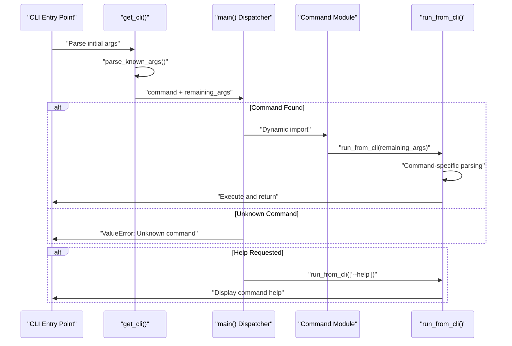
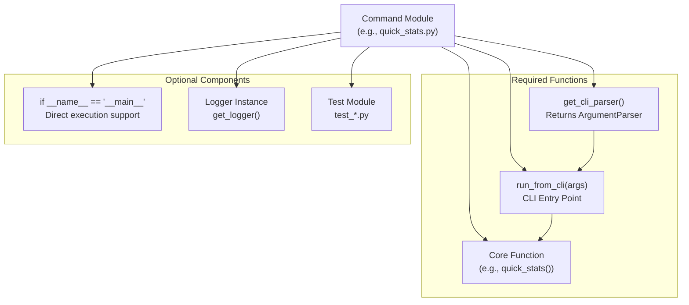
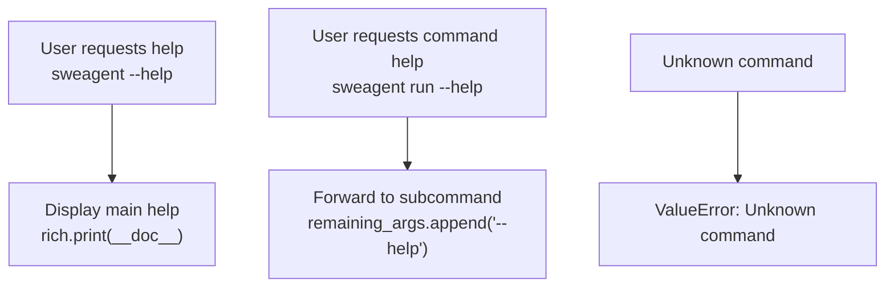

# Command Line Interface

<details>
<summary>Relevant source files</summary>

The following files were used as context for generating this wiki page:

- [README.md](README.md)
- [docs/assets/mini_logo.svg](docs/assets/mini_logo.svg)
- [docs/assets/mini_logo_text_below.svg](docs/assets/mini_logo_text_below.svg)
- [docs/index.md](docs/index.md)
- [docs/overrides/main.html](docs/overrides/main.html)
- [docs/usage/cl_tutorial.md](docs/usage/cl_tutorial.md)
- [mkdocs.yml](mkdocs.yml)
- [sweagent/run/batch_instances.py](sweagent/run/batch_instances.py)
- [sweagent/run/common.py](sweagent/run/common.py)
- [sweagent/run/hooks/apply_patch.py](sweagent/run/hooks/apply_patch.py)
- [sweagent/run/run_batch.py](sweagent/run/run_batch.py)
- [sweagent/run/run_replay.py](sweagent/run/run_replay.py)
- [sweagent/run/run_single.py](sweagent/run/run_single.py)
- [sweagent/utils/log.py](sweagent/utils/log.py)

</details>


The Command Line Interface (CLI) provides the primary entry point for interacting with SWE-agent through the `sweagent` command. This system implements a modular command dispatch architecture that routes user commands to specialized execution modules for different SWE-agent operations.

This document covers the overall CLI architecture and command routing system. For detailed command usage patterns and examples, see [Basic Usage and Commands](#7.1). For YAML configuration file management and options, see [Configuration Options](#7.2).

## CLI Architecture Overview

The SWE-agent CLI implements a centralized dispatcher pattern where the main `sweagent` command routes subcommands to specialized modules. This design enables modular command handling while maintaining a consistent interface.

**CLI Architecture and Command Dispatch**

```mermaid
graph TD
    User["User Input<br/>sweagent <cmd> [args]"]
    MainCLI["main()<br/>sweagent/run/run.py"]
    Parser["get_cli()<br/>ArgumentParser"]
    Dispatcher["Command Dispatcher<br/>main() switch logic"]
    
    subgraph "Execution Commands"
        RunSingle["run_single_main()<br/>sweagent/run/run_single.py"]
        RunBatch["run_batch_main()<br/>sweagent/run/run_batch.py"]
        RunReplay["run_replay_main()<br/>sweagent/run/run_replay.py"]
        RunAPI["run_api_main()<br/>sweagent/api/server.py"]
    end
    
    subgraph "Analysis Commands"
        InspectCLI["inspect_main()<br/>sweagent/run/inspector_cli.py"]
        InspectorWeb["inspector_main()<br/>sweagent/inspector/server.py"]
        QuickStats["quick_stats_main()<br/>sweagent/run/quick_stats.py"]
        CompareRuns["compare_runs_main()<br/>sweagent/run/compare_runs.py"]
    end
    
    subgraph "Utility Commands"
        TrajToDemo["convert_traj_to_demo_main()<br/>sweagent/run/run_traj_to_demo.py"]
        MergePreds["merge_predictions_main()<br/>sweagent/run/merge_predictions.py"]
        RemoveUnfinished["remove_unfinished_main()<br/>sweagent/run/remove_unfinished.py"]
        Shell["run_shell_main()<br/>sweagent/run/run_shell.py"]
    end
    
    User --> MainCLI
    MainCLI --> Parser
    Parser --> Dispatcher
    
    Dispatcher --> RunSingle
    Dispatcher --> RunBatch
    Dispatcher --> RunReplay
    Dispatcher --> RunAPI
    
    Dispatcher --> InspectCLI
    Dispatcher --> InspectorWeb
    Dispatcher --> QuickStats
    Dispatcher --> CompareRuns
    
    Dispatcher --> TrajToDemo
    Dispatcher --> MergePreds
    Dispatcher --> RemoveUnfinished
    Dispatcher --> Shell
```


Sources: [sweagent/run/run.py:37-67](), [sweagent/run/run.py:70-144]()

## Command Dispatch System

The CLI system uses a two-phase parsing approach where the main parser identifies the subcommand, then delegates argument parsing to the specific command module. This allows each command to define its own argument structure while maintaining a unified entry point.

**Command Parsing and Module Loading Flow**


Sources: [sweagent/run/run.py:70-87](), [sweagent/run/run.py:88-144]()

## Subcommand Categories

The CLI organizes subcommands into logical categories based on their primary function. Each category serves a specific aspect of the SWE-agent workflow.

| Category | Commands | Primary Module | Purpose |
|----------|----------|----------------|---------|
| **Execution** | `run`, `run-batch`, `run-replay`, `run-api` | `sweagent/run/` | Execute agents on problems |
| **Analysis** | `inspect`, `inspector`, `quick-stats`, `compare-runs` | `sweagent/run/`, `sweagent/inspector/` | Analyze trajectories and results |
| **Utilities** | `traj-to-demo`, `merge-preds`, `remove-unfinished`, `shell` | `sweagent/run/` | File manipulation and utilities |

### Command Aliases and Shortcuts

The CLI provides short aliases for frequently used commands to improve developer productivity:

| Full Command | Alias | Module Reference |
|--------------|-------|------------------|
| `run` | `r` | [sweagent/run/run_single.py]() |
| `run-batch` | `b` | [sweagent/run/run_batch.py]() |
| `inspect` | `i` | [sweagent/run/inspector_cli.py]() |
| `inspector` | `I` | [sweagent/inspector/server.py]() |
| `compare-runs` | `cr` | [sweagent/run/compare_runs.py]() |
| `remove-unfinished` | `ru` | [sweagent/run/remove_unfinished.py]() |
| `quick-stats` | `qs` | [sweagent/run/quick_stats.py]() |
| `shell` | `sh` | [sweagent/run/run_shell.py]() |

Sources: [sweagent/run/run.py:41-63]()

## Implementation Pattern

Each CLI subcommand follows a consistent implementation pattern that promotes modularity and testability. Command modules implement a standardized interface for argument parsing and execution.

**Standard Command Module Pattern**


### Example: Quick Stats Command Implementation

The `quick-stats` command demonstrates the standard pattern:

```python
# Core function that can be used programmatically
def quick_stats(directory: Path | str = ".") -> str:
    # Implementation logic
    
# CLI argument parser setup
def get_cli_parser() -> argparse.ArgumentParser:
    # Define command-specific arguments
    
# CLI entry point called by main dispatcher  
def run_from_cli(args: list[str] | None = None) -> None:
    # Parse args and call core function
```

Sources: [sweagent/run/quick_stats.py:16-73](), [sweagent/run/quick_stats.py:75-96]()

## Error Handling and Help System

The CLI implements a hierarchical help system where users can request help at the main level or for specific subcommands. The dispatcher handles unknown commands gracefully and provides informative error messages.

**Help System Flow**


The main CLI module uses rich formatting to display comprehensive help documentation that includes command descriptions, usage patterns, and examples.

Sources: [sweagent/run/run.py:1-29](), [sweagent/run/run.py:77-87](), [sweagent/run/run.py:142-143]()