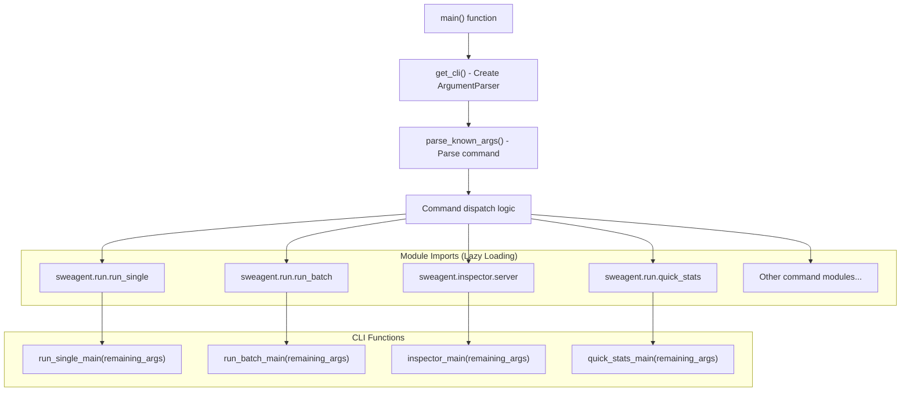
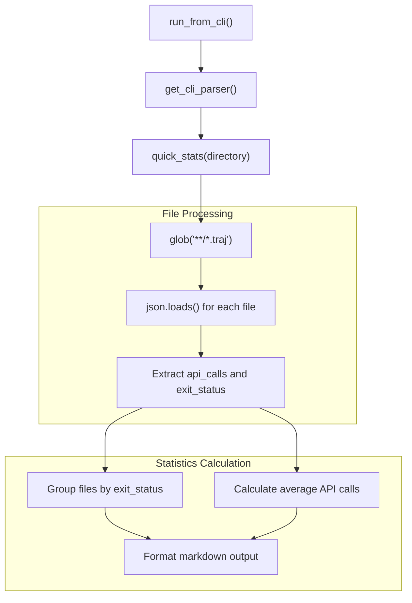

# Basic Usage and Commands

<details>
<summary>Relevant source files</summary>

The following files were used as context for generating this wiki page:

- [README.md](README.md)
- [docs/assets/mini_logo.svg](docs/assets/mini_logo.svg)
- [docs/assets/mini_logo_text_below.svg](docs/assets/mini_logo_text_below.svg)
- [docs/index.md](docs/index.md)
- [docs/overrides/main.html](docs/overrides/main.html)
- [docs/usage/cl_tutorial.md](docs/usage/cl_tutorial.md)
- [mkdocs.yml](mkdocs.yml)
- [sweagent/run/batch_instances.py](sweagent/run/batch_instances.py)
- [sweagent/run/common.py](sweagent/run/common.py)
- [sweagent/run/hooks/apply_patch.py](sweagent/run/hooks/apply_patch.py)
- [sweagent/run/run_batch.py](sweagent/run/run_batch.py)
- [sweagent/run/run_replay.py](sweagent/run/run_replay.py)
- [sweagent/run/run_single.py](sweagent/run/run_single.py)
- [sweagent/utils/log.py](sweagent/utils/log.py)

</details>


This document covers the basic usage patterns and command structure of the SWE-agent command line interface (CLI). It focuses on the entry point commands, command categories, and how the CLI dispatches to different execution modules.

For detailed configuration options and YAML files, see [Configuration Options](#7.2). For specific execution details of single runs and batch processing, see [Single Run Execution](#5.1) and [Batch Processing](#5.2). For detailed inspection tool usage, see [Inspection Tools](#8.2).

## CLI System Overview

The SWE-agent CLI provides a unified entry point through the `sweagent` command with multiple subcommands for different operations. The main CLI dispatcher is implemented in [sweagent/run/run.py:37-147]() and uses a lazy-loading pattern to minimize startup time.

**CLI Command Structure**

```mermaid
graph TD
    sweagent["sweagent (main entry point)"]
    
    subgraph "Execution Commands"
        run["run (r) - Single problem execution"]
        runbatch["run-batch (b) - Batch execution"]
        replay["run-replay - Replay trajectories"]
        api["run-api - Backend server"]
    end
    
    subgraph "Analysis Commands" 
        inspect["inspect (i) - Terminal viewer"]
        inspector["inspector (I) - Web viewer"]
        quickstats["quick-stats (qs) - Statistics"]
        compareruns["compare-runs (cr) - Compare results"]
    end
    
    subgraph "Utility Commands"
        mergepreds["merge-preds - Merge predictions"]
        trajdemo["traj-to-demo - Convert trajectories"]
        removeunfinished["remove-unfinished (ru) - Cleanup"]
        extractpred["extract-pred - Extract predictions"]
        shell["shell (sh) - Interactive shell"]
    end
    
    sweagent --> run
    sweagent --> runbatch  
    sweagent --> replay
    sweagent --> api
    sweagent --> inspect
    sweagent --> inspector
    sweagent --> quickstats
    sweagent --> compareruns
    sweagent --> mergepreds
    sweagent --> trajdemo
    sweagent --> removeunfinished
    sweagent --> extractpred
    sweagent --> shell
```


Sources: [sweagent/run/run.py:1-29](), [sweagent/run/run.py:37-67]()

## Command Categories

The CLI commands are organized into three main categories based on their primary function:

| Category | Commands | Purpose |
|----------|----------|---------|
| **Execution** | `run`, `run-batch`, `run-replay`, `run-api` | Execute agents and run SWE-agent |
| **Analysis** | `inspect`, `inspector`, `quick-stats`, `compare-runs` | Analyze results and trajectories |
| **Utilities** | `merge-preds`, `traj-to-demo`, `remove-unfinished`, `extract-pred`, `shell` | Data management and conversion |

### Execution Commands

- **`run` (alias: `r`)**: Execute SWE-agent on a single problem statement or GitHub issue
- **`run-batch` (alias: `b`)**: Execute SWE-agent on multiple problems, such as SWE-Bench datasets  
- **`run-replay`**: Replay trajectory files or demonstration files
- **`run-api`**: Start SWE-agent as a backend server for GUI interfaces

### Analysis Commands

- **`inspect` (alias: `i`)**: Open trajectory files in a terminal-based viewer
- **`inspector` (alias: `I`)**: Launch web-based trajectory viewer
- **`quick-stats` (alias: `qs`)**: Generate statistics from trajectory directories
- **`compare-runs` (alias: `cr`)**: Compare results between different runs

### Utility Commands

- **`merge-preds`**: Combine multiple prediction files into a single file
- **`traj-to-demo`**: Convert trajectory files to editable demonstration format
- **`remove-unfinished` (alias: `ru`)**: Clean up incomplete trajectory files
- **`extract-pred`**: Extract prediction data from trajectory files
- **`shell` (alias: `sh`)**: Start interactive SWE-agent shell

Sources: [sweagent/run/run.py:11-29](), [sweagent/run/run.py:41-63]()

## Command Dispatch Mechanism

**CLI Dispatch Flow**


The CLI system uses a lazy-loading pattern implemented in [sweagent/run/run.py:88-144]() where modules are only imported when their corresponding commands are invoked. This reduces startup time by avoiding unnecessary imports.

Each command module provides a `run_from_cli()` function that handles command-line argument parsing and execution for that specific command.

Sources: [sweagent/run/run.py:70-87](), [sweagent/run/run.py:88-144]()

## Basic Usage Patterns

### Help System

```bash
# Show main help with all commands
sweagent --help

# Show help for specific command  
sweagent run --help
sweagent run-batch --help
```

The help system is implemented in [sweagent/run/run.py:76-84]() and displays the rich-formatted documentation from [sweagent/run/run.py:1-29]().

### Common Command Examples

```bash
# Execute agent on single problem
sweagent run --config default.yaml --problem_statement "Fix the bug..."

# Run batch processing
sweagent run-batch --config default.yaml --instance_source swe-bench

# Quick statistics from trajectory directory
sweagent quick-stats ./results/

# Inspect single trajectory
sweagent inspect ./results/trajectory.traj

# Launch web inspector
sweagent inspector ./results/
```

### Command Aliases

Many frequently used commands have short aliases:

| Full Command | Alias | Usage |
|--------------|-------|-------|
| `run` | `r` | `sweagent r --config default.yaml` |
| `run-batch` | `b` | `sweagent b --instance_source swe-bench` |
| `inspect` | `i` | `sweagent i trajectory.traj` |
| `inspector` | `I` | `sweagent I ./results/` |
| `quick-stats` | `qs` | `sweagent qs ./results/` |
| `compare-runs` | `cr` | `sweagent cr run1/ run2/` |
| `remove-unfinished` | `ru` | `sweagent ru ./results/` |
| `shell` | `sh` | `sweagent sh` |

Sources: [sweagent/run/run.py:41-63](), [sweagent/run/run.py:89-141]()

## Quick Stats Example

The `quick-stats` command demonstrates the typical CLI command pattern. It analyzes trajectory files and provides statistics about API calls and exit statuses:

**Quick Stats Implementation Flow**


The command processes `.traj` files to extract `info.model_stats.api_calls` and `info.exit_status` fields, then generates statistics grouped by exit status.

Sources: [sweagent/run/quick_stats.py:16-73](), [sweagent/run/quick_stats.py:87-93]()