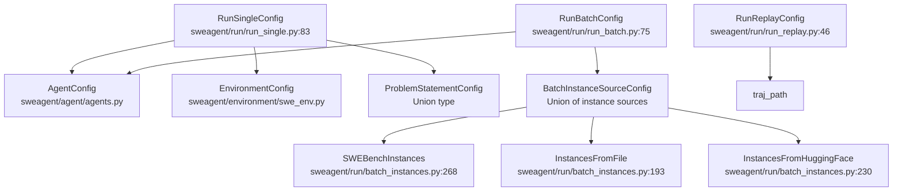
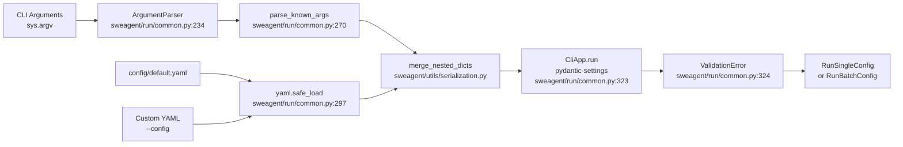
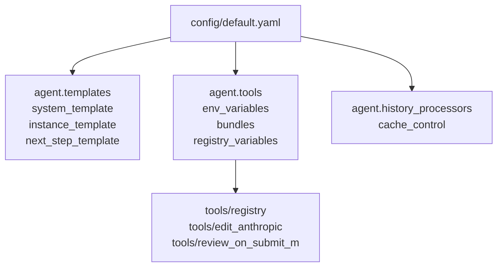
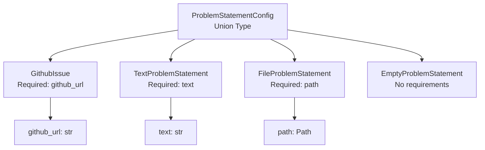
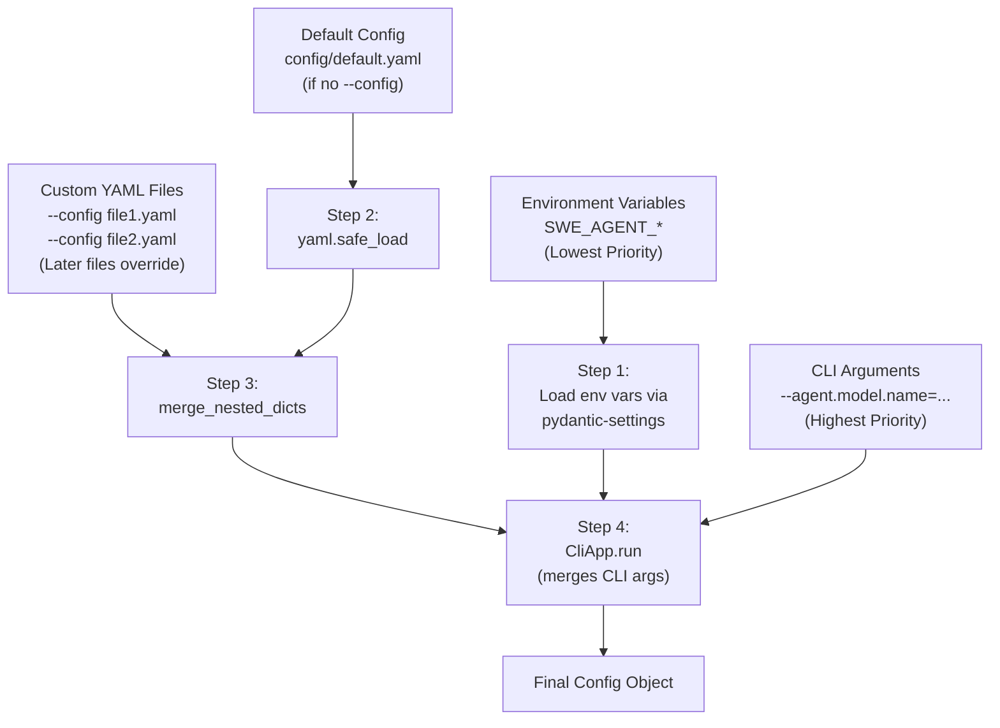
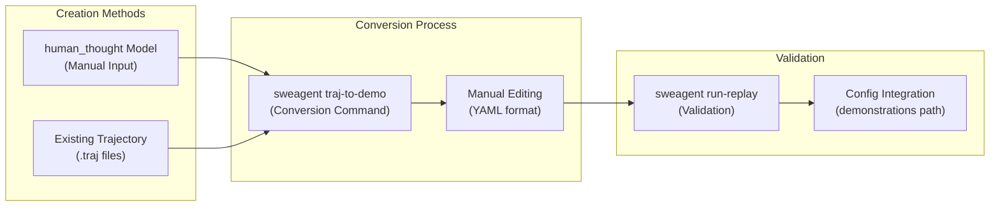

# Configuration System

<details>
<summary>Relevant source files</summary>

The following files were used as context for generating this wiki page:

- [README.md](README.md)
- [config/default.yaml](config/default.yaml)
- [docs/assets/mini_logo.svg](docs/assets/mini_logo.svg)
- [docs/assets/mini_logo_text_below.svg](docs/assets/mini_logo_text_below.svg)
- [docs/index.md](docs/index.md)
- [docs/overrides/main.html](docs/overrides/main.html)
- [docs/usage/cl_tutorial.md](docs/usage/cl_tutorial.md)
- [mkdocs.yml](mkdocs.yml)
- [sweagent/run/batch_instances.py](sweagent/run/batch_instances.py)
- [sweagent/run/common.py](sweagent/run/common.py)
- [sweagent/run/hooks/apply_patch.py](sweagent/run/hooks/apply_patch.py)
- [sweagent/run/run_batch.py](sweagent/run/run_batch.py)
- [sweagent/run/run_replay.py](sweagent/run/run_replay.py)
- [sweagent/run/run_single.py](sweagent/run/run_single.py)
- [sweagent/utils/log.py](sweagent/utils/log.py)

</details>


This page documents the hierarchical configuration system that powers SWE-agent's command line interface. The system uses `pydantic-settings` to merge YAML files, CLI arguments, and environment variables into strongly-typed configuration objects.

For CLI usage patterns and examples, see page 7.1. For tool-specific configurations, see page 6.1.

## Architecture Overview

SWE-agent's configuration system is built on `pydantic-settings` and provides hierarchical configuration merging with strong type safety. The `BasicCLI` class orchestrates the loading and validation process.

### Configuration Class Hierarchy



**Sources**: [sweagent/run/run_single.py:83-98](), [sweagent/run/run_batch.py:75-101](), [sweagent/run/batch_instances.py:193-420]()

### Configuration Loading Pipeline



**Sources**: [sweagent/run/common.py:227-368]()
</thinking>

## Core Configuration Classes

### BaseSettings with Environment Prefix

All top-level configuration classes inherit from `pydantic_settings.BaseSettings` with a common environment variable prefix:

```python
# sweagent/run/run_single.py:83
class RunSingleConfig(BaseSettings, cli_implicit_flags=False):
    env: EnvironmentConfig = Field(...)
    agent: AgentConfig = Field(...)
    problem_statement: ProblemStatementConfig = Field(...)
    
    model_config = SettingsConfigDict(extra="forbid", env_prefix="SWE_AGENT_")
```

This means environment variables like `SWE_AGENT_OUTPUT_DIR` will be automatically mapped to the `output_dir` field.

**Sources**: [sweagent/run/run_single.py:83-98](), [sweagent/run/run_batch.py:75-101]()

### Configuration Fields Reference

| Class | Field | Type | Purpose |
|-------|-------|------|---------|
| `RunSingleConfig` | `env` | `EnvironmentConfig` | Environment/deployment settings |
| `RunSingleConfig` | `agent` | `AgentConfig` | Agent behavior and model config |
| `RunSingleConfig` | `problem_statement` | `ProblemStatementConfig` | Problem to solve (union type) |
| `RunSingleConfig` | `output_dir` | `Path` | Trajectory output location |
| `RunBatchConfig` | `instances` | `BatchInstanceSourceConfig` | Instance source (union type) |
| `RunBatchConfig` | `num_workers` | `int` | Parallel execution workers |
| `RunBatchConfig` | `redo_existing` | `bool` | Skip completed instances |

**Sources**: [sweagent/run/run_single.py:83-98](), [sweagent/run/run_batch.py:75-101]()

## Configuration Merging Process

### BasicCLI Implementation

The `BasicCLI` class in [sweagent/run/common.py:187-368]() orchestrates the configuration loading process:

1. **Argument Parsing** (lines 234-270): Uses `ArgumentParser` to extract `--config` flags and other special options
2. **YAML Loading** (lines 288-314): Loads and merges YAML files using `yaml.safe_load`
3. **Hierarchical Merging** (line 298): Calls `merge_nested_dicts` to combine YAML configs
4. **Pydantic Validation** (line 323): Uses `CliApp.run` from `pydantic-settings` to merge CLI args and validate

### Merge Order Example

Given these inputs:

```bash
sweagent run --config config/default.yaml --config my_config.yaml --agent.model.name=gpt-4o
```

The merge order is:
1. `config/default.yaml` loaded first
2. `my_config.yaml` merged into it (nested override)
3. CLI argument `--agent.model.name=gpt-4o` overrides final result

**Sources**: [sweagent/run/common.py:187-368](), [sweagent/utils/serialization.py]()

### merge_nested_dicts Function

The hierarchical merge uses `merge_nested_dicts` from [sweagent/utils/serialization.py]() which:
- Recursively merges dictionaries at each level
- Preserves structure from earlier configs
- Later configs override specific keys without replacing entire sections

This means if `config/default.yaml` has:
```yaml
agent:
  model:
    name: gpt-4o
    temperature: 0.0
  tools:
    bundles: [tools/registry]
```

And `my_config.yaml` has:
```yaml
agent:
  model:
    name: claude-sonnet-4
```

The result preserves `temperature` and `tools` while only overriding `name`.

**Sources**: [sweagent/run/common.py:288-314]()

### Default Configuration File Structure

The default configuration at [config/default.yaml:1-70]() defines the baseline settings:



Key sections in [config/default.yaml]():
- Lines 6-27: Jinja2 templates for system/instance/next_step prompts
- Lines 34-40: Environment variables (PAGER, MANPAGER, etc.)
- Lines 41-44: Tool bundle paths
- Lines 45-63: Registry variables including `SUBMIT_REVIEW_MESSAGES`
- Lines 65-66: Parse function configuration (`function_calling`)
- Lines 67-69: History processor configuration (`cache_control`)

**Sources**: [config/default.yaml:1-70]()

## Union Types and Discriminated Configuration

### Problem Statement Union Type

The `problem_statement` field in `RunSingleConfig` is a union type, meaning it can be one of several concrete types:



The configuration system automatically selects the correct type based on which fields are provided. For example:
- Providing `--problem_statement.github_url=...` → `GithubIssue`
- Providing `--problem_statement.text=...` → `TextProblemStatement`
- Providing `--problem_statement.path=...` → `FileProblemStatement`

**Sources**: [sweagent/run/run_single.py:86-87](), [sweagent/agent/problem_statement.py](), [docs/usage/cl_tutorial.md:139-198]()

### Batch Instance Source Union Type

Similarly, `RunBatchConfig.instances` is a union type from [sweagent/run/batch_instances.py:417-419]():

```python
BatchInstanceSourceConfig = (
    InstancesFromHuggingFace | InstancesFromFile | SWEBenchInstances | 
    ExpertInstancesFromFile | SWESmithInstances
)
```

Each type has a `type` discriminator field:
- `type: "huggingface"` → `InstancesFromHuggingFace`
- `type: "file"` → `InstancesFromFile`
- `type: "swe_bench"` → `SWEBenchInstances`
- `type: "expert_file"` → `ExpertInstancesFromFile`
- `type: "swesmith"` → `SWESmithInstances`

**Sources**: [sweagent/run/batch_instances.py:230-420](), [docs/usage/cl_tutorial.md:156-198]()

## CLI Argument Parsing

### Dot-Notation Argument Parsing

The `_parse_args_to_nested_dict` function at [sweagent/run/common.py:149-183]() converts flat CLI arguments into nested dictionaries:

```python
# Input: ["--agent.model.name=gpt-4o", "--num_workers", "4"]
# Output: {"agent": {"model": {"name": "gpt-4o"}}, "num_workers": 4}
```

The parser handles both `--key=value` and `--key value` formats and automatically converts numeric strings to integers.

**Sources**: [sweagent/run/common.py:149-183]()

### Special CLI Options

The `ArgumentParser` in `BasicCLI` recognizes several special options:

| Option | Purpose | Implementation |
|--------|---------|----------------|
| `--config` | Load YAML config file(s) | [sweagent/run/common.py:235-243]() |
| `--help` | Show help text | [sweagent/run/common.py:246-250]() |
| `--help_option` | Show help for specific config class | [sweagent/run/common.py:251-254]() |
| `--no_config_file` | Skip loading default config | [sweagent/run/common.py:256-260]() |
| `--print_config` | Print final config and exit | [sweagent/run/common.py:261-265]() |

**Sources**: [sweagent/run/common.py:234-265]()

### Configuration Precedence Flow



**Sources**: [sweagent/run/common.py:288-323]()

## Configuration Validation and Error Handling

### Pydantic Validation

After merging, `CliApp.run` from `pydantic-settings` validates the configuration at [sweagent/run/common.py:323]():

```python
config: BaseSettings = CliApp.run(
    self.arg_type, 
    remaining_args, 
    **config_merged, 
    cli_exit_on_error=False
)
```

This performs:
- Type checking (e.g., `int` fields must be integers)
- Required field validation
- Constraint validation (e.g., `Field(gt=0)` for positive integers)
- Union type discrimination

**Sources**: [sweagent/run/common.py:323]()

### Error Reporting

When validation fails, the system displays multiple diagnostic panels at [sweagent/run/common.py:325-358]():

1. **Configuration from config files**: Shows merged YAML content
2. **Configuration from CLI arguments**: Shows parsed CLI args
3. **Merged configuration**: Shows final merged dict before validation
4. **Validation error**: Shows Pydantic's error messages with field paths

For union types that fail, Pydantic tries each option and reports why each failed, which can lead to verbose output (see explanation at [sweagent/run/common.py:50-61]()).

**Sources**: [sweagent/run/common.py:324-358](), [docs/usage/cl_tutorial.md:179-196]()

### Auto-Correct Suggestions

The `AutoCorrectSuggestion` class at [sweagent/run/common.py:73-100]() provides helpful error messages for common mistakes:

```python
class AutoCorrectSuggestion:
    def __init__(self, original: str, alternative: str = "", ...):
        # Maps old argument names to new ones
        # e.g., "model" -> "agent.model.name"
```

For example, if you type `--model=gpt-4o`, it suggests `--agent.model.name=gpt-4o`.

**Sources**: [sweagent/run/common.py:73-100](), [sweagent/run/run_single.py:105-122]()

## Demonstrations Configuration

### Demonstration Integration

Demonstrations are integrated into configuration files to guide agent behavior through example trajectories:

```yaml
agent:
  templates:
    demonstrations:
      - path: demos/example_demo.yaml
      - path: demos/editing_demo.yaml
```

### Demonstration Creation Workflow



**Sources**: [docs/config/demonstrations.md:12-17](), [docs/config/demonstrations.md:28-40]()

## Multimodal Configuration

### Multimodal-Specific Settings

For vision-capable models and image processing, specialized configuration options are available:

```yaml
agent:
  templates:
    disable_image_processing: false  # Enable image processing
    max_observation_length: 10_000_000  # Increased for images
  tools:
    bundles:
      - path: tools/image_tools  # Image viewing capabilities
      - path: tools/web_browser  # Browser automation
  history_processors:
    - type: image_parsing  # Required for image tools
```

### Multimodal Configuration File

The `default_mm_with_images.yaml` configuration provides:

- **SWE-bench Multimodal Image processing**: GitHub issue image processing
- **Extended observation length**: Accommodates image data
- **Image tools bundle**: Image viewing and manipulation
- **Web browsing tools**: Browser automation capabilities
- **Image parsing history processor**: Processes image tool outputs

**Sources**: [docs/config/config.md:43-72]()

## Configuration Validation

### Type Safety and Validation

The configuration system uses Pydantic for type checking and validation:

- **Type enforcement**: Ensures configuration values match expected types
- **Required field validation**: Validates that required configuration keys are present
- **Path validation**: Ensures file and directory paths exist and are accessible
- **Model name validation**: Validates that specified language models are available

### Error Handling

Configuration errors are reported with clear messages indicating:
- Invalid configuration keys
- Type mismatches
- Missing required fields
- Inaccessible file paths

**Sources**: [docs/config/config.md:25-27]()