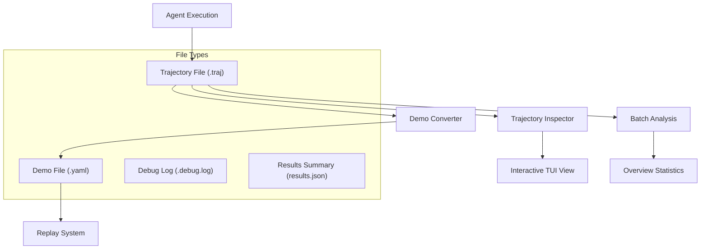
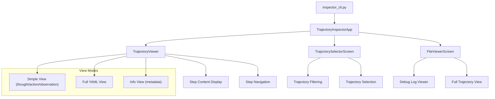
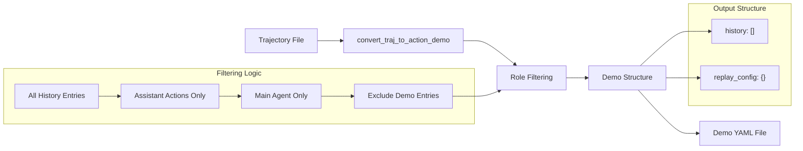
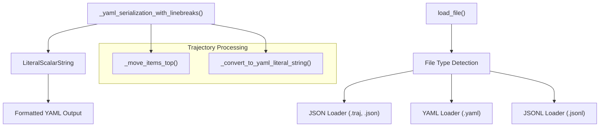

# Trajectory Management and Inspection

<details>
<summary>Relevant source files</summary>

The following files were used as context for generating this wiki page:

- [sweagent/run/inspector_cli.py](sweagent/run/inspector_cli.py)
- [sweagent/run/run_traj_to_demo.py](sweagent/run/run_traj_to_demo.py)
- [sweagent/utils/files.py](sweagent/utils/files.py)
- [sweagent/utils/serialization.py](sweagent/utils/serialization.py)
- [trajectories/demonstrations/str_replace_anthropic_demo.yaml](trajectories/demonstrations/str_replace_anthropic_demo.yaml)

</details>


This document covers the trajectory management and inspection system in SWE-agent, which handles the creation, storage, analysis, and conversion of agent execution traces. A trajectory represents the complete step-by-step execution record of an agent run, including all thoughts, actions, observations, and metadata.

For information about the core agent execution system that generates these trajectories, see [Agent Framework](#3). For details about batch execution and run orchestration, see [Execution and Run System](#5).

## Purpose and Scope

The trajectory management system provides:
- **Trajectory Storage**: JSON-based format for storing complete agent execution traces
- **Interactive Inspection**: Terminal-based UI for browsing and analyzing trajectories
- **Demo Conversion**: Tools for converting trajectories into editable demo files for replay
- **Batch Analysis**: Support for analyzing multiple trajectories with overview statistics

## Trajectory File Format

Trajectory files use the `.traj` extension and contain JSON-formatted execution traces with the following structure:

```json
{
  "trajectory": [
    {
      "thought": "Agent's reasoning",
      "action": "Command or tool call",
      "observation": "Environment response",
      "response": "Raw model response", 
      "execution_time": 1.234
    }
  ],
  "info": {
    "exit_status": "submitted",
    "model_stats": {
      "api_calls": 42,
      "instance_cost": 0.15
    },
    "submission": "Final patch or solution"
  },
  "history": [
    {
      "role": "user|assistant|tool",
      "content": "Message content",
      "tool_calls": [],
      "agent": "main"
    }
  ],
  "replay_config": {
    "env": {},
    "agent": {},
    "problem_statement": {}
  }
}
```

### Trajectory Data Flow



**Sources:** [sweagent/run/inspector_cli.py:54-58](), [sweagent/run/run_traj_to_demo.py:35-41]()

## Interactive Trajectory Inspector

The `TrajectoryInspectorApp` provides a terminal-based interface for inspecting trajectory files with full keyboard navigation and multiple viewing modes.

### Inspector Architecture



**Sources:** [sweagent/run/inspector_cli.py:336-364](), [sweagent/run/inspector_cli.py:39-76]()

### Key Inspector Features

| Feature | Keybinding | Description |
|---------|------------|-------------|
| Step Navigation | `h/l`, `←/→` | Move between trajectory steps |
| View Toggle | `v` | Switch between simple and full YAML view |
| Trajectory Selection | `t` | Open trajectory selector modal |
| Scrolling | `j/k`, `↑/↓` | Scroll within current view |
| Log Viewing | `o` | View debug log file |
| Full File View | `r` | View complete trajectory file |

The inspector automatically loads trajectory statistics and provides filtering capabilities for large batch results.

**Sources:** [sweagent/run/inspector_cli.py:40-48](), [sweagent/run/inspector_cli.py:337-344]()

## Demo Conversion System

The demo conversion system transforms trajectory files into editable YAML demo files that can be replayed or modified.

### Conversion Process



**Sources:** [sweagent/run/run_traj_to_demo.py:35-56](), [sweagent/run/run_traj_to_demo.py:43-52]()

### Demo File Structure

Demo files contain two main sections:

1. **History Section**: Filtered conversation history with only assistant actions
2. **Replay Config Section**: Complete environment and agent configuration for replay

The conversion process:
- Filters history to include only `assistant` role entries
- Excludes demo entries and non-main agents
- Preserves essential fields: `content`, `role`, `tool_calls`, `agent`, `message_type`
- Includes complete replay configuration for environment reconstruction

**Sources:** [sweagent/run/run_traj_to_demo.py:43-55](), [trajectories/demonstrations/str_replace_anthropic_demo.yaml:176-432]()

## File Format Utilities

The trajectory system uses specialized serialization utilities for handling multi-line strings and various file formats.

### Serialization Components



**Sources:** [sweagent/utils/files.py:8-27](), [sweagent/utils/serialization.py:25-33]()

### Key Utilities

| Function | Purpose | File |
|----------|---------|------|
| `load_file()` | Multi-format file loader | [sweagent/utils/files.py:8-27]() |
| `_yaml_serialization_with_linebreaks()` | YAML formatting with literal strings | [sweagent/utils/serialization.py:25-33]() |
| `_move_items_top()` | Reorder dictionary keys for display | [sweagent/run/inspector_cli.py:23-36]() |
| `_convert_to_yaml_literal_string()` | Convert multiline strings to YAML literals | [sweagent/utils/serialization.py:9-22]() |

These utilities ensure proper formatting of trajectory content, especially for multi-line strings like code snippets, thoughts, and observations.

**Sources:** [sweagent/utils/files.py:20-21](), [sweagent/utils/serialization.py:20-21]()

## Command Line Interface

The trajectory management system provides command-line tools for both inspection and conversion:

### Inspector CLI
```bash
python -m sweagent.run.inspector_cli [trajectory_path] [-d data_path]
```

### Demo Conversion CLI
```bash
python -m sweagent.run.run_traj_to_demo trajectory.traj [--output_dir demos] [--include_user] [--overwrite]
```

The inspector supports both single trajectory files and directories containing multiple trajectories, automatically building overview statistics from `results.json` files when available.

**Sources:** [sweagent/run/inspector_cli.py:477-489](), [sweagent/run/run_traj_to_demo.py:68-81]()