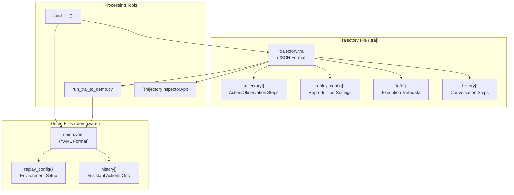
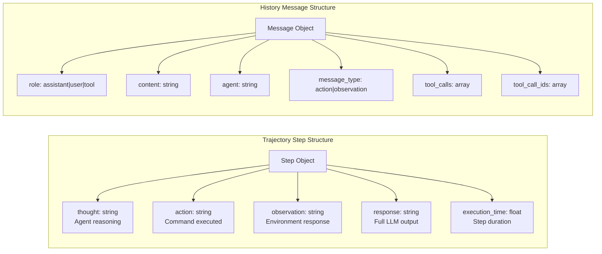
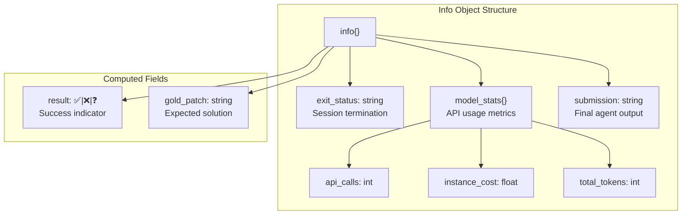
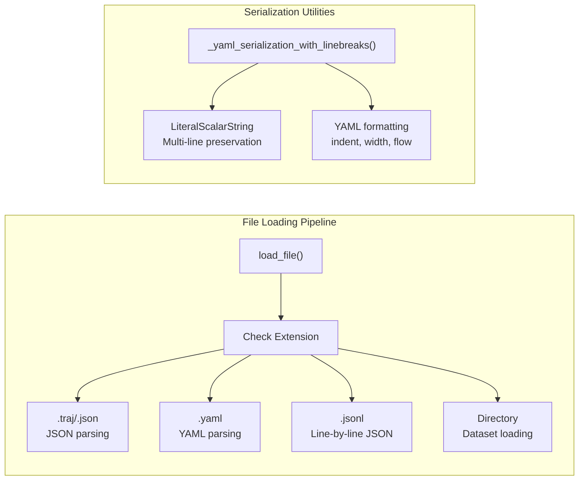
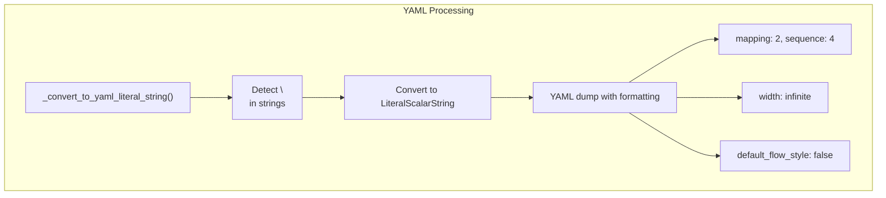
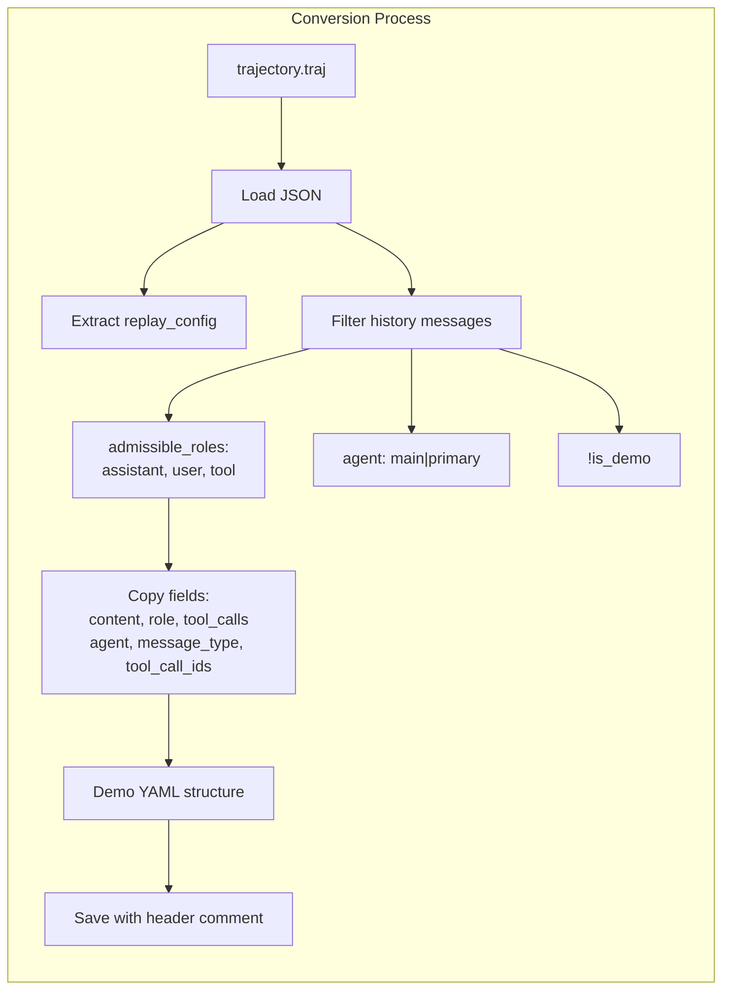
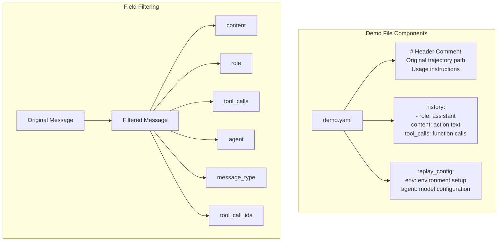
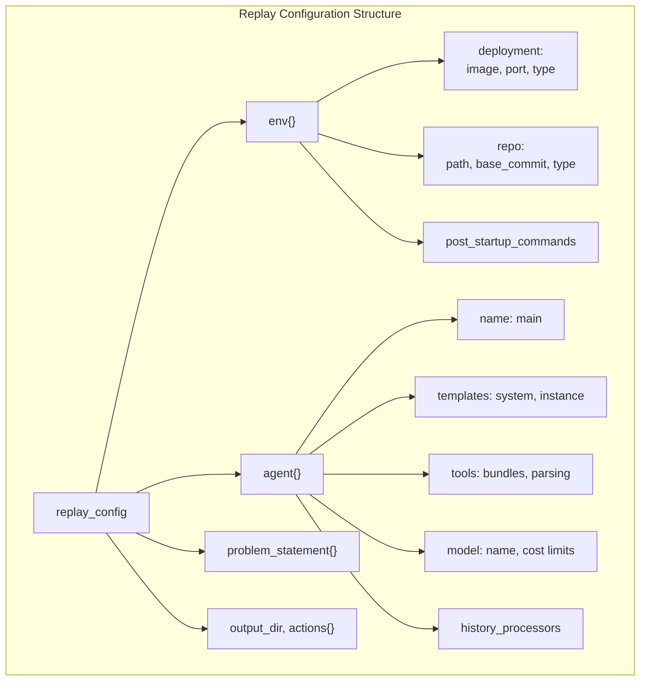
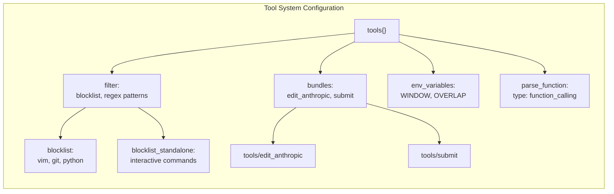

# Trajectory Files and Format

Relevant source files

The following files were used as context for generating this wiki page:

- [sweagent/agent/agents.py](sweagent/agent/agents.py)
- [sweagent/agent/models.py](sweagent/agent/models.py)
- [sweagent/agent/reviewer.py](sweagent/agent/reviewer.py)
- [sweagent/run/inspector_cli.py](sweagent/run/inspector_cli.py)
- [sweagent/run/run_traj_to_demo.py](sweagent/run/run_traj_to_demo.py)
- [sweagent/types.py](sweagent/types.py)
- [sweagent/utils/files.py](sweagent/utils/files.py)
- [sweagent/utils/serialization.py](sweagent/utils/serialization.py)
- [trajectories/demonstrations/str_replace_anthropic_demo.yaml](trajectories/demonstrations/str_replace_anthropic_demo.yaml)

This document explains the structure and format of trajectory files in SWE-agent, which record agent execution sessions and enable replay, analysis, and demonstration creation. Trajectory files capture the complete interaction history between agents and environments, including actions taken, observations received, and execution metadata.

For information about trajectory inspection and analysis tools, see [Inspection Tools](#8.2). For details about batch processing that generates trajectories, see [Batch Processing](#5.2).

## File Format Overview

SWE-agent uses JSON-based trajectory files with the `.traj` extension to store execution records. These files contain structured data about agent sessions including the conversation history, environment interactions, configuration settings, and execution metadata.

Sources: [sweagent/run/inspector_cli.py:54](), [sweagent/run/run_traj_to_demo.py:36-41](), [sweagent/utils/files.py:20-21]()

## Core Trajectory Structure

### Main Trajectory Format

Trajectory files contain two primary data structures for recording agent interactions:

| Field | Type | Description |
|-------|------|-------------|
| `trajectory` | Array | Step-by-step action/observation pairs |
| `history` | Array | Complete conversation history including system messages |
| `info` | Object | Execution metadata and statistics |
| `replay_config` | Object/String | Configuration for reproducing the session |

Sources: [sweagent/run/inspector_cli.py:78-90](), [sweagent/run/inspector_cli.py:94-102](), [trajectories/demonstrations/str_replace_anthropic_demo.yaml:9-175]()

### Information Metadata

The `info` section contains execution statistics and results:

Sources: [sweagent/run/inspector_cli.py:105-113](), [sweagent/run/inspector_cli.py:384-411]()

## File Loading and Serialization

### File Type Detection

The system automatically detects and loads trajectory files based on extension:

Sources: [sweagent/utils/files.py:8-27](), [sweagent/utils/serialization.py:25-33]()

### YAML Serialization Features

The system provides specialized YAML serialization to preserve multi-line strings:

Sources: [sweagent/utils/serialization.py:9-22](), [sweagent/utils/serialization.py:25-33]()

## Conversion Utilities

### Trajectory to Demo Conversion

The `run_traj_to_demo.py` script converts full trajectory files into demonstration format suitable for replay:

Sources: [sweagent/run/run_traj_to_demo.py:35-56](), [sweagent/run/run_traj_to_demo.py:43-52]()

### Demo File Structure

Demo files contain filtered conversation history optimized for replay:

| Field | Content | Purpose |
|-------|---------|---------|
| `history` | Assistant actions only | Replay commands |
| `replay_config` | Environment setup | Reproduction context |
| Header comment | Original trajectory path | Documentation |

Sources: [sweagent/run/run_traj_to_demo.py:17-24](), [sweagent/run/run_traj_to_demo.py:43-52](), [trajectories/demonstrations/str_replace_anthropic_demo.yaml:1-8]()

## Replay Configuration

### Environment Configuration

The `replay_config` section contains all settings needed to reproduce a trajectory:

Sources: [trajectories/demonstrations/str_replace_anthropic_demo.yaml:176-432]()

### Tool Configuration

Agent tools are configured with specific parsing functions and command filters:

Sources: [trajectories/demonstrations/str_replace_anthropic_demo.yaml:286-346](), [trajectories/demonstrations/str_replace_anthropic_demo.yaml:317-325]()