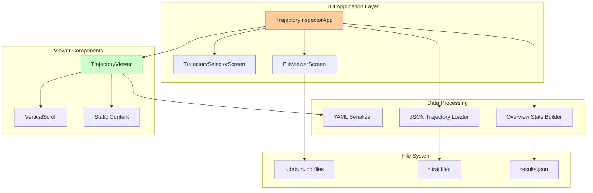
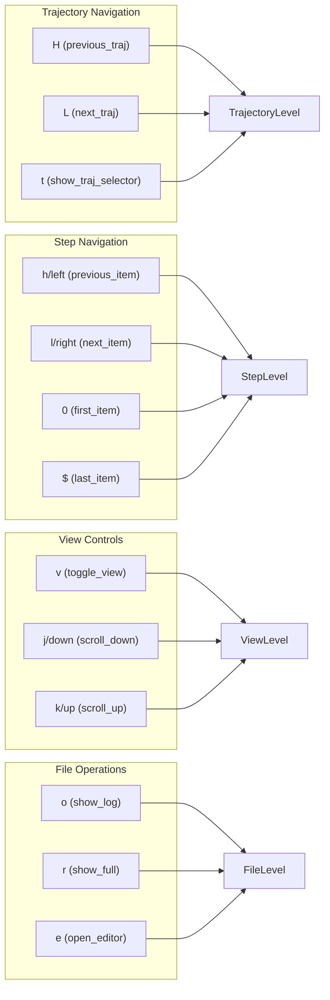
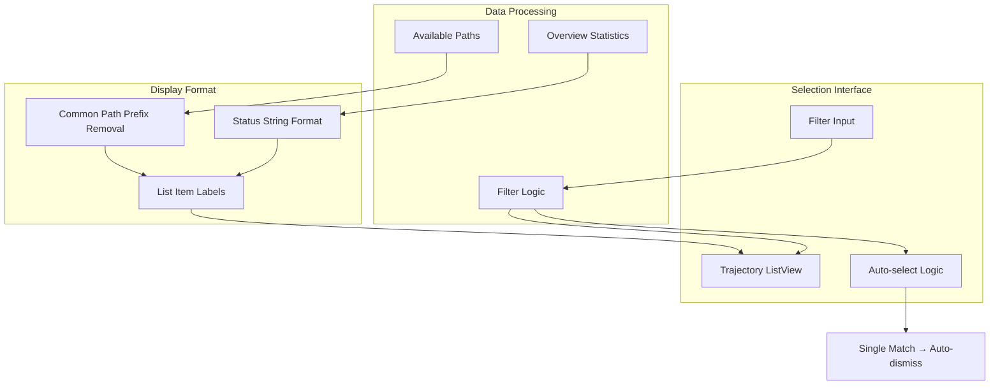
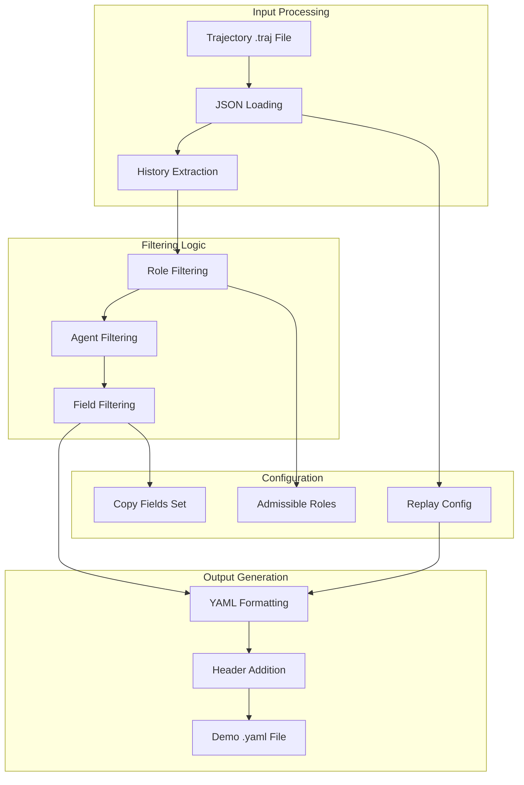
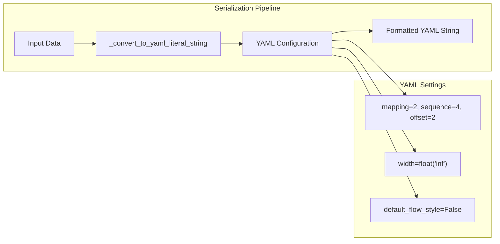
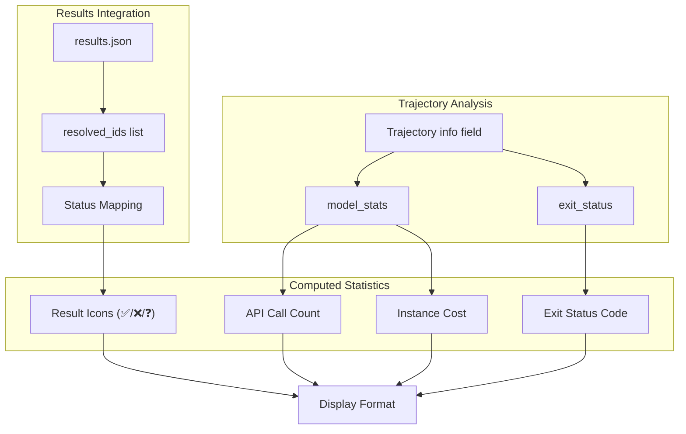

# Inspection Tools

<details>
<summary>Relevant source files</summary>

The following files were used as context for generating this wiki page:

- [sweagent/run/inspector_cli.py](sweagent/run/inspector_cli.py)
- [sweagent/run/run_traj_to_demo.py](sweagent/run/run_traj_to_demo.py)
- [sweagent/utils/files.py](sweagent/utils/files.py)
- [sweagent/utils/serialization.py](sweagent/utils/serialization.py)
- [trajectories/demonstrations/str_replace_anthropic_demo.yaml](trajectories/demonstrations/str_replace_anthropic_demo.yaml)

</details>


This document covers the trajectory inspection and analysis tools provided by SWE-agent. These tools enable users to examine agent execution trajectories, analyze behavior patterns, and convert trajectories to reusable demonstration files. For information about trajectory file formats and structure, see [Trajectory Files and Format](#8.1).

## Overview

SWE-agent provides several tools for inspecting and analyzing agent trajectories:

- **TrajectoryInspectorApp**: A terminal-based user interface for interactive trajectory exploration
- **CLI Inspector**: Command-line tool for trajectory examination
- **Trajectory-to-Demo Converter**: Utility for converting trajectories into reusable demonstration files
- **Supporting Utilities**: File loading and serialization helpers

## TrajectoryInspectorApp Architecture

The trajectory inspector is built using the Textual framework and provides an interactive TUI for examining trajectory files.

### Core Components



**Core TUI Classes and Responsibilities**

| Class | Purpose | Key Methods |
|-------|---------|-------------|
| `TrajectoryInspectorApp` | Main application controller | `action_next_traj`, `action_show_traj_selector` |
| `TrajectoryViewer` | Individual trajectory display | `action_next_item`, `action_toggle_view` |
| `TrajectorySelectorScreen` | Trajectory selection modal | `on_list_view_selected`, `on_input_changed` |
| `FileViewerScreen` | File content viewer | `action_open_editor`, `action_scroll_down` |

Sources: [sweagent/run/inspector_cli.py:336-475]()

### Key Bindings and Navigation

The inspector provides vim-style navigation bindings:



Sources: [sweagent/run/inspector_cli.py:40-48](), [sweagent/run/inspector_cli.py:337-344](), [sweagent/run/inspector_cli.py:271-276]()

## Trajectory Viewing Modes

The `TrajectoryViewer` supports multiple display modes for examining trajectory steps:

### Simple View Mode
- Displays `thought`, `action`, and `observation` as plain text
- Optimized for readability during step-by-step analysis
- Activated by default or via `action_toggle_view`

### Full YAML View Mode  
- Shows complete trajectory step data in YAML format with syntax highlighting
- Uses `_move_items_top` to prioritize key fields: `thought`, `action`, `observation`, `response`, `execution_time`
- Leverages `_yaml_serialization_with_linebreaks` for proper formatting

### Info View Mode
- Displays trajectory metadata including `result`, `exit_status`, `model_stats`, `submission`
- Shows when `i_step < 0` or `i_step >= n_steps`
- Includes gold patch information if available

Sources: [sweagent/run/inspector_cli.py:82-125]()

## CLI Usage and Entry Points

### Inspector CLI

The main entry point for trajectory inspection:

```bash
python -m sweagent.run.inspector_cli [trajectory_path] [-d data_path]
```

**Arguments:**
- `trajectory_path`: Path to trajectory file or directory containing `*.traj` files (defaults to current directory)
- `-d, --data_path`: Path to data file for loading gold patches

### Trajectory Selection and Filtering

The `TrajectorySelectorScreen` provides advanced trajectory selection:



**Status Information Display:**
- Exit status (success/failure indicators)
- Result status (✅/❌/❓ based on `results.json`)
- Cost information (`$X.XX` format)
- API call count

Sources: [sweagent/run/inspector_cli.py:165-234](), [sweagent/run/inspector_cli.py:178-191]()

## Trajectory-to-Demo Conversion

The conversion tool transforms trajectory files into editable demonstration files for replay scenarios.

### Conversion Process Flow



### Field Filtering and Role Selection

The conversion process uses specific filtering criteria:

**Copy Fields Set:**
```python
{"content", "role", "tool_calls", "agent", "message_type", "tool_call_ids"}
```

**Role Filtering:**
- Default: `{"assistant"}` (assistant actions only)
- With `--include_user`: `{"assistant", "user", "tool"}` (full conversation)

**Agent Filtering:**
- Includes agents: `{"main", "primary"}`
- Excludes demo steps: `not step.get("is_demo")`

Sources: [sweagent/run/run_traj_to_demo.py:43-55]()

### CLI Usage for Conversion

```bash
python -m sweagent.run.run_traj_to_demo trajectory.traj [options]
```

**Options:**
- `--output_dir`: Output directory (default: `./demos`)
- `--suffix`: Suffix for output filename
- `--overwrite`: Overwrite existing files
- `--include_user`: Include user/computer responses

**Output Structure:**
```
demos/
└── {parent_directory_name}{suffix}/
    └── {trajectory_stem}.demo.yaml
```

Sources: [sweagent/run/run_traj_to_demo.py:68-82]()

## Supporting Utilities

### YAML Serialization with Line Breaks

The `_yaml_serialization_with_linebreaks` function provides enhanced YAML formatting:

- Converts multi-line strings to `LiteralScalarString` (YAML `|-` syntax)
- Handles nested dictionaries and lists recursively
- Configures YAML output with proper indentation and unlimited width



Sources: [sweagent/utils/serialization.py:9-33]()

### File Loading Utilities

The `load_file` function provides unified file loading based on extensions:

| Extension | Loading Method | Return Type |
|-----------|----------------|-------------|
| `.json`, `.traj` | `json.loads()` | `dict` |
| `.jsonl` | Line-by-line JSON parsing | `list[dict]` |
| `.yaml` | `yaml.safe_load()` | `dict` |
| Directory | `datasets.load_from_disk()` | Dataset |

Sources: [sweagent/utils/files.py:8-27]()

## Overview Statistics and Result Integration

The inspector builds comprehensive statistics for trajectory analysis:

### Statistics Collection Process



**Threading for Performance:**
- Uses `ThreadPoolExecutor` for parallel trajectory info extraction
- Maintains order correspondence with `executor.map()`
- Reduces loading time for large trajectory sets

Sources: [sweagent/run/inspector_cli.py:384-412]()