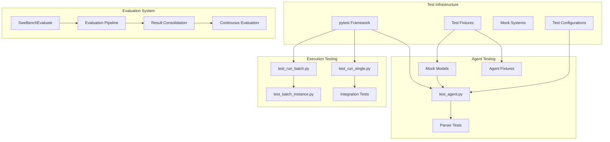
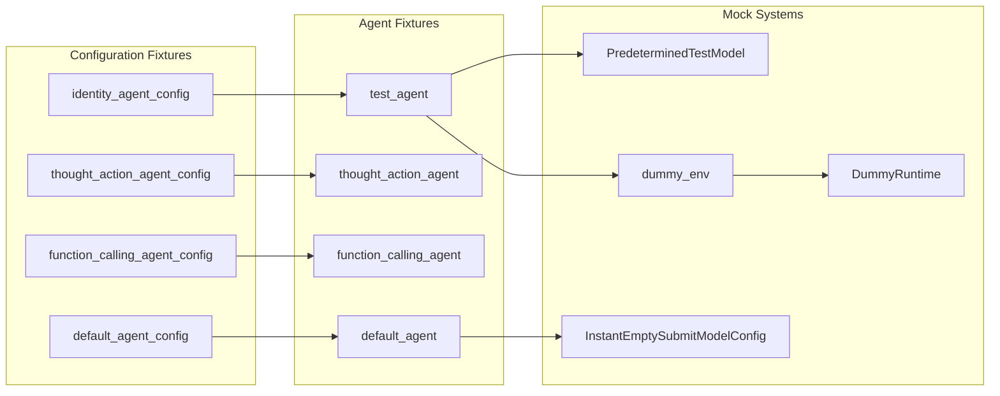
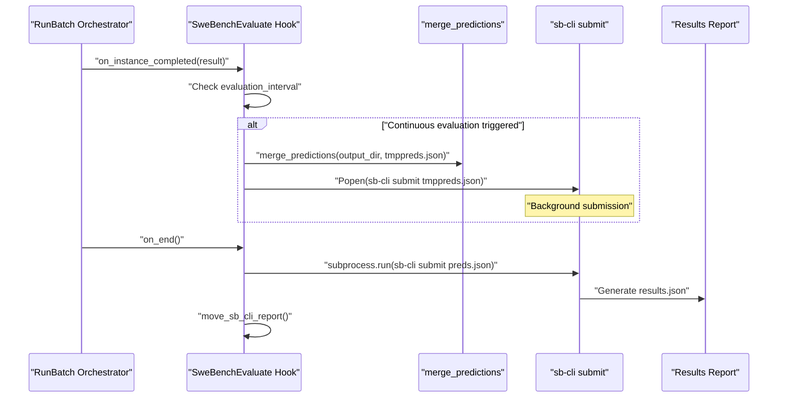
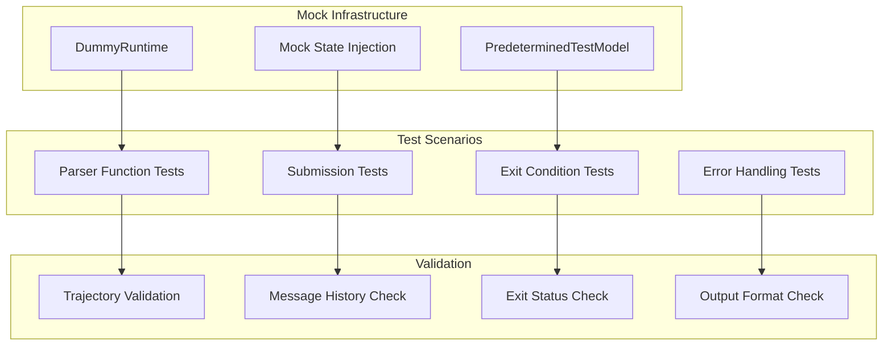

# Development and Testing

Relevant source files

The following files were used as context for generating this wiki page:

- [CONTRIBUTING.md](CONTRIBUTING.md)
- [docs/_footer.md](docs/_footer.md)
- [docs/assets/navigation_cards.css](docs/assets/navigation_cards.css)
- [docs/dev/contribute.md](docs/dev/contribute.md)
- [docs/dev/formatting_conflicts.md](docs/dev/formatting_conflicts.md)
- [docs/installation/index.md](docs/installation/index.md)
- [docs/usage/index.md](docs/usage/index.md)
- [mlc_config.json](mlc_config.json)

This document covers the development workflow, testing infrastructure, and quality assurance systems for the SWE-agent codebase. It provides an overview of the testing framework, evaluation systems, and development tools that ensure code quality and system reliability.

For detailed information about specific testing approaches, see [Testing Framework](#9.1). For documentation generation and maintenance, see [Documentation System](#9.2). For continuous integration and deployment processes, see [CI/CD and Deployment](#9.3).

## Overview

The SWE-agent development ecosystem consists of three main components:

1. **Testing Framework** - Comprehensive test suite using pytest with specialized fixtures and mock systems
2. **Evaluation System** - Automated evaluation against SWE-bench datasets with continuous submission capabilities  
3. **Quality Assurance** - Pre-commit hooks, linting, type checking, and CI/CD pipeline integration

## Testing Architecture

The testing system is built around pytest and provides specialized fixtures for testing agent behavior, environment interactions, and tool parsing.

**Sources:** [tests/test_agent.py:1-263](), [tests/test_run_single.py:1-126](), [tests/test_run_batch.py:1-111](), [tests/test_batch_instance.py:1-44]()

## Test Fixture System

The testing framework provides specialized fixtures for different testing scenarios:

| Fixture Type | Purpose | Key Classes |
|-------------|---------|-------------|
| Agent Configurations | Different parsing and model configurations | `DefaultAgentConfig`, `InstantEmptySubmitModelConfig` |
| Mock Models | Predictable model responses for testing | `PredeterminedTestModel`, `InstantEmptySubmitModelConfig` |
| Parser Fixtures | Testing different command parsing strategies | `Identity`, `ThoughtActionParser`, `FunctionCallingParser` |
| Environment Fixtures | Controlled environment for testing | `SWEEnv`, `DummyRuntime` |

**Sources:** [tests/test_agent.py:20-78](), [tests/test_run_single.py:32-44]()

## Evaluation and Benchmarking

The `SweBenchEvaluate` hook provides automated evaluation against SWE-bench datasets with support for continuous submission and result tracking.

### Key Components

- **`SweBenchEvaluate`** - Main evaluation hook class
- **Continuous Evaluation** - Automatic submission at configurable intervals
- **Result Consolidation** - Merging predictions from multiple runs
- **SB-CLI Integration** - Direct integration with SWE-bench evaluation CLI

**Sources:** [sweagent/run/hooks/swe_bench_evaluate.py:1-114]()

## Test Categories and Exit Conditions

The testing framework validates various agent behaviors and exit conditions:

### Exit Status Testing

| Test Type | Purpose | Expected Behavior |
|-----------|---------|-------------------|
| `test_exit_cost` | Cost limit reached | `exit_cost` status |
| `test_exit_context` | Context limit exceeded | `exit_context` status |
| `test_exit_model_error` | Model runtime errors | `exit_environment_error` status |
| `test_exit_format` | Invalid command format | `exit_format` status |
| `test_exit_blocklist` | Blocked commands used | `exit_format` status |

### Agent Behavior Testing

- **Step-by-step execution** - Validates agent history and message handling
- **Tool calling** - Tests function calling parser with structured responses
- **Submission handling** - Tests automatic submission detection and processing
- **Error handling** - Validates graceful error recovery and reporting

**Sources:** [tests/test_agent.py:80-263]()

## Integration Testing

### Single Run Testing

Tests individual agent execution with various configurations:
- Repository sources (local, GitHub)
- Problem statement sources (GitHub issues, local files, text)
- Output format validation (trajectory, predictions, patches)

### Batch Processing Testing

Validates batch execution capabilities:
- Instance loading from different sources
- Parallel execution coordination
- Progress tracking and reporting
- Exception handling and recovery

**Sources:** [tests/test_run_single.py:82-126](), [tests/test_run_batch.py:8-89]()

## Mock and Test Infrastructure

### Mock Model System

The `PredeterminedTestModel` provides controlled responses for testing:
- Predictable command sequences
- Error condition simulation
- Cost and context limit testing

### Environment Mocking

- **`DummyRuntime`** - Simulated command execution
- **`RuntimeRaisesFirst`** - Error condition testing
- **Mock state injection** - Controlled environment state

**Sources:** [tests/test_agent.py:130-263]()