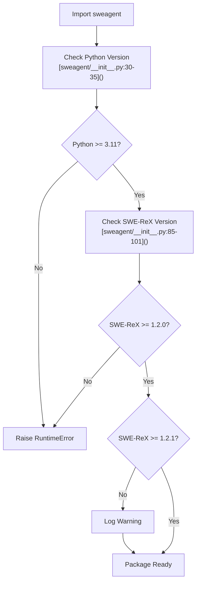
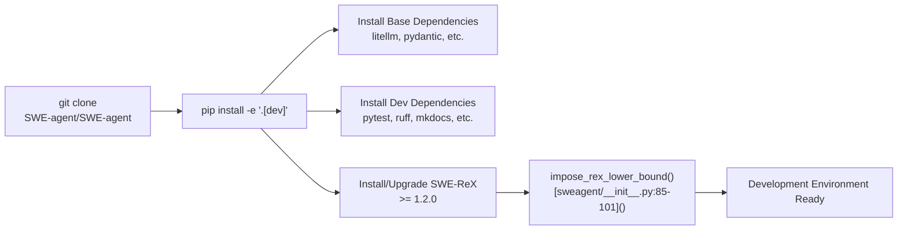
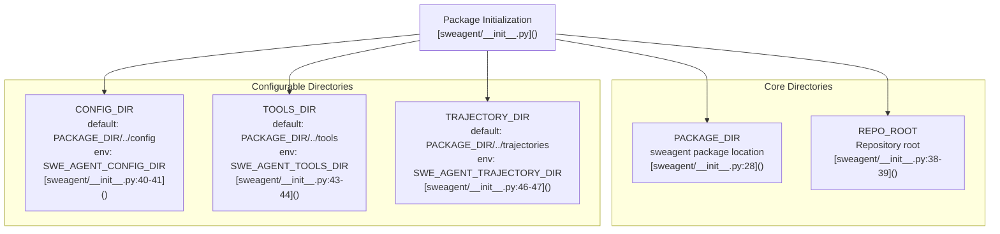
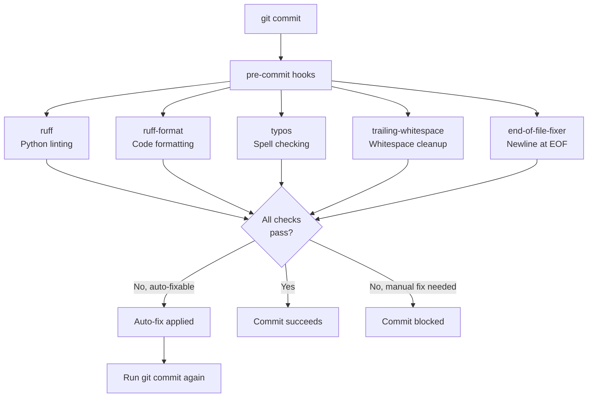
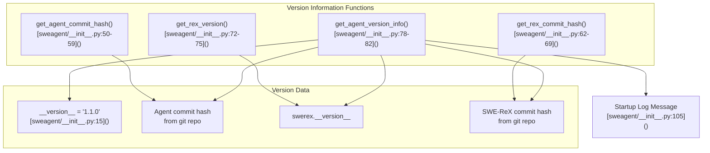
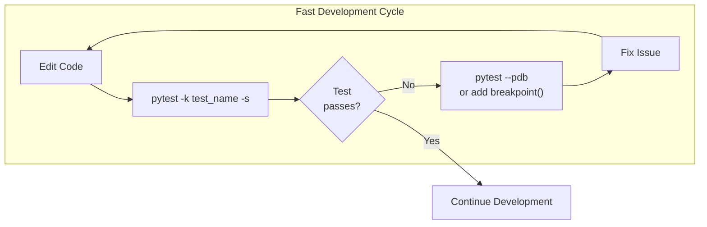
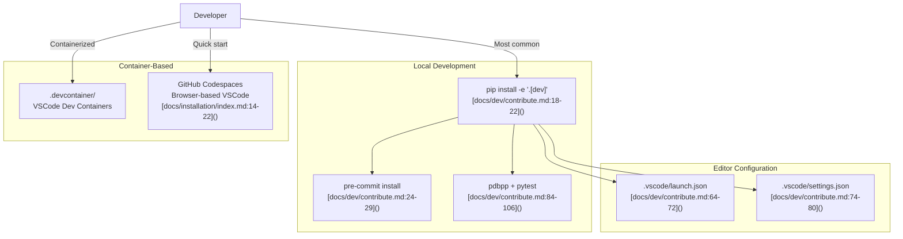
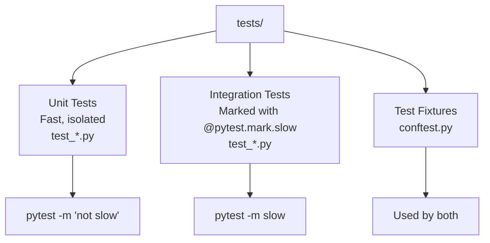

# Development Setup

<details>
<summary>Relevant source files</summary>

The following files were used as context for generating this wiki page:

- [.github/CODE_OF_CONDUCT.md](.github/CODE_OF_CONDUCT.md)
- [CONTRIBUTING.md](CONTRIBUTING.md)
- [docs/_footer.md](docs/_footer.md)
- [docs/assets/navigation_cards.css](docs/assets/navigation_cards.css)
- [docs/config/env.md](docs/config/env.md)
- [docs/dev/contribute.md](docs/dev/contribute.md)
- [docs/dev/formatting_conflicts.md](docs/dev/formatting_conflicts.md)
- [docs/installation/changelog.md](docs/installation/changelog.md)
- [docs/installation/index.md](docs/installation/index.md)
- [docs/usage/index.md](docs/usage/index.md)
- [mlc_config.json](mlc_config.json)
- [sweagent/__init__.py](sweagent/__init__.py)
- [tests/test_models.py](tests/test_models.py)

</details>


This document covers the development environment setup for contributing to SWE-agent. It includes instructions for installing dependencies, configuring pre-commit hooks, setting up debugging tools, and understanding the development directory structure. For information about running tests, see [Testing Framework](#9.2). For details on code quality enforcement, see [Code Quality Tools](#9.3).

## Prerequisites and System Requirements

SWE-agent requires Python 3.11 or higher. The minimum and recommended versions are enforced at package initialization:



**Version Requirements**

| Requirement | Minimum Version | Recommended Version | Enforcement Location |
|------------|----------------|---------------------|---------------------|
| Python | 3.11 | 3.11+ | [sweagent/__init__.py:16,30-35]() |
| SWE-ReX | 1.2.0 | 1.2.1 | [sweagent/__init__.py:17-18,85-101]() |

Sources: [sweagent/__init__.py:15-18,30-35,85-104](), [docs/dev/contribute.md:1-148]()

## Installing for Development

Install the repository from source with development dependencies:

```bash
# Clone the repository
git clone https://github.com/SWE-agent/SWE-agent.git
cd SWE-agent

# Install with development extras
pip install -e '.[dev]'
```

The `[dev]` extra includes additional dependencies for testing, documentation building, and code quality tools. The `-e` flag installs the package in editable mode, allowing you to modify the source code without reinstalling.

**Development Installation Flow**



Sources: [docs/dev/contribute.md:16-22](), [sweagent/__init__.py:85-104]()

## Directory Structure and Environment Variables

SWE-agent uses several directory paths that can be overridden via environment variables when not installed in editable mode:



**Environment Variables for Development**

| Variable | Purpose | Default | When to Set |
|----------|---------|---------|------------|
| `SWE_AGENT_CONFIG_DIR` | Configuration files location | `<PACKAGE>/config` | Non-editable install |
| `SWE_AGENT_TOOLS_DIR` | Tool bundles location | `<PACKAGE>/tools` | Non-editable install |
| `SWE_AGENT_TRAJECTORY_DIR` | Trajectory files location | `<PACKAGE>/trajectories` | Non-editable install |
| `SWE_AGENT_LOG_TIME` | Add timestamps to log output | Not set | When debugging timing |
| `SWE_AGENT_LOG_STREAM_LEVEL` | CLI log level | INFO | Set to DEBUG or TRACE |

Environment variables can be set in a `.env` file at the repository root, which is automatically loaded by the configuration system.

Sources: [sweagent/__init__.py:28-47](), [docs/config/env.md:1-24]()

## Pre-commit Hooks Setup

Pre-commit hooks enforce code quality standards before commits are created:

```bash
# Install pre-commit hooks
pre-commit install
```

The hooks run automatically on `git commit` and check for formatting errors, syntax issues, and common problems.



**Auto-fixes and Manual Intervention**

Most formatting issues are automatically fixed by the hooks. If a commit fails:

1. The hooks apply automatic fixes to the staged files
2. Run `git commit` again to commit the fixed code
3. For issues requiring manual fixes, edit the files and stage them

For additional auto-fixes using unsafe transformations:

```bash
pipx run ruff check --fix --unsafe-fixes
```

**Bypassing Hooks**

In rare cases where you need to commit without running hooks (not recommended):

```bash
git commit --no-verify
```

Sources: [docs/dev/contribute.md:24-41](), [docs/dev/formatting_conflicts.md:1-64]()

## Version Management and Commit Tracking

SWE-agent tracks version information for both the agent and SWE-ReX runtime:



**Version Information Output**

When SWE-agent starts, it logs version information including commit hashes for both the agent and SWE-ReX:

```
This is SWE-agent version 1.1.0 (hash='abc123...') with SWE-ReX version 1.2.1 (rex_hash='def456...')
```

This information is useful for debugging and reproducibility. The commit hashes are determined by inspecting the git repository at [sweagent/__init__.py:50-69]().

Sources: [sweagent/__init__.py:15,50-82,105]()

## Debugging Tools

### pdbpp - Enhanced Python Debugger

Install `pdbpp` for improved debugging features:

```bash
pip install pdbpp
```

Set breakpoints in code using Python's built-in `breakpoint()` function:

```python
# In any Python file
def problematic_function():
    x = compute_something()
    breakpoint()  # Execution will pause here
    return process(x)
```

Run SWE-agent with the debugger:

```bash
pdb -m sweagent run -- --agent.model.name=gpt-4o --problem_statement.text="Fix the bug"
```

Note the `--` separator between `pdb` options and `sweagent` options.

### pytest Debugging Options

When debugging a specific test:

```bash
# Run single test with full output
pytest -k test_name -s --capture=no --log-cli-level=DEBUG

# Run with breakpoints enabled
pytest -k test_name -s --capture=no --pdb
```

**pytest Options for Debugging**

| Option | Purpose |
|--------|---------|
| `-k test_name` | Run only tests matching the pattern |
| `-s` | Disable output capture (show print statements) |
| `--capture=no` | Disable all capturing |
| `--log-cli-level=DEBUG` | Show DEBUG level logs in console |
| `--pdb` | Drop into debugger on test failure |
| `-n auto` | Run tests in parallel (for fast iteration) |
| `-m "not slow"` | Exclude slow integration tests |



Sources: [docs/dev/contribute.md:82-106](), [tests/test_models.py:1-24]()

## Development Environment Options

SWE-agent supports multiple development environment configurations:



### Local Development

Standard development setup on your local machine. Provides full control and fastest execution.

### Dev Containers

VSCode Dev Containers provide a containerized development environment with all dependencies pre-configured. Configuration is stored in the `.devcontainer/` directory.

### GitHub Codespaces

Browser-based development environment that runs in the cloud. Useful for quick experimentation without local setup. Access via the GitHub repository's "Code" button.

**Choosing a Development Environment**

| Environment | Setup Time | Performance | Use Case |
|-------------|-----------|-------------|----------|
| Local | Medium | Fast | Primary development |
| Dev Container | Medium | Medium | Consistent environment |
| Codespaces | Fast | Medium | Quick testing, demos |

Sources: [docs/dev/contribute.md:16-29,64-80](), [docs/installation/index.md:14-22]()

## Configuration and Logging

### Logging Configuration

Control logging verbosity during development:

```bash
# Enable DEBUG level logging
export SWE_AGENT_LOG_STREAM_LEVEL=DEBUG

# Enable TRACE level (below DEBUG)
export SWE_AGENT_LOG_STREAM_LEVEL=TRACE

# Add timestamps to logs
export SWE_AGENT_LOG_TIME=1
```

### Running Tests with Different Configurations

```bash
# Run all tests
pytest

# Run only fast tests
pytest -m "not slow"

# Run tests in parallel
pytest -n auto

# Run specific test file
pytest tests/test_models.py

# Run with verbose output
pytest -v
```

**Test Organization**



Sources: [docs/dev/contribute.md:43-63](), [docs/config/env.md:18-22]()

## Formatting Conflict Resolution

If you encounter merge conflicts after the formatting changes (introduced May 28, 2024), follow the automated resolution process:

```bash
# Add upstream remote
git remote add upstream https://github.com/SWE-agent/SWE-agent.git
git fetch upstream

# Get updated formatting configuration
git checkout upstream/main -- .pre-commit-config.yaml pyproject.toml
git commit -m "Update formatting instructions" --no-verify

# Rebase with automatic formatting
export FEATURE_BRANCH="main"  # or your branch name
git branch "${FEATURE_BRANCH}_REBASED" "${FEATURE_BRANCH}"
git rebase upstream/main "${FEATURE_BRANCH}_REBASED" \
  -Xtheirs \
  --exec 'git reset --soft HEAD^; pre-commit run; pipx run ruff check --fix --unsafe-fixes; git add -u; git commit -C HEAD@{1} --no-verify'
```

This command rebases your changes while applying formatting at each step.

Sources: [docs/dev/formatting_conflicts.md:1-64]()

## Next Steps

After setting up your development environment:

- Review the [Testing Framework](#9.2) for information on writing and running tests
- See [Code Quality Tools](#9.3) for details on the enforcement mechanisms
- Consult [Documentation System](#9.4) to learn how to build and preview documentation changes
- Check [CI/CD Pipeline](#9.5) to understand what checks run on pull requests

For questions or issues during setup, open an issue on GitHub or join the community Slack channel.

Sources: [docs/dev/contribute.md:108-148](), [CONTRIBUTING.md:1-16]()