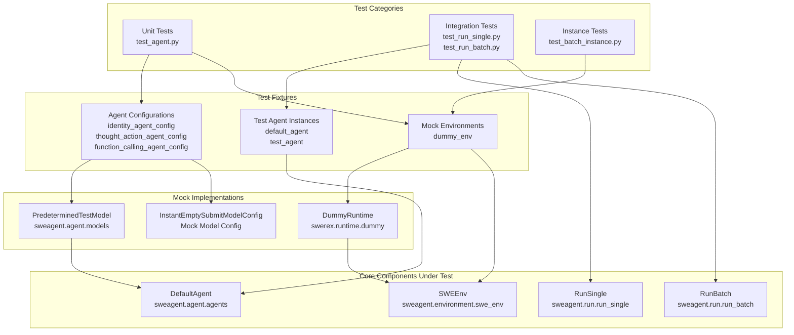
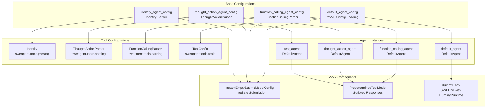
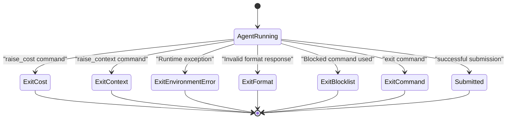
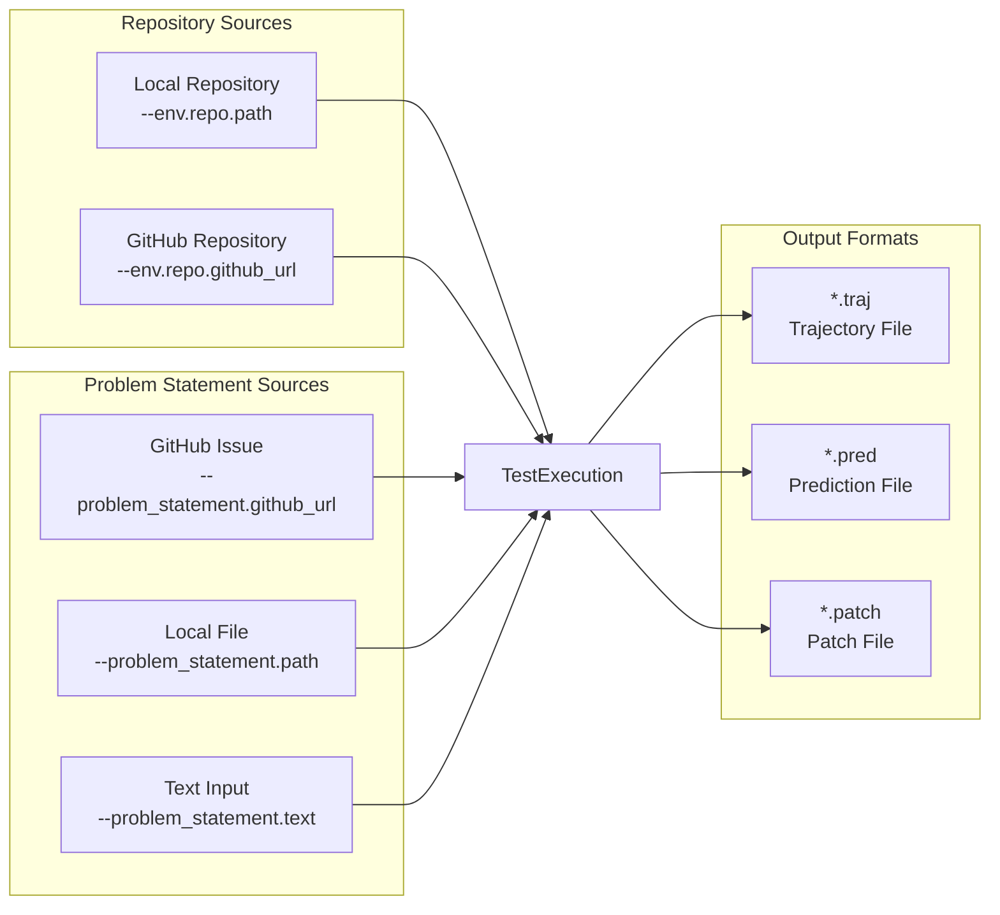
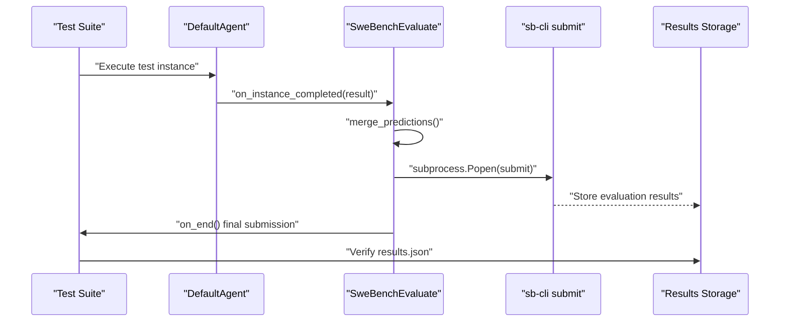

# Testing Framework

<details>
<summary>Relevant source files</summary>

The following files were used as context for generating this wiki page:

- [CONTRIBUTING.md](CONTRIBUTING.md)
- [docs/_footer.md](docs/_footer.md)
- [docs/assets/navigation_cards.css](docs/assets/navigation_cards.css)
- [docs/dev/contribute.md](docs/dev/contribute.md)
- [docs/dev/formatting_conflicts.md](docs/dev/formatting_conflicts.md)
- [docs/installation/index.md](docs/installation/index.md)
- [docs/usage/index.md](docs/usage/index.md)
- [mlc_config.json](mlc_config.json)
- [sweagent/run/hooks/swe_bench_evaluate.py](sweagent/run/hooks/swe_bench_evaluate.py)
- [tests/test_agent.py](tests/test_agent.py)
- [tests/test_batch_instance.py](tests/test_batch_instance.py)
- [tests/test_run_batch.py](tests/test_run_batch.py)
- [tests/test_run_single.py](tests/test_run_single.py)

</details>


The SWE-agent testing framework provides comprehensive validation of agent behavior, execution environments, and system integration. This document covers the test structure, mock implementations, fixtures, and testing patterns used to ensure reliable agent performance across single runs, batch processing, and evaluation scenarios.

For information about the actual agent execution system, see [Core Agent System](#3.1). For details about batch processing functionality, see [Batch Processing](#5.2).

## Test Architecture Overview

The testing framework is built on pytest and provides multiple layers of validation from unit tests to integration tests. The system uses mock implementations to isolate components and custom fixtures to provide reusable test configurations.

**Test Architecture and Component Relationships**


Sources: [tests/test_agent.py:1-263](), [tests/test_run_single.py:1-126](), [tests/test_batch_instance.py:1-44](), [tests/test_run_batch.py:1-111]()

## Test Fixtures and Configuration

The testing framework provides reusable fixtures that create standardized test configurations for different agent setups and parsing strategies.

**Test Fixture Dependencies and Configuration Flow**


Sources: [tests/test_agent.py:20-77](), [tests/test_run_single.py:32-44]()

| Fixture | Purpose | Configuration |
|---------|---------|---------------|
| `identity_agent_config` | Basic agent with Identity parser | Uses `InstantEmptySubmitModelConfig` and `Identity()` parser |
| `thought_action_agent_config` | Agent with ThoughtAction format | Uses `ThoughtActionParser()` for command interpretation |
| `function_calling_agent_config` | Agent with function calling | Uses `FunctionCallingParser()` for structured responses |
| `default_agent_config` | Full configuration from YAML | Loads from `CONFIG_DIR / "sweagent_0_7/07.yaml"` |
| `dummy_env` | Mock execution environment | Provides `SWEEnv` with `DummyRuntime` backend |

## Agent Testing Patterns

The framework tests various agent behaviors including exit conditions, error handling, step-by-step execution, and different parsing strategies.

### Exit Condition Testing

Tests validate proper handling of different termination scenarios:

```python
# Cost limit exceeded
def test_exit_cost(dummy_env: SWEEnv, test_agent: DefaultAgent, tmp_path):
    test_agent.model = PredeterminedTestModel(["raise_cost"])
    result = test_agent.run(problem_statement=EmptyProblemStatement(), 
                           env=dummy_env, output_dir=tmp_path)
    assert result.info["exit_status"] == "exit_cost"
```

**Agent Exit Status Flow**


Sources: [tests/test_agent.py:80-147](), [tests/test_agent.py:236-244]()

### Mock Implementation Strategy

The framework uses specialized mock classes to control agent behavior during testing:

| Mock Class | Purpose | Usage |
|------------|---------|-------|
| `PredeterminedTestModel` | Scripted model responses | Returns predefined sequences of commands/responses |
| `InstantEmptySubmitModelConfig` | Immediate submission | Causes agent to submit empty solution immediately |
| `DummyRuntime` | Mock execution environment | Simulates command execution without real containers |
| `RuntimeRaisesFirst` | Exception testing | Raises `SwerexException` on specific commands |

The `RuntimeRaisesFirst` class demonstrates custom runtime behavior for testing error handling:

```python
class RuntimeRaisesFirst(DummyRuntime):
    async def run_in_session(self, action: Action) -> Observation:
        if action.action_type == "bash" and action.command == "raise":
            raise SwerexException()
        return await super().run_in_session(action)
```

Sources: [tests/test_agent.py:130-146]()

## Integration Testing

Integration tests validate end-to-end functionality including repository handling, problem statement processing, and output generation.

### Single Run Integration Testing

Tests verify complete execution workflows with different repository and problem statement configurations:

**Integration Test Matrix**


Sources: [tests/test_run_single.py:81-126]()

### Batch Processing Testing

Batch tests validate parallel execution, instance loading, and result consolidation:

```python
def test_expert_instances(test_data_sources_path: Path, tmp_path: Path):
    cmd = ["run-batch", "--agent.model.name", "instant_empty_submit",
           "--instances.type", "expert_file", 
           "--instances.path", str(ds_path),
           "--output_dir", str(tmp_path)]
    main(cmd)
    # Verify trajectory files created for each instance
    for _id in ["simple_test_problem", "simple_test_problem_2"]:
        assert (tmp_path / f"{_id}" / f"{_id}.traj").exists()
```

Sources: [tests/test_run_batch.py:8-28]()

## Evaluation and Validation Integration

The testing framework integrates with the SWE-bench evaluation system through hooks that provide automated validation of agent performance.

**SWE-bench Evaluation Integration**


Sources: [sweagent/run/hooks/swe_bench_evaluate.py:65-114]()

The `SweBenchEvaluate` hook provides continuous evaluation during batch testing:

- **Continuous Submission**: Submits results every N completed instances via `continuous_submission_every` parameter
- **Final Evaluation**: Performs complete evaluation at test completion using `sb-cli submit`
- **Result Management**: Automatically merges predictions and manages temporary files
- **Error Handling**: Monitors subprocess calls and logs evaluation failures

## Test Execution and Validation

Tests use pytest markers to categorize execution requirements:

| Marker | Purpose | Usage |
|--------|---------|-------|
| `@pytest.mark.slow` | Integration tests | Long-running tests with real environments |
| `@pytest.mark.xfail` | Expected failures | Tests requiring specific environment setup |
| `@pytest.mark.parametrize` | Matrix testing | Test multiple configurations systematically |

The framework validates outputs through assertion patterns:
- **Exit Status Verification**: Confirms proper termination conditions
- **File Generation**: Validates creation of trajectory, prediction, and patch files  
- **Content Validation**: Checks message history, observations, and state consistency
- **Error Propagation**: Ensures exceptions are properly caught and reported

Sources: [tests/test_agent.py:189-234](), [tests/test_run_single.py:23-29](), [tests/test_run_single.py:47-64]()