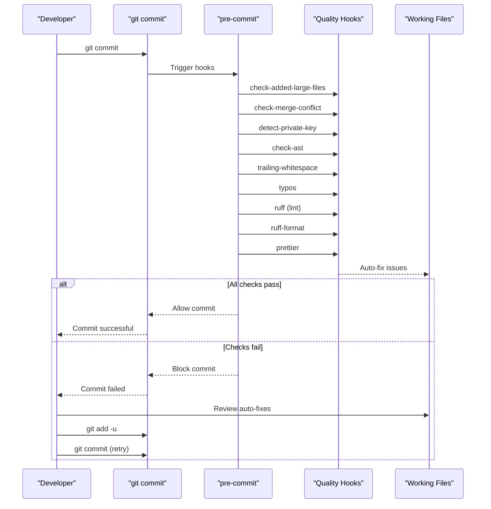
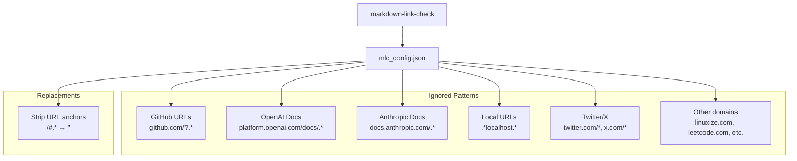
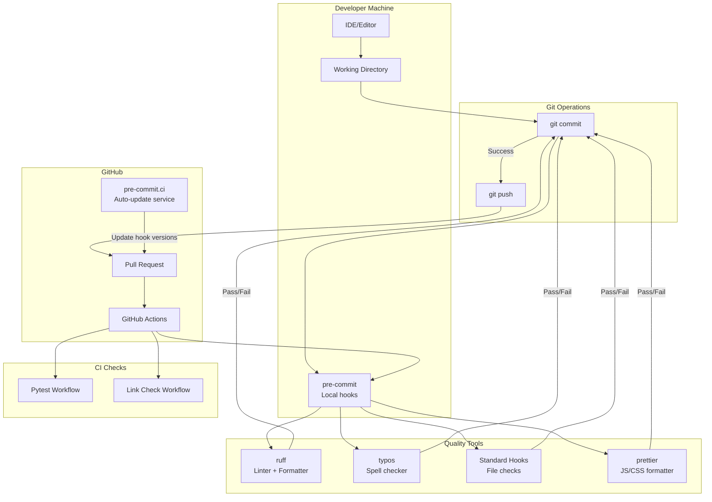
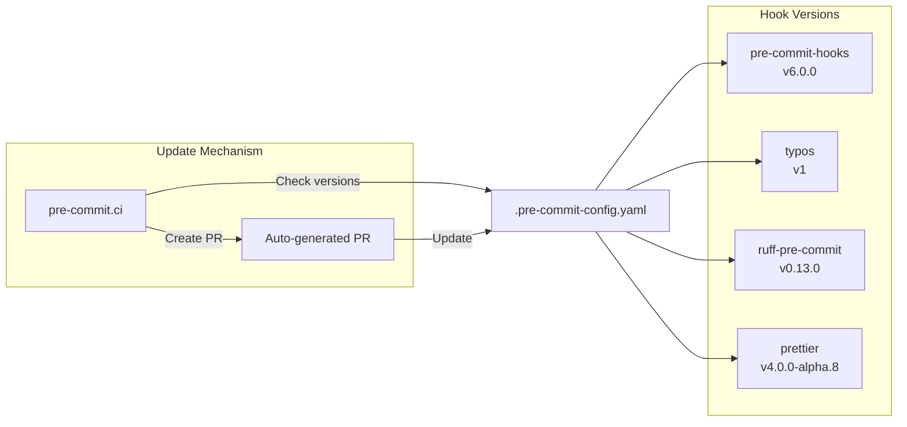

# Code Quality Tools

<details>
<summary>Relevant source files</summary>

The following files were used as context for generating this wiki page:

- [.pre-commit-config.yaml](.pre-commit-config.yaml)
- [CONTRIBUTING.md](CONTRIBUTING.md)
- [docs/_footer.md](docs/_footer.md)
- [docs/assets/navigation_cards.css](docs/assets/navigation_cards.css)
- [docs/dev/contribute.md](docs/dev/contribute.md)
- [docs/dev/formatting_conflicts.md](docs/dev/formatting_conflicts.md)
- [docs/installation/index.md](docs/installation/index.md)
- [docs/usage/index.md](docs/usage/index.md)
- [mlc_config.json](mlc_config.json)

</details>


This document describes the code quality enforcement mechanisms in the SWE-agent codebase. These tools ensure consistent code style, catch common errors, and maintain documentation quality through automated checks that run before commits and in CI/CD pipelines.

For information about the broader development setup and testing framework, see [Development Setup](#9.1) and [Testing Framework](#9.2). For CI/CD pipeline configuration, see [CI/CD Pipeline](#9.5).

## Overview

SWE-agent uses a layered approach to code quality with three enforcement points:

1. **Pre-commit hooks** - Automated checks that run before each git commit
2. **CI validation** - Same checks run on GitHub Actions for all PRs
3. **Automated updates** - pre-commit.ci service automatically updates hook versions

The quality tooling covers Python code (linting, formatting, syntax), documentation (spell checking, link validation), and web assets (JavaScript/CSS formatting).

## Pre-commit Hook System

### Framework Configuration

The pre-commit framework is configured in [.pre-commit-config.yaml:1-39](). The configuration defines four repository sources:

| Repository | Purpose | Hooks |
|------------|---------|-------|
| `pre-commit/pre-commit-hooks` | General file checks | 8 hooks for file integrity |
| `crate-ci/typos` | Spell checking | Typo detection in source files |
| `astral-sh/ruff-pre-commit` | Python quality | Linting and formatting |
| `pre-commit/mirrors-prettier` | Web assets | JavaScript/CSS formatting |

**Sources:** [.pre-commit-config.yaml:1-39]()

### Installation and Usage

Developers enable pre-commit hooks during initial setup:

```bash
pip install -e '.[dev]'
pre-commit install
```

Once installed, all hooks run automatically before each commit. Failed checks block the commit until issues are resolved. Most formatting issues are auto-fixed, requiring developers to re-stage files and retry the commit.

Manual execution of all hooks:

```bash
pre-commit run --all-files
```

**Sources:** [docs/dev/contribute.md:18-36]()

### Hook Execution Flow



**Diagram: Pre-commit hook execution flow showing automated checks and auto-fix cycle**

**Sources:** [.pre-commit-config.yaml:1-39](), [docs/dev/contribute.md:24-36]()

## Ruff: Python Linting and Formatting

### Configuration

Ruff serves dual purposes as both a linter (replacing flake8, isort, and others) and formatter (replacing black). The pre-commit configuration runs ruff in two stages:

1. **Linting phase** - [.pre-commit-config.yaml:28-29](): Runs `ruff` with `--fix` to automatically fix issues
2. **Formatting phase** - [.pre-commit-config.yaml:30-31](): Runs `ruff-format` to enforce code style

Ruff's specific rules and configuration are defined in `pyproject.toml` (not shown in provided files but referenced throughout).

**Sources:** [.pre-commit-config.yaml:24-31]()

### Auto-fix Capabilities

Ruff provides two levels of auto-fixing:

- **Safe fixes** (default): Applied automatically via `--fix` flag
- **Unsafe fixes**: Applied with explicit `--unsafe-fixes` flag

```bash
# Manual execution with unsafe fixes
pipx run ruff check --fix --unsafe-fixes
```

Unsafe fixes make more aggressive changes that could potentially alter code semantics, requiring developer review.

**Sources:** [docs/dev/contribute.md:37-41]()

### Usage in Formatting Conflicts

When rebasing branches that predate the introduction of automated formatting, developers can apply ruff during rebase:

```bash
git rebase upstream/main "${FEATURE_BRANCH}_REBASED" \
  -Xtheirs \
  --exec 'git reset --soft HEAD^; pre-commit run; pipx run ruff check --fix --unsafe-fixes; git add -u; git commit -C HEAD@{1} --no-verify'
```

This command applies formatting to each commit during rebase, preventing merge conflicts from style differences.

**Sources:** [docs/dev/formatting_conflicts.md:38-41]()

## Typos Spell Checker

### Configuration

The typos checker scans source files for spelling errors. Configuration at [.pre-commit-config.yaml:17-22]():

```yaml
- repo: https://github.com/crate-ci/typos
  rev: v1
  hooks:
    - id: typos
      files: \.(py|md|rst|yaml|toml)
      exclude: pyproject.toml
```

**File coverage:**
- Python files (`.py`)
- Documentation (`.md`, `.rst`)
- Configuration files (`.yaml`, `.toml`)

**Exclusions:**
- `pyproject.toml` - Contains valid package names that may appear as typos

**Sources:** [.pre-commit-config.yaml:17-22]()

## Standard Pre-commit Hooks

### File Integrity Checks

The `pre-commit-hooks` repository provides eight standard checks [.pre-commit-config.yaml:8-15]():

| Hook | Purpose |
|------|---------|
| `check-added-large-files` | Prevents accidentally committing large files |
| `check-case-conflict` | Detects files that would conflict on case-insensitive filesystems |
| `check-merge-conflict` | Detects merge conflict markers in files |
| `check-symlinks` | Validates symbolic links point to existing files |
| `mixed-line-ending` | Ensures consistent line endings |
| `detect-private-key` | Prevents committing private keys |
| `check-ast` | Validates Python syntax by parsing AST |
| `trailing-whitespace` | Removes trailing whitespace |

These hooks catch common developer errors before they reach the repository.

**Sources:** [.pre-commit-config.yaml:5-15]()

## Prettier for Web Assets

### Configuration

Prettier formats JavaScript and CSS files [.pre-commit-config.yaml:33-37]():

```yaml
- repo: https://github.com/pre-commit/mirrors-prettier
  rev: "v4.0.0-alpha.8"
  hooks:
    - id: prettier
      types_or: ["javascript", "css"]
```

This ensures consistent formatting for web components like the trajectory inspector interface.

**Sources:** [.pre-commit-config.yaml:33-37]()

## Global Exclusions

### Excluded Paths

The pre-commit configuration excludes specific directories from all checks [.pre-commit-config.yaml:39]():

```yaml
exclude: "^tests/test_data/|^tools/.*/.*.py"
```

**Excluded patterns:**
- `tests/test_data/` - Test fixtures that may intentionally contain malformed code
- `tools/.*/.*.py` - Tool bundle scripts that may have different formatting requirements

**Sources:** [.pre-commit-config.yaml:39]()

## Link Checking System

### Configuration

Link validation is configured separately in [mlc_config.json:1-44](). This file defines patterns for links that should be ignored during validation:



**Diagram: Link checker configuration showing ignored URL patterns**

**Sources:** [mlc_config.json:1-44]()

### Pattern Categories

The configuration ignores links that:

1. **External API documentation** - OpenAI, Anthropic docs (frequently reorganized)
2. **Social media** - Twitter/X links (authentication issues)
3. **Development URLs** - localhost references
4. **Problem-specific links** - LeetCode, specific tutorials
5. **Internal fragments** - Links to generated API docs (`*.md/#sweagent.*`)

The replacements section strips URL anchors before checking, as anchors may not be reliably validated.

**Sources:** [mlc_config.json:2-44]()

## Code Quality Tool Integration



**Diagram: Integration of code quality tools across development and CI environments**

**Sources:** [.pre-commit-config.yaml:1-39](), [docs/dev/contribute.md:24-36]()

## CI Auto-update Configuration

### Pre-commit.ci Integration

The pre-commit configuration enables automatic hook updates via pre-commit.ci [.pre-commit-config.yaml:1-2]():

```yaml
ci:
  autoupdate_commit_msg: "chore: update pre-commit hooks"
```

The pre-commit.ci service automatically:
1. Checks for new versions of configured hooks
2. Creates PRs with updated versions
3. Uses the custom commit message format

This ensures hooks stay current without manual intervention.

**Sources:** [.pre-commit-config.yaml:1-2]()

## Common Workflows

### Initial Setup

1. Install development dependencies: `pip install -e '.[dev]'`
2. Install pre-commit hooks: `pre-commit install`
3. Verify installation: `pre-commit run --all-files`

**Sources:** [docs/dev/contribute.md:18-29]()

### Handling Failed Commits

When pre-commit checks fail:

1. Review the output to identify issues
2. Most formatting issues are auto-fixed - check `git status`
3. Stage auto-fixed files: `git add -u`
4. Retry commit: `git commit`

For manual fixes:

1. Edit files to address reported issues
2. Stage changes: `git add <files>`
3. Retry commit: `git commit`

**Sources:** [docs/dev/contribute.md:33-36]()

### Dealing with Formatting Conflicts

When merging branches that predate formatting changes:

1. Checkout formatting config: `git checkout upstream/main -- .pre-commit-config.yaml pyproject.toml`
2. Use interactive rebase with formatting: See [docs/dev/formatting_conflicts.md:38-41]()
3. Resolve any remaining non-formatting conflicts manually

**Sources:** [docs/dev/formatting_conflicts.md:1-64]()

## Tool Version Management



**Diagram: Version management for pre-commit hooks showing automated update flow**

Current versions defined in [.pre-commit-config.yaml:6-34]():
- `pre-commit-hooks`: v6.0.0
- `typos`: v1
- `ruff-pre-commit`: v0.13.0
- `prettier`: v4.0.0-alpha.8

**Sources:** [.pre-commit-config.yaml:6-34]()

## Summary Table

| Tool | Purpose | Auto-fix | File Types | Configuration |
|------|---------|----------|------------|---------------|
| ruff | Linting | Yes | `.py` | `.pre-commit-config.yaml`, `pyproject.toml` |
| ruff-format | Formatting | Yes | `.py` | `.pre-commit-config.yaml`, `pyproject.toml` |
| typos | Spell check | No | `.py`, `.md`, `.rst`, `.yaml`, `.toml` | `.pre-commit-config.yaml` |
| prettier | Formatting | Yes | `.js`, `.css` | `.pre-commit-config.yaml` |
| check-ast | Syntax validation | No | `.py` | `.pre-commit-config.yaml` |
| trailing-whitespace | Whitespace cleanup | Yes | All text files | `.pre-commit-config.yaml` |
| check-added-large-files | Large file prevention | No | All files | `.pre-commit-config.yaml` |
| Other hooks | File integrity | Varies | Varies | `.pre-commit-config.yaml` |

**Sources:** [.pre-commit-config.yaml:1-39]()