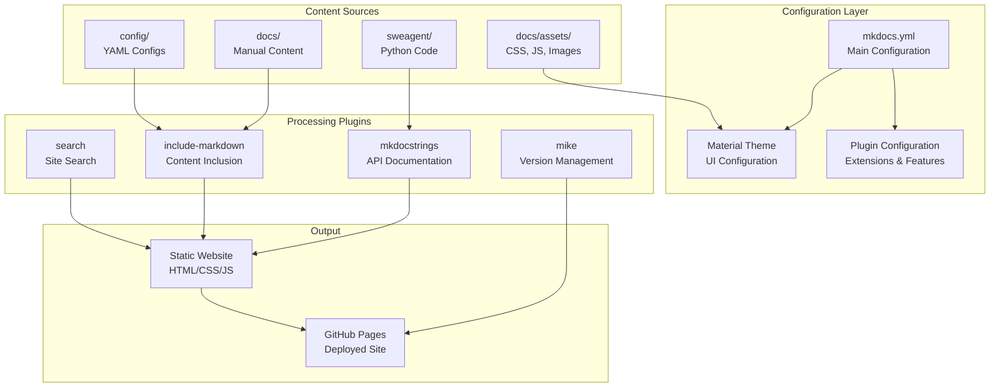
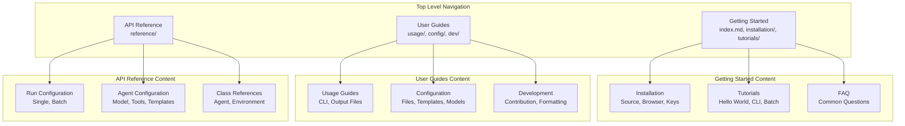
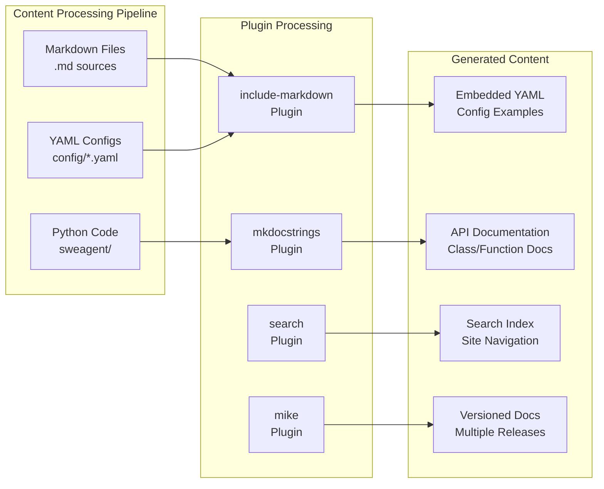
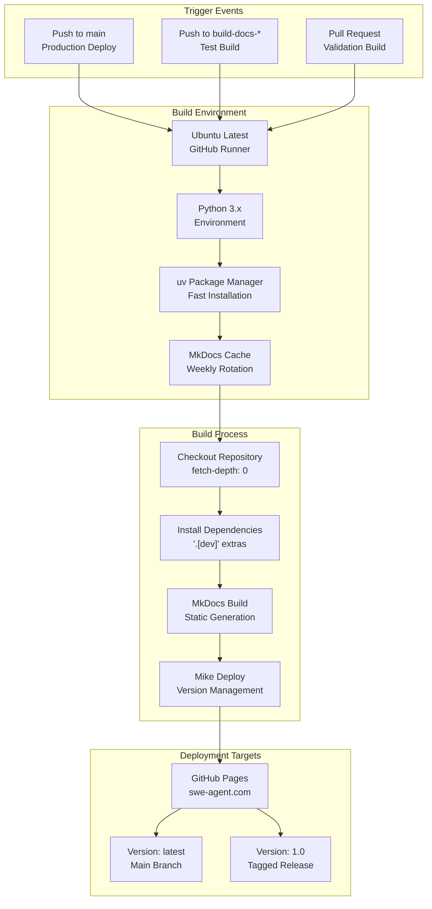

# Documentation System

<details>
<summary>Relevant source files</summary>

The following files were used as context for generating this wiki page:

- [.cursor/rules/general.mdc](.cursor/rules/general.mdc)
- [.cursor/rules/project-overview.mdc](.cursor/rules/project-overview.mdc)
- [.github/workflows/build-docs.yaml](.github/workflows/build-docs.yaml)
- [.github/workflows/check-links-periodic.yaml](.github/workflows/check-links-periodic.yaml)
- [.github/workflows/check-links-pr.yaml](.github/workflows/check-links-pr.yaml)
- [.github/workflows/pytest.yaml](.github/workflows/pytest.yaml)
- [CONTRIBUTING.md](CONTRIBUTING.md)
- [docs/_footer.md](docs/_footer.md)
- [docs/assets/navigation_cards.css](docs/assets/navigation_cards.css)
- [docs/dev/contribute.md](docs/dev/contribute.md)
- [docs/dev/formatting_conflicts.md](docs/dev/formatting_conflicts.md)
- [docs/installation/index.md](docs/installation/index.md)
- [docs/usage/batch_mode.md](docs/usage/batch_mode.md)
- [docs/usage/index.md](docs/usage/index.md)
- [mlc_config.json](mlc_config.json)

</details>


## Purpose and Scope

This document covers the MkDocs-based documentation system used by SWE-agent. The system handles static site generation, API reference documentation, versioning, and automated deployment. For information about testing framework and development workflows, see [Testing Framework](#9.1) and [CI/CD and Deployment](#9.3).

## MkDocs Configuration Architecture

The documentation system is built around MkDocs with the Material theme and several specialized plugins. The core configuration defines site structure, build behavior, and deployment settings.



Sources: [mkdocs.yml:1-181]()

## Site Configuration and Theme

The documentation uses the Material theme with extensive customization for navigation, search, and visual appearance. The configuration includes palette management, feature flags, and custom styling.

| Configuration Section | Purpose | Key Settings |
|----------------------|---------|--------------|
| `site_name` | Site identification | "SWE-agent documentation" |
| `theme.name` | Base theme | "material" |
| `theme.features` | UI capabilities | navigation.tabs, content.code.copy |
| `theme.palette` | Color schemes | Light/dark mode support |
| `markdown_extensions` | Content processing | admonition, pymdownx.superfences |

The theme configuration enables advanced features like:
- **Navigation tabs**: Top-level section organization [mkdocs.yml:40-41]()
- **Code annotations**: Interactive code explanations [mkdocs.yml:39]()
- **Content editing**: Direct GitHub editing links [mkdocs.yml:33]()
- **Search functionality**: Built-in site search [mkdocs.yml:121]()

Sources: [mkdocs.yml:3-41](), [docs/assets/custom.css](), [docs/assets/mkdocstrings.css]()

## Navigation Structure and Content Organization

The documentation follows a hierarchical structure with distinct sections for different user needs and experience levels.



The navigation structure is defined in the `nav` section and includes:
- **Progressive complexity**: From hello world to advanced configuration
- **Task-oriented sections**: Installation, tutorials, configuration, development
- **Reference material**: Comprehensive API documentation

Sources: [mkdocs.yml:57-118]()

## Plugin System and Content Generation

The documentation system uses multiple plugins to process different types of content and generate comprehensive documentation automatically.



### Key Plugins Configuration

**mkdocstrings Plugin**: Generates API documentation from Python docstrings
- **Handler**: Python with custom options [mkdocs.yml:126-150]()
- **Path resolution**: Points to `sweagent` package [mkdocs.yml:130]()
- **Documentation style**: Google-style docstrings [mkdocs.yml:136]()
- **Filtering**: Excludes private members and model internals [mkdocs.yml:148-151]()

**include-markdown Plugin**: Embeds external content
- **Path checking**: Validates included file paths [mkdocs.yml:52-53]()
- **YAML embedding**: Includes configuration examples in tutorials
- **Content reuse**: Shares common content across pages

**mike Plugin**: Manages documentation versioning
- **Version aliasing**: Maps version numbers to deployment targets [mkdocs.yml:123-125]()
- **Canonical version**: Sets "latest" as default [mkdocs.yml:124]()

Sources: [mkdocs.yml:119-151]()

## Build and Deployment Pipeline

The documentation system uses GitHub Actions for automated building and deployment with different strategies for different branches.



### Deployment Strategy

The build process handles different deployment scenarios:

**Main Branch Deployment**: Full deployment with versioning
- **Command**: `mike deploy --push 1.0 latest` [.github/workflows/build-docs.yaml:52]()
- **Target**: Production site with version management
- **Git configuration**: Uses GitHub Actions bot credentials [.github/workflows/build-docs.yaml:26-29]()

**Branch Testing**: Build validation without deployment
- **Command**: `mkdocs build` [.github/workflows/build-docs.yaml:46]()
- **Purpose**: Validates documentation builds correctly
- **Scope**: Pull requests and feature branches

**Caching Strategy**: Optimized build performance
- **Cache key**: Weekly rotation based on week number [.github/workflows/build-docs.yaml:33-39]()
- **Cache content**: MkDocs Material theme assets
- **Fallback**: Previous cache versions for faster builds

Sources: [.github/workflows/build-docs.yaml:1-53]()

## Local Development Workflow

The documentation system supports local development with hot-reload capabilities for rapid iteration during content creation and modification.

### Development Setup

**Prerequisites Installation**:
```bash
pip install -e '.[dev]'  # Install with development dependencies
```

**Local Development Server**:
```bash
mkdocs serve  # Start development server on port 8000
```

The development setup includes:
- **Hot reload**: Automatic page refresh on content changes
- **Local preview**: Full site functionality without deployment
- **Debug output**: Detailed build information for troubleshooting

### Content Creation Guidelines

**Manual Content**: Written in Markdown with specific extensions
- **Location**: `docs/` directory with organized subdirectories
- **Format**: Standard Markdown with Material theme extensions
- **Includes**: YAML configuration examples using include-markdown

**API Documentation**: Auto-generated from Python code
- **Source**: Python docstrings in `sweagent/` package
- **Style**: Google-style docstring format
- **Integration**: Seamless embedding in manual content

Sources: [docs/dev/contribute.md:123-133](), [mkdocs.yml:52-53]()

## Asset Management and Customization

The documentation system includes custom styling, JavaScript functionality, and static assets to enhance the user experience beyond the default Material theme.

### Custom Assets Structure

| Asset Type | Location | Purpose |
|------------|----------|---------|
| CSS Stylesheets | `docs/assets/custom.css` | Theme customization |
| API Styling | `docs/assets/mkdocstrings.css` | API documentation styling |
| Image Themes | `docs/assets/image_theme.css` | Image display handling |
| Interactive UI | `docs/assets/bubbles.css` | UI enhancements |
| JavaScript | `docs/assets/js/sh-annotation.js` | Shell command annotations |

### Theme Customization Features

**Visual Customization**:
- **Logo and favicon**: Custom SWE-agent branding [mkdocs.yml:9-10]()
- **Color palette**: Coordinated light/dark themes [mkdocs.yml:11-29]()
- **Custom CSS**: Override Material theme defaults [mkdocs.yml:157-161]()

**Enhanced Functionality**:
- **Analytics integration**: Google Analytics tracking [mkdocs.yml:165-167]()
- **Interactive elements**: Enhanced code blocks and annotations
- **Responsive design**: Mobile-friendly layouts

Sources: [mkdocs.yml:155-181](), [docs/assets/]()