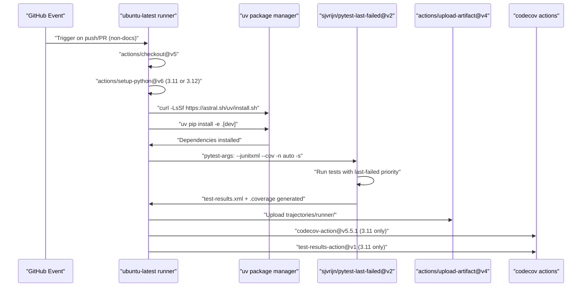
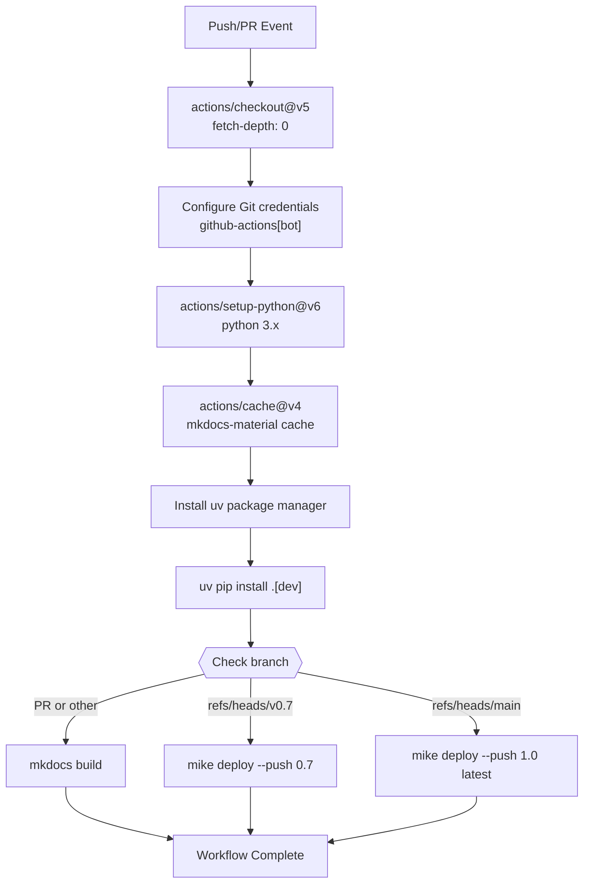
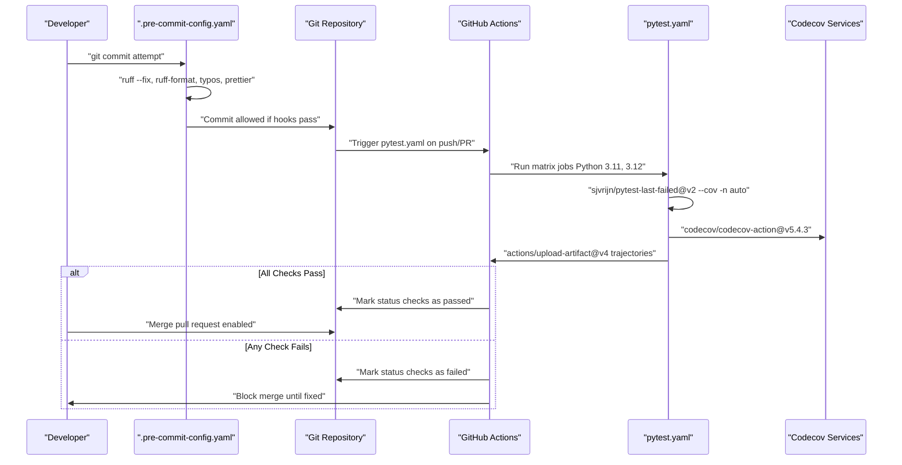

# CI/CD Pipeline

<details>
<summary>Relevant source files</summary>

The following files were used as context for generating this wiki page:

- [.cursor/rules/general.mdc](.cursor/rules/general.mdc)
- [.cursor/rules/project-overview.mdc](.cursor/rules/project-overview.mdc)
- [.github/workflows/build-docs.yaml](.github/workflows/build-docs.yaml)
- [.github/workflows/check-links-periodic.yaml](.github/workflows/check-links-periodic.yaml)
- [.github/workflows/check-links-pr.yaml](.github/workflows/check-links-pr.yaml)
- [.github/workflows/pytest.yaml](.github/workflows/pytest.yaml)
- [docs/usage/batch_mode.md](docs/usage/batch_mode.md)

</details>


This page documents the continuous integration and continuous deployment (CI/CD) infrastructure for SWE-agent. The CI/CD pipeline ensures code quality through automated testing, documentation building, link validation, and coverage reporting using GitHub Actions workflows. For related information about development environment setup, see [Development Setup](9.1) and [Code Quality Tools](9.3).

## Overview of CI/CD Workflows

SWE-agent uses GitHub Actions to implement a comprehensive CI/CD pipeline with four primary workflows:

| Workflow | File | Trigger | Purpose |
|----------|------|---------|---------|
| Testing | `pytest.yaml` | Push/PR to main | Run test suite on Python 3.11 and 3.12 |
| Documentation | `build-docs.yaml` | Push/PR to main | Build and deploy versioned docs with MkDocs |
| Link Check (PR) | `check-links-pr.yaml` | Pull requests | Validate links in modified files only |
| Link Check (Periodic) | `check-links-periodic.yaml` | Monthly schedule | Validate all documentation links |

Sources: [.github/workflows/pytest.yaml:1-76](), [.github/workflows/build-docs.yaml:1-53](), [.github/workflows/check-links-pr.yaml:1-14](), [.github/workflows/check-links-periodic.yaml:1-21]()

## pytest.yaml - Testing Workflow

The primary CI workflow runs the test suite on multiple Python versions with coverage reporting and artifact collection.

### Workflow Trigger Configuration

The workflow triggers on:
- **Push events**: To `main` and `prepare-public2` branches
- **Pull requests**: Targeting `main` and `prepare-public2` branches
- **Path filtering**: Excludes `docs/**`, `.cursor/**`, `README.md`, and `mkdocs.yml` to avoid running tests on documentation-only changes

```yaml
on:
  push:
    branches: [main, prepare-public2]
    paths-ignore: ['docs/**', '.cursor/**', 'README.md', 'mkdocs.yml']
  pull_request:
    branches: [main, prepare-public2]
    paths-ignore: ['docs/**', 'README.md', 'mkdocs.yml']
```

Sources: [.github/workflows/pytest.yaml:6-23]()

### Testing Workflow Execution



Sources: [.github/workflows/pytest.yaml:28-76]()

### Python Version Matrix

The workflow uses a matrix strategy to test on multiple Python versions:

| Matrix Variable | Values | Purpose |
|----------------|--------|---------|
| `python-version` | `["3.11", "3.12"]` | Ensures compatibility across supported Python versions |

The matrix creates two parallel jobs, one for each Python version.

Sources: [.github/workflows/pytest.yaml:30-32]()

### Key Workflow Steps

#### 1. Environment Setup

```yaml
- name: Checkout code
  uses: actions/checkout@v5
- uses: actions/setup-python@v6
  with:
    python-version: "${{ matrix.python-version }}"
```

Sources: [.github/workflows/pytest.yaml:37-41]()

#### 2. Dependency Installation with uv

The workflow uses `uv`, a fast Python package installer, for dependency management:

```yaml
- name: Install uv
  run: curl -LsSf https://astral.sh/uv/install.sh | sh
- name: Install dependencies
  run: uv pip install --python ${Python_ROOT_DIR} -e '.[dev]'
```

Sources: [.github/workflows/pytest.yaml:42-47]()

#### 3. Test Execution

The workflow uses `sjvrijn/pytest-last-failed@v2` action, which intelligently reruns previously failed tests first:

```yaml
- name: Run pytest
  uses: sjvrijn/pytest-last-failed@v2
  with:
    pytest-args: '--junitxml=test-results.xml --cov -n auto -s'
```

**Pytest arguments**:
- `--junitxml=test-results.xml`: Generate JUnit XML for test results
- `--cov`: Collect coverage data
- `-n auto`: Parallel test execution (auto-detect CPU cores)
- `-s`: Show print statements (no capture)

Sources: [.github/workflows/pytest.yaml:51-54]()

#### 4. Artifact Collection

Test trajectories are uploaded as artifacts for debugging:

```yaml
- name: Upload logs & trajectories
  uses: actions/upload-artifact@v4
  if: always()
  with:
    name: trajectories-py${{ matrix.python-version }}
    path: trajectories/runner/
```

The `if: always()` condition ensures artifacts are uploaded even if tests fail.

Sources: [.github/workflows/pytest.yaml:55-61]()

#### 5. Coverage Reporting

Coverage reports are uploaded to Codecov only for Python 3.11 to avoid duplicate reports:

```yaml
- name: Explicitly convert coverage to xml
  if: matrix.python-version == '3.11'
  run: coverage xml
- name: Upload coverage reports to Codecov
  if: matrix.python-version == '3.11'
  uses: codecov/codecov-action@v5.5.1
  with:
    token: ${{ secrets.CODECOV_TOKEN }}
    slug: SWE-agent/SWE-agent
- name: Upload test results to Codecov
  if: matrix.python-version == '3.11'
  uses: codecov/test-results-action@v1
  with:
    files: test-results.xml
```

Sources: [.github/workflows/pytest.yaml:62-76]()

## build-docs.yaml - Documentation Workflow

The documentation workflow builds and deploys versioned documentation using MkDocs Material and mike for version management.

### Documentation Workflow Triggers

```yaml
on:
  push:
    branches: [main, "build-docs-*"]
  pull_request:
    branches: [main]
```

The workflow includes concurrency control to prevent conflicts when deploying to `gh-pages`:

```yaml
concurrency:
  group: build-docs-${{ github.ref }}
  cancel-in-progress: false
```

Sources: [.github/workflows/build-docs.yaml:3-15]()

### Documentation Build and Deployment Flow



Sources: [.github/workflows/build-docs.yaml:20-52]()

### Version Management with mike

The workflow uses `mike` for documentation versioning:

| Branch | Action | Version Tags | Description |
|--------|--------|--------------|-------------|
| `main` | `mike deploy --push 1.0 latest` | `1.0`, `latest` | Deploy current stable docs |
| `v0.7` | `mike deploy --push 0.7` | `0.7` | Deploy legacy version docs |
| Other branches/PRs | `mkdocs build` | N/A | Build only (no deploy) |

The `--push` flag automatically pushes the built documentation to the `gh-pages` branch.

Sources: [.github/workflows/build-docs.yaml:44-52]()

### MkDocs Material Caching

The workflow uses weekly cache rotation for MkDocs Material plugins:

```yaml
- run: echo "cache_id=$(date --utc '+%V')" >> $GITHUB_ENV
- uses: actions/cache@v4
  with:
    key: mkdocs-material-${{ env.cache_id }}
    path: .cache
    restore-keys: mkdocs-material-
```

This caches the `.cache` directory, which stores downloaded assets and plugin state.

Sources: [.github/workflows/build-docs.yaml:33-39]()

## Link Checking Workflows

SWE-agent maintains two separate link checking workflows to ensure documentation quality.

### check-links-pr.yaml - Pull Request Link Checking

This workflow validates links only in files modified by a pull request:

```yaml
on: [pull_request]
name: Check Markdown links in modified files
jobs:
  markdown-link-check:
    runs-on: ubuntu-latest
    steps:
    - uses: actions/checkout@v5
    - uses: tcort/github-action-markdown-link-check@v1
      with:
        use-quiet-mode: 'yes'
        use-verbose-mode: 'yes'
        check-modified-files-only: 'yes'
        base-branch: 'main'
```

The `check-modified-files-only: 'yes'` option ensures only changed files are validated, making PR checks fast.

Sources: [.github/workflows/check-links-pr.yaml:1-14]()

### check-links-periodic.yaml - Scheduled Full Link Checking

This workflow performs comprehensive link validation on the entire documentation:

```yaml
on:
  workflow_dispatch:
  push:
    branches: [main, bala/fix_broken_links]
  schedule:
    - cron: "0 0 1 * *"  # Monthly on the 1st at midnight
```

**Trigger conditions**:
- **Manual dispatch**: Can be triggered manually via GitHub UI
- **Push**: On main branch and specific fix branches
- **Schedule**: Monthly on the 1st at midnight UTC (`0 0 1 * *`)

The workflow uses the same `tcort/github-action-markdown-link-check@v1` action but checks all files.

Sources: [.github/workflows/check-links-periodic.yaml:1-21]()

### Link Checker Configuration

Both workflows use the same configuration:

| Option | Value | Purpose |
|--------|-------|---------|
| `use-quiet-mode` | `yes` | Reduce output noise |
| `use-verbose-mode` | `yes` | Show detailed error information |
| `check-modified-files-only` | `yes` (PR only) | Only check changed files in PRs |
| `base-branch` | `main` (PR only) | Base branch for diff comparison |

Sources: [.github/workflows/check-links-pr.yaml:8-13](), [.github/workflows/check-links-periodic.yaml:16-20]()

## 8. CI/CD Integration with Development Workflow

The CI/CD pipeline integrates seamlessly with the development workflow, providing automated quality assurance through pre-commit hooks and GitHub Actions workflows.

### Development to Deployment Flow



### Quality Gates and Enforcement

| Stage | Tool/Action | Enforcement Point | Failure Action |
|-------|-------------|-------------------|----------------|
| Pre-commit | `ruff`, `typos`, `prettier` | Local git hooks | Block commit |
| CI Tests | `sjvrijn/pytest-last-failed@v2` | GitHub Actions | Block merge |
| Coverage | `codecov/codecov-action@v5.4.3` | Codecov integration | Generate report |
| Links | `gaurav-nelson/github-action-markdown-link-check@v1` | Monthly schedule | Create issue |

The system enforces quality through multiple layers: local pre-commit hooks prevent bad commits, while GitHub Actions workflows prevent merging of failing code.

Sources: [.github/workflows/pytest.yaml:6-24](), [.github/workflows/check-links.yaml:3-8](), [.pre-commit-config.yaml:24-32]()

## 7. Production Deployment Considerations

When deploying SWE-agent in a production environment, consider the following:

1. **Docker Socket Mounting**: The container requires access to the host's Docker socket (`/var/run/docker.sock`) to create and manage other containers.

2. **Volume Mounting**: For persistence of data and trajectories, mounting volumes is recommended:
   - Trajectory storage
   - Configuration files
   - Repository caching

3. **Network Configuration**: Properly configure network settings to allow:
   - Access to the web interface
   - Communication with language model APIs
   - Git repository access

4. **Security Considerations**:
   - The Docker-in-Docker approach grants significant permissions to the container
   - Consider using Docker's security features like seccomp profiles and read-only filesystems where possible
   - Limit container capabilities to only what's necessary

Sources: [Dockerfile:1-25]()

## 8. Development vs. Production Deployment

The Docker configuration supports both development and production deployment scenarios:

| Aspect | Development Usage | Production Usage |
|--------|-------------------|------------------|
| Code Mounting | Mount local code for live editing | Use built image with code copied in |
| Frontend | Run with hot reloading | Serve pre-built static files |
| Environment Variables | Development config | Production config with API keys |
| Network | Exposed ports for debugging | Limited port exposure |
| Volumes | Temporary | Persistent data storage |

For development, you might run the container with additional mounts and environment settings:

```
docker run -v $(pwd):/app -p 5000:5000 -v /var/run/docker.sock:/var/run/docker.sock swe-agent:latest
```

Sources: [Dockerfile:1-25]()