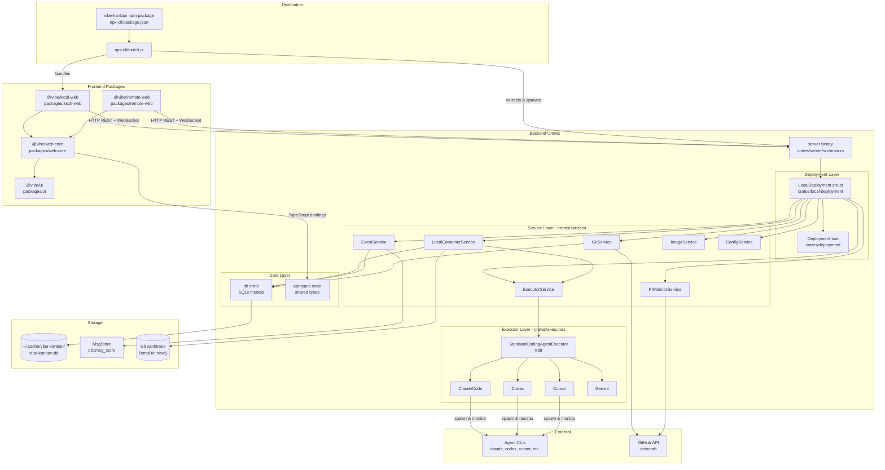
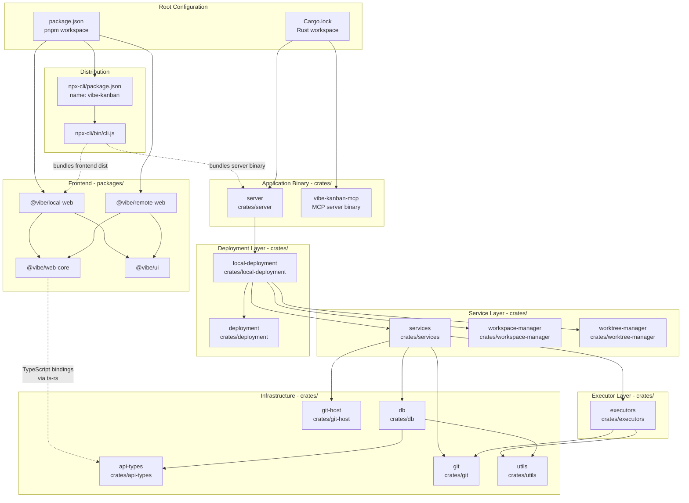

# Overview

Relevant source files

The following files were used as context for generating this wiki page:

- [Cargo.lock](Cargo.lock)
- [README.md](README.md)
- [crates/db/Cargo.toml](crates/db/Cargo.toml)
- [crates/deployment/Cargo.toml](crates/deployment/Cargo.toml)
- [crates/executors/Cargo.toml](crates/executors/Cargo.toml)
- [crates/local-deployment/Cargo.toml](crates/local-deployment/Cargo.toml)
- [crates/review/Cargo.toml](crates/review/Cargo.toml)
- [crates/server/Cargo.toml](crates/server/Cargo.toml)
- [crates/services/Cargo.toml](crates/services/Cargo.toml)
- [crates/utils/Cargo.toml](crates/utils/Cargo.toml)
- [docs/configuration-customisation/agent-configurations.mdx](docs/configuration-customisation/agent-configurations.mdx)
- [docs/configuration-customisation/global-settings.mdx](docs/configuration-customisation/global-settings.mdx)
- [docs/core-features/completing-a-task.mdx](docs/core-features/completing-a-task.mdx)
- [docs/core-features/reviewing-code-changes.mdx](docs/core-features/reviewing-code-changes.mdx)
- [docs/core-features/subtasks.mdx](docs/core-features/subtasks.mdx)
- [docs/getting-started.mdx](docs/getting-started.mdx)
- [docs/index.mdx](docs/index.mdx)
- [docs/integrations/github-integration.mdx](docs/integrations/github-integration.mdx)
- [docs/integrations/vscode-extension.mdx](docs/integrations/vscode-extension.mdx)
- [npx-cli/package.json](npx-cli/package.json)
- [package.json](package.json)
- [packages/public/vibe-kanban-screenshot-overview.png](packages/public/vibe-kanban-screenshot-overview.png)
- [packages/public/vibe-kanban-screenshot-workspace.png](packages/public/vibe-kanban-screenshot-workspace.png)

This document provides a high-level introduction to Vibe Kanban, describing its purpose, architecture, and core components. For detailed information about specific subsystems, refer to the child pages: [System Architecture](#1.1) covers the technical architecture in depth, and [Getting Started](#1.2) provides installation and setup instructions.

## What is Vibe Kanban

Vibe Kanban is a development platform for planning and reviewing work with AI coding agents. It provides a kanban-based project management interface combined with isolated workspace environments where coding agents (Claude Code, Codex, Gemini CLI, GitHub Copilot, Amp, Cursor, etc.) can execute tasks in Git worktrees. The system enables engineers to rapidly plan work via issues, execute via agents, and review changes through an integrated diff viewer and browser preview [README.md:25-36]().

The platform is distributed as a single npm package (`vibe-kanban`) that bundles both the Rust backend server and React frontend application, allowing users to run a fully functional instance with `npx vibe-kanban` [package.json:1-10](), [npx-cli/package.json:1-23]().

**Sources:** [README.md:25-44](), [package.json:1-10](), [npx-cli/package.json:1-23]()

## Core Value Proposition

| Problem | Solution |
|---------|----------|
| Engineers spend most time planning and reviewing agent work | Kanban-based planning interface with issue management |
| Agents need isolated execution environments | Git worktree-based workspaces with terminal and dev server access |
| Reviewing agent changes is slow | Integrated diff viewer with inline commenting |
| Testing agent changes requires switching contexts | Built-in browser with devtools, inspect mode, and device emulation |
| Different agents have different interfaces | Unified executor abstraction supporting 10+ agents |
| Merging agent work requires manual Git operations | PR creation with AI-generated descriptions and one-click merge |

**Sources:** [README.md:26-36]()

## High-Level Architecture

**System Architecture with Code Entity Mapping**

**Architecture Overview**

The system is organized into four primary layers:

1. **Frontend Layer**: React-based SPAs communicate with the backend via HTTP REST endpoints and WebSocket streams. The `@vibe/local-web` package serves desktop users, while `@vibe/remote-web` provides the cloud UI. Both share code through `@vibe/web-core` and `@vibe/ui` [package.json:18-28]().

2. **Backend Service Layer**: The `server` binary [crates/server/Cargo.toml:2-5]() uses the Axum framework to expose HTTP/WebSocket endpoints. The `LocalDeployment` struct [crates/local-deployment/Cargo.toml:2-3]() implements the `Deployment` trait [crates/deployment/Cargo.toml:2-3]() and orchestrates these services:
   - `LocalContainerService`: Workspace lifecycle and Git worktree management [crates/services/Cargo.toml:20]().
   - `EventService`: SQLite hook-based change capture and WebSocket streaming [crates/services/Cargo.toml:28]().
   - `ExecutorService`: Factory for spawning `StandardCodingAgentExecutor` instances [crates/services/Cargo.toml:18]().
   - `GitService`: Git operations via `git2` crate [crates/services/Cargo.toml:16]().
   - `ImageService`: File upload handling and caching [crates/services/Cargo.toml:54]().
   - `PrMonitorService`: GitHub PR status polling [crates/services/Cargo.toml:17]().
   - `ConfigService`: Application configuration persistence [crates/services/Cargo.toml:15]().

3. **Executor Layer**: The `StandardCodingAgentExecutor` trait [crates/executors/Cargo.toml:2-3]() defines a unified interface for agent integrations. Implementations like `ClaudeCode`, `Codex`, `Cursor`, and `Gemini` spawn child processes via `command-group` and normalize agent output streams [crates/executors/Cargo.toml:22-40]().

4. **Data Layer**: The `db` crate [crates/db/Cargo.toml:2-3]() provides SQLx-based models for SQLite persistence. The `api-types` crate [crates/api-types/Cargo.toml:237-247]() defines shared types that generate TypeScript bindings via `ts-rs`. `MsgStore` buffers real-time updates for WebSocket subscribers [crates/db/Cargo.toml:21]().

For details, see [System Architecture](#1.1).

**Sources:** [crates/server/Cargo.toml:10-22](), [crates/local-deployment/Cargo.toml:7-25](), [crates/services/Cargo.toml:13-19](), [crates/executors/Cargo.toml:7-40](), [crates/deployment/Cargo.toml:7-22]()

## Monorepo Structure

**Dependency Graph with Crate Names**

**Crate Organization and Purpose**

| Crate/Package | Binary/Lib | Primary Exports | Core Dependencies |
|---------------|------------|-----------------|-------------------|
| `server` | Binary | `server` binary | `axum`, `local-deployment`, `services`, `db` [crates/server/Cargo.toml:10-22]() |
| `local-deployment` | Library | `LocalDeployment` struct | `deployment`, `services`, `workspace-manager` [crates/local-deployment/Cargo.toml:7-25]() |
| `deployment` | Library | `Deployment` trait | `db`, `services`, `executors` [crates/deployment/Cargo.toml:7-12]() |
| `services` | Library | `LocalContainerService`, `EventService` | `db`, `executors`, `git`, `worktree-manager` [crates/services/Cargo.toml:13-20]() |
| `executors` | Library | `StandardCodingAgentExecutor` | `git`, `utils`, `tokio` [crates/executors/Cargo.toml:7-13]() |
| `db` | Library | SQLx models, `MsgStore` | `sqlx`, `utils`, `api-types` [crates/db/Cargo.toml:7-17]() |
| `api-types` | Library | Shared types with `#[derive(TS)]` | `ts-rs`, `serde`, `schemars` [crates/api-types/Cargo.toml:237-247]() |
| `git` | Library | `GitService` | `git2`, `tokio` [crates/services/Cargo.toml:16]() |
| `utils` | Library | Shared utilities, error types | `tokio`, `serde`, `thiserror` [crates/utils/Cargo.toml:7-33]() |
| `@vibe/local-web` | Frontend | Desktop React app | `@vibe/web-core`, `@vibe/ui`, `vite` [package.json:18-28]() |

**Type System Contract**

The `api-types` crate [crates/api-types/Cargo.toml:237-247]() defines shared data structures between Rust and TypeScript. Rust structs annotated with `#[derive(TS)]` generate TypeScript definitions via `ts-rs`. The `generate-types` script [package.json:35]() exports these to the frontend packages.

**Sources:** [package.json:1-68](), [crates/server/Cargo.toml:1-67](), [crates/local-deployment/Cargo.toml:1-41](), [crates/services/Cargo.toml:1-56](), [crates/executors/Cargo.toml:1-51](), [crates/deployment/Cargo.toml:1-29](), [crates/db/Cargo.toml:1-22]()

## Deployment Modes

Vibe Kanban supports two deployment modes:

### Local Deployment

**Local Mode Characteristics:**

- **Installation**: Single command `npx vibe-kanban` [README.md:42]() downloads and runs the entire stack.
- **Server**: The `server` binary is extracted and executed from the `npx-cli` wrapper [npx-cli/package.json:23]().
- **Database**: SQLite database used for local persistence [crates/server/Cargo.toml:44]().
- **Worktrees**: Git worktrees created for isolated agent execution [README.md:31]().
- **Frontend**: Local web UI served via Axum [crates/server/Cargo.toml:38]().

For details, see [Getting Started](#1.2).

**Sources:** [npx-cli/package.json:1-35](), [README.md:41-52](), [README.md:112-130]()

### Remote Deployment

Remote deployment is designed for cloud hosting with multi-tenant support.

- **Infrastructure**: Supports PostgreSQL and remote execution contexts [README.md:60]().
- **Relay Tunnel**: Support for connecting remote deployments to local environments via the relay tunnel system [crates/server/Cargo.toml:23-30]().
- **Configuration**: Managed via environment variables and cloud-specific services [README.md:147-162]().

**Sources:** [README.md:147-162](), [package.json:46-51]()

## Technology Stack

| Layer | Technologies | Key Crates/Packages |
|-------|-------------|---------------------|
| **Frontend** | React, TypeScript, Vite | `@vibe/local-web`, `@vibe/web-core`, `@vibe/ui` |
| **Backend Framework** | Axum, Tokio | `server`, `axum`, `tokio` |
| **Database** | SQLite via SQLx | `sqlx`, `db` |
| **Type Synchronization** | `ts-rs` | `api-types` |
| **Version Control** | `git2` | `git`, `worktree-manager` |
| **Agent Integration** | `command-group` | `executors` |
| **Error Handling** | `thiserror`, `anyhow` | `utils` |

**Sources:** [package.json:53-67](), [crates/server/Cargo.toml:32-66](), [crates/services/Cargo.toml:21-55](), [crates/executors/Cargo.toml:9-50]()

## Key Concepts

For detailed explanations of the system's core concepts, see:

- [System Architecture](#1.1) - High-level architecture and component interaction.
- [Getting Started](#1.2) - Installation and basic usage guide.

**Sources:** [README.md:24-36](), [package.json:1-68]()