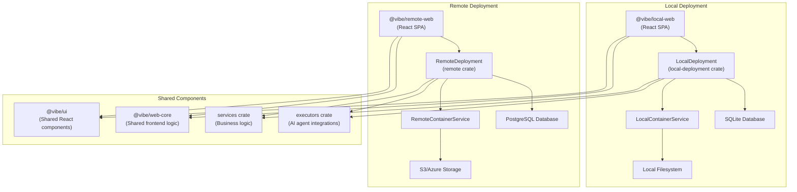
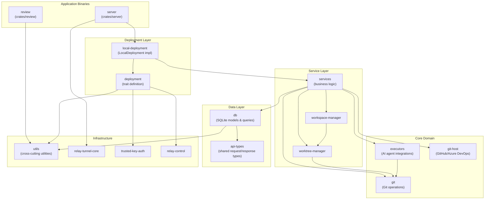
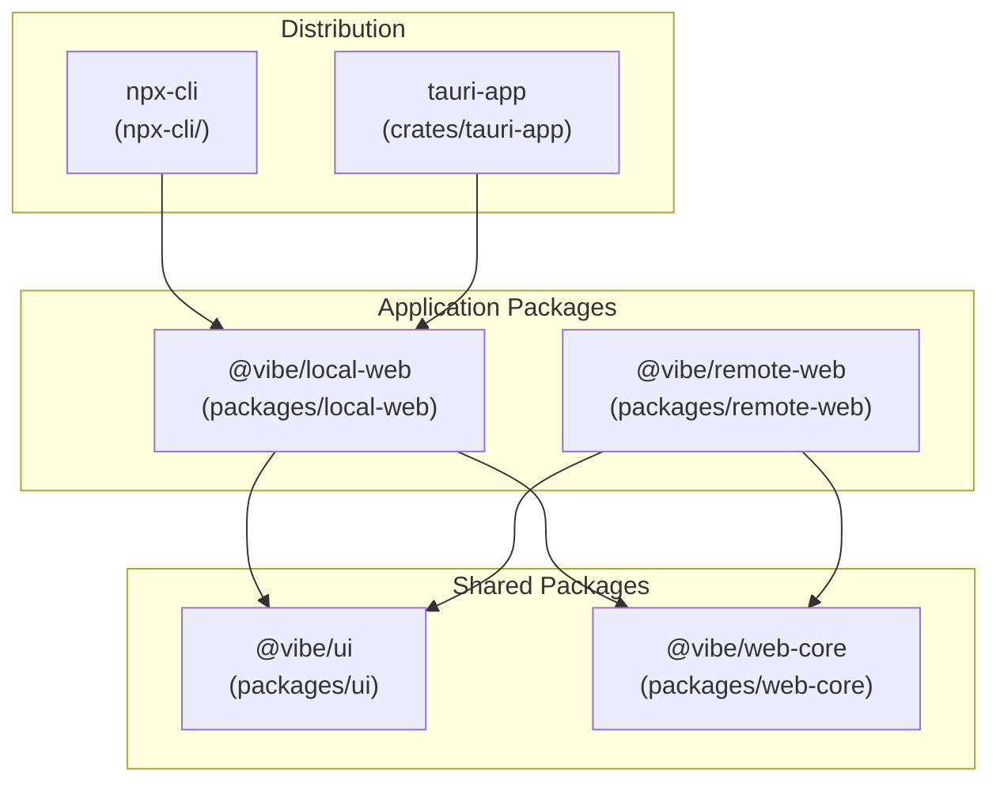
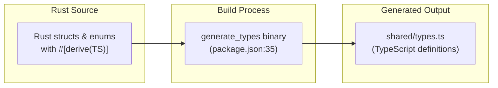
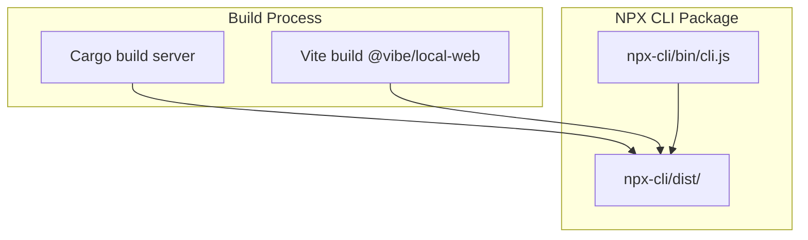

# System Architecture

Relevant source files

The following files were used as context for generating this wiki page:

- [Cargo.lock](Cargo.lock)
- [Cargo.toml](Cargo.toml)
- [crates/client-info/src/lib.rs](crates/client-info/src/lib.rs)
- [crates/db/Cargo.toml](crates/db/Cargo.toml)
- [crates/deployment/Cargo.toml](crates/deployment/Cargo.toml)
- [crates/executors/Cargo.toml](crates/executors/Cargo.toml)
- [crates/local-deployment/Cargo.toml](crates/local-deployment/Cargo.toml)
- [crates/preview-proxy/src/lib.rs](crates/preview-proxy/src/lib.rs)
- [crates/relay-control/Cargo.toml](crates/relay-control/Cargo.toml)
- [crates/relay-tunnel-core/src/client.rs](crates/relay-tunnel-core/src/client.rs)
- [crates/relay-tunnel-core/src/lib.rs](crates/relay-tunnel-core/src/lib.rs)
- [crates/relay-tunnel-core/src/server.rs](crates/relay-tunnel-core/src/server.rs)
- [crates/relay-tunnel/Cargo.lock](crates/relay-tunnel/Cargo.lock)
- [crates/relay-tunnel/Cargo.toml](crates/relay-tunnel/Cargo.toml)
- [crates/review/Cargo.toml](crates/review/Cargo.toml)
- [crates/server/Cargo.toml](crates/server/Cargo.toml)
- [crates/server/src/main.rs](crates/server/src/main.rs)
- [crates/server/src/middleware/error_logging.rs](crates/server/src/middleware/error_logging.rs)
- [crates/server/src/middleware/mod.rs](crates/server/src/middleware/mod.rs)
- [crates/server/src/middleware/origin.rs](crates/server/src/middleware/origin.rs)
- [crates/server/src/routes/mod.rs](crates/server/src/routes/mod.rs)
- [crates/server/src/routes/preview.rs](crates/server/src/routes/preview.rs)
- [crates/server/src/runtime/relay_registration.rs](crates/server/src/runtime/relay_registration.rs)
- [crates/server/src/startup.rs](crates/server/src/startup.rs)
- [crates/services/Cargo.toml](crates/services/Cargo.toml)
- [crates/utils/Cargo.toml](crates/utils/Cargo.toml)
- [npx-cli/package.json](npx-cli/package.json)
- [package.json](package.json)

This document describes the high-level architecture of Vibe Kanban, focusing on how the major subsystems are organized and interact. For detailed information about specific components, see related pages: [Core Concepts](#2) for data models, [Executor System](#3) for AI agent integration, and [Backend Services](#4) for service-level implementation details.

## Purpose and Scope

Vibe Kanban is architected as a dual-deployment system that can run either **locally** (for individual developers) or **remotely** (cloud-hosted for teams). This page covers:

- The two deployment modes and their architectural differences.
- Backend crate organization and layering.
- Frontend package structure and code sharing.
- Type system synchronization between Rust and TypeScript.
- Distribution mechanisms (NPX, Tauri, Docker).

## Deployment Modes

Vibe Kanban supports two deployment strategies, both sharing the same core business logic but with different infrastructure implementations.

### Local Deployment vs Remote Deployment

Title: "Deployment Strategy Overview"

The `Deployment` trait defines the interface that both modes implement [crates/deployment/src/lib.rs:74-149](). `LocalDeployment` uses SQLite and local filesystem storage [crates/local-deployment/Cargo.toml:8-23](), while the remote deployment uses PostgreSQL and cloud storage. Both delegate to the `services` crate for shared business logic [crates/server/Cargo.toml:19-19]().

| Aspect | Local Deployment | Remote Deployment |
|--------|------------------|-------------------|
| **Database** | SQLite (sqlx) | PostgreSQL |
| **Storage** | Local filesystem | S3/Azure Blob |
| **Container Service** | `LocalContainerService` | `RemoteContainerService` |
| **Authentication** | OAuth handoffs + trusted keys | JWT tokens |
| **Entry Point** | `server` binary | `remote` binary |

**Sources**: [crates/deployment/Cargo.toml:7-22](), [crates/local-deployment/Cargo.toml:7-25](), [crates/server/Cargo.toml:11-31](), [crates/deployment/src/lib.rs:74-149]()

## Backend Crate Architecture

The Rust backend is organized into distinct layers, with dependencies flowing downward from application binaries to infrastructure utilities.

### Crate Dependency Graph

Title: "Backend Crate Hierarchy"

**Sources**: [crates/server/Cargo.toml:10-31](), [crates/local-deployment/Cargo.toml:7-25](), [crates/services/Cargo.toml:13-20](), [crates/deployment/Cargo.toml:7-22](), [package.json:1-34]()

### Layer Breakdown

#### Application Layer
Contains entry point binaries that initialize and run services:
- **`server`** [crates/server/Cargo.toml:2-5](): Main HTTP server using Axum, initializes deployment and starts listening.
- **`review`** [crates/review/Cargo.toml:8-9](): CLI tool for code review workflows.

#### Deployment Layer
The `Deployment` trait abstracts over local vs remote infrastructure [crates/deployment/src/lib.rs:74-149](). `LocalDeployment` implements this trait with local filesystem and SQLite [crates/local-deployment/Cargo.toml:8-23]().

#### Service Layer
Core business logic resides in the `services` crate [crates/services/Cargo.toml:2-4](). Key services include `ContainerService` for execution management [crates/services/Cargo.toml:19-22]() and `EventService` for real-time updates.

#### Core Domain Layer
- **`executors`** [crates/executors/Cargo.toml:2-2](): Integrations with AI coding agents (Claude, Codex, Gemini, etc.) utilizing protocols like `agent-client-protocol` [crates/executors/Cargo.toml:38-40]().
- **`workspace-manager`**: Manages isolated workspace directories.
- **`worktree-manager`**: Git worktree lifecycle management.
- **`git`**: Git operations wrapper.

#### Data Layer
- **`db`** [crates/db/Cargo.toml:2-2](): SQLite models and queries using `sqlx` [crates/db/Cargo.toml:14-14]().
- **`api-types`** [Cargo.lock:238-239](): Shared request/response types for API communication, utilizing `ts-rs` for frontend sync [Cargo.lock:246-246]().

## Frontend Architecture

The frontend is organized as a pnpm monorepo with workspace packages sharing common UI components and business logic.

### Package Structure

Title: "Frontend Package Relationships"

**Sources**: [package.json:18-28](), [package.json:51-52]()

| Package | Purpose |
|---------|---------|
| `@vibe/local-web` | Desktop UI for local deployment [package.json:18-25](). |
| `@vibe/remote-web` | Cloud UI with organization features [package.json:24-26](). |
| `@vibe/ui` | Shared component library [package.json:27-28](). |
| `@vibe/web-core` | Shared API client and state logic [package.json:20-21](). |

## Type System Synchronization

Vibe Kanban maintains type consistency between Rust backend and TypeScript frontend through automatic code generation via the `generate_types` binary.

Title: "Type Synchronization Flow"

**Sources**: [package.json:35-36](), [Cargo.lock:246-246]()

The `generate_types` binary uses the `ts-rs` crate to export TypeScript definitions from Rust types marked with `#[derive(TS)]` [Cargo.lock:246-246](). This is primarily implemented in `api-types` and `db` crates.

## Distribution Mechanisms

### NPX Distribution
The NPX wrapper detects the platform, extracts the appropriate binary, and launches the server with bundled frontend assets [npx-cli/package.json:23-30]().

Title: "NPX Build and Release Pipeline"

**Sources**: [package.json:5-11](), [npx-cli/package.json:6-10](), [npx-cli/package.json:23-30]()

### Tauri and Docker
- **Tauri**: Bundles the Rust backend and frontend into a native desktop application [package.json:51-52]().
- **Docker**: Used for remote/cloud deployment environments, supporting profiles like `relay` and `attachments` [package.json:46-48]().

---

This architecture enables Vibe Kanban to support both local development workflows and team collaboration, with shared core logic ensuring consistent behavior across deployment modes.