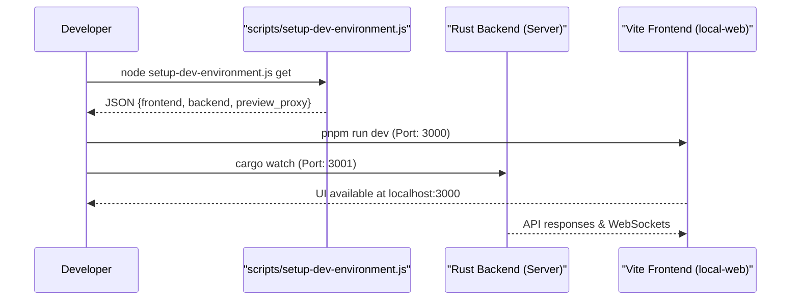

# Getting Started

<details>
<summary>Relevant source files</summary>

The following files were used as context for generating this wiki page:

- [README.md](README.md)
- [dev_assets_seed/config.json](dev_assets_seed/config.json)
- [dev_assets_seed/db.sqlite](dev_assets_seed/db.sqlite)
- [docs/configuration-customisation/agent-configurations.mdx](docs/configuration-customisation/agent-configurations.mdx)
- [docs/configuration-customisation/global-settings.mdx](docs/configuration-customisation/global-settings.mdx)
- [docs/core-features/completing-a-task.mdx](docs/core-features/completing-a-task.mdx)
- [docs/core-features/reviewing-code-changes.mdx](docs/core-features/reviewing-code-changes.mdx)
- [docs/core-features/subtasks.mdx](docs/core-features/subtasks.mdx)
- [docs/getting-started.mdx](docs/getting-started.mdx)
- [docs/index.mdx](docs/index.mdx)
- [docs/integrations/github-integration.mdx](docs/integrations/github-integration.mdx)
- [docs/integrations/vscode-extension.mdx](docs/integrations/vscode-extension.mdx)
- [packages/public/vibe-kanban-screenshot-overview.png](packages/public/vibe-kanban-screenshot-overview.png)
- [packages/public/vibe-kanban-screenshot-workspace.png](packages/public/vibe-kanban-screenshot-workspace.png)
- [scripts/setup-dev-environment.js](scripts/setup-dev-environment.js)

</details>


This page provides instructions for installing and running Vibe Kanban locally. It covers both end-user installation via the `npx` command and development environment setup for contributors. For information about the overall system architecture, see [System Architecture](1.1).

---

## End User Installation

The simplest way to run Vibe Kanban is through the published npm package:

```bash
npx vibe-kanban
```

This command downloads the distribution wrapper, extracts the platform-specific server binary and frontend assets, and launches a local instance with automatic port selection [README.md:42-44](), [README.md:51-53]().

### Prerequisites

| Requirement | Version | Purpose |
|------------|---------|---------|
| Node.js | ≥ 20 | Required to run the npx launcher and CLI tools [README.md:76-76]() |
| Coding Agent | Any supported | Authenticate with agents like Claude Code, Gemini CLI, or Codex [README.md:49-49](), [docs/index.mdx:11-12]() |
| Git | Latest | Required for worktree management and repository operations [README.md:126-126](), [docs/getting-started.mdx:73-74]() |

**Sources:** [README.md:49-76](), [docs/index.mdx:11-12](), [docs/getting-started.mdx:73-74]()

---

### How NPX Distribution Works

The `npx-cli` package acts as a distribution wrapper. When invoked, it executes a bundled CLI which detects the platform and architecture to run the correct native binary.

**Diagram: NPX Installation and Launch Flow**

```mermaid
flowchart TB
    subgraph "NPM_Registry"
        ["vibe-kanban_package"]
    end
    
    subgraph "User_Machine"
        ["npx_vibe-kanban"]
        ["npx-cli/bin/cli.js"]
        ["Extract_platform_binary"]
        ["Local_Server_Process"]
        ["Launch_browser"]
    end
    
    subgraph "Runtime_Components"
        ["db.sqlite"]
        ["Git_Worktrees"]
        ["local-web::UI"]
    end
    
    ["npx_vibe-kanban"] --> ["vibe-kanban_package"]
    ["vibe-kanban_package"] --> ["npx-cli/bin/cli.js"]
    ["npx-cli/bin/cli.js"] --> ["Extract_platform_binary"]
    ["Extract_platform_binary"] --> ["Local_Server_Process"]
    ["Local_Server_Process"] --> ["db.sqlite"]
    ["Local_Server_Process"] --> ["Git_Worktrees"]
    ["Local_Server_Process"] --> ["local-web::UI"]
    ["Local_Server_Process"] --> ["Launch_browser"]
```

1.  **Platform Detection**: The CLI detects the operating system and architecture to fetch the correct server binary [README.md:107-110]().
2.  **Binary Extraction**: The distribution wrapper extracts the server binary and assets to a local directory.
3.  **Initialization**: The server initializes the local environment, including copying a seed database `dev_assets_seed/db.sqlite` if a local database does not exist [README.md:96-96](), [scripts/setup-dev-environment.js:168-177]().

**Sources:** [README.md:96-110](), [scripts/setup-dev-environment.js:168-181]()

---

## Development Environment Setup

### Prerequisites

The development environment requires the following tools:

| Tool | Minimum Version | Purpose |
|------|----------------|---------|
| Rust | Latest Stable | Backend services and binaries [README.md:75-75]() |
| Node.js | 20 | Frontend and CLI development [README.md:76-76]() |
| pnpm | 8 | Package management and monorepo orchestration [README.md:77-77]() |
| cargo-watch | - | Hot-reloading for Rust backend development [README.md:81-81]() |
| sqlx-cli | - | Database migrations and management [README.md:82-82]() |

**Sources:** [README.md:73-83]()

---

### Installation and Build Steps

1.  **Clone the repository**
    ```bash
    git clone https://github.com/BloopAI/vibe-kanban.git
    cd vibe-kanban
    ```

2.  **Install dependencies**
    ```bash
    pnpm i
    ```
    [README.md:86-88]()

3.  **Running the dev server**
    ```bash
    pnpm run dev
    ```
    [README.md:92-94]()
    This command starts both the backend and the web app. It uses `scripts/setup-dev-environment.js` to allocate free ports for the frontend, backend, and preview proxy [scripts/setup-dev-environment.js:86-108](). It also seeds the local database from `dev_assets_seed/db.sqlite` [scripts/setup-dev-environment.js:168-177]().

4.  **Building from Source (macOS)**
    To build the binaries and the web app locally, use the provided build script:
    ```bash
    ./local-build.sh
    cd npx-cli && node bin/cli.js
    ```
    [README.md:107-110]()

**Sources:** [README.md:86-110](), [scripts/setup-dev-environment.js:86-177]()

---

### Development Workflow Sequence

**Diagram: Local Build and Execution Sequence**



**Sources:** [README.md:92-94](), [scripts/setup-dev-environment.js:159-163](), [scripts/setup-dev-environment.js:204-210]()

---

## Initial Configuration

On the first launch, Vibe Kanban prompts the user for basic preferences including the default coding agent, preferred IDE, and notification settings [docs/getting-started.mdx:18-25]().

### Local vs. Remote Setup

Vibe Kanban can be configured for remote environments, such as a VPS or cloud instance:

1.  **Remote SSH**: Users can configure "Remote SSH Host" and "Remote SSH User" in Settings to open code in a local IDE via an SSH tunnel [docs/configuration-customisation/global-settings.mdx:48-60]().
2.  **Allowed Origins**: When behind a reverse proxy, the `VK_ALLOWED_ORIGINS` environment variable must be set to prevent CORS and 403 Forbidden errors [README.md:134-146]().
3.  **Tunneling**: The system supports a relay tunnel mode via `VK_TUNNEL` and `VK_SHARED_RELAY_API_BASE` [README.md:129-130]().

### Editor Integration

The system supports a variety of editors including VS Code, Cursor, Windsurf, and Neovim [docs/configuration-customisation/global-settings.mdx:34-40](). This configuration is stored in the `config.json` file under the `editor` key [dev_assets_seed/config.json:11-14]().

**Diagram: Editor Opening Logic**

```mermaid
flowchart TD
    ["local-web::UI_Button"] -- "Click 'Open in VSCode'" --> ["frontend::generate_url"]
    ["frontend::generate_url"] -- "Remote SSH Configured?" --> ["vscode-remote://ssh-remote+user@host/path"]
    ["frontend::generate_url"] -- "Local Mode?" --> ["vscode://file/path"]
    ["vscode-remote://..."] --> ["Local_OS_Handler"]
    ["vscode://..."] --> ["Local_OS_Handler"]
    ["Local_OS_Handler"] --> ["VSCode_Process"]
```

**Sources:** [docs/configuration-customisation/global-settings.mdx:48-80](), [dev_assets_seed/config.json:11-14]()

---

## Agent Configuration (Profiles)

Vibe Kanban manages AI coding agents through profiles and variants. Each agent type (e.g., `CLAUDE_CODE`, `GEMINI`, `CODEX`) supports specific flags and parameters defined in a `profiles.json` file [docs/configuration-customisation/agent-configurations.mdx:42-60]().

| Agent | Key Parameters |
|-------|----------------|
| **CLAUDE_CODE** | `plan`, `claude_code_router`, `dangerously_skip_permissions` [docs/configuration-customisation/agent-configurations.mdx:80-94]() |
| **GEMINI** | `model` (default/flash), `yolo` [docs/configuration-customisation/agent-configurations.mdx:96-106]() |
| **CODEX** | `sandbox` (read-only/write), `model_reasoning_effort` [docs/configuration-customisation/agent-configurations.mdx:116-134]() |
| **DROID** | `autonomy`, `reasoning_effort` [docs/configuration-customisation/agent-configurations.mdx:168-182]() |

**Sources:** [docs/configuration-customisation/agent-configurations.mdx:42-182]()