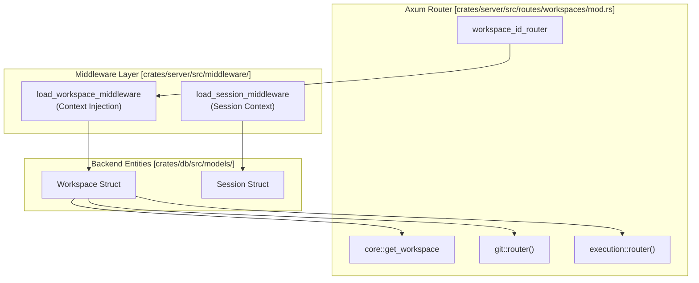
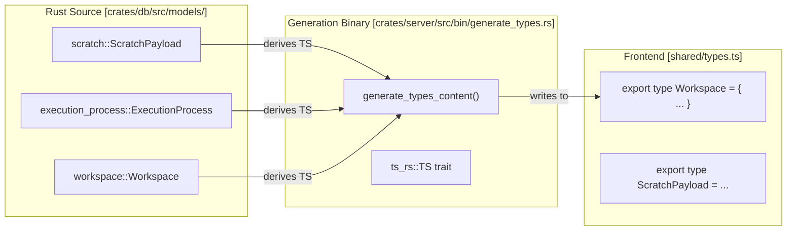

# API Reference

Relevant source files

The following files were used as context for generating this wiki page:

- [crates/db/src/models/scratch.rs](crates/db/src/models/scratch.rs)
- [crates/server/src/bin/generate_types.rs](crates/server/src/bin/generate_types.rs)
- [crates/server/src/routes/sessions/mod.rs](crates/server/src/routes/sessions/mod.rs)
- [crates/server/src/routes/workspaces/core.rs](crates/server/src/routes/workspaces/core.rs)
- [crates/server/src/routes/workspaces/execution.rs](crates/server/src/routes/workspaces/execution.rs)
- [crates/server/src/routes/workspaces/integration.rs](crates/server/src/routes/workspaces/integration.rs)
- [crates/server/src/routes/workspaces/links.rs](crates/server/src/routes/workspaces/links.rs)
- [crates/server/src/routes/workspaces/mod.rs](crates/server/src/routes/workspaces/mod.rs)
- [crates/server/src/routes/workspaces/repos.rs](crates/server/src/routes/workspaces/repos.rs)
- [crates/server/src/routes/workspaces/streams.rs](crates/server/src/routes/workspaces/streams.rs)
- [shared/types.ts](shared/types.ts)

This document provides a comprehensive reference for Vibe Kanban's HTTP REST API, WebSocket streaming endpoints, and data type schemas. It serves as a technical specification for integrating with the Vibe Kanban backend.

For implementation details of specific API handlers, see [Backend Services](#4). For information about frontend data fetching patterns, see [Frontend Application](#5). For details on the executor configuration schemas, see [Executor System](#3).

## Overview

The Vibe Kanban API is built on the Axum web framework [crates/server/src/routes/mod.rs:4-10]() and provides:

- **REST API**: Conventional HTTP endpoints for CRUD operations on workspaces, sessions, repositories, configuration, and more [crates/server/src/routes/workspaces/mod.rs:24-61]().
- **WebSocket Streams**: Real-time streaming endpoints for live updates to workspace state, execution logs, and diffs [crates/server/src/routes/workspaces/streams.rs:27-53]().
- **MCP Server**: A Model Context Protocol (MCP) interface for external tools to interact with the Kanban system [crates/server/src/bin/generate_types.rs:98-100]().
- **Type-Safe Contracts**: TypeScript types automatically generated from Rust structs using `ts-rs`, ensuring frontend-backend type consistency [shared/types.ts:1-11]().

All API responses follow a standardized `ApiResponse<T>` wrapper format [shared/types.ts:221](). Request/call authorization is handled via a multi-layered middleware system, including specific handlers for workspace and session context loading [crates/server/src/routes/workspaces/mod.rs:39-42]().

Sources: [crates/server/src/routes/mod.rs:1-87](), [shared/types.ts:1-11](), [crates/server/src/routes/workspaces/mod.rs:24-61](), [crates/server/src/routes/workspaces/streams.rs:27-53]()

---

## REST API Architecture

### API Route Organization

Vibe Kanban uses a modular routing structure where specialized routers are merged into a primary router collection. The workspace router, for instance, handles a wide array of sub-resources [crates/server/src/routes/workspaces/mod.rs:24-61]().

| Route Prefix | Purpose | Primary Source |
| :--- | :--- | :--- |
| `/workspaces` | Workspace lifecycle, Git operations, and integration | [crates/server/src/routes/workspaces/mod.rs:44]() |
| `/sessions` | Agent interaction contexts and execution follow-ups | [crates/server/src/routes/sessions/mod.rs:4-10]() |
| `/workspaces/{id}/repos` | Managing repositories attached to a workspace | [crates/server/src/routes/workspaces/repos.rs:28-30]() |
| `/workspaces/{id}/execution` | Controlling dev servers, cleanup, and archive scripts | [crates/server/src/routes/workspaces/execution.rs:29-35]() |
| `/workspaces/{id}/links` | Linking local workspaces to remote cloud projects | [crates/server/src/routes/workspaces/links.rs:105-116]() |
| `/workspaces/{id}/integration`| Opening editors and running agent-specific setup | [crates/server/src/routes/workspaces/integration.rs:52-58]() |

### Request Lifecycle and Middleware

The API enforces context through middleware. For example, `load_workspace_middleware` ensures that the `Workspace` entity is loaded into the request extensions before reaching handlers like `get_workspace` or `start_dev_server` [crates/server/src/routes/workspaces/mod.rs:39-42](). This ensures that all operations are performed against a valid, existing workspace.

Sources: [crates/server/src/routes/workspaces/mod.rs:25-61](), [crates/server/src/routes/sessions/mod.rs:34](), [crates/server/src/routes/workspaces/execution.rs:38-41]()

---

## Child Pages Reference

For detailed endpoint lists and schemas, please refer to the following child pages:

### [REST API Endpoints](#10.1)
Complete list of HTTP endpoints including:
- **Workspaces**: Core lifecycle management including creation, update, and deletion [crates/server/src/routes/workspaces/core.rs:29-103]().
- **Sessions**: Creating agent sessions and handling follow-up attempts with `CreateFollowUpAttempt` [crates/server/src/routes/sessions/mod.rs:108-115]().
- **Integration**: Commands to open local paths in editors like VS Code or Cursor [crates/server/src/routes/workspaces/integration.rs:92-139]().

### [WebSocket Streams](#10.2)
Documentation of real-time communication channels:
- **Workspaces Stream**: Streaming workspace updates via `stream_workspaces_ws` [crates/server/src/routes/workspaces/streams.rs:27-38]().
- **Diff Stream**: Live git diff updates for a specific workspace via `stream_workspace_diff_ws` [crates/server/src/routes/workspaces/streams.rs:40-53]().

### [Data Types and Schemas](#10.3)
Reference of shared data types:
- **Core Models**: `Workspace` [shared/types.ts:155](), `Session` [shared/types.ts:212](), `ExecutionProcess` [shared/types.ts:214]().
- **Scratch/Draft Data**: UI persistence types like `UiPreferencesData` [crates/db/src/models/scratch.rs:101-153]() and `DraftWorkspaceData` [crates/db/src/models/scratch.rs:177-187]().

---

## Type Generation System

Vibe Kanban maintains a "Single Source of Truth" for data structures by defining them in Rust and exporting them to TypeScript using the `generate_types.rs` utility [crates/server/src/bin/generate_types.rs:7-12]().

### Type Synchronization Flow

The `generate_types.rs` binary collects declarations from database models [crates/server/src/bin/generate_types.rs:14-57](), utility types like `ApprovalInfo` [crates/server/src/bin/generate_types.rs:58](), and API-specific request types like `AddWorkspaceRepoRequest` [crates/server/src/bin/generate_types.rs:119]().

Sources: [crates/server/src/bin/generate_types.rs:1-133](), [shared/types.ts:1-11](), [crates/db/src/models/scratch.rs:21-26]()

---

## Standard Response Format

The backend utilizes a consistent response pattern to ensure the frontend can reliably handle both data and errors.

- **Success**: `200 OK` with a JSON body containing the requested data wrapped in `ApiResponse<T>` [crates/server/src/routes/sessions/mod.rs:89]().
- **Error Handling**: Custom `ApiError` enum maps various internal errors (Database, Workspace, Session) to appropriate HTTP status codes and standardized error messages [crates/server/src/routes/sessions/mod.rs:157-161]().
- **Validation**: Handlers like `follow_up` perform logic checks (e.g., executor mismatch) and return structured errors before execution begins [crates/server/src/routes/sessions/mod.rs:148-162]().

Sources: [crates/server/src/routes/sessions/mod.rs:50-106](), [crates/server/src/bin/generate_types.rs:66](), [crates/db/src/models/scratch.rs:10-18]()