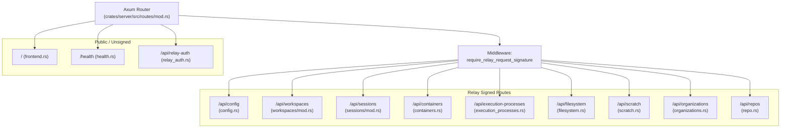
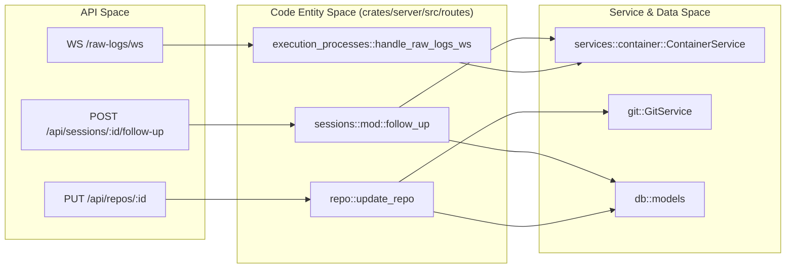

# REST API Endpoints

Relevant source files

The following files were used as context for generating this wiki page:

- [Cargo.toml](Cargo.toml)
- [crates/deployment/src/lib.rs](crates/deployment/src/lib.rs)
- [crates/local-deployment/src/lib.rs](crates/local-deployment/src/lib.rs)
- [crates/relay-control/Cargo.toml](crates/relay-control/Cargo.toml)
- [crates/relay-tunnel/Cargo.lock](crates/relay-tunnel/Cargo.lock)
- [crates/relay-tunnel/Cargo.toml](crates/relay-tunnel/Cargo.toml)
- [crates/server/src/error.rs](crates/server/src/error.rs)
- [crates/server/src/middleware/error_logging.rs](crates/server/src/middleware/error_logging.rs)
- [crates/server/src/middleware/mod.rs](crates/server/src/middleware/mod.rs)
- [crates/server/src/middleware/origin.rs](crates/server/src/middleware/origin.rs)
- [crates/server/src/routes/config.rs](crates/server/src/routes/config.rs)
- [crates/server/src/routes/mod.rs](crates/server/src/routes/mod.rs)
- [crates/server/src/routes/sessions/mod.rs](crates/server/src/routes/sessions/mod.rs)
- [crates/server/src/routes/workspaces/core.rs](crates/server/src/routes/workspaces/core.rs)
- [crates/server/src/routes/workspaces/execution.rs](crates/server/src/routes/workspaces/execution.rs)
- [crates/server/src/routes/workspaces/integration.rs](crates/server/src/routes/workspaces/integration.rs)
- [crates/server/src/routes/workspaces/links.rs](crates/server/src/routes/workspaces/links.rs)
- [crates/server/src/routes/workspaces/mod.rs](crates/server/src/routes/workspaces/mod.rs)
- [crates/server/src/routes/workspaces/repos.rs](crates/server/src/routes/workspaces/repos.rs)
- [crates/server/src/routes/workspaces/streams.rs](crates/server/src/routes/workspaces/streams.rs)
- [crates/services/src/services/mod.rs](crates/services/src/services/mod.rs)

This document provides a comprehensive reference for all REST API endpoints in the Vibe Kanban backend server. The API is implemented using **Axum** and follows RESTful conventions with JSON request/response bodies wrapped in a standardized `ApiResponse<T>` envelope type. [crates/server/src/error.rs:29-29](), [crates/server/src/routes/mod.rs:36-86]()

For real-time data streaming over WebSockets, see [10.2 WebSocket Streams](). For detailed information about request/response data structures, see [10.3 Data Types and Schemas]().

---

## API Architecture Overview

The REST API is organized into functional route modules. The server uses Axum's routing system with specialized middleware for model loading (Sessions, Workspaces) and security (Relay signature validation). [crates/server/src/routes/mod.rs:37-78]()

**API Route Hierarchy**

**Sources:** [crates/server/src/routes/mod.rs:36-86](), [crates/server/src/routes/repo.rs:1-20]()

---

## System Configuration & Info

Endpoints for retrieving system metadata, environment details, and managing user preferences.

### Get System Info
`GET /api/info`

Returns comprehensive information about the current deployment, including OS details via the `Environment` struct, login status, and executor capabilities. [crates/server/src/routes/config.rs:106-178]()

### Update Configuration
`PUT /api/config`

Updates the system configuration (e.g., git branch prefix, analytics settings). It validates the git branch prefix using `git::is_valid_branch_prefix` and persists changes to the filesystem via `save_config_to_file`. [crates/server/src/routes/config.rs:180-205]()

**Sources:** [crates/server/src/routes/config.rs:106-205](), [crates/local-deployment/src/lib.rs:120-120]()

---

## Repository Endpoints

These endpoints manage the lifecycle of local git repositories registered within the system.

### Register Repository
`POST /api/repos`

Registers an existing local directory as a repository in the system. [crates/server/src/routes/repo.rs:50-64]()

### Get Repository Details
`GET /api/repos/:id`

Fetches metadata for a specific repository. [crates/server/src/routes/repo.rs:131-140]()

### Git Operations
| Endpoint | Method | Description |
|----------|--------|-------------|
| `/api/repos/:id/branches` | `GET` | Lists all local and remote branches for the repo. [crates/server/src/routes/repo.rs:83-94]() |
| `/api/repos/:id/remotes` | `GET` | Lists configured git remotes. [crates/server/src/routes/repo.rs:96-107]() |
| `/api/repos/:id/open-in-editor` | `POST` | Opens the repository in the user's configured IDE. [crates/server/src/routes/repo.rs:151-196]() |
| `/api/repos/:id/search` | `GET` | Performs a file search using the `file_search_cache`. [crates/server/src/routes/repo.rs:198-225]() |

**Sources:** [crates/server/src/routes/repo.rs:50-225]()

---

## Workspace & Execution Endpoints

Workspaces represent isolated development environments. Execution endpoints manage background scripts and dev servers.

### Workspace Core Operations
`GET /api/workspaces` - List all workspaces. [crates/server/src/routes/workspaces/core.rs:29-35]()
`PUT /api/workspaces/:id` - Update workspace status (archive, pin, rename). [crates/server/src/routes/workspaces/core.rs:43-88]()
`DELETE /api/workspaces/:id` - Deletes the workspace and its associated git worktrees. [crates/server/src/routes/workspaces/core.rs:99-183]()

### Workspace Execution Control
`POST /api/workspaces/:id/execution/dev-server/start`

Starts the dev server scripts configured for the repositories in the workspace. It automatically stops existing dev servers before starting new ones. [crates/server/src/routes/workspaces/execution.rs:38-137]()

`POST /api/workspaces/:id/execution/stop`

Stops all active execution processes in the workspace container. [crates/server/src/routes/workspaces/execution.rs:139-155]()

**Sources:** [crates/server/src/routes/workspaces/core.rs:29-183](), [crates/server/src/routes/workspaces/execution.rs:38-155]()

---

## Session & Agent Interaction Endpoints

Sessions manage the conversation history and state between the user and the AI coding agents.

### Create Session
`POST /api/sessions`

Initializes a new interaction context within a workspace. [crates/server/src/routes/sessions/mod.rs:65-90]()

### Follow-up (Agent Execution)
`POST /api/sessions/:id/follow-up`

Sends a prompt to the coding agent. This endpoint triggers the actual execution logic, starting a container if necessary and an `ExecutionProcess`. [crates/server/src/routes/sessions/mod.rs:124-219]()

**Logic Flow:**
1. Validates the workspace and ensures the container is running via `ContainerService`. [crates/server/src/routes/sessions/mod.rs:140-143]()
2. Validates executor profile compatibility. [crates/server/src/routes/sessions/mod.rs:148-162]()
3. If `retry_process_id` is provided, performs a git reset to the state of that process via `reset_session_to_process`. [crates/server/src/routes/sessions/mod.rs:169-176]()
4. Calls `deployment.container().start_execution()` to begin the background agent process. [crates/server/src/routes/sessions/mod.rs:212-219]()

**Sources:** [crates/server/src/routes/sessions/mod.rs:65-219]()

---

## Execution Process & Logs

Endpoints for monitoring individual task executions and retrieving logs.

### Get Execution Process
`GET /api/execution-processes/:id`

Returns the current status and metadata of a specific execution process. [crates/server/src/routes/execution_processes.rs:37-42]()

### WebSocket Log Streams
| Endpoint | Type | Description |
|----------|------|-------------|
| `/api/execution-processes/:id/raw-logs/ws` | WS | Streams raw `stdout`/`stderr` wrapped in `LogMsg`. [crates/server/src/routes/execution_processes.rs:44-58]() |
| `/api/execution-processes/:id/normalized-logs/ws` | WS | Streams structured logs parsed by the executor's normalization logic. [crates/server/src/routes/execution_processes.rs:138-166]() |

**Sources:** [crates/server/src/routes/execution_processes.rs:37-166]()

---

## Data Flow & Entity Mapping

The following diagram bridges the high-level API concepts to the internal code entities and services.

**Sources:** [crates/server/src/routes/sessions/mod.rs:124-219](), [crates/server/src/routes/execution_processes.rs:60-136](), [crates/server/src/routes/repo.rs:142-149]()

---

## UI State Persistence (Scratch)

The "Scratch" system is used to persist UI state that doesn't belong in the primary domain models, such as panel sizes, expanded tree nodes, and filter preferences.

| Endpoint | Method | Purpose |
|----------|--------|---------|
| `/api/scratch` | `GET` | Retrieve all scratch data for the user. [crates/server/src/routes/scratch.rs]() |
| `/api/scratch/:id` | `PUT` | Update a specific scratch record. [crates/server/src/routes/scratch.rs]() |

The `EventService` monitors the `scratch` table in SQLite and pushes updates to clients via the WebSocket event stream when UI state changes. [crates/local-deployment/src/lib.rs:141-147]()

**Sources:** [crates/local-deployment/src/lib.rs:141-147](), [crates/server/src/routes/mod.rs:50-50]()