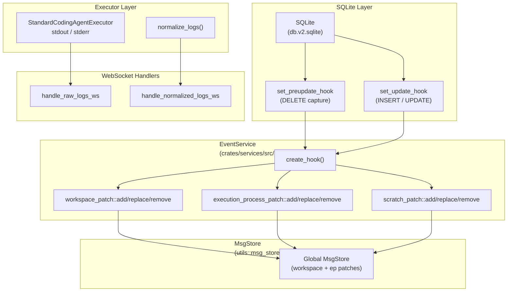
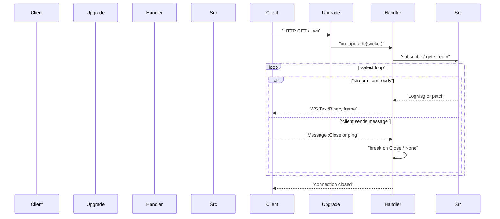
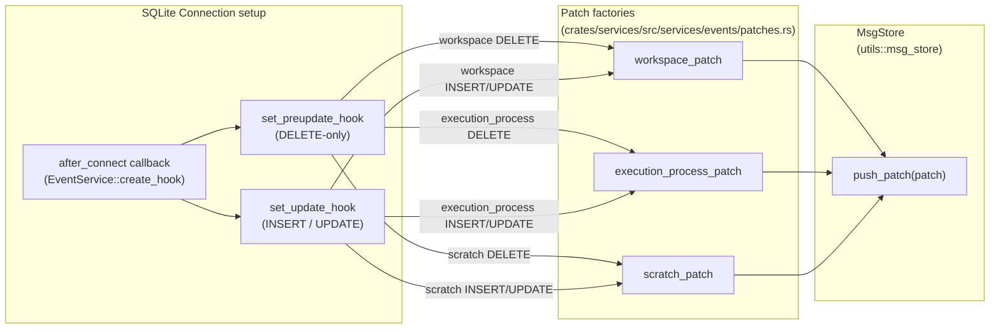
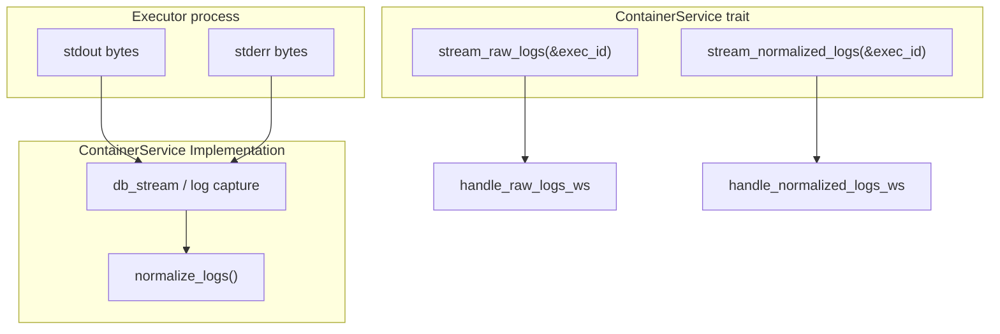

# WebSocket Streams

Relevant source files

The following files were used as context for generating this wiki page:

- [Cargo.toml](Cargo.toml)
- [crates/relay-control/Cargo.toml](crates/relay-control/Cargo.toml)
- [crates/relay-tunnel/Cargo.lock](crates/relay-tunnel/Cargo.lock)
- [crates/relay-tunnel/Cargo.toml](crates/relay-tunnel/Cargo.toml)
- [crates/server/src/middleware/error_logging.rs](crates/server/src/middleware/error_logging.rs)
- [crates/server/src/middleware/mod.rs](crates/server/src/middleware/mod.rs)
- [crates/server/src/middleware/origin.rs](crates/server/src/middleware/origin.rs)
- [crates/server/src/routes/execution_processes.rs](crates/server/src/routes/execution_processes.rs)
- [crates/server/src/routes/mod.rs](crates/server/src/routes/mod.rs)
- [crates/services/src/services/events.rs](crates/services/src/services/events.rs)
- [packages/web-core/src/shared/components/VirtualizedProcessLogs.tsx](packages/web-core/src/shared/components/VirtualizedProcessLogs.tsx)
- [packages/web-core/src/shared/hooks/useJsonPatchWsStream.ts](packages/web-core/src/shared/hooks/useJsonPatchWsStream.ts)
- [packages/web-core/src/shared/hooks/useLogStream.ts](packages/web-core/src/shared/hooks/useLogStream.ts)

This page documents every WebSocket endpoint exposed by the vibe-kanban backend server: their paths, query parameters, message formats, and connection lifecycle. It covers the underlying event propagation machinery that feeds those streams.

For information about the HTTP REST endpoints that complement these streams, see [10.1](). For the `EventService` and `MsgStore` internals in broader context, see [4.7](). For how normalized log entries are produced by executors, see [3.4]().

---

## Architecture Overview

All WebSocket streams follow one of two source patterns:

| Pattern | Used by | Source |
|---|---|---|
| **Event-driven patch** | Workspaces, Execution Processes | SQLite update hook → `MsgStore` → subscriber stream |
| **Live log stream** | Raw logs, Normalized logs | `MsgStore` keyed by `execution_process_id` |

**Event propagation pipeline diagram**

Sources: [crates/services/src/services/events.rs:27-42](), [crates/server/src/routes/execution_processes.rs:44-63](), [crates/services/src/services/events.rs:59-117]()

---

## Common Connection Lifecycle

Every WebSocket handler uses a `tokio::select!` loop pattern to handle simultaneous stream transmission and client control messages (like `Close`).

Sources: [crates/server/src/routes/execution_processes.rs:106-131](), [crates/server/src/routes/execution_processes.rs:173-198]()

All endpoints use `SignedWsUpgrade` and `MaybeSignedWebSocket` from the server middleware. These wrappers handle relay-mode authentication transparently.

Sources: [crates/server/src/routes/execution_processes.rs:23-27](), [crates/server/src/routes/execution_processes.rs:44-48]()

---

## Endpoint Reference

The backend router [crates/server/src/routes/mod.rs:36-86]() aggregates these streaming endpoints alongside REST routes.

| Endpoint | Path | Query Parameters | Source pattern |
|---|---|---|---|
| Raw logs | `GET /api/execution-processes/{id}/raw-logs/ws` | — | Live log stream |
| Normalized logs | `GET /api/execution-processes/{id}/normalized-logs/ws` | — | Live log stream |
| Events (Generic) | `GET /api/events/ws` | `session_id` | Event-driven patch |
| SSH Session | `GET /api/ssh-session` | — | Direct stream |

Sources: [crates/server/src/routes/mod.rs:42-56](), [crates/server/src/routes/execution_processes.rs:44-58](), [crates/server/src/routes/execution_processes.rs:138-142]()

---

## Raw Logs Stream

**Handler:** `stream_raw_logs_ws` / `handle_raw_logs_ws` [crates/server/src/routes/execution_processes.rs:44-63]()

Streams the unprocessed stdout and stderr bytes from a running or completed execution process. Each output chunk is wrapped in a `ConversationPatch` JSON Patch operation so the client can append it to an array at a stable index.

**Source:** `ContainerService::stream_raw_logs(&exec_id)` returns a stream of `LogMsg`. The handler converts each item on-the-fly:

| `LogMsg` variant | Patch produced |
|---|---|
| `LogMsg::Stdout(content)` | `ConversationPatch::add_stdout(index, content)` |
| `LogMsg::Stderr(content)` | `ConversationPatch::add_stderr(index, content)` |
| `LogMsg::Finished` | Sentinel message; loop exits |

The index is a monotonically increasing counter local to each connection, managed via `AtomicUsize`. [crates/server/src/routes/execution_processes.rs:87-103]()

**Message format:** Each frame is a JSON Patch (array), where each operation uses a `PatchType` envelope.

Sources: [crates/server/src/routes/execution_processes.rs:44-63](), [crates/server/src/routes/execution_processes.rs:87-103](), [packages/web-core/src/shared/hooks/useLogStream.ts:102-122]()

---

## Normalized Logs Stream

**Handler:** `stream_normalized_logs_ws` / `handle_normalized_logs_ws` [crates/server/src/routes/execution_processes.rs:138-166]()

Streams agent output that has been parsed and normalized by the executor's normalization layer into structured entries. This is the stream the frontend uses to render the conversation UI.

**Source:** `ContainerService::stream_normalized_logs(&exec_id)` returns a `Stream<Item = LogMsg>`. [crates/server/src/routes/execution_processes.rs:144-147]()

**Message format:** Each frame is a JSON Patch containing structured data like assistant messages, tool uses, or thinking blocks.

Sources: [crates/server/src/routes/execution_processes.rs:138-147](), [crates/server/src/routes/execution_processes.rs:168-171]()

---

## Frontend Integration

The frontend consumes these streams using specialized React hooks that manage connection lifecycle, reconnection with exponential backoff, and state updates via `immer`.

### `useLogStream`
Used for the terminal-like view of raw process output. It maintains a `logs` array state and handles `finished` signals to stop reconnection attempts.

- **File:** `packages/web-core/src/shared/hooks/useLogStream.ts` [packages/web-core/src/shared/hooks/useLogStream.ts:12-12]()
- **Reconnection:** Retries up to 6 times with exponential backoff (max 1.5s delay). [packages/web-core/src/shared/hooks/useLogStream.ts:148-154]()
- **Deduplication:** Tracks `isReconnect` via `retryCountRef` to replace (not append) logs on the first message after a drop, avoiding duplicates from server history replay. [packages/web-core/src/shared/hooks/useLogStream.ts:64-65]()
- **Rendering:** Logs are rendered using `VirtualizedProcessLogs`, which uses `@virtuoso.dev/message-list` for efficient display of large log volumes. [packages/web-core/src/shared/components/VirtualizedProcessLogs.tsx:6-10]()

### `useJsonPatchWsStream`
A generic hook for streams that deliver RFC 6902 JSON Patches. It applies incoming patches to a local state using `produce` from `immer`.

- **File:** `packages/web-core/src/shared/hooks/useJsonPatchWsStream.ts` [packages/web-core/src/shared/hooks/useJsonPatchWsStream.ts:33-33]()
- **Patch Application:** Uses `applyUpsertPatch` inside an `immer` `produce` call to update the local `dataRef`. [packages/web-core/src/shared/hooks/useJsonPatchWsStream.ts:138-140]()
- **Connection Management:** Uses `openLocalApiWebSocket` to establish the connection through the local transport layer. [packages/web-core/src/shared/hooks/useJsonPatchWsStream.ts:105-105]()

---

## Event System Internals

The `EventService` manages database-level change detection and propagates those changes to subscribers.

**SQLite hook → MsgStore → WebSocket data flow**

**Implementation details:**
- `EventService::create_hook` initializes the SQLite preupdate and update hooks. [crates/services/src/services/events.rs:59-77]()
- The preupdate hook handles `DELETE` operations to capture old primary keys before they are purged, supporting `workspaces`, `execution_processes`, and `scratch` tables. [crates/services/src/services/events.rs:79-117]()
- The update hook handles `INSERT` and `UPDATE`, spawning tasks to fetch the new record state (e.g., via `ExecutionProcess::find_by_rowid`) and push patches to `MsgStore`. [crates/services/src/services/events.rs:119-150]()

Sources: [crates/services/src/services/events.rs:59-150](), [crates/services/src/services/events.rs:16-24]()

---

## Log Stream Internals

The diagram below shows how live executor output reaches a WebSocket client.

**Per-process log pipeline**

Sources: [crates/server/src/routes/execution_processes.rs:74-85](), [crates/server/src/routes/execution_processes.rs:144-147]()