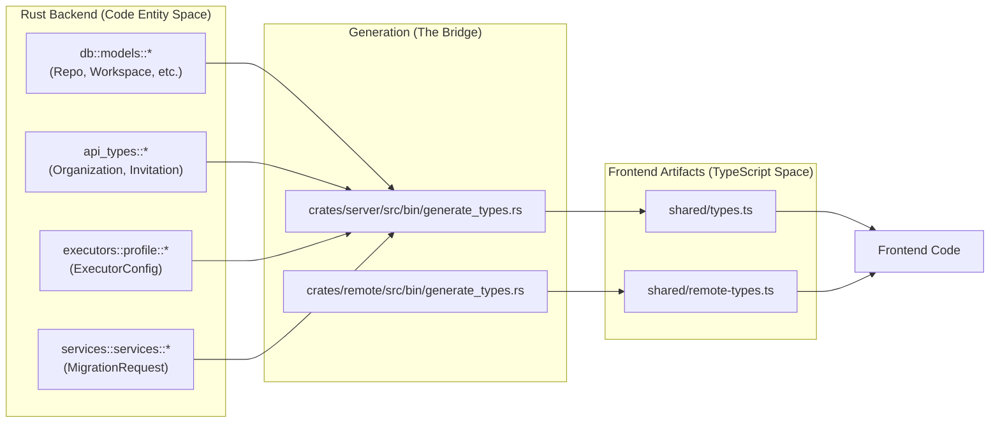
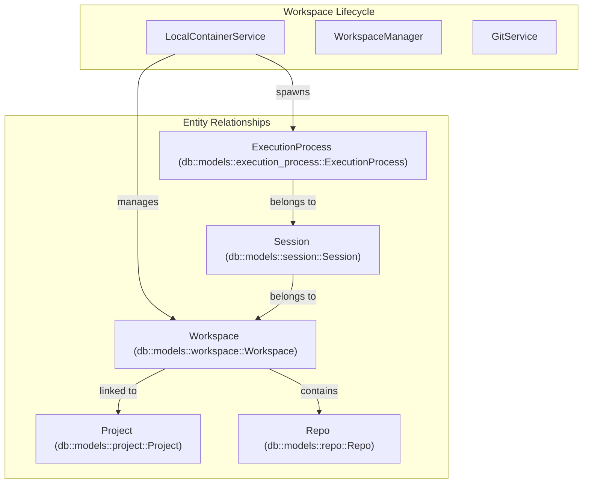
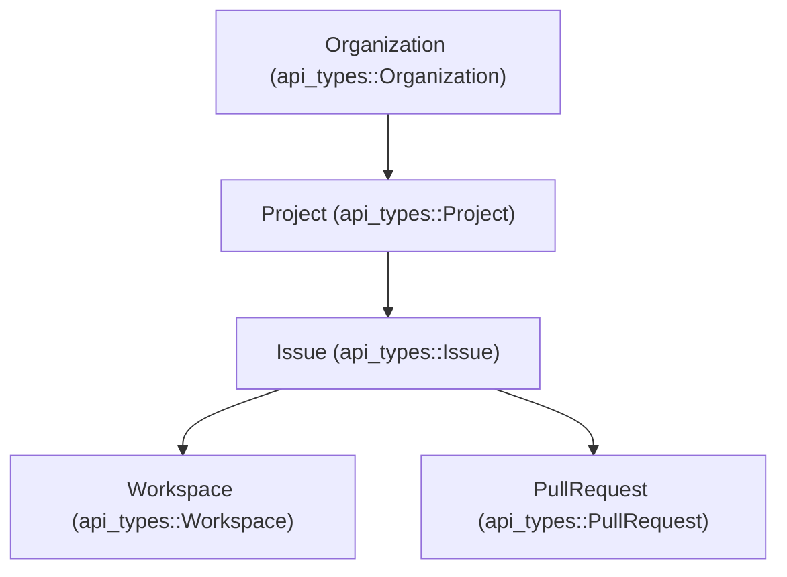

# Data Types and Schemas

<details>
<summary>Relevant source files</summary>

The following files were used as context for generating this wiki page:

- [crates/api-types/Cargo.toml](crates/api-types/Cargo.toml)
- [crates/api-types/src/issue.rs](crates/api-types/src/issue.rs)
- [crates/db/src/models/scratch.rs](crates/db/src/models/scratch.rs)
- [crates/remote/.sqlx/query-a5d1aeb3ce62a3f286a2a4bddc38c3f5caf2eb556236b561b68483b17dc24cfd.json](crates/remote/.sqlx/query-a5d1aeb3ce62a3f286a2a4bddc38c3f5caf2eb556236b561b68483b17dc24cfd.json)
- [crates/remote/.sqlx/query-d2275416ba3ddb1bbaf929787b5df4c736084582ddebdbe9f4a4aa6853727484.json](crates/remote/.sqlx/query-d2275416ba3ddb1bbaf929787b5df4c736084582ddebdbe9f4a4aa6853727484.json)
- [crates/remote/src/bin/generate_types.rs](crates/remote/src/bin/generate_types.rs)
- [crates/remote/src/db/issues.rs](crates/remote/src/db/issues.rs)
- [crates/remote/src/routes/issues.rs](crates/remote/src/routes/issues.rs)
- [crates/remote/src/routes/mod.rs](crates/remote/src/routes/mod.rs)
- [crates/remote/src/routes/workspaces.rs](crates/remote/src/routes/workspaces.rs)
- [crates/remote/src/shape_routes.rs](crates/remote/src/shape_routes.rs)
- [crates/server/src/bin/generate_types.rs](crates/server/src/bin/generate_types.rs)
- [crates/server/src/routes/remote/issues.rs](crates/server/src/routes/remote/issues.rs)
- [crates/services/src/services/remote_client.rs](crates/services/src/services/remote_client.rs)
- [shared/remote-types.ts](shared/remote-types.ts)
- [shared/types.ts](shared/types.ts)

</details>


This page provides a comprehensive reference for all shared data types and schemas used throughout the Vibe Kanban system. These types form the contract between the Rust backend and TypeScript frontend, ensuring type safety across the entire application.

---

## Overview

Vibe Kanban uses a **type generation system** to maintain consistency between Rust backend models and TypeScript frontend types. All types are defined in Rust using the `ts-rs` and `schemars` crates, then automatically exported to `shared/types.ts` (for local development) and `shared/remote-types.ts` (for the remote service) for use in the frontend. This ensures compile-time type safety on both sides of the API boundary.

The type system covers:
- **Core entities**: `Workspace`, `Session`, `ExecutionProcess`, `Repo`, `Project`.
- **Scratch/draft data**: Temporary UI state and draft workspace configurations.
- **Remote service types**: `Organization`, `Issue`, `PullRequest`, `Notification`.
- **Request/response types**: API payloads for creating and updating entities.
- **Configuration types**: User settings, executor profiles, executor-specific options.
- **Log types**: Normalized log entries and streaming data structures.

---

## Type Generation System

### Generation Flow

The `generate_types` binary acts as the bridge between the Rust "Code Entity Space" and the TypeScript "Natural Language/Frontend Space".



**Sources:** [crates/server/src/bin/generate_types.rs:7-135](), [crates/remote/src/bin/generate_types.rs:30-61](), [shared/types.ts:1-5]()

The `generate_types.rs` binary iterates through all Rust types decorated with `#[derive(TS)]` and generates TypeScript declarations using the `ts-rs` library [crates/server/src/bin/generate_types.rs:13-135](). 

### Type Annotations

Rust types use key derive macros to participate in this system:
- **`#[derive(TS)]`**: Generates TypeScript type declaration via `ts-rs` [crates/server/src/bin/generate_types.rs:5-5]().
- **`#[derive(JsonSchema)]`**: Generates JSON Schema for validation (used for executor configs and tool definitions) [crates/server/src/bin/generate_types.rs:3-3]().
- **`#[derive(FromRow)]`**: Allows `sqlx` to map database rows directly to these structures [crates/api-types/Cargo.toml:11-11]().

Example of a bridged entity mapping to TypeScript in [shared/types.ts:155-155]():
```typescript
export type Workspace = { id: string, task_id: string | null, container_ref: string | null, branch: string, setup_completed_at: string | null, created_at: string, updated_at: string, archived: boolean, pinned: boolean, name: string | null, worktree_deleted: boolean, };
```

**Sources:** [crates/server/src/bin/generate_types.rs:46-47](), [shared/types.ts:155-155]()

---

## Core Entity Types

These types represent the primary database models managed by the backend services.

### Data Flow and Ownership



**Sources:** [crates/server/src/bin/generate_types.rs:46-51]()

### Workspace

The `Workspace` type represents an isolated development environment typically backed by a git worktree.

| Field | Type | Description |
|-------|------|-------------|
| `id` | `string` | Unique workspace identifier (UUID) |
| `task_id` | `string?` | Optional linked task/issue ID |
| `container_ref` | `string?` | File path or reference to workspace directory |
| `branch` | `string` | Git branch name for this workspace |
| `setup_completed_at` | `string?` | Timestamp when setup scripts completed |
| `archived` | `boolean` | Whether workspace is archived |
| `pinned` | `boolean` | Whether workspace is pinned in UI |
| `worktree_deleted` | `boolean` | Whether git worktree has been cleaned up |

**TypeScript Definition:** [shared/types.ts:155-155]()
**Rust Definition:** `db::models::workspace::Workspace` [crates/server/src/bin/generate_types.rs:46-46]()

### Session

The `Session` type represents a specific conversation or interaction context with a coding agent.

| Field | Type | Description |
|-------|------|-------------|
| `id` | `string` | Unique session identifier |
| `workspace_id` | `string` | Parent workspace |
| `agent_working_dir` | `string?` | Specific directory for agent execution |

**TypeScript Definition:** [shared/types.ts:157-157]()
**Sources:** [crates/server/src/bin/generate_types.rs:48-48]()

### ExecutionProcess

Tracks individual task executions, including setup scripts, coding agents, and cleanup scripts.

| Field | Type | Description |
|-------|------|-------------|
| `id` | `string` | Unique process identifier |
| `session_id` | `string` | Parent session |
| `run_reason` | `ExecutionProcessRunReason` | Why this process was started (e.g., `CodingAgent`, `SetupScript`) |
| `status` | `ExecutionProcessStatus` | `Running`, `Completed`, `Failed`, `Killed` |

**TypeScript Definition:** [shared/types.ts:158-158]()
**Enums:** [shared/types.ts:160-161]()
**Sources:** [crates/server/src/bin/generate_types.rs:49-51]()

---

## Remote and Cloud Types

The remote service (Vibe Kanban Cloud) uses a separate set of schemas for multi-user collaboration and issue tracking. These are defined in the `api-types` crate and synchronized via `shared/remote-types.ts`.

### Organization and Issues



**Sources:** [shared/remote-types.ts:7-57](), [crates/remote/src/bin/generate_types.rs:3-15]()

### Key Remote Entities

| Entity | Description | Reference |
|--------|-------------|-----------|
| `Project` | Container for issues and organization-wide settings. | [shared/remote-types.ts:7-7]() |
| `Issue` | The unit of work (Task) in the Kanban board. | [shared/remote-types.ts:23-23]() |
| `Workspace` | Cloud-side metadata for a local developer environment. | [shared/remote-types.ts:17-17]() |
| `PullRequest` | Metadata for git PRs linked to issues. | [shared/remote-types.ts:57-57]() |
| `Notification` | Real-time alerts for issue updates and comments. | [shared/remote-types.ts:9-9]() |

**Sources:** [shared/remote-types.ts:7-57](), [crates/api-types/src/issue.rs:1-1]()

---

## Scratch Data Types

The `Scratch` system provides temporary storage for draft data and UI state via the `ScratchPayload` enum [shared/types.ts:145-145]().

### ScratchPayload Variants

| Variant | Data Type | Purpose |
|---------|-----------|---------|
| `DRAFT_WORKSPACE` | `DraftWorkspaceData` | State for new workspace creation [shared/types.ts:35-35]() |
| `DRAFT_FOLLOW_UP` | `DraftFollowUpData` | Queued follow-up message for a running agent [shared/types.ts:33-33]() |
| `UI_PREFERENCES` | `UiPreferencesData` | Global UI state (pane sizes, visibility, sidebar state) [shared/types.ts:73-141]() |
| `WORKSPACE_NOTES` | `WorkspaceNotesData` | Per-workspace scratchpad notes [shared/types.ts:59-59]() |
| `PREVIEW_SETTINGS` | `PreviewSettingsData` | Browser preview URL and responsive sizing [shared/types.ts:57-57]() |
| `PROJECT_REPO_DEFAULTS` | `ProjectRepoDefaultsData` | Default repositories/branches for a project [shared/types.ts:143-143]() |

**Sources:** [crates/server/src/bin/generate_types.rs:41-42](), [shared/types.ts:145-147](), [crates/db/src/models/scratch.rs:21-200]()

### UI Preferences Persistence

The `UiPreferencesData` structure persists the "state of the IDE" across reloads:
- `repo_actions`: Preferred git actions per repo [shared/types.ts:77-77]()
- `pane_sizes`: JSON map of resizable UI dimensions [shared/types.ts:89-89]()
- `collapsed_paths`: Map of collapsed folders in the file tree per workspace [shared/types.ts:93-93]()
- `workspace_panel_states`: Visibility and mode of panels per workspace [shared/types.ts:113-113]()
- `workspace_filters`: Sidebar filter preferences (PR status, projects) [shared/types.ts:117-117]()

**Sources:** [shared/types.ts:73-141](), [crates/db/src/models/scratch.rs:101-153]()

---

## Git and Repository Types

### Repo

Represents a git repository registered in the Vibe Kanban system.

| Field | Type | Description |
|-------|------|-------------|
| `id` | `string` | Unique repository identifier |
| `path` | `string` | Absolute path on the local disk [shared/types.ts:7-7]() |
| `display_name` | `string` | User-friendly name for the UI |
| `setup_script` | `string?` | Script run before agent starts [shared/types.ts:7-7]() |
| `dev_server_script` | `string?` | Script to start the preview/dev server [shared/types.ts:7-7]() |

**Sources:** [shared/types.ts:7-7](), [crates/server/src/bin/generate_types.rs:14-14]()

### SearchResult

Used for repository and file discovery within the system, particularly in the workspace creation flow.

| Field | Type | Description |
|-------|------|-------------|
| `path` | `string` | File or directory path [shared/types.ts:13-13]() |
| `is_file` | `boolean` | Whether the result is a file [shared/types.ts:13-13]() |
| `match_type` | `SearchMatchType` | `FileName`, `DirectoryName`, or `FullPath` [shared/types.ts:19-19]() |
| `score` | `bigint` | Ranking score based on git history frequency/recency [shared/types.ts:17-17]() |

**Sources:** [shared/types.ts:13-19](), [crates/server/src/bin/generate_types.rs:17-18]()