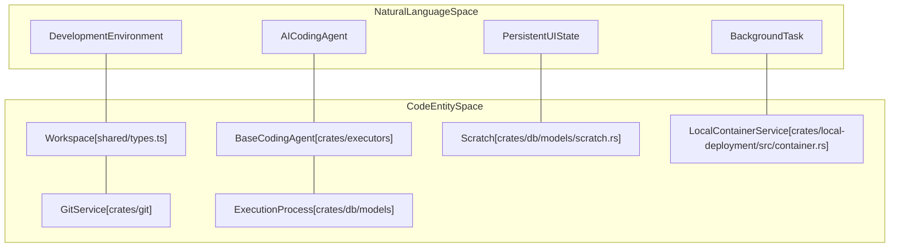
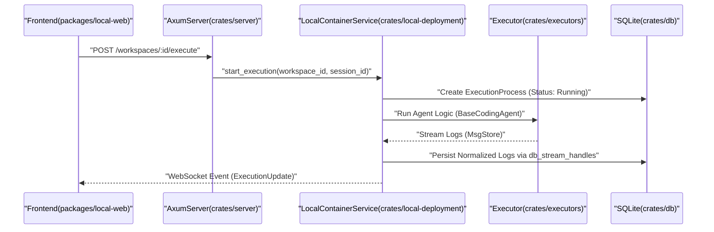

# Glossary

Relevant source files

The following files were used as context for generating this wiki page:

- [.github/actions/cargo-checks-common-setup/action.yml](.github/actions/cargo-checks-common-setup/action.yml)
- [.github/actions/setup-node/action.yml](.github/actions/setup-node/action.yml)
- [.github/workflows/pre-release.yml](.github/workflows/pre-release.yml)
- [.github/workflows/publish.yml](.github/workflows/publish.yml)
- [.github/workflows/relay-deploy-dev.yml](.github/workflows/relay-deploy-dev.yml)
- [.github/workflows/relay-deploy-prod.yml](.github/workflows/relay-deploy-prod.yml)
- [.github/workflows/relay-release.yml](.github/workflows/relay-release.yml)
- [.github/workflows/remote-deploy-dev.yml](.github/workflows/remote-deploy-dev.yml)
- [.github/workflows/remote-deploy-prod.yml](.github/workflows/remote-deploy-prod.yml)
- [.github/workflows/remote-release.yml](.github/workflows/remote-release.yml)
- [.github/workflows/test.yml](.github/workflows/test.yml)
- [AGENTS.md](AGENTS.md)
- [CLAUDE.md](CLAUDE.md)
- [Cargo.toml](Cargo.toml)
- [crates/db/.sqlx/query-1b186dc075846fc1f7270a942afbf82a88806ee6ababdb437ab5e97ddd2122da.json](crates/db/.sqlx/query-1b186dc075846fc1f7270a942afbf82a88806ee6ababdb437ab5e97ddd2122da.json)
- [crates/db/.sqlx/query-2a57b702e52b3cc9bdbc361267985958b11d4493b01a9ab8daedf5d951422897.json](crates/db/.sqlx/query-2a57b702e52b3cc9bdbc361267985958b11d4493b01a9ab8daedf5d951422897.json)
- [crates/db/.sqlx/query-f584dbe0f2f2a4f1e7dcf5b8f675eb2a6d954bb3f148ac0fece10652f05fb49b.json](crates/db/.sqlx/query-f584dbe0f2f2a4f1e7dcf5b8f675eb2a6d954bb3f148ac0fece10652f05fb49b.json)
- [crates/db/src/models/execution_process.rs](crates/db/src/models/execution_process.rs)
- [crates/db/src/models/scratch.rs](crates/db/src/models/scratch.rs)
- [crates/db/src/models/workspace.rs](crates/db/src/models/workspace.rs)
- [crates/executors/default_profiles.json](crates/executors/default_profiles.json)
- [crates/executors/src/executors/amp.rs](crates/executors/src/executors/amp.rs)
- [crates/executors/src/executors/claude.rs](crates/executors/src/executors/claude.rs)
- [crates/executors/src/executors/copilot.rs](crates/executors/src/executors/copilot.rs)
- [crates/executors/src/executors/cursor.rs](crates/executors/src/executors/cursor.rs)
- [crates/executors/src/executors/droid.rs](crates/executors/src/executors/droid.rs)
- [crates/executors/src/executors/gemini.rs](crates/executors/src/executors/gemini.rs)
- [crates/executors/src/executors/mod.rs](crates/executors/src/executors/mod.rs)
- [crates/executors/src/executors/opencode.rs](crates/executors/src/executors/opencode.rs)
- [crates/executors/src/executors/qwen.rs](crates/executors/src/executors/qwen.rs)
- [crates/local-deployment/src/container.rs](crates/local-deployment/src/container.rs)
- [crates/relay-control/Cargo.toml](crates/relay-control/Cargo.toml)
- [crates/relay-tunnel/Cargo.lock](crates/relay-tunnel/Cargo.lock)
- [crates/relay-tunnel/Cargo.toml](crates/relay-tunnel/Cargo.toml)
- [crates/remote/AGENTS.md](crates/remote/AGENTS.md)
- [crates/server/src/bin/generate_types.rs](crates/server/src/bin/generate_types.rs)
- [crates/server/src/middleware/error_logging.rs](crates/server/src/middleware/error_logging.rs)
- [crates/server/src/middleware/mod.rs](crates/server/src/middleware/mod.rs)
- [crates/server/src/middleware/origin.rs](crates/server/src/middleware/origin.rs)
- [crates/server/src/routes/containers.rs](crates/server/src/routes/containers.rs)
- [crates/server/src/routes/mod.rs](crates/server/src/routes/mod.rs)
- [crates/services/src/services/container.rs](crates/services/src/services/container.rs)
- [crates/utils/src/port_file.rs](crates/utils/src/port_file.rs)
- [shared/schemas/cursor_agent.json](shared/schemas/cursor_agent.json)
- [shared/types.ts](shared/types.ts)

This glossary defines the technical terms, architectural concepts, and domain-specific jargon used within the Vibe Kanban codebase. It serves as a bridge between high-level development concepts and their specific implementations in Rust and TypeScript.

## Core Domain Entities

### Workspace
The primary unit of isolation for development tasks. A Workspace maps to a specific branch and contains one or more git worktrees. It manages the lifecycle of AI agent interactions for a specific feature or fix.
*   **Implementation**: `Workspace` struct in [shared/types.ts:155-155]() and `WorkspaceWithStatus` in [shared/types.ts:157-157]().
*   **Data Flow**: Managed by the `WorkspaceManager` and `WorktreeManager` crates [crates/local-deployment/src/container.rs:62-62]().
*   **Status**: Tracks execution state via `is_running` and `is_errored` flags [shared/types.ts:157-157]().

### Session
A continuous conversation or interaction context between a user and an AI coding agent within a specific Workspace.
*   **Implementation**: `Session` struct referenced in [shared/types.ts:159-159]().
*   **Role**: Groups multiple `ExecutionProcesses` into a coherent history, allowing the agent to maintain context across multiple turns. It also tracks session-level errors via `SessionError` [crates/local-deployment/src/container.rs:22-22]().

### Execution Process
A single, discrete run of an AI agent or a system command. Every time an agent is "started" to perform a task (e.g., "Fix this bug"), a new `ExecutionProcess` is tracked.
*   **Implementation**: Tracked via `ExecutionProcessStatus` and stored in the database [shared/types.ts:157-157]().
*   **Lifecycle**: Transitions through states (`Running`, `Completed`, `Failed`) managed by the `ContainerService` [crates/local-deployment/src/container.rs:16-18]().

### Scratch
A mechanism for persisting ephemeral UI state, drafts, and temporary data that does not belong in the primary relational schema (e.g., a half-written issue description or UI panel positions).
*   **Implementation**: `Scratch` struct and `ScratchPayload` enum in [shared/types.ts:145-149]().
*   **Types**: Includes `DRAFT_ISSUE`, `UI_PREFERENCES`, `PREVIEW_SETTINGS`, and `WORKSPACE_NOTES` defined in `ScratchType` [shared/types.ts:147-147]().
*   **Persistence**: Stored via the `DBService` in the `db` crate [crates/local-deployment/src/container.rs:12-13]().

**Sources**: [shared/types.ts:145-157](), [crates/local-deployment/src/container.rs:12-23](), [crates/local-deployment/src/container.rs:62-62]().

---

## Executor System Terms

### Executor
A backend component that wraps an AI coding agent (e.g., Claude, OpenAI Codex, Gemini, Cursor). It implements the logic to translate user requests into agent actions like file edits or shell commands.
*   **Implementations**: Located in `crates/executors/src/executors/` (e.g., `claude.rs` [crates/executors/src/executors/claude.rs:1-146](), `opencode.rs` [crates/executors/src/executors/opencode.rs:1-46](), `cursor.rs` [crates/executors/src/executors/cursor.rs:1-42](), `amp.rs` [crates/executors/src/executors/amp.rs:22-33]()).
*   **Traits**: Most executors implement `StandardCodingAgentExecutor` [crates/executors/src/executors/claude.rs:41-41]().

### Log Normalization
The process of converting raw, vendor-specific output from different AI agents into a standardized format for the Vibe Kanban UI. This ensures that a file edit from Claude looks the same as one from Cursor in the frontend.
*   **Logic**: Handled by modules like `PlainTextLogProcessor` or specific `normalize_logs.rs` within executor directories [crates/executors/src/executors/claude.rs:47-47]().
*   **Standardization**: Uses `NormalizedEntryType` and `NormalizedEntry` to ensure UI consistency [crates/executors/src/executors/claude.rs:77-84]().

### Executor Profile
A configuration object that defines which AI model to use, its API parameters, and default behaviors.
*   **Definition**: Found in [crates/executors/default_profiles.json]().
*   **Structure**: Maps agent types (e.g., `CLAUDE_CODE`, `CURSOR_AGENT`, `OPENCODE`) to specific settings like `dangerously_skip_permissions` or `auto_approve` [crates/executors/default_profiles.json:3-52]().

**Sources**: [crates/executors/src/executors/claude.rs:1-146](), [crates/executors/src/executors/opencode.rs:1-46](), [crates/executors/src/executors/cursor.rs:1-42](), [crates/executors/src/executors/amp.rs:127-146](), [crates/executors/default_profiles.json:1-69]().

---

## System Architecture Mapping

The following diagram bridges the Natural Language concepts to the specific Code Entities and Services that implement them.

### Concept to Code Mapping

**Sources**: [shared/types.ts:145-157](), [crates/local-deployment/src/container.rs:12-88]().

---

## Infrastructure & Tooling

### LocalContainerService
The concrete implementation of the `ContainerService` trait for local deployments. It manages the physical execution of processes and the lifecycle of workspaces on the user's machine.
*   **Key Responsibilities**: Spawning child processes using `AsyncGroupChild` [crates/local-deployment/src/container.rs:11-11](), managing cancellation tokens [crates/local-deployment/src/container.rs:73-73](), and tracking workspace activity via `workspace_touch_times` [crates/local-deployment/src/container.rs:79-79]().
*   **Cleanup**: Automatically spawns a workspace cleanup task upon initialization [crates/local-deployment/src/container.rs:130-130]().

### Type Generation (`generate_types`)
A utility that parses Rust structs (marked with `TS` derive) and generates the corresponding TypeScript definitions used by the frontend to ensure type safety across the network boundary.
*   **Binary**: `crates/server/src/bin/generate_types.rs` [crates/server/src/bin/generate_types.rs:1-7]().
*   **Output**: [shared/types.ts:1-1]().

### Workspace Execution Flow

**Sources**: [crates/server/src/bin/generate_types.rs:1-133](), [shared/types.ts:145-157](), [crates/local-deployment/src/container.rs:69-133](), [crates/services/src/services/container.rs:88-107]().

---

## Abbreviations & Jargon

| Term | Full Name / Meaning | Code Pointer |
| :--- | :--- | :--- |
| **ACP** | Agent Client Protocol | [crates/executors/src/executors/claude.rs:32-32]() |
| **MCP** | Model Context Protocol - enables external AI to control Vibe | [crates/server/src/bin/generate_types.rs:98-98]() |
| **PR** | Pull Request | [shared/types.ts:63-63]() |
| **Worktree** | Git Worktree - isolated directory for a branch | [crates/local-deployment/src/container.rs:40-40]() |
| **Scratch** | Ephemeral Data Store for UI state and drafts | [shared/types.ts:145-151]() |
| **TS-RS** | Tool for generating TS types from Rust | [crates/server/src/bin/generate_types.rs:5-5]() |
| **FSI** | File System Interface / Service | [crates/local-deployment/src/container.rs:48-48]() |
| **YOLO** | Mode where agents execute commands without approval | [crates/executors/default_profiles.json:20-20]() |

**Sources**: [shared/types.ts:1-155](), [crates/server/src/bin/generate_types.rs:1-133](), [crates/local-deployment/src/container.rs:1-88](), [crates/executors/default_profiles.json:1-69]().