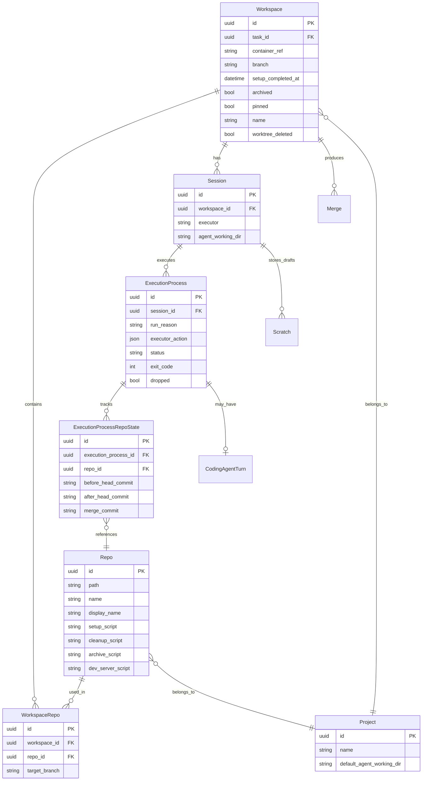

# Core Concepts

<details>
<summary>Relevant source files</summary>

The following files were used as context for generating this wiki page:

- [crates/db/.sqlx/query-1b186dc075846fc1f7270a942afbf82a88806ee6ababdb437ab5e97ddd2122da.json](crates/db/.sqlx/query-1b186dc075846fc1f7270a942afbf82a88806ee6ababdb437ab5e97ddd2122da.json)
- [crates/db/.sqlx/query-2a57b702e52b3cc9bdbc361267985958b11d4493b01a9ab8daedf5d951422897.json](crates/db/.sqlx/query-2a57b702e52b3cc9bdbc361267985958b11d4493b01a9ab8daedf5d951422897.json)
- [crates/db/.sqlx/query-f584dbe0f2f2a4f1e7dcf5b8f675eb2a6d954bb3f148ac0fece10652f05fb49b.json](crates/db/.sqlx/query-f584dbe0f2f2a4f1e7dcf5b8f675eb2a6d954bb3f148ac0fece10652f05fb49b.json)
- [crates/db/src/models/execution_process.rs](crates/db/src/models/execution_process.rs)
- [crates/db/src/models/scratch.rs](crates/db/src/models/scratch.rs)
- [crates/db/src/models/workspace.rs](crates/db/src/models/workspace.rs)
- [crates/local-deployment/src/container.rs](crates/local-deployment/src/container.rs)
- [crates/server/src/bin/generate_types.rs](crates/server/src/bin/generate_types.rs)
- [crates/server/src/routes/containers.rs](crates/server/src/routes/containers.rs)
- [crates/services/src/services/container.rs](crates/services/src/services/container.rs)
- [crates/utils/src/port_file.rs](crates/utils/src/port_file.rs)
- [shared/types.ts](shared/types.ts)

</details>


This document explains the fundamental data models, type system, and architectural patterns that underpin Vibe Kanban. These concepts form the foundation for understanding how workspaces execute coding agents, how data flows between frontend and backend, and how the system maintains isolation and real-time synchronization.

For information about the executor system and coding agent integration, see [Executor System](#3). For deployment architecture and infrastructure, see [Backend Services](#4).

---

## Fundamental Data Models

Vibe Kanban's core domain model centers on **Workspaces**, **Sessions**, and **ExecutionProcesses**. These entities work together to provide isolated environments where coding agents can make changes to repositories.

### Entity Relationship Diagram

Vibe Kanban uses a relational model to track the state of AI agent interactions and the resulting code changes.



**Sources:** [shared/types.ts:7-9](), [shared/types.ts:21-21](), [shared/types.ts:145-147](), [shared/types.ts:155-157](), [crates/local-deployment/src/container.rs:12-25](), [crates/services/src/services/container.rs:12-24]()

### Core Entity Descriptions

| Entity | Purpose | Key Characteristics |
|--------|---------|-------------------|
| `Workspace` | Isolated environment for coding agent execution | - Has unique branch name<br/>- References container directory (`container_ref`) [shared/types.ts:155]()<br/>- Can be archived/pinned<br/>- Contains one or more repositories |
| `WorkspaceRepo` | Links repositories to workspaces | - Specifies `target_branch` per repo [shared/types.ts:21]()<br/>- One workspace can have multiple repos |
| `Session` | Groups related execution processes | - Tied to one workspace<br/>- Stores executor configuration [shared/types.ts:159]()<br/>- Maintains `agent_working_dir` [shared/types.ts:159]() |
| `ExecutionProcess` | Single invocation of an executor | - Tracks status (`Running`, `Completed`, `Failed`, `Killed`) [crates/db/src/models/execution_process.rs:43-48]()<br/>- Contains `executor_action` chain [crates/db/src/models/execution_process.rs:67]()<br/>- Records exit code and timing |
| `ExecutionProcessRepoState` | Tracks commit state per repo | - Before/after head commits<br/>- Merge commit if applicable<br/>- Enables diff computation [shared/types.ts:165]() |
| `Repo` | Repository configuration | - Local path to git repository<br/>- Setup/cleanup/archive scripts<br/>- Dev server configuration [shared/types.ts:7]() |
| `Project` | High-level organizational unit | - Default working directories for agents [shared/types.ts:9]() |

**Sources:** [shared/types.ts:7-165](), [crates/local-deployment/src/container.rs:12-25](), [crates/db/src/models/execution_process.rs:43-67]()

---

## Type System and API Contracts

Vibe Kanban maintains type safety between its Rust backend and TypeScript frontend through code generation. The `generate_types` binary serves as the bridge.

### Type Generation Flow

The system ensures that changes to Rust database models or API responses are immediately reflected in the TypeScript frontend.

```mermaid
flowchart LR
    "RustModels"["Rust Models<br/>(db::models)"]
    "TsRsMacro"["#[derive(TS)]<br/>ts-rs macro"]
    "GenerateBin"["crates/server/src/bin/generate_types.rs"]
    "TypesFile"["shared/types.ts"]
    "Frontend"["Frontend Packages<br/>(local-web, remote-web)"]
    
    "RustModels" --> "TsRsMacro"
    "TsRsMacro" --> "GenerateBin"
    "GenerateBin" --> "TypesFile"
    "TypesFile" --> "Frontend"
```

**Sources:** [crates/server/src/bin/generate_types.rs:7-133](), [shared/types.ts:1-5]()

### Type Generation Process

1. **Rust Type Definition**: Structs are defined in Rust with `#[derive(Serialize, Deserialize, TS)]` attributes (e.g., `Workspace` in `db::models` [crates/db/src/models/workspace.rs:41-42]()).
2. **Type Declaration Collection**: The `generate_types_content` function in the generator binary explicitly lists every struct that needs to be exported to the frontend [crates/server/src/bin/generate_types.rs:13-133]().
3. **TypeScript Generation**: The `ts-rs` library generates TypeScript types with proper field mappings.
4. **Export**: All types are exported from `shared/types.ts` with a warning banner [shared/types.ts:1-11]().

For details, see [Type System and API Contracts](#2.1).

---

## Workspace Lifecycle

A workspace progresses through several states from creation to cleanup. The lifecycle is managed by the `ContainerService` trait and implemented by `LocalContainerService`.

### Workspace State Transitions

```mermaid
stateDiagram-v2
    [*] --> "Created" : "POST /workspaces"
    "Created" --> "SetupRunning" : "ContainerService::create()"
    "SetupRunning" --> "Ready" : "setup completes"
    "SetupRunning" --> "Failed" : "setup fails"
    "Ready" --> "CodingAgentRunning" : "ContainerService::start_execution()"
    "CodingAgentRunning" --> "Ready" : "agent completes"
    "CodingAgentRunning" --> "Failed" : "agent fails"
    "Ready" --> "Archived" : "ContainerService::delete()"
    "Archived" --> [*]
```

**Sources:** [crates/services/src/services/container.rs:87-198](), [crates/local-deployment/src/container.rs:90-133]()

### Lifecycle Stages

#### 1. Creation
When a workspace is created, the `LocalContainerService` uses a `WorkspaceManager` to initialize the environment [crates/local-deployment/src/container.rs:71](). This involves generating a unique branch ID and setting up the filesystem path [crates/services/src/services/container.rs:55-55]().

#### 2. Execution
During execution, the workspace hosts one or more `ExecutionProcess` instances. The `LocalContainerService` tracks these processes using a `child_store` and `cancellation_tokens` [crates/local-deployment/src/container.rs:72-73]().

#### 3. Archival and Cleanup
Workspaces can be archived, which triggers cleanup scripts defined in the `Repo` model [shared/types.ts:7](). The `LocalContainerService` runs a background task `spawn_workspace_cleanup` to remove stale worktrees [crates/local-deployment/src/container.rs:130]().

For details, see [Workspaces and Execution Lifecycle](#2.3).

---

## Isolation Through Git Worktrees

Vibe Kanban achieves workspace isolation using **git worktrees**. This allows multiple agents to work on the same repository simultaneously without interfering with each other's files or the user's primary working directory.

### Worktree Structure

```mermaid
graph TB
    "MainRepo"["Main Repository<br/>/path/to/repo"]
    "WorkspaceDir"["Workspace Directory<br/>(container_ref)"]
    "Worktree1"["Repo A Worktree<br/>(branch: vk-abc)"]
    "Worktree2"["Repo B Worktree<br/>(branch: vk-abc)"]
    
    "MainRepo" -.->|git worktree add| "Worktree1"
    "MainRepo" -.->|git worktree add| "Worktree2"
    "WorkspaceDir" --> "Worktree1"
    "WorkspaceDir" --> "Worktree2"
```

**Sources:** [crates/local-deployment/src/container.rs:160-188](), [crates/services/src/services/container.rs:125-134]()

The `container_ref` in the `Workspace` model points to the root directory containing these worktrees [shared/types.ts:155](). The `LocalContainerService` resolves paths by joining the `container_ref` with the repository's relative path [crates/services/src/services/container.rs:134-138]().

For details, see [Git Worktree Management](#2.4).

---

## Sessions and Execution Processes

A `Session` groups related execution processes within a workspace. Each `ExecutionProcess` represents a single invocation of an executor (coding agent or script).

### Execution Process Anatomy

Each `ExecutionProcess` has a `run_reason` and a `status` [crates/db/src/models/execution_process.rs:65-68]().

| `run_reason` | Description |
|--------------|-------------|
| `SetupScript` | Initial environment preparation [crates/db/src/models/execution_process.rs:54](). |
| `CodingAgent` | Main AI agent interaction [crates/db/src/models/execution_process.rs:57](). |
| `CleanupScript` | Post-execution cleanup [crates/db/src/models/execution_process.rs:55](). |
| `DevServer` | Long-running background process for previews [crates/db/src/models/execution_process.rs:58](). |

**Sources:** [crates/db/src/models/execution_process.rs:53-59](), [crates/services/src/services/container.rs:200-203]()

For details, see [Sessions and Execution Processes](#2.5).

---

## Draft Storage and State Persistence

The `Scratch` system provides typed, transient storage for draft data and UI preferences. This avoids polluting core domain tables with temporary state.

### Scratch Types

The `ScratchType` enum defines the various categories of data persisted in the scratch system [shared/types.ts:147]():

| Type | Data Model | Purpose |
|------|------------|---------|
| `DRAFT_WORKSPACE` | `DraftWorkspaceData` | Persists multi-repo selection and prompt during workspace creation [shared/types.ts:35](). |
| `UI_PREFERENCES` | `UiPreferencesData` | Stores sidebar visibility, pane sizes, and collapsed file tree paths [shared/types.ts:73-141](). |
| `WORKSPACE_NOTES` | `WorkspaceNotesData` | Per-workspace user notes [shared/types.ts:59](). |
| `PREVIEW_SETTINGS` | `PreviewSettingsData` | Browser preview configuration [shared/types.ts:57](). |

**Sources:** [shared/types.ts:21-147](), [crates/db/src/models/scratch.rs:145-147]()

For details, see [Scratch Data and UI State Persistence](#2.7).

---

## Real-time Streaming and Updates

Vibe Kanban uses WebSockets and an internal event service to provide a live experience.

- **Logs**: Captured via `MsgStore` and streamed to the frontend [crates/local-deployment/src/container.rs:74-77]().
- **Database Changes**: The `EventService` monitors the SQLite database and pushes updates to the frontend.
- **Notifications**: Managed by the `NotificationService` to alert users of completed or failed tasks [crates/local-deployment/src/container.rs:109]().

For details, see [Real-time Streaming and Updates](#2.6).