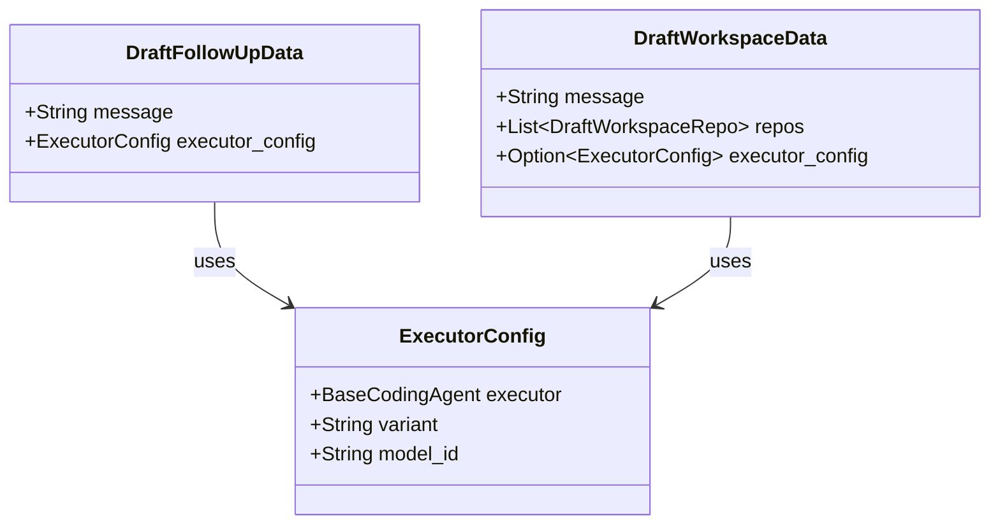

# Type System and API Contracts

<details>
<summary>Relevant source files</summary>

The following files were used as context for generating this wiki page:

- [crates/api-types/Cargo.toml](crates/api-types/Cargo.toml)
- [crates/db/src/models/scratch.rs](crates/db/src/models/scratch.rs)
- [crates/server/src/bin/generate_types.rs](crates/server/src/bin/generate_types.rs)
- [packages/web-core/src/shared/hooks/useExecutorConfig.ts](packages/web-core/src/shared/hooks/useExecutorConfig.ts)
- [shared/schemas/claude_code.json](shared/schemas/claude_code.json)
- [shared/types.ts](shared/types.ts)

</details>


This page explains how Rust backend types are translated into TypeScript declarations that the frontend consumes, covering the generation binaries, the `ts-rs` macro system, the generated shared type files, and the JSON schema outputs. It also describes the `ApiResponse` wrapper contract and the specialized remote type synchronization used for the cloud infrastructure.

---

## Purpose and Scope

The frontend (React/TypeScript) and the backend (Rust/Axum) must agree on the shape of every data structure exchanged over HTTP and WebSocket. Rather than maintaining parallel definitions, the codebase uses `ts-rs` to derive TypeScript type declarations directly from Rust structs and enums. Dedicated binaries collect all such declarations and write them to shared TypeScript files.

This approach ensures:
- The Rust type definition is the single source of truth.
- TypeScript consumers import from central files with no hand-written type glue.
- CI check gates enforce that TypeScript files are always synchronized with Rust sources.

---

## Generation Pipeline

Vibe Kanban maintains two distinct type generation pipelines: one for the local development environment (`shared/types.ts`) and one for the remote/cloud service (`shared/remote-types.ts`).

**Type Generation Data Flow**

```mermaid
flowchart TD
    subgraph "Rust_Source_Crates"
        [DB] ["db::models::*"]
        [Executors] ["executors::profile::*"]
        [Services] ["services::services::*"]
        [ServerRoutes] ["server::routes::*"]
        [ApiTypes] ["api_types::*"]
        [RemoteRoutes] ["remote::routes::*"]
    end

    subgraph "ts-rs_derive_macro"
        [TSDerived] ["#[derive(TS)] implements TS::decl()"]
    end

    subgraph "Generation_Binaries"
        [LocalGen] ["crates/server/src/bin/generate_types.rs"]
        [RemoteGen] ["crates/remote/src/bin/remote_generate_types.rs"]
    end

    subgraph "Output_Artifacts"
        [LocalTS] ["shared/types.ts"]
        [RemoteTS] ["shared/remote-types.ts"]
        [Schemas] ["shared/schemas/*.json"]
    end

    [DB] & [Executors] & [Services] & [ServerRoutes] & [ApiTypes] --> [TSDerived]
    [RemoteRoutes] & [ApiTypes] --> [TSDerived]
    
    [TSDerived] --> [LocalGen]
    [TSDerived] --> [RemoteGen]
    
    [LocalGen] --> [LocalTS]
    [LocalGen] --> [Schemas]
    [RemoteGen] --> [RemoteTS]
```

Sources: [crates/server/src/bin/generate_types.rs:7-134](), [shared/types.ts:1-5]()

### The `generate_types` Binaries

1.  **Local Generator**: Resides in `crates/server/src/bin/generate_types.rs`. It assembles declarations by calling `.decl()` on types from `db`, `executors`, `services`, and `server` [crates/server/src/bin/generate_types.rs:13-134](). It also generates JSON schemas for executor configurations using `schemars` to facilitate dynamic UI generation for agent settings.
2.  **Remote Generator**: Resides in `crates/remote/src/bin/remote_generate_types.rs`. It focuses on cloud-specific entities like `OrganizationMember`, `Issue`, and `Project`.

### The `ts-rs` Trait

Every exported Rust type has `#[derive(TS)]` applied [crates/db/src/models/scratch.rs:21](). The `TS` trait provides a `decl()` associated function that returns a `String` containing the TypeScript type alias or interface. Serialization attributes like `#[serde(rename_all = "snake_case")]` are respected to ensure JSON compatibility [crates/db/src/models/scratch.rs:55-79]().

Multiple crates declare `ts-rs` as a dependency:
- `api-types`: [crates/api-types/Cargo.toml:12]()
- `server`: [crates/server/src/bin/generate_types.rs:5]()
- `db`: [crates/db/src/models/scratch.rs:7]()

---

## The `api-types` Crate

The `api-types` crate ([crates/api-types]()) is a foundation crate holding types shared between the local server, the remote service, and the MCP server. It depends on `ts-rs`, `serde`, and `schemars` but has no dependencies on internal services or database logic [crates/api-types/Cargo.toml:6-13]().

Key types defined here include:
- **Identity & Auth**: `LoginStatus`, `ProviderProfile`, `CurrentUserResponse` [crates/server/src/bin/generate_types.rs:67-69](), [crates/server/src/bin/generate_types.rs:105]().
- **Organizations**: `Organization`, `OrganizationMemberInfo`, `Invitation` [crates/server/src/bin/generate_types.rs:73-80]().
- **System Info**: `UserSystemInfo`, `Environment` [crates/server/src/bin/generate_types.rs:96-97]().

Sources: [crates/api-types/Cargo.toml:1-14](), [crates/server/src/bin/generate_types.rs:67-91]()

---

## Key Type Definitions and Contracts

### `ApiResponse<T, E>`

The local backend wraps all REST responses in a standard `ApiResponse` structure to provide consistent success/error signaling [crates/server/src/bin/generate_types.rs:66]().

```typescript
export type ApiResponse<T, E = T> = {
  success: boolean,
  data: T | null,
  error_data: E | null,
  message: string | null,
};
```

### Discriminated Unions: `ScratchPayload`

The `Scratch` system is used for persisting UI state and drafts. The `ScratchPayload` is a tagged union in Rust that translates to a discriminated union in TypeScript [shared/types.ts:145]().

```typescript
export type ScratchPayload = 
  | { "type": "DRAFT_TASK", "data": string } 
  | { "type": "DRAFT_FOLLOW_UP", "data": DraftFollowUpData } 
  | { "type": "DRAFT_WORKSPACE", "data": DraftWorkspaceData } 
  | { "type": "DRAFT_ISSUE", "data": DraftIssueData } 
  | { "type": "PREVIEW_SETTINGS", "data": PreviewSettingsData } 
  | { "type": "WORKSPACE_NOTES", "data": WorkspaceNotesData } 
  | { "type": "UI_PREFERENCES", "data": UiPreferencesData } 
  | { "type": "PROJECT_REPO_DEFAULTS", "data": ProjectRepoDefaultsData };
```

Sources: [shared/types.ts:145-147](), [crates/db/src/models/scratch.rs:21-204]()

---

## API Contract Mapping

The following diagram bridges natural language API concepts to the specific code entities used in contracts for both local and remote operations.

**API Contract Mapping**

```mermaid
graph LR
    subgraph "Natural_Language_Concept"
        [RegisterRepo] ["Register a Repository"]
        [CreateScratch] ["Save a Draft/UI State"]
        [UpdateMember] ["Update Organization Member"]
    end

    subgraph "Code_Entity_(Rust/TS)"
        direction TB
        [RR_Req] ["RegisterRepoRequest"]
        [CS_Req] ["CreateScratch"]
        [UMR_Req] ["UpdateMemberRoleRequest"]
    end

    subgraph "Implementation_Site"
        [RepoRouter] ["server::routes::repo"]
        [ScratchModel] ["db::models::scratch"]
        [ApiTypes] ["api_types"]
    end

    [RegisterRepo] --> [RR_Req]
    [CreateScratch] --> [CS_Req]
    [UpdateMember] --> [UMR_Req]
    
    [RR_Req] --> [RepoRouter]
    [CS_Req] --> [ScratchModel]
    [UMR_Req] --> [ApiTypes]
```

Sources: [crates/server/src/bin/generate_types.rs:92](), [crates/server/src/bin/generate_types.rs:44](), [crates/server/src/bin/generate_types.rs:90](), [shared/types.ts:151]()

---

## Executor Profile Contracts

Executor configurations are heavily typed to ensure the frontend sends valid parameters to the backend. Each executor configuration (e.g., `DraftFollowUpData`) references an `ExecutorConfig` which is derived from the `executors` crate [crates/db/src/models/scratch.rs:21-25](). 

The frontend uses `useExecutorConfig` to resolve effective configurations through a fallback chain: user selections, scratch state, last used config, and finally presets [packages/web-core/src/shared/hooks/useExecutorConfig.ts:201-241]().

**Executor Type Relationship**



Sources: [crates/db/src/models/scratch.rs:21-26](), [crates/db/src/models/scratch.rs:177-187](), [shared/types.ts:33-35](), [packages/web-core/src/shared/hooks/useExecutorConfig.ts:142-170]()

---

## JSON Schema Integration

For complex configurations like `claude_code`, the system uses JSON Schema files (e.g., `shared/schemas/claude_code.json`) to define property constraints, default values, and UI hints like `format: textarea` [shared/schemas/claude_code.json:1-13](). These schemas are consumed by the frontend to render dynamic forms for executor settings.

Sources: [shared/schemas/claude_code.json:1-102]()