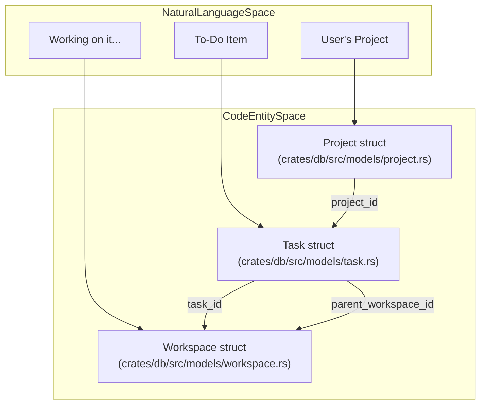
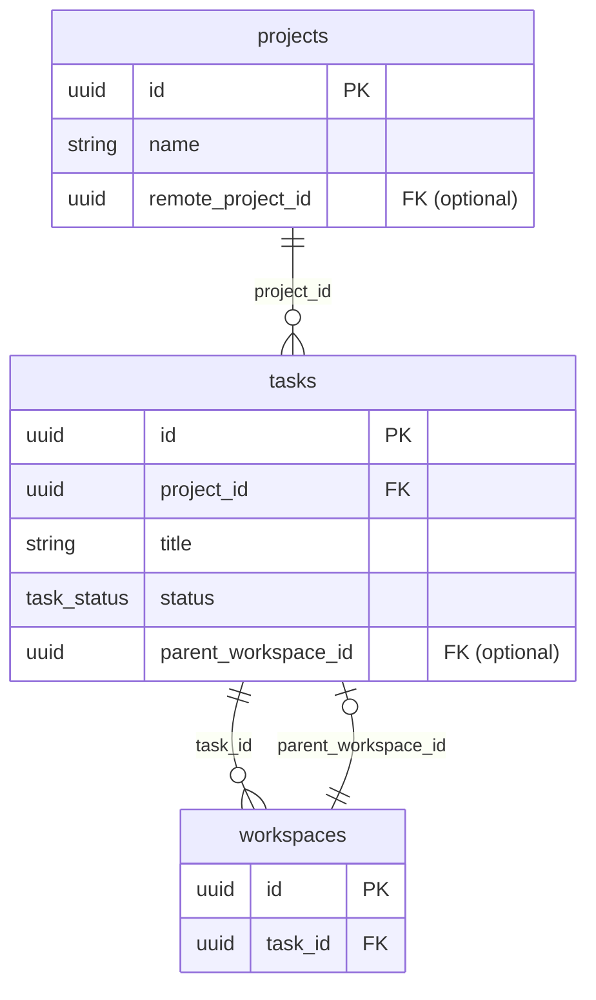

# Projects, Tasks, and Issues

<details>
<summary>Relevant source files</summary>

The following files were used as context for generating this wiki page:

- [crates/db/src/models/project.rs](crates/db/src/models/project.rs)
- [crates/db/src/models/task.rs](crates/db/src/models/task.rs)
- [docs/configuration-customisation/creating-task-tags.mdx](docs/configuration-customisation/creating-task-tags.mdx)
- [docs/core-features/creating-projects.mdx](docs/core-features/creating-projects.mdx)
- [docs/core-features/creating-tasks.mdx](docs/core-features/creating-tasks.mdx)
- [docs/images/screenshot-create-task-tag.png](docs/images/screenshot-create-task-tag.png)
- [docs/images/screenshot-task-tag-autocomplete.png](docs/images/screenshot-task-tag-autocomplete.png)
- [docs/images/vk-task-dialog.png](docs/images/vk-task-dialog.png)

</details>


This page documents the data models for organizing work in Vibe Kanban. The system utilizes two parallel hierarchies to support both local development and remote team collaboration:

- **Local System**: `Project` → `Task` → `Workspace` (stored in local SQLite) [[crates/db/src/models/project.rs:8-17]](), [[crates/db/src/models/task.rs:24-33]]()
- **Remote System**: `Organization` → `Project` → `Issue` (stored in remote PostgreSQL, optional cloud service).

Tasks are the local-only work item model used for standalone usage. Issues are the remote-only work item model used when syncing with the cloud service. Projects exist in both systems and can optionally link a local project to a remote project via `remote_project_id` [[crates/db/src/models/project.rs:12]]().

---

## Entity Hierarchy Overview

### Local Work Item Hierarchy

**Project → Task → Workspace → Session → ExecutionProcess**

Title: "Local Hierarchy Mapping"


### Task Lifecycle and UI Interaction

Tasks are the primary unit of work on the Kanban board. They move between columns based on execution state [[docs/core-features/creating-tasks.mdx:88-96]]().

| Action | Column |
|--------|---------|
| Task created | **To do** [[docs/core-features/creating-tasks.mdx:92]]() |
| Task attempt started | **In Progress** [[docs/core-features/creating-tasks.mdx:93]]() |
| Task attempt completed | **In Review** [[docs/core-features/creating-tasks.mdx:94]]() |
| Task attempt/PR merged | **Done** [[docs/core-features/creating-tasks.mdx:95-96]]() |

Sources: [[crates/db/src/models/task.rs:8-33]](), [[crates/db/src/models/project.rs:1-54]](), [[docs/core-features/creating-tasks.mdx:88-101]]()

---

## Project Entity (Local and Remote)

Projects represent a git repository [[docs/core-features/creating-projects.mdx:16]](). In the local database, they store configuration for agent execution environments.

### Project Properties

| Property | Type | Description |
|----------|------|-------------|
| `id` | `Uuid` | Unique identifier [[crates/db/src/models/project.rs:9]]() |
| `name` | `String` | Human-readable project name [[crates/db/src/models/project.rs:10]]() |
| `default_agent_working_dir` | `Option<String>` | Default working directory for AI agents [[crates/db/src/models/project.rs:11]]() |
| `remote_project_id` | `Option<Uuid>` | Links local project to remote project [[crates/db/src/models/project.rs:12]]() |

### Project Configuration
Projects include scripts that define the execution lifecycle for coding agents:
- **Setup Scripts**: Run before execution (e.g., `npm install`) [[docs/core-features/creating-projects.mdx:27-29]]().
- **Dev Server Scripts**: Used for previewing work [[docs/core-features/creating-projects.mdx:35-37]]().
- **Cleanup Scripts**: Post-execution tidying (e.g., `npm run format`) [[docs/core-features/creating-projects.mdx:39-41]]().
- **Copy Files**: Files copied from the original directory to the worktree before execution [[docs/core-features/creating-projects.mdx:44-46]]().

Sources: [[crates/db/src/models/project.rs:1-54]](), [[docs/core-features/creating-projects.mdx:12-53]]()

---

## Task Entity (Local Only)

Tasks are the work items displayed on the Kanban board. They can be created manually via the UI or programmatically via MCP clients [[docs/core-features/creating-tasks.mdx:10-12]](), [[docs/core-features/creating-tasks.mdx:53-57]]().

### Task Data Model

```rust
// crates/db/src/models/task.rs:24-33
pub struct Task {
    pub id: Uuid,
    pub project_id: Uuid, 
    pub title: String,
    pub description: Option<String>,
    pub status: TaskStatus,
    pub parent_workspace_id: Option<Uuid>, 
    pub created_at: DateTime<Utc>,
    pub updated_at: DateTime<Utc>,
}
```

### Task Status Workflow
The `TaskStatus` enum [[crates/db/src/models/task.rs:14-21]]() drives the UI column placement:
- `Todo`: Default state [[crates/db/src/models/task.rs:16]]().
- `InProgress`: Active coding agent attempt [[crates/db/src/models/task.rs:17]]().
- `InReview`: Agent has finished its turn [[crates/db/src/models/task.rs:18]]().
- `Done`: Changes merged [[crates/db/src/models/task.rs:19]]().
- `Cancelled`: Task abandoned [[crates/db/src/models/task.rs:20]]().

### Task Tags
The system supports "Task Tags"—reusable text snippets inserted via `@` mentions in descriptions [[docs/configuration-customisation/creating-task-tags.mdx:6-8]](). These are global across projects and use `snake_case` naming [[docs/configuration-customisation/creating-task-tags.mdx:11-16]]().

Sources: [[crates/db/src/models/task.rs:14-58]](), [[docs/configuration-customisation/creating-task-tags.mdx:1-124]]()

---

## Data Model and Database Relationships

### Local Database Schema (SQLite)

Title: "Local Entity Relationships"


### Relationship Logic

1. **Task-to-Project**: Every `Task` must belong to a `Project` via `project_id` [[crates/db/src/models/task.rs:26]]().
2. **Workspace-to-Task**: A `Workspace` (execution attempt) is linked to a specific `Task` via `task_id`.
3. **Subtasks**: A `Task` can be a subtask if its `parent_workspace_id` is set, linking it to the workspace of a parent task [[crates/db/src/models/task.rs:30]](). This allows agents to spawn new tasks within an existing context.
4. **Task Attempts**: A single task can have multiple attempts. Each attempt creates a new `Workspace` (isolated git worktree) where an agent profile and base branch are configured [[docs/core-features/creating-tasks.mdx:39-44]]().

Sources: [[crates/db/src/models/task.rs:23-33]](), [[crates/db/src/models/project.rs:1-54]](), [[docs/core-features/creating-tasks.mdx:33-52]]()