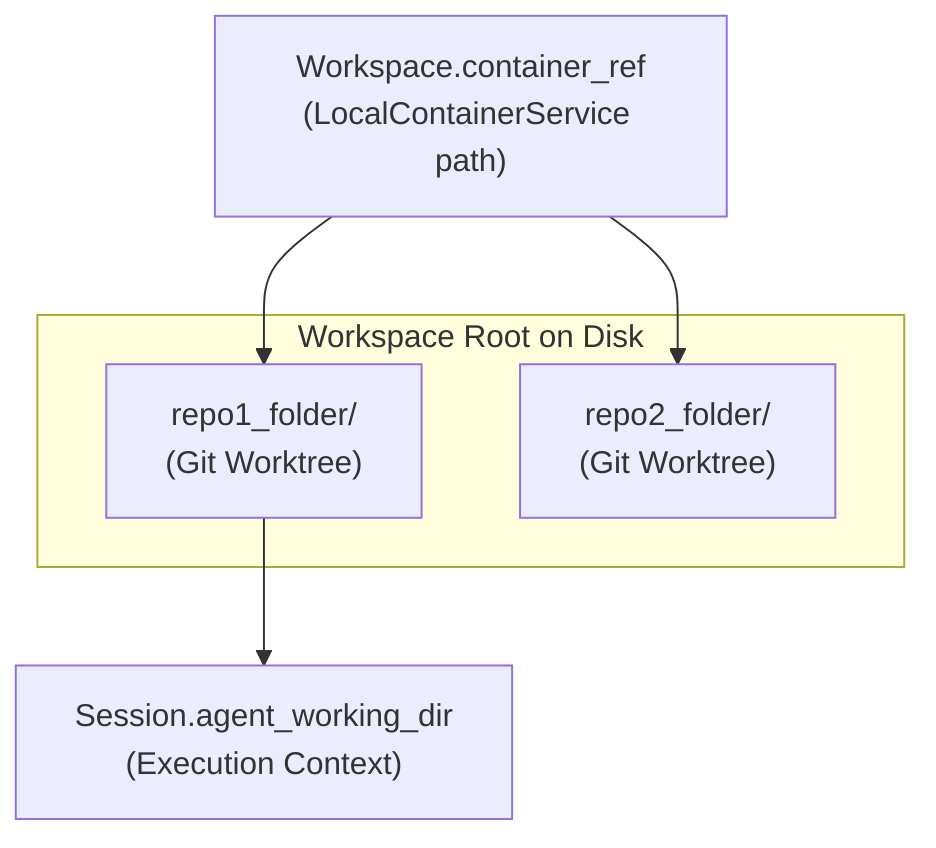
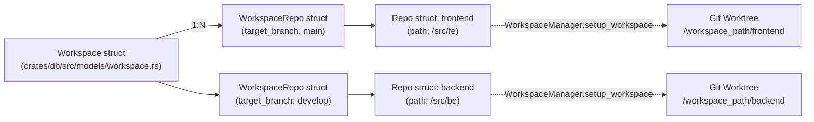
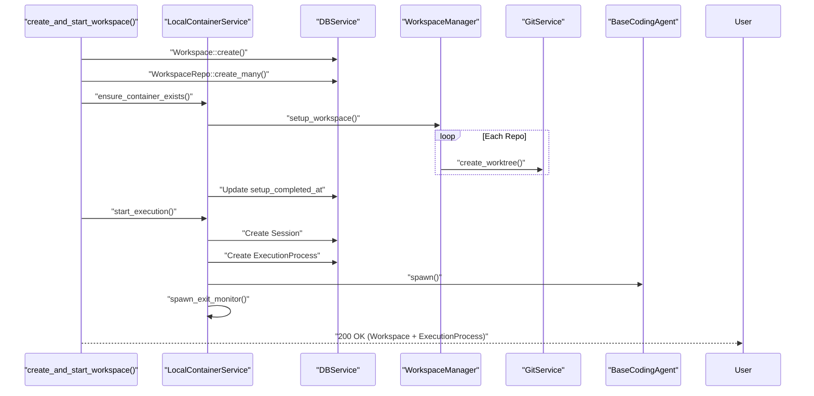
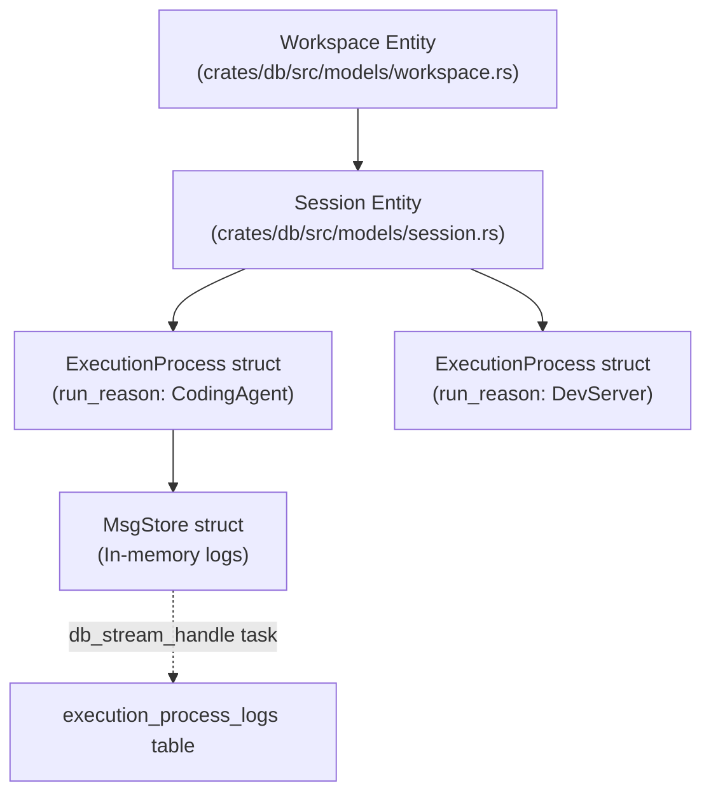
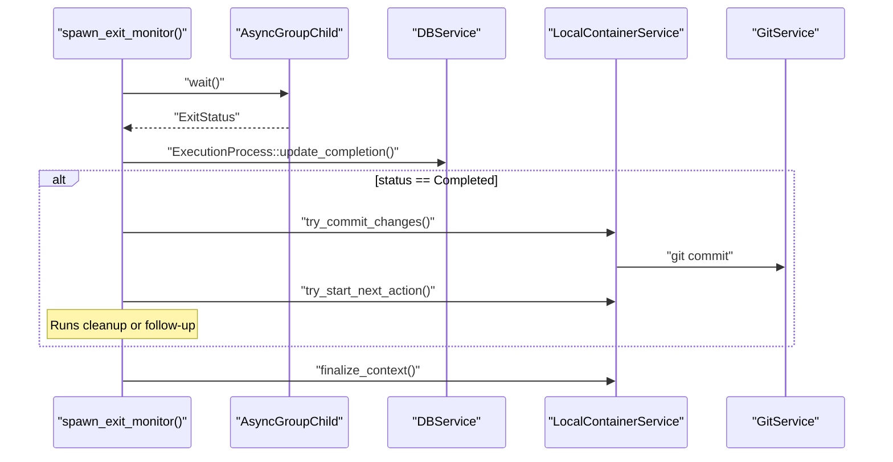

# Workspaces and Execution Lifecycle

<details>
<summary>Relevant source files</summary>

The following files were used as context for generating this wiki page:

- [crates/db/.sqlx/query-1b186dc075846fc1f7270a942afbf82a88806ee6ababdb437ab5e97ddd2122da.json](crates/db/.sqlx/query-1b186dc075846fc1f7270a942afbf82a88806ee6ababdb437ab5e97ddd2122da.json)
- [crates/db/.sqlx/query-2a57b702e52b3cc9bdbc361267985958b11d4493b01a9ab8daedf5d951422897.json](crates/db/.sqlx/query-2a57b702e52b3cc9bdbc361267985958b11d4493b01a9ab8daedf5d951422897.json)
- [crates/db/.sqlx/query-f584dbe0f2f2a4f1e7dcf5b8f675eb2a6d954bb3f148ac0fece10652f05fb49b.json](crates/db/.sqlx/query-f584dbe0f2f2a4f1e7dcf5b8f675eb2a6d954bb3f148ac0fece10652f05fb49b.json)
- [crates/db/src/models/execution_process.rs](crates/db/src/models/execution_process.rs)
- [crates/db/src/models/workspace.rs](crates/db/src/models/workspace.rs)
- [crates/local-deployment/src/container.rs](crates/local-deployment/src/container.rs)
- [crates/server/src/routes/containers.rs](crates/server/src/routes/containers.rs)
- [crates/services/src/services/container.rs](crates/services/src/services/container.rs)
- [crates/utils/src/port_file.rs](crates/utils/src/port_file.rs)
- [crates/workspace-manager/Cargo.toml](crates/workspace-manager/Cargo.toml)
- [crates/worktree-manager/Cargo.toml](crates/worktree-manager/Cargo.toml)
- [docs/agents/ccr.mdx](docs/agents/ccr.mdx)
- [docs/images/workspaces-preview-no-script.png](docs/images/workspaces-preview-no-script.png)
- [docs/settings/projects-repositories.mdx](docs/settings/projects-repositories.mdx)
- [docs/workspaces/changes.mdx](docs/workspaces/changes.mdx)
- [docs/workspaces/command-bar.mdx](docs/workspaces/command-bar.mdx)
- [docs/workspaces/creating-workspaces.mdx](docs/workspaces/creating-workspaces.mdx)
- [docs/workspaces/index.mdx](docs/workspaces/index.mdx)
- [docs/workspaces/interface.mdx](docs/workspaces/interface.mdx)
- [docs/workspaces/repositories.mdx](docs/workspaces/repositories.mdx)
- [docs/workspaces/sessions.mdx](docs/workspaces/sessions.mdx)

</details>


## Purpose and Scope

This document provides a deep dive into the **Workspace** concept, which represents a single attempt at solving a task or issue. A workspace provides an isolated development environment using Git worktrees, its own branch, and manages the full execution lifecycle from creation through agent interaction to archiving. This page covers the workspace data models, the multi-repository orchestration, lifecycle states, and automated cleanup mechanisms.

For information about the parent Task entity, see [2.2 Projects, Tasks, and Issues](). For details on Git implementation, see [2.4 Git Worktree Management](). For the Session and ExecutionProcess models that track work within a workspace, see [2.5 Sessions and Execution Processes]().

---

## Workspace as Task Attempt

A **Workspace** is a task attempt—each time a user starts working on a task or an issue, a new workspace is created. Multiple workspaces can exist for the same task, representing different attempts with different approaches or configurations.

Key characteristics:
- **Isolated environment**: Each workspace operates in its own Git worktrees managed by the `WorkspaceManager` [crates/local-deployment/src/container.rs:71]().
- **Dedicated branch**: Every workspace has a unique branch generated using a UUID and a slugified title [utils/src/text.rs:55-60]().
- **Multi-repo support**: A workspace can span multiple repositories simultaneously [crates/db/src/models/workspace_repo.rs:21-25]().
- **Execution tracking**: Associated sessions and execution processes track all work performed [crates/db/src/models/execution_process.rs:61-78]().

Sources: [crates/db/src/models/workspace.rs:42-54](), [crates/local-deployment/src/container.rs:70-71](), [utils/src/text.rs:55-60]()

---

## Workspace Data Model

### Core Workspace Type

The `Workspace` struct defines the persistence layer for an attempt in the SQLite database.

| Field | Type | Description |
| :--- | :--- | :--- |
| `id` | `Uuid` | Unique identifier for the workspace [crates/db/src/models/workspace.rs:43]() |
| `task_id` | `Option<Uuid>` | Optional reference to a Kanban task [crates/db/src/models/workspace.rs:44]() |
| `container_ref` | `Option<String>` | Filesystem path to the workspace directory [crates/db/src/models/workspace.rs:45]() |
| `branch` | `String` | Unique git branch name for this attempt [crates/db/src/models/workspace.rs:46]() |
| `setup_completed_at`| `Option<DateTime>`| Timestamp when worktrees were successfully initialized [crates/db/src/models/workspace.rs:47]() |
| `worktree_deleted` | `bool` | Flag indicating if the physical files have been cleaned up [crates/db/src/models/workspace.rs:53]() |

**Workspace Directory Structure**



The `container_ref` field stores the absolute filesystem path to the workspace directory [crates/db/src/models/workspace.rs:45](). For multi-repo workspaces, each repository is set up as a subdirectory containing a Git worktree. The `agent_working_dir` (stored on the `Session` object) specifies where the coding agent executes relative to the workspace root [crates/services/src/services/container.rs:135-138]().

Sources: [crates/db/src/models/workspace.rs:42-54](), [crates/services/src/services/container.rs:99-150]()

---

## Multi-Repository Model

Workspaces support multiple repositories through the `WorkspaceRepo` join entity:

```rust
pub struct WorkspaceRepo {
    pub id: Uuid,
    pub workspace_id: Uuid,
    pub repo_id: Uuid,
    pub target_branch: String,
    pub created_at: DateTime<Utc>,
    pub updated_at: DateTime<Utc>,
}
```
[crates/db/src/models/workspace_repo.rs:21]()

**Multi-Repo Workspace Relationships**



Each repository in a workspace can target a different branch [crates/db/src/models/workspace_repo.rs:21-25](). This enables coordinated changes across multiple codebases within a single task attempt.

Sources: [crates/db/src/models/workspace_repo.rs:21-25](), [crates/local-deployment/src/container.rs:160-188]()

---

## Workspace Lifecycle Overview

```mermaid
stateDiagram-v2
    [*] --> Created: "Workspace::create()"
    
    Created --> SettingUp: "LocalContainerService.ensure_container_exists()"
    SettingUp --> Ready: "setup_completed_at updated"
    
    Ready --> Executing: "LocalContainerService.start_execution()"
    Executing --> Executing: "LocalContainerService.follow_up()"
    Executing --> Completing: "spawn_exit_monitor()"
    
    Completing --> Ready: "Finalize actions run"
    
    Ready --> Archived: "Workspace::archive()"
    
    Archived --> Deleted: "LocalContainerService.delete()"
    Ready --> Deleted: "worktree_deleted = true"
    
    Deleted --> [*]
```

### Lifecycle Phases

| Phase | Description | Key Field State |
|-------|-------------|-----------------|
| **Created** | Workspace record exists but no filesystem setup | `container_ref = None` [crates/db/src/models/workspace.rs:45]() |
| **Setting Up** | Worktrees being created via `WorkspaceManager` | `container_ref.is_some()`, `setup_completed_at = None` [crates/db/src/models/workspace.rs:47]() |
| **Ready** | Setup complete, ready for execution | `setup_completed_at.is_some()` [crates/db/src/models/workspace.rs:47]() |
| **Executing** | Coding agent or script running | `ExecutionProcessStatus::Running` [crates/db/src/models/execution_process.rs:44]() |
| **Archived** | Workspace preserved but marked inactive | `archived = true` [crates/db/src/models/workspace.rs:50]() |
| **Deleted** | Filesystem resources removed | `worktree_deleted = true` [crates/db/src/models/workspace.rs:53]() |

Sources: [crates/services/src/services/container.rs:193-198](), [crates/db/src/models/workspace.rs:42-54]()

---

## Workspace Creation Flow

### API Endpoint: `POST /api/workspaces/start`

This endpoint handles the atomic creation and initial execution of a workspace.

**Workspace Creation and Execution Sequence**



**Key Implementation Details**:

1. **Branch Naming**: Backend generates a unique branch using `git_branch_id()` and `short_uuid()` [utils/src/text.rs:55-60]().
2. **Container Setup**: `LocalContainerService` uses `WorkspaceManager` to create physical worktrees on disk [crates/local-deployment/src/container.rs:71]().
3. **Session Creation**: A `Session` is initialized to track the conversation with the AI agent [crates/db/src/models/session.rs:25-45]().
4. **Initial Execution**: An `ExecutionProcess` is spawned with `ExecutionProcessRunReason::CodingAgent` [crates/db/src/models/execution_process.rs:57-65]().

Sources: [crates/db/src/models/workspace.rs:90-114](), [crates/local-deployment/src/container.rs:135-158](), [utils/src/text.rs:55-60]()

---

## Execution Phase

Once setup is complete, the workspace enters the execution phase where coding agents and scripts perform work.



### Execution Process Lifecycle

For each execution:
1. **`start_execution()`**: Creates the `ExecutionProcess` record in the DB [crates/services/src/services/container.rs:13-16]().
2. **`MsgStore`**: Captures stdout/stderr into an in-memory `MsgStore` for real-time access [crates/local-deployment/src/container.rs:74]().
3. **`db_stream_handles`**: Tracks background tasks that stream logs from `MsgStore` to the database or flat files [crates/local-deployment/src/container.rs:77]().
4. **`exit_monitor_handles`**: Tracks tasks that monitor process exit and handle post-execution logic [crates/local-deployment/src/container.rs:78]().

Sources: [crates/local-deployment/src/container.rs:74-78](), [crates/services/src/services/container.rs:13-16]()

---

## Completion and Finalization

When an execution process exits, the `spawn_exit_monitor()` task handles completion, commits, and cleanup.

### Exit Monitor Implementation



**Key Implementation Details**:

- **Finalization**: The `finalize_context()` method determines if the workspace execution is fully complete. Dev servers are explicitly never finalized automatically to allow persistent previews [crates/services/src/services/container.rs:199-216]().
- **Queued Messages**: If a user sent a message while the agent was busy, the `QueuedMessageService` triggers a follow-up immediately after the current process finalizes [crates/local-deployment/src/container.rs:85]().

Sources: [crates/local-deployment/src/container.rs:85](), [crates/services/src/services/container.rs:199-216]()

---

## Cleanup and Deletion

### Background Cleanup Process

A periodic task runs to clean up expired workspaces and orphaned processes to manage disk space.

```rust
pub fn spawn_workspace_cleanup(&self) {
    let db = self.db.clone();
    tokio::spawn(async move {
        // Orphan cleanup at startup
        WorkspaceManager::cleanup_orphan_workspaces(&db.pool).await;
        
        // Periodic cleanup
        let mut cleanup_interval = tokio::time::interval(Duration::from_secs(1800));
        loop {
            cleanup_interval.tick().await;
            Self::cleanup_expired_workspaces(&db).await;
        }
    });
}
```
[crates/local-deployment/src/container.rs:130]()

**Cleanup Rules**:
- **Expiration**: Workspaces unused for a duration defined by `WORKSPACE_TOUCH_DEBOUNCE` (2 minutes) and subsequent logic are candidates for cleanup [crates/local-deployment/src/container.rs:66-79]().
- **Worktree Deletion**: `WorkspaceManager` removes the physical Git worktrees but preserves the database record, marking `worktree_deleted = true` to allow for later restoration if needed [crates/db/src/models/workspace.rs:53-156]().

Sources: [crates/local-deployment/src/container.rs:66-130](), [crates/db/src/models/workspace.rs:156-167]()

---

## Workspace State Tracking

### Workspace Touch Mechanism

To prevent auto-archiving of active workspaces, the system "touches" workspaces when they are accessed (e.g., via the UI or VSCode extension). The `LocalContainerService` debounces these calls using `WORKSPACE_TOUCH_DEBOUNCE` (2 minutes) to minimize database load.

```rust
const WORKSPACE_TOUCH_DEBOUNCE: Duration = Duration::from_mins(2);
```
[crates/local-deployment/src/container.rs:66]()

The `touch` function updates the `updated_at` column in the `workspaces` table [crates/db/src/models/workspace.rs:184-192]().

Sources: [crates/local-deployment/src/container.rs:66-79](), [crates/db/src/models/workspace.rs:184-192]()