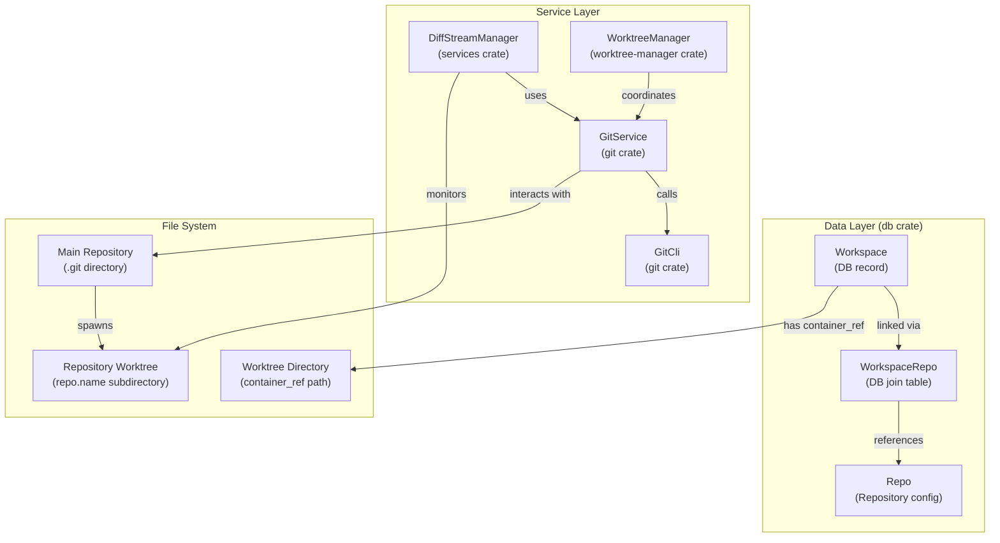
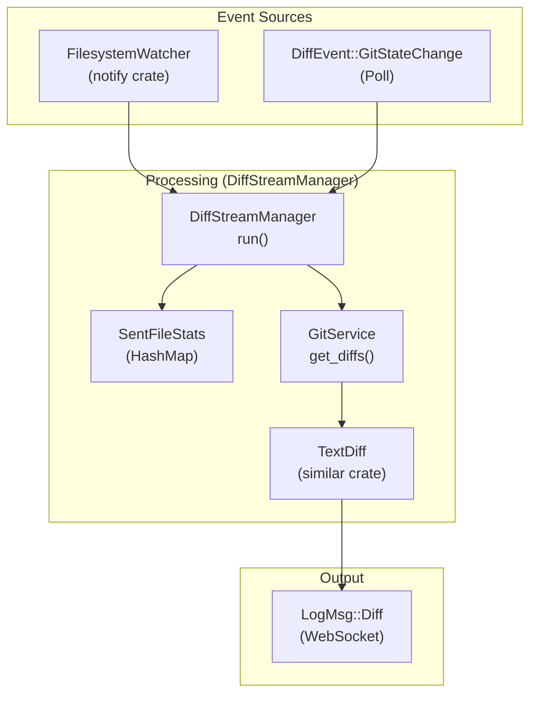

# Git Worktree Management

<details>
<summary>Relevant source files</summary>

The following files were used as context for generating this wiki page:

- [crates/git/Cargo.toml](crates/git/Cargo.toml)
- [crates/git/src/lib.rs](crates/git/src/lib.rs)
- [crates/git/tests/git_ops_safety.rs](crates/git/tests/git_ops_safety.rs)
- [crates/git/tests/git_workflow.rs](crates/git/tests/git_workflow.rs)
- [crates/services/src/services/diff_stream.rs](crates/services/src/services/diff_stream.rs)
- [crates/utils/src/diff.rs](crates/utils/src/diff.rs)
- [crates/workspace-manager/Cargo.toml](crates/workspace-manager/Cargo.toml)
- [crates/worktree-manager/Cargo.toml](crates/worktree-manager/Cargo.toml)
- [packages/web-core/src/shared/hooks/useDiffStream.ts](packages/web-core/src/shared/hooks/useDiffStream.ts)

</details>


This page describes how Vibe Kanban uses git worktrees to provide isolated development environments for each workspace. Git worktrees allow multiple workspaces to operate on the same repository simultaneously without interfering with each other's file state.

For information about workspace creation and lifecycle, see [Workspaces and Execution Lifecycle](2.3). For details about how workspaces execute coding agent sessions, see [Sessions and Execution Processes](2.5).

---

## Git Worktrees Fundamentals

Git worktrees are a native Git feature that allows multiple working directories to be checked out from a single repository. Instead of cloning a repository multiple times, worktrees share the same `.git` directory while maintaining separate working trees.

### Why Worktrees

Vibe Kanban uses git worktrees to enable:

| Benefit | Description |
|---------|-------------|
| **Parallel Execution** | Multiple coding agents can work on different tasks simultaneously without conflicts. |
| **Isolation** | Each workspace has its own file state independent of other workspaces. |
| **Efficiency** | Worktrees share object storage, reducing disk usage compared to full clones. |
| **Branch Safety** | Workspaces can track different branches without switching the main repository. |

**Sources**: [crates/git/src/lib.rs:183-190](), [crates/git/Cargo.toml:1-10]()

---

## System Architecture

### Worktree Management Components

The following diagram bridges the high-level workspace concept to the underlying Rust crates and file system structures.



**Sources**: [crates/services/src/services/diff_stream.rs:169-182](), [crates/git/src/lib.rs:58-60](), [crates/git/src/lib.rs:13-17](), [crates/worktree-manager/Cargo.toml:1-12]()

---

## Workspace-to-Worktree Mapping

### Directory Structure

Vibe Kanban organizes worktrees within a dedicated temporary or persistent directory depending on the OS. The `Workspace` model's `container_ref` field stores the base path for these worktrees.

### Multi-Repository Worktrees

Workspaces can span multiple repositories. Each repository gets its own worktree subdirectory within the workspace root. The `compute_diff_stats` function demonstrates how paths are constructed by joining the `container_ref` with the repository name.

**Function**: `compute_diff_stats` [crates/services/src/services/diff_stream.rs:43-92]()

```
/vibe-kanban-temp-dir/workspaces/ws-uuid/
├── frontend-repo/                (Worktree 1)
│   └── src/
└── backend-repo/                 (Worktree 2)
    └── crates/
```

**Sources**: [crates/services/src/services/diff_stream.rs:57-59](), [crates/services/src/services/diff_stream.rs:48-53]()

---

## Worktree Diffs and Monitoring

Vibe Kanban provides real-time visibility into worktree changes through a specialized diff streaming service.

### Diff Streaming Architecture

The `DiffStreamManager` monitors a worktree for filesystem events and computes diffs against the base commit. It uses a `SentFileStats` map to track the state of files already processed.



**Sources**: [crates/services/src/services/diff_stream.rs:169-190](), [crates/services/src/services/diff_stream.rs:33-33](), [crates/utils/src/diff.rs:44-58]()

### Diff Data Model

The system uses a `Diff` struct to represent changes within the worktree. Large file contents are omitted to maintain performance.

**Struct**: `Diff` [crates/utils/src/diff.rs:11-25]()
- `change`: The type of change (`DiffChangeKind`: Added, Deleted, Modified, Renamed, Copied, PermissionChange) [crates/utils/src/diff.rs:29-36]()
- `content_omitted`: Boolean flag set if file exceeds `MAX_INLINE_DIFF_BYTES` (2MB) [crates/utils/src/diff.rs:20](), [crates/git/src/lib.rs:63-63]().
- `additions` / `deletions`: Precomputed stats for the change [crates/utils/src/diff.rs:22-23]().

### Unified Diff Generation

For the UI, the system generates unified diffs using the `similar` crate and normalizes them into standard git-diff format. This ensures compatibility with frontend diff viewers.

**Function**: `create_unified_diff` [crates/utils/src/diff.rs:61-64]()
**Function**: `concatenate_diff_hunks` [crates/utils/src/diff.rs:198-219]()
**Function**: `extract_unified_diff_hunks` [crates/utils/src/diff.rs:79-144]()
**Function**: `normalize_unified_diff` [crates/utils/src/diff.rs:222-225]()

---

## Worktree Creation and Validation

### Creation and Branching

The `GitService` handles the underlying Git operations to prepare a worktree, including ensuring a local identity exists for CLI-based commits.

**Function**: `ensure_cli_commit_identity` [crates/git/src/lib.rs:208-219]()
**Function**: `create_branch` [crates/git/src/lib.rs:193-204]()
**Function**: `validate_worktree` [crates/git/src/lib.rs:183-190]()

### Excluded Directories

During operations like file watching or indexing within a worktree, certain directories are always ignored to maintain performance and prevent recursion into version control metadata.

**Constant**: `ALWAYS_SKIP_DIRS` [crates/git/src/lib.rs:18-18]()
- `.git`
- `node_modules`

---

## Git Operations Safety

Vibe Kanban implements checks to ensure worktrees are in a valid state before performing operations like resets or branch switches.

### Reset Behavior
The system can perform resets on worktrees while checking for "dirty" states (uncommitted changes). The `GitService` provides methods to check worktree cleanliness.

**Struct**: `WorktreeResetOptions` [crates/git/src/lib.rs:115-121]()
**Struct**: `WorktreeResetOutcome` [crates/git/src/lib.rs:139-142]()
**Test Case**: `staged_but_uncommitted_changes_is_dirty` [crates/git/tests/git_workflow.rs:150-161]()

### Conflict Handling
When operations like rebases or merges fail, the system identifies the conflict type and can report conflicted files.

**Enum**: `ConflictOp` [crates/git/src/lib.rs:65-73]()
**Error Variant**: `GitServiceError::MergeConflicts` [crates/git/src/lib.rs:44-48]()

**Sources**: [crates/git/src/lib.rs:65-73](), [crates/git/src/lib.rs:114-142](), [crates/git/tests/git_workflow.rs:150-161]()