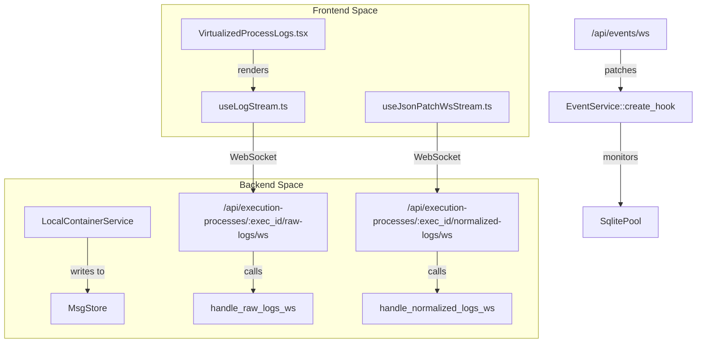
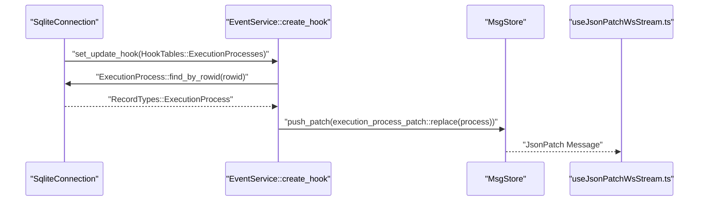

# Sessions and Execution Processes

<details>
<summary>Relevant source files</summary>

The following files were used as context for generating this wiki page:

- [crates/db/.sqlx/query-3634e2bab8fef106721bb64a791edd81d3d49eb34fbabd34e4feadfb5f229a6e.json](crates/db/.sqlx/query-3634e2bab8fef106721bb64a791edd81d3d49eb34fbabd34e4feadfb5f229a6e.json)
- [crates/db/src/models/session.rs](crates/db/src/models/session.rs)
- [crates/executors/src/actions/coding_agent_follow_up.rs](crates/executors/src/actions/coding_agent_follow_up.rs)
- [crates/executors/src/actions/coding_agent_initial.rs](crates/executors/src/actions/coding_agent_initial.rs)
- [crates/mcp/src/bin/vibe_kanban_mcp.rs](crates/mcp/src/bin/vibe_kanban_mcp.rs)
- [crates/mcp/src/task_server/mod.rs](crates/mcp/src/task_server/mod.rs)
- [crates/mcp/src/task_server/tools/context.rs](crates/mcp/src/task_server/tools/context.rs)
- [crates/server/src/routes/execution_processes.rs](crates/server/src/routes/execution_processes.rs)
- [crates/server/src/routes/filesystem.rs](crates/server/src/routes/filesystem.rs)
- [crates/services/src/services/events.rs](crates/services/src/services/events.rs)
- [crates/services/src/services/filesystem.rs](crates/services/src/services/filesystem.rs)
- [packages/web-core/src/shared/components/VirtualizedProcessLogs.tsx](packages/web-core/src/shared/components/VirtualizedProcessLogs.tsx)
- [packages/web-core/src/shared/hooks/useJsonPatchWsStream.ts](packages/web-core/src/shared/hooks/useJsonPatchWsStream.ts)
- [packages/web-core/src/shared/hooks/useLogStream.ts](packages/web-core/src/shared/hooks/useLogStream.ts)

</details>


This page describes the `Session` and `ExecutionProcess` models, which track the execution of coding agents and scripts within workspaces. Sessions group related execution attempts, while execution processes represent individual runs with status tracking and action chains.

For information about workspace lifecycle and Git worktree setup, see [Workspaces and Execution Lifecycle](2.3). For real-time log streaming and event propagation, see [Real-time Streaming and Updates](2.6).

---

## Session Model

A `Session` represents a logical execution thread within a workspace. Each session belongs to exactly one workspace and can contain multiple execution processes as the agent performs follow-up actions or retries.

### Session Structure

```rust
pub struct Session {
    pub id: Uuid,
    pub workspace_id: Uuid,
    pub name: Option<String>,
    pub executor: Option<String>,
    pub agent_working_dir: Option<String>,
    pub created_at: DateTime<Utc>,
    pub updated_at: DateTime<Utc>,
}
```

**Sources:** [crates/db/src/models/session.rs:22-31]()

### Session Lifecycle and Discovery

Sessions are created when a user initiates an interaction with an agent or script. The system provides several methods to discover and prioritize sessions:

1.  **Recency-based**: `find_by_workspace_id` and `find_latest_by_workspace_id` order sessions by the most recent non-dev server execution process [crates/db/src/models/session.rs:61-87](), [crates/db/src/models/session.rs:92-119]().
2.  **Creation-based**: `find_first_by_workspace_id` is used by the orchestrator MCP for discovery [crates/db/src/models/session.rs:123-143]().
3.  **Automatic Directory Resolution**: When a session is created, the system attempts to resolve the `agent_working_dir` by inspecting the workspace's repositories [crates/db/src/models/session.rs:175-191]().

**Sources:** [crates/db/src/models/session.rs:145-173](), [crates/services/src/services/events.rs:44-56]()

---

## ExecutionProcess Model

An `ExecutionProcess` represents a single execution run of a coding agent or script. Each process has a status, tracks timing, and maintains a reference to its `ExecutorAction`.

### ExecutionProcess Structure

```rust
pub struct ExecutionProcess {
    pub id: Uuid,
    pub session_id: Uuid,
    pub run_reason: ExecutionProcessRunReason,
    pub executor_action: sqlx::types::Json<ExecutorActionField>,
    pub status: ExecutionProcessStatus,
    pub exit_code: Option<i64>,
    pub dropped: bool,
    pub started_at: DateTime<Utc>,
    pub completed_at: Option<DateTime<Utc>>,
    pub created_at: DateTime<Utc>,
    pub updated_at: DateTime<Utc>,
}
```

**Sources:** [crates/server/src/routes/execution_processes.rs:9-12](), [crates/services/src/services/events.rs:149-156]()

### ExecutionProcessRunReason

The `run_reason` field indicates the intent of the execution:

| Run Reason | Description |
|-----------|-------------|
| `SetupScript` | Initial repository setup (e.g., `npm install`). |
| `CleanupScript` | Post-execution cleanup tasks. |
| `ArchiveScript` | Tasks performed when a workspace is archived. |
| `CodingAgent` | Primary AI agent interaction (Initial or Follow-up). |
| `DevServer` | Long-running development server processes. |

**Sources:** [crates/db/src/models/session.rs:78-78]()

### ExecutionProcessStatus Transitions

Processes transition through these statuses:

```mermaid
stateDiagram-v2
    [*] --> "running" : "LocalContainerService::spawn_executor_task"
    "running" --> "completed" : "ExitCode == 0"
    "running" --> "failed" : "ExitCode != 0"
    "running" --> "killed" : "stop_execution_process route"
    "completed" --> [*]
    "failed" --> [*]
    "killed" --> [*]
```

**Execution Process Status Transitions**

**Sources:** [crates/server/src/routes/execution_processes.rs:203-208]()

---

## ExecutorAction and Action Chains

Each execution process contains an `ExecutorAction` that defines the payload for the executor. Actions are typed and determine how logs are processed and displayed in the UI.

### ExecutorAction Types
The system distinguishes between script-based actions and agent-based actions to determine the correct log endpoint:
- **ScriptRequest**: Uses `/api/execution-processes/:id/raw-logs/ws` [crates/server/src/routes/execution_processes.rs:44-48]().
- **CodingAgentInitialRequest / CodingAgentFollowUpRequest**: Uses `/api/execution-processes/:id/normalized-logs/ws` [crates/server/src/routes/execution_processes.rs:138-142]().

**Sources:** [crates/executors/src/actions/coding_agent_initial.rs:18-27](), [crates/executors/src/actions/coding_agent_follow_up.rs:18-30]()

---

## Log Management and Streaming

Vibe Kanban provides real-time log streaming via WebSockets. The backend implements two streaming modes: **Raw** (for shell output) and **Normalized** (for agent interactions like tool use).

### Log Streaming Architecture



**Sources:** [crates/server/src/routes/execution_processes.rs:44-64](), [crates/server/src/routes/execution_processes.rs:138-171](), [packages/web-core/src/shared/hooks/useLogStream.ts:49-51](), [packages/web-core/src/shared/components/VirtualizedProcessLogs.tsx:163-174]()

### Normalized vs Raw Logs
- **Raw Logs**: Streamed via `handle_raw_logs_ws`. It maps `Stdout` and `Stderr` to `ConversationPatch` objects with incrementing indices using `AtomicUsize` [crates/server/src/routes/execution_processes.rs:87-103]().
- **Normalized Logs**: Streamed via `handle_normalized_logs_ws`. These contain structured data such as agent thoughts, tool calls, and tool results, which the UI renders as rich chat elements [crates/server/src/routes/execution_processes.rs:168-172]().

**Sources:** [crates/server/src/routes/execution_processes.rs:88-104](), [crates/server/src/routes/execution_processes.rs:168-201]()

---

## Dropped Processes and History Management

The `dropped` field on `ExecutionProcess` marks processes that should be excluded from the primary timeline view. This occurs during "Reset" operations where a user reverts to a previous point in the agent's history.

### Reset Process Logic
When a session is reset, the backend marks subsequent processes as `dropped`.
- **Visible Processes**: UI filters where `dropped` is false for the primary timeline.
- **Audit View**: The `SessionExecutionProcessQuery` allows including soft-deleted (dropped) processes in results/stream by setting `show_soft_deleted` to true [crates/server/src/routes/execution_processes.rs:29-35]().

**Sources:** [crates/db/src/models/session.rs:78-78](), [crates/server/src/routes/execution_processes.rs:29-35]()

---

## Real-time Event Propagation

The `EventService` in the backend uses SQLite pre-update and update hooks to detect changes to the `execution_processes` table. These changes are pushed to the `MsgStore` as JSON patches and streamed to the frontend.



**Sources:** [crates/services/src/services/events.rs:59-70](), [crates/services/src/services/events.rs:119-125](), [crates/services/src/services/events.rs:149-156](), [packages/web-core/src/shared/hooks/useJsonPatchWsStream.ts:128-144]()

---

## Summary

- **Sessions** provide the persistent context for agent interactions, grouping multiple execution attempts within a workspace [crates/db/src/models/session.rs:22-31]().
- **ExecutionProcesses** are the atomic units of execution, tracking lifecycle states (`running`, `completed`, `failed`, `killed`) and storing the `ExecutorAction` [crates/server/src/routes/execution_processes.rs:9-12]().
- **Log Streaming** supports both structured agent data (normalized) and raw shell output, delivered via specialized WebSocket routes [crates/server/src/routes/execution_processes.rs:44-201]().
- **Event Synchronization** ensures the UI stays in sync with the backend execution state through a reactive patch system triggered by database hooks [crates/services/src/services/events.rs:59-70]().