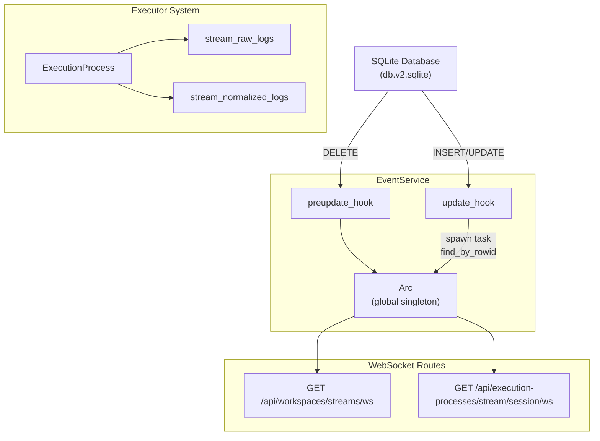
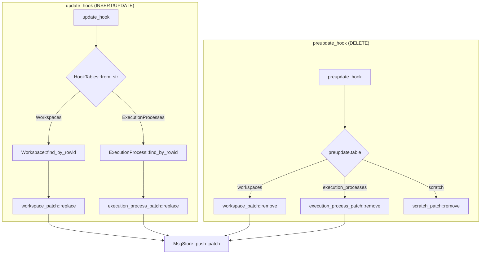
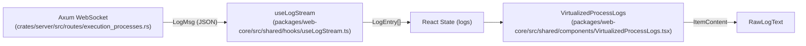

# Real-time Streaming and Updates

Relevant source files

The following files were used as context for generating this wiki page:

- [crates/db/.sqlx/query-12a5c0a8b95d8cb87f1c869ff35692a2cee52bc418b06d00a31a4c139e12d18a.json](crates/db/.sqlx/query-12a5c0a8b95d8cb87f1c869ff35692a2cee52bc418b06d00a31a4c139e12d18a.json)
- [crates/db/.sqlx/query-9139f8d02c4ff94db0f2e8de7a6d5a53092479499815531962b7c84f5e0b2129.json](crates/db/.sqlx/query-9139f8d02c4ff94db0f2e8de7a6d5a53092479499815531962b7c84f5e0b2129.json)
- [crates/db/src/lib.rs](crates/db/src/lib.rs)
- [crates/db/src/models/execution_process_logs.rs](crates/db/src/models/execution_process_logs.rs)
- [crates/server/src/routes/execution_processes.rs](crates/server/src/routes/execution_processes.rs)
- [crates/services/src/services/events.rs](crates/services/src/services/events.rs)
- [crates/services/src/services/execution_process.rs](crates/services/src/services/execution_process.rs)
- [crates/services/src/services/filesystem_watcher.rs](crates/services/src/services/filesystem_watcher.rs)
- [packages/web-core/src/shared/components/VirtualizedProcessLogs.tsx](packages/web-core/src/shared/components/VirtualizedProcessLogs.tsx)
- [packages/web-core/src/shared/hooks/useJsonPatchWsStream.ts](packages/web-core/src/shared/hooks/useJsonPatchWsStream.ts)
- [packages/web-core/src/shared/hooks/useLogStream.ts](packages/web-core/src/shared/hooks/useLogStream.ts)

This page describes how Vibe Kanban propagates database changes and agent output to connected browser clients in real time. It covers the SQLite hook mechanism, the `MsgStore` buffering layer, `EventPatch` structure, per-process log streaming, WebSocket endpoints, and frontend consumption patterns.

---

## Overview

The system implements two distinct real-time pipelines that deliver data over WebSocket connections:

| Pipeline | What it carries | Source of truth |
|---|---|---|
| **Event pipeline** | Workspace, ExecutionProcess, and Scratch record changes | SQLite update/preupdate hooks → `MsgStore` (global) |
| **Log pipeline** | Agent stdout, stderr, and lifecycle status | Executor output → per-process `MsgStore` |

Both pipelines use the `MsgStore` abstraction. The event pipeline uses a single global store shared across all connections. The log pipeline creates one store per running `ExecutionProcess`, keyed by execution process ID.

**Real-time Data Flow**

Sources: [crates/services/src/services/events.rs:26-42](), [crates/services/src/services/events.rs:119-130](), [crates/server/src/routes/execution_processes.rs:74-85]()

---

## SQLite Hook Mechanism

### Two Hooks, Two Responsibilities

`EventService::create_hook` [crates/services/src/services/events.rs:59-69]() registers two complementary SQLite hooks on every new connection:

**`set_preupdate_hook`** [crates/services/src/services/events.rs:77-117]() — Fires *before* a DELETE, while the old row is still readable. It handles only deletes on monitored tables (`workspaces`, `execution_processes`, `scratch`) because after deletion the row's UUID cannot be recovered from the update hook. It extracts the primary key using `get_old_column_value` [crates/services/src/services/events.rs:86-112]().

**`set_update_hook`** [crates/services/src/services/events.rs:119-124]() — Fires *after* INSERT or UPDATE. It fetches the current row state from the database using the provided `rowid` [crates/services/src/services/events.rs:135-150](), then constructs an `EventPatch` and pushes it into the global `MsgStore`.

### Monitored Tables

The `HookTables` and `RecordTypes` types enumerate which tables participate:

| Table | `HookTables` variant | `RecordTypes` variants |
|---|---|---|
| `workspaces` | `HookTables::Workspaces` | `RecordTypes::Workspace` |
| `execution_processes` | `HookTables::ExecutionProcesses` | `RecordTypes::ExecutionProcess` |
| `scratch` | `HookTables::Scratch` | `RecordTypes::Scratch` |

**Hook Dispatch Logic**

Sources: [crates/services/src/services/events.rs:77-117](), [crates/services/src/services/events.rs:119-160](), [crates/services/src/services/events.rs:23-24]()

---

## Log Streaming

Vibe Kanban provides real-time visibility into agent execution through raw and normalized log streams. These are consumed by the frontend to provide a live terminal-like experience.

### Backend Implementation
The backend exposes endpoints for streaming logs via Axum's WebSocket support.
- **Raw Logs**: `stream_raw_logs_ws` [crates/server/src/routes/execution_processes.rs:44-58]() streams `stdout` and `stderr` output. It uses `handle_raw_logs_ws` [crates/server/src/routes/execution_processes.rs:60-136]() to map raw output into `LogMsg::JsonPatch` frames using `ConversationPatch` [crates/server/src/routes/execution_processes.rs:70-71]().
- **Normalized Logs**: `stream_normalized_logs_ws` [crates/server/src/routes/execution_processes.rs:138-165]() provides structured log events via `handle_normalized_logs_ws` [crates/server/src/routes/execution_processes.rs:168-201]().
- **Persistence**: Historically stored in SQLite, logs are migrated to flat files for performance via `migrate_execution_logs_to_files` [crates/services/src/services/execution_process.rs:30-182]().

### Frontend Consumption
The frontend application uses custom hooks and specialized components to render these streams efficiently:

- **`useLogStream`**: This hook [packages/web-core/src/shared/hooks/useLogStream.ts:12-192]() manages the WebSocket connection for a specific `processId`. It handles reconnection logic with exponential backoff [packages/web-core/src/shared/hooks/useLogStream.ts:149-157]() and prevents stale messages from contaminating logs when switching processes [packages/web-core/src/shared/hooks/useLogStream.ts:22-32]().
- **`useJsonPatchWsStream`**: A generic hook [packages/web-core/src/shared/hooks/useJsonPatchWsStream.ts:33-221]() for consuming WebSocket streams that send JSON patches. It uses `immer`'s `produce` [packages/web-core/src/shared/hooks/useJsonPatchWsStream.ts:138-140]() to apply updates efficiently via `applyUpsertPatch` [packages/web-core/src/shared/hooks/useJsonPatchWsStream.ts:139]().
- **`VirtualizedProcessLogs`**: To handle high-volume output, the UI uses `VirtuosoMessageList` [packages/web-core/src/shared/components/VirtualizedProcessLogs.tsx:163-175](). This component implements windowing to maintain performance even when agents produce thousands of lines of logs. It uses `ItemContent` [packages/web-core/src/shared/components/VirtualizedProcessLogs.tsx:49-64]() to render individual `STDOUT` or `STDERR` entries via the `RawLogText` component [packages/web-core/src/shared/components/VirtualizedProcessLogs.tsx:55-62]().
- **Auto-Scrolling**: The log viewer maintains an `isAtBottomRef` [packages/web-core/src/shared/components/VirtualizedProcessLogs.tsx:82]() to determine if it should automatically scroll to the latest item using `ScrollToLastItem` [packages/web-core/src/shared/components/VirtualizedProcessLogs.tsx:101]().

**Frontend Streaming Architecture**

Sources: [crates/server/src/routes/execution_processes.rs:44-201](), [packages/web-core/src/shared/components/VirtualizedProcessLogs.tsx:1-179](), [packages/web-core/src/shared/hooks/useLogStream.ts:102-131]()

---

## Workspace Status Cascade

When an `ExecutionProcess` row is updated in the database, the `EventService` ensures the parent workspace is also refreshed to reflect its current status. The `push_workspace_update_for_session` helper [crates/services/src/services/events.rs:44-56]() fetches the `Workspace::find_by_id_with_status` and pushes a `workspace_patch::replace` to the global `MsgStore`. This mechanism ensures that the UI updates status indicators immediately.

Sources: [crates/services/src/services/events.rs:44-56]()