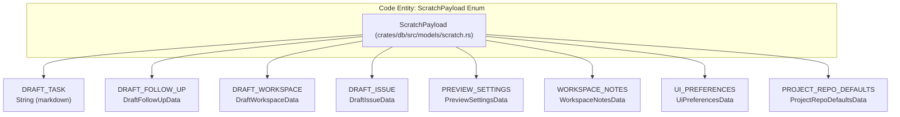
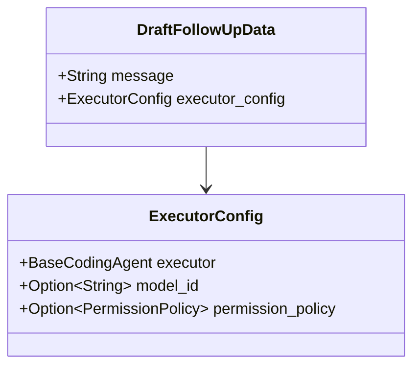
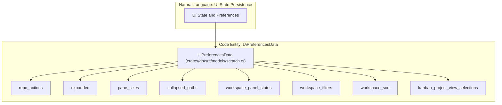
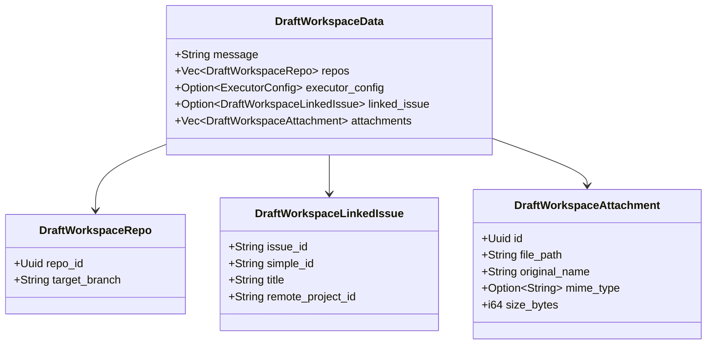
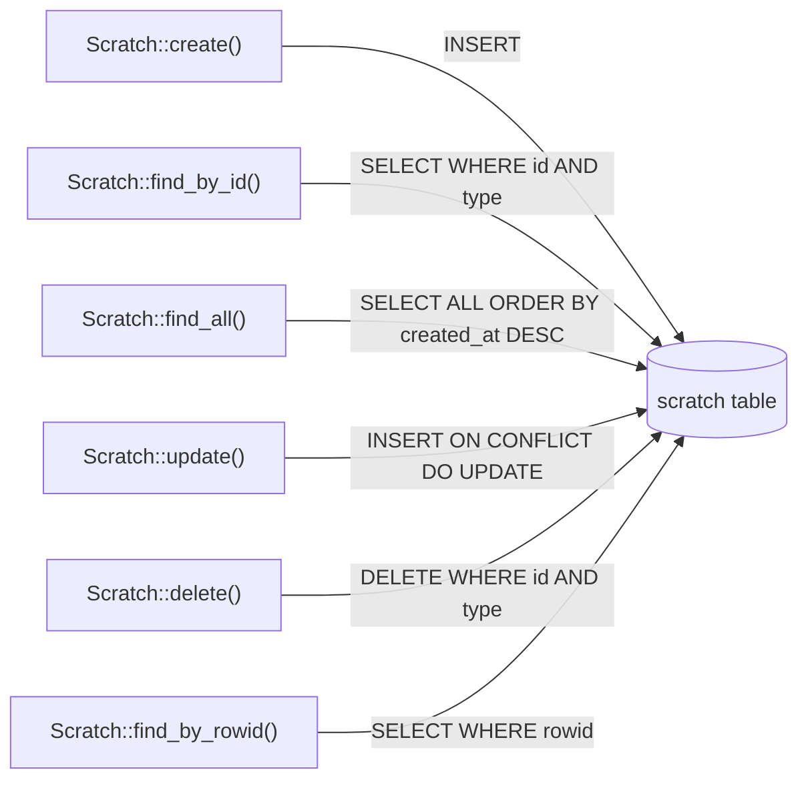

# Scratch Data and UI State Persistence

<details>
<summary>Relevant source files</summary>

The following files were used as context for generating this wiki page:

- [crates/db/src/models/scratch.rs](crates/db/src/models/scratch.rs)
- [crates/server/src/bin/generate_types.rs](crates/server/src/bin/generate_types.rs)
- [packages/remote-web/src/app/providers/RemoteActionsProvider.tsx](packages/remote-web/src/app/providers/RemoteActionsProvider.tsx)
- [packages/web-core/src/pages/kanban/IssueCommentsSectionContainer.tsx](packages/web-core/src/pages/kanban/IssueCommentsSectionContainer.tsx)
- [packages/web-core/src/shared/actions/index.ts](packages/web-core/src/shared/actions/index.ts)
- [packages/web-core/src/shared/hooks/useKanbanIssueComposerScratch.ts](packages/web-core/src/shared/hooks/useKanbanIssueComposerScratch.ts)
- [packages/web-core/src/shared/hooks/useLocalStorageScratch.ts](packages/web-core/src/shared/hooks/useLocalStorageScratch.ts)
- [packages/web-core/src/shared/hooks/useProjectWorkspaceCreateDraft.ts](packages/web-core/src/shared/hooks/useProjectWorkspaceCreateDraft.ts)
- [packages/web-core/src/shared/hooks/useScratch.ts](packages/web-core/src/shared/hooks/useScratch.ts)
- [packages/web-core/src/shared/lib/workspaceCreateState.ts](packages/web-core/src/shared/lib/workspaceCreateState.ts)
- [packages/web-core/src/shared/providers/ActionsProvider.tsx](packages/web-core/src/shared/providers/ActionsProvider.tsx)
- [packages/web-core/src/shared/types/actions.ts](packages/web-core/src/shared/types/actions.ts)
- [shared/types.ts](shared/types.ts)

</details>


The scratch system provides a unified persistence layer for draft data, UI preferences, and temporary state that should survive page refreshes but may not be permanent application data. This system enables features like auto-saving workspace drafts, persisting user UI preferences, and maintaining temporary settings like preview URLs.

For information about how scratch updates are streamed to clients in real-time, see [2.6 Real-time Streaming and Updates]().

## Purpose and Scope

The `scratch` table stores ephemeral or semi-ephemeral data that represents user intent or interface state. Unlike core entities like `workspaces` or `execution_processes`, scratch data is explicitly designed to be:

- **Transient**: Can be safely deleted without affecting system functionality.
- **User-scoped**: Typically associated with a specific user or device.
- **Draft-oriented**: Represents incomplete or in-progress user actions.
- **Preference-driven**: Captures UI state and user customization.

The scratch system uses a composite primary key of `(id, scratch_type)`, allowing the same ID to store different types of scratch data [crates/db/src/models/scratch.rs:261-266](). This design enables, for example, storing both a draft workspace and draft follow-up for the same workspace ID.

Sources: [crates/db/src/models/scratch.rs:10-18](), [crates/db/src/models/scratch.rs:261-266]()

## Runtime-Aware Persistence

The scratch system adapts its storage mechanism based on the application runtime [packages/web-core/src/shared/hooks/useScratch.ts:34-40]().

- **Local Runtime**: Streams a single scratch item via WebSocket (JSON Patch) backed by the server-side SQLite `scratch` table [packages/web-core/src/shared/hooks/useScratch.ts:48-57]().
- **Remote Runtime**: Persists scratch data in the browser's `localStorage` for the stable cloud domain [packages/web-core/src/shared/hooks/useScratch.ts:43-45]().

The `useScratch` hook abstracts these details, providing a consistent interface for `updateScratch` and `deleteScratch` regardless of the environment [packages/web-core/src/shared/hooks/useScratch.ts:63-86](). In the remote runtime, `useLocalStorageScratch` mirrors the interface of the WebSocket-based hook [packages/web-core/src/shared/hooks/useLocalStorageScratch.ts:97-101]().

Sources: [packages/web-core/src/shared/hooks/useScratch.ts:34-86](), [packages/web-core/src/shared/hooks/useLocalStorageScratch.ts:97-101]()

## Scratch Types and Data Structures

The system defines several distinct scratch types, each with a specific data structure and purpose. The `ScratchPayload` enum discriminates between these types using a tagged union pattern [crates/db/src/models/scratch.rs:222-240]().

### Scratch Type Enumeration



Sources: [crates/db/src/models/scratch.rs:222-240]()

### Scratch Type Purposes

| Scratch Type | Primary Use Case | ID Scope | Example Usage |
|--------------|------------------|----------|---------------|
| `DRAFT_TASK` | Autosave task/comment descriptions | Task ID or Issue ID | User typing a new issue comment [packages/web-core/src/pages/kanban/IssueCommentsSectionContainer.tsx:77-83]() |
| `DRAFT_FOLLOW_UP` | Draft follow-up prompts for workspaces | Workspace ID | Composing a follow-up message before sending |
| `DRAFT_WORKSPACE` | New workspace creation form | Generated UUID | Workspace creation modal with repos and config [packages/web-core/src/shared/lib/workspaceCreateState.ts:23-24]() |
| `DRAFT_ISSUE` | Issue creation on kanban board | Generated UUID or status ID | Creating a new issue with partial information |
| `PREVIEW_SETTINGS` | Preview URL and screen size | Workspace ID | Custom preview URL for a workspace's dev server |
| `WORKSPACE_NOTES` | Free-form workspace notes | Workspace ID | User notes about a workspace's purpose |
| `UI_PREFERENCES` | Global UI state and preferences | User/device ID | Sidebar visibility, panel sizes, expanded state |
| `PROJECT_REPO_DEFAULTS` | Default repos per project | Project ID | Remembered repo selections for new workspaces |

Sources: [crates/db/src/models/scratch.rs:22-218](), [packages/web-core/src/pages/kanban/IssueCommentsSectionContainer.tsx:77-83]()

## Data Model Structures

### DraftFollowUpData

Stores the draft message and executor configuration for a follow-up prompt on an existing workspace [crates/db/src/models/scratch.rs:22-26]().



The `executor_config` field includes backwards-compatible aliases (`executor_profile_id`, `config`) to support data migration from older versions [crates/db/src/models/scratch.rs:24-25]().

Sources: [crates/db/src/models/scratch.rs:22-26](), [shared/types.ts:33]()

### UiPreferencesData

The most complex scratch type, storing global user preferences across multiple UI subsystems [crates/db/src/models/scratch.rs:101-147]().



Sources: [crates/db/src/models/scratch.rs:101-153](), [shared/types.ts:73-141]()

### DraftWorkspaceData

Stores all information needed to create a new workspace, including repos, executor configuration, linked issues, and uploaded attachments [crates/db/src/models/scratch.rs:177-187]().



Sources: [crates/db/src/models/scratch.rs:157-194](), [shared/types.ts:35-41]()

## Database Schema and Operations

### Table Structure

The `scratch` table uses a composite primary key design [crates/db/src/models/scratch.rs:261-266]():

```sql
CREATE TABLE scratch (
    id              TEXT NOT NULL,
    scratch_type    TEXT NOT NULL,
    payload         TEXT NOT NULL,
    created_at      DATETIME DEFAULT (datetime('now', 'subsec')),
    updated_at      DATETIME DEFAULT (datetime('now', 'subsec')),
    PRIMARY KEY (id, scratch_type)
);
```

The `payload` column stores the JSON-serialized `ScratchPayload`, while `scratch_type` stores the enum discriminant as a string (e.g., "DRAFT_WORKSPACE") [crates/db/src/models/scratch.rs:285-302]().

Sources: [crates/db/src/models/scratch.rs:261-302]()

### CRUD Operations

The `Scratch` model provides primary operations for managing state:



Sources: [crates/db/src/models/scratch.rs:317-477]()

## Usage Patterns

### Issue Comment Autosave

When a user types a comment in the Kanban issue panel, the `IssueCommentsSectionContainer` uses the `useScratch` hook with `ScratchType.DRAFT_TASK` [packages/web-core/src/pages/kanban/IssueCommentsSectionContainer.tsx:78-83](). The draft is keyed by `issue-comment:${issueId}` [packages/web-core/src/pages/kanban/IssueCommentsSectionContainer.tsx:77]().

Sources: [packages/web-core/src/pages/kanban/IssueCommentsSectionContainer.tsx:77-115]()

### Workspace Creation Flow

The `persistWorkspaceCreateDraft` function converts the frontend's `CreateModeInitialState` into `DraftWorkspaceData` and persists it [packages/web-core/src/shared/lib/workspaceCreateState.ts:100-110](). In remote runtimes, this uses `localStorageScratchUpdate` [packages/web-core/src/shared/lib/workspaceCreateState.ts:113-118](), while local runtimes use `scratchApi.update` [packages/web-core/src/shared/lib/workspaceCreateState.ts:124-126]().

Sources: [packages/web-core/src/shared/lib/workspaceCreateState.ts:100-133]()

### Kanban Issue Composer

The Kanban issue panel maintains its own specialized scratch mechanism for issue creation state via `useKanbanIssueComposerScratch` [packages/web-core/src/shared/hooks/useKanbanIssueComposerScratch.ts:51](). On remote-web, this synchronizes the `KanbanIssueComposerStore` to `localStorage` under the key `vk-kanban-issue-composer` [packages/web-core/src/shared/hooks/useKanbanIssueComposerScratch.ts:8-12]().

Sources: [packages/web-core/src/shared/hooks/useKanbanIssueComposerScratch.ts:8-87]()

## TypeScript Type Generation

All scratch data structures are decorated with `#[derive(TS)]`, which generates corresponding TypeScript types via the `ts-rs` crate [crates/db/src/models/scratch.rs:7](). The `generate_types` binary includes these models to ensure type safety across the frontend-backend boundary [crates/server/src/bin/generate_types.rs:25-45]().

Sources: [crates/db/src/models/scratch.rs:21-234](), [crates/server/src/bin/generate_types.rs:25-45](), [shared/types.ts:1-153]()