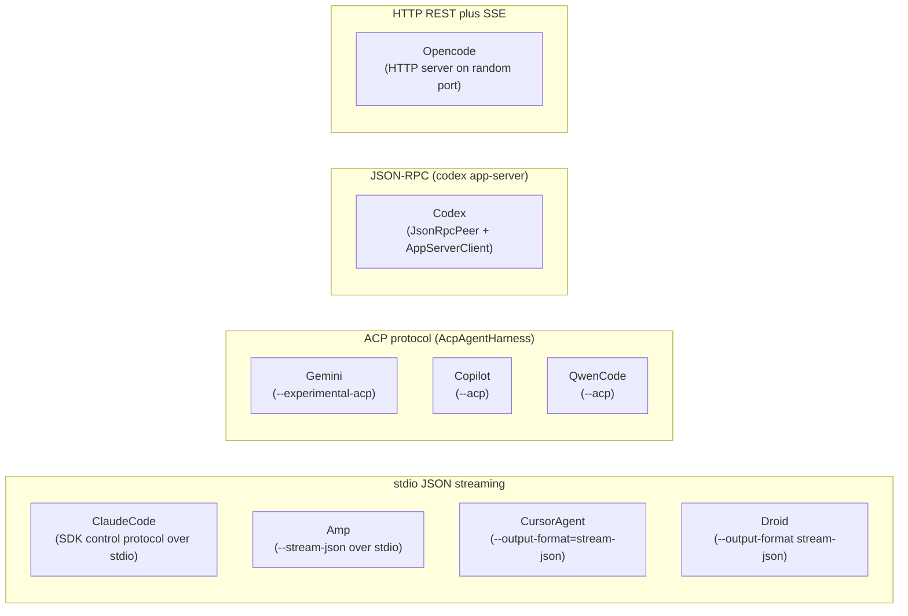
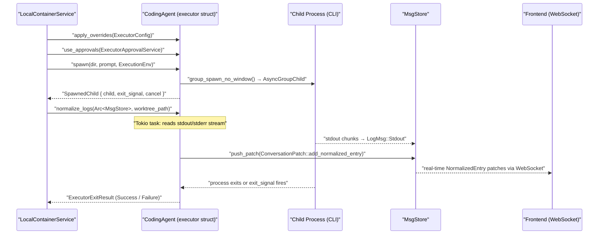

# Executor System

<details>
<summary>Relevant source files</summary>

The following files were used as context for generating this wiki page:

- [crates/executors/default_profiles.json](crates/executors/default_profiles.json)
- [crates/executors/src/executors/amp.rs](crates/executors/src/executors/amp.rs)
- [crates/executors/src/executors/claude.rs](crates/executors/src/executors/claude.rs)
- [crates/executors/src/executors/codex.rs](crates/executors/src/executors/codex.rs)
- [crates/executors/src/executors/codex/client.rs](crates/executors/src/executors/codex/client.rs)
- [crates/executors/src/executors/codex/normalize_logs.rs](crates/executors/src/executors/codex/normalize_logs.rs)
- [crates/executors/src/executors/codex/review.rs](crates/executors/src/executors/codex/review.rs)
- [crates/executors/src/executors/codex/slash_commands.rs](crates/executors/src/executors/codex/slash_commands.rs)
- [crates/executors/src/executors/copilot.rs](crates/executors/src/executors/copilot.rs)
- [crates/executors/src/executors/cursor.rs](crates/executors/src/executors/cursor.rs)
- [crates/executors/src/executors/droid.rs](crates/executors/src/executors/droid.rs)
- [crates/executors/src/executors/gemini.rs](crates/executors/src/executors/gemini.rs)
- [crates/executors/src/executors/mod.rs](crates/executors/src/executors/mod.rs)
- [crates/executors/src/executors/opencode.rs](crates/executors/src/executors/opencode.rs)
- [crates/executors/src/executors/qwen.rs](crates/executors/src/executors/qwen.rs)
- [packages/web-core/src/features/workspace-chat/ui/DisplayConversationEntry.tsx](packages/web-core/src/features/workspace-chat/ui/DisplayConversationEntry.tsx)
- [shared/schemas/codex.json](shared/schemas/codex.json)
- [shared/schemas/cursor_agent.json](shared/schemas/cursor_agent.json)

</details>


This section covers the `crates/executors` crate: how AI coding agents are abstracted, configured, spawned as subprocesses, and how their raw output is normalized into a structured conversation format. For information on how executors are invoked within the broader workspace lifecycle, see [Workspaces and Execution Lifecycle](#2.3). For configuration profiles and user overrides, see [Executor Profiles and Configuration](#3.2). For the approval system that gates tool calls, see [Approval System](#3.5).

---

## Core Abstractions

### The `StandardCodingAgentExecutor` Trait

Every AI coding agent in the system implements the `StandardCodingAgentExecutor` trait, defined in [crates/executors/src/executors/mod.rs:221-295](). The trait is dispatched through the `CodingAgent` enum using the `enum_dispatch` crate, which eliminates dynamic dispatch overhead.

| Method | Signature | Purpose |
|---|---|---|
| `apply_overrides` | `(&mut self, &ExecutorConfig)` | Merge profile settings (model, permissions) into the struct before spawning [crates/executors/src/executors/mod.rs:223-223]() |
| `use_approvals` | `(&mut self, Arc<dyn ExecutorApprovalService>)` | Wire in the approval service for tool-use gating [crates/executors/src/executors/mod.rs:225-225]() |
| `spawn` | `(&self, dir, prompt, env) → SpawnedChild` | Launch the agent subprocess for a new session [crates/executors/src/executors/mod.rs:227-232]() |
| `spawn_follow_up` | `(&self, dir, prompt, session_id, reset_to_msg_id, env) → SpawnedChild` | Resume an existing session, optionally rolling back to a specific message [crates/executors/src/executors/mod.rs:234-241]() |
| `spawn_review` | `(&self, dir, prompt, session_id, env) → SpawnedChild` | Launch a code review session (defaults to `spawn`/`spawn_follow_up`) [crates/executors/src/executors/mod.rs:243-249]() |
| `normalize_logs` | `(&self, Arc<MsgStore>, &Path)` | Start a background Tokio task that reads raw stdout/stderr and emits `NormalizedEntry` patches [crates/executors/src/executors/mod.rs:251-255]() |
| `default_mcp_config_path` | `(&self) → Option<PathBuf>` | Return the path of this agent's MCP configuration file [crates/executors/src/executors/mod.rs:258-258]() |
| `get_availability_info` | `(&self) → AvailabilityInfo` | Detect whether the agent is installed/authenticated [crates/executors/src/executors/mod.rs:260-260]() |
| `discover_options` | `(&self, workdir, repo_path) → BoxStream<json_patch::Patch>` | Stream model list, agents, slash commands and permission policies available for this agent [crates/executors/src/executors/mod.rs:262-266]() |
| `get_preset_options` | `(&self) → ExecutorConfig` | Return the current executor config as an `ExecutorConfig` snapshot [crates/executors/src/executors/mod.rs:268-268]() |
| `get_setup_helper_action` | `(&self) → ExecutorAction` | Return a setup action (e.g., login) for agents that need it [crates/executors/src/executors/mod.rs:270-270]() |

Sources: [crates/executors/src/executors/mod.rs:221-295]()

---

### `CodingAgent` Enum and Dispatch

**`CodingAgent` enum dispatch chain**

```mermaid
graph TD
    CS["LocalContainerService\n(crates/local-deployment/src/container.rs)"] -->|"holds CodingAgent, calls trait methods"| CA["CodingAgent\n(enum_dispatch macro)"]
    CA -->|"variant"| CC["ClaudeCode struct\ncrates/executors/src/executors/claude.rs"]
    CA -->|"variant"| CX["Codex struct\ncrates/executors/src/executors/codex.rs"]
    CA -->|"variant"| OC["Opencode struct\ncrates/executors/src/executors/opencode.rs"]
    CA -->|"variant"| CU["CursorAgent struct\ncrates/executors/src/executors/cursor.rs"]
    CA -->|"variant"| AM["Amp struct\ncrates/executors/src/executors/amp.rs"]
    CA -->|"variant"| GE["Gemini struct\ncrates/executors/src/executors/gemini.rs"]
    CA -->|"variant"| CO["Copilot struct\ncrates/executors/src/executors/copilot.rs"]
    CA -->|"variant"| QW["QwenCode struct\ncrates/executors/src/executors/qwen.rs"]
    CA -->|"variant"| DR["Droid struct\ncrates/executors/src/executors/droid.rs"]
    CA -->|"variant qa-mode only"| QM["QaMockExecutor struct\ncrates/executors/src/executors/qa_mock.rs"]

    TRAIT["StandardCodingAgentExecutor trait\nmod.rs:221"] -. "implemented by" .-> CC
    TRAIT -. "implemented by" .-> CX
    TRAIT -. "implemented by" .-> OC
    TRAIT -. "implemented by" .-> CU
    TRAIT -. "implemented by" .-> AM
    TRAIT -. "implemented by" .-> GE
    TRAIT -. "implemented by" .-> CO
    TRAIT -. "implemented by" .-> QW
    TRAIT -. "implemented by" .-> DR
```



The `BaseCodingAgent` discriminant enum (derived from `CodingAgent` via `EnumDiscriminants`) is used as a lightweight identifier stored in the database and used in configuration [crates/executors/src/executors/mod.rs:101-108]().

Sources: [crates/executors/src/executors/mod.rs:93-124](), [crates/local-deployment/src/container.rs:28-36]()

---

### `SpawnedChild`

`spawn()` and `spawn_follow_up()` return a `SpawnedChild`, defined at [crates/executors/src/executors/mod.rs:316-322]():

```rust
pub struct SpawnedChild {
    pub child: AsyncGroupChild,                    // the OS process group
    pub exit_signal: Option<ExecutorExitSignal>,   // executor→container: completion notification
    pub cancel: Option<CancellationToken>,         // container→executor: shutdown request
}
```

- `exit_signal` is a `tokio::sync::oneshot::Receiver<ExecutorExitResult>`. Executors that manage their own lifecycle (Claude SDK, Codex JSON-RPC, Opencode HTTP) send through this channel when the session completes or fails, rather than waiting for the subprocess to exit naturally [crates/executors/src/executors/mod.rs:319-319]().
- `cancel` is a `tokio_util::sync::CancellationToken`. When the container cancels it, in-flight approval loops and protocol tasks should terminate gracefully before the process is killed [crates/executors/src/executors/mod.rs:321-321]().

Sources: [crates/executors/src/executors/mod.rs:316-322]()

---

### `ExecutorError`

`ExecutorError` (defined at [crates/executors/src/executors/mod.rs:67-92]()) enumerates all failure modes:

| Variant | Meaning |
|---|---|
| `FollowUpNotSupported` | Agent does not support session resumption [crates/executors/src/executors/mod.rs:68-69]() |
| `SpawnError` | I/O error from `group_spawn()` [crates/executors/src/executors/mod.rs:70-71]() |
| `Io` | Generic I/O error during execution [crates/executors/src/executors/mod.rs:74-75]() |
| `ExecutableNotFound` | Binary not on `PATH` [crates/executors/src/executors/mod.rs:86-87]() |
| `AuthRequired` | Agent needs authentication before running [crates/executors/src/executors/mod.rs:90-91]() |
| `ExecutorApprovalError` | Error from the approval service [crates/executors/src/executors/mod.rs:82-83]() |
| `CommandBuild` | Error constructing the CLI invocation [crates/executors/src/executors/mod.rs:84-85]() |
| `SetupHelperNotSupported` | `get_setup_helper_action()` called on an unsupported agent [crates/executors/src/executors/mod.rs:88-89]() |

---

### `AvailabilityInfo`

Each executor implements `get_availability_info()` to indicate whether the agent appears to be installed on the current machine:

| Variant | Meaning |
|---|---|
| `LoginDetected { last_auth_timestamp }` | An auth credential file was found (e.g., `~/.claude.json`) [crates/executors/src/executors/mod.rs:206-206]() |
| `InstallationFound` | Installation indicator found (e.g., config or version file) [crates/executors/src/executors/mod.rs:207-207]() |
| `NotFound` | No sign of the agent on this machine [crates/executors/src/executors/mod.rs:208-208]() |

Sources: [crates/executors/src/executors/mod.rs:205-209](), [crates/executors/src/executors/gemini.rs:155-181]()

---

## Executor Roster

**Executor implementations and their communication protocols**



The table below summarises each executor's identity and key configuration knobs:

| Agent | Rust Struct | CLI Invocation | Permission Control Field | Session Resume |
|---|---|---|---|---|
| `ClaudeCode` | `ClaudeCode` | `npx @anthropic-ai/claude-code` | `dangerously_skip_permissions` [crates/executors/src/executors/claude.rs:136-136]() | `--replay-user-messages` [crates/executors/src/executors/claude.rs:194-194]() |
| `Codex` | `Codex` | `npx @openai/codex app-server` | `ask_for_approval` [crates/executors/src/executors/codex.rs:159-159]() | `ThreadForkParams` [crates/executors/src/executors/codex.rs:34-48]() |
| `Opencode` | `Opencode` | `npx opencode-ai serve` | `auto_approve` [crates/executors/src/executors/opencode.rs:55-57]() | session ID via API [crates/executors/src/executors/opencode.rs:162-162]() |
| `Amp` | `Amp` | `npx @sourcegraph/amp` | `dangerously_allow_all` [crates/executors/src/executors/amp.rs:26-30]() | `threads continue <id>` [crates/executors/src/executors/amp.rs:93-97]() |
| `Gemini` | `Gemini` | `npx @google/gemini-cli` | `yolo` [crates/executors/src/executors/gemini.rs:38-38]() | ACP follow-up [crates/executors/src/executors/gemini.rs:110-137]() |
| `CursorAgent` | `CursorAgent` | `cursor-agent` | `force` [crates/executors/src/executors/cursor.rs:46-47]() | `--resume <session_id>` [crates/executors/src/executors/cursor.rs:172-174]() |
| `Copilot` | `Copilot` | `npx @github/copilot` | `allow_all_tools` [crates/executors/src/executors/copilot.rs:33-33]() | ACP follow-up [crates/executors/src/executors/copilot.rs:128-150]() |
| `QwenCode` | `QwenCode` | `npx @qwen-code/qwen-code` | `yolo` | ACP follow-up |
| `Droid` | `Droid` | `droid exec` | `autonomy` | session ID via args |
| `QaMock` | `QaMockExecutor` | `sh` script | N/A | treated as new spawn |

Sources: [crates/executors/src/executors/claude.rs:61-67](), [crates/executors/src/executors/codex.rs:153-191](), [crates/executors/src/executors/opencode.rs:90-97](), [crates/executors/src/executors/amp.rs:35-44](), [crates/executors/src/executors/gemini.rs:47-64](), [crates/executors/src/executors/cursor.rs:140-167](), [crates/executors/src/executors/copilot.rs:50-86](), [crates/executors/src/executors/mod.rs:109-124]()

---

## Execution Flow

**End-to-end spawn and normalization lifecycle**



Sources: [crates/executors/src/executors/mod.rs:221-295](), [crates/executors/src/executors/claude.rs:148-196](), [crates/executors/src/executors/codex.rs:194-224](), [crates/local-deployment/src/container.rs:28-36]()

---

## Agent Capabilities

Each `CodingAgent` variant reports a set of `BaseAgentCapability` values via the `capabilities()` method [crates/executors/src/executors/mod.rs:176-199]():

| Capability | Meaning | Agents |
|---|---|---|
| `SessionFork` | Agent supports `spawn_follow_up()` with a session ID | ClaudeCode, Opencode, Codex, Gemini, QwenCode [crates/executors/src/executors/mod.rs:179-194]() |
| `SetupHelper` | Agent has a guided setup flow (`get_setup_helper_action()`) | Codex, CursorAgent [crates/executors/src/executors/mod.rs:189-195]() |
| `ContextUsage` | Agent reports context/token usage information in logs | ClaudeCode, Opencode, Codex [crates/executors/src/executors/mod.rs:181-190]() |

---

## Communication Protocol Details

### stdio JSON streaming (Claude, Amp, Cursor, Droid)

These agents are spawned with `--output-format=stream-json` (or equivalent). The executor writes the prompt to `stdin`, then reads newline-delimited JSON from `stdout`. Claude additionally uses a bidirectional SDK control protocol over stdio, handled by `ClaudeAgentClient` and `ProtocolPeer` in `crates/executors/src/executors/claude/client.rs`.

Amp reuses `ClaudeLogProcessor::process_logs()` with `HistoryStrategy::AmpResume` because Amp's JSON format is compatible with Claude's [crates/executors/src/executors/amp.rs:135-140]().

### ACP Protocol (Gemini, Copilot, QwenCode)

These agents implement the Agent Client Protocol (ACP). The shared `AcpAgentHarness` struct in `crates/executors/src/executors/acp/mod.rs` handles process spawning and the ACP session lifecycle. Log normalization is shared via `normalize_logs` in `crates/executors/src/executors/acp/normalize_logs.rs`.

### JSON-RPC App Server (Codex)

Codex spawns `npx @openai/codex app-server`. The executor communicates over stdin/stdout using a JSON-RPC peer (`JsonRpcPeer`) and a higher-level `AppServerClient` [crates/executors/src/executors/codex/client.rs:48-63](). Sessions are resumed by forking a thread via `thread_fork` [crates/executors/src/executors/codex/client.rs:143-152]().

### HTTP REST + SSE (Opencode)

Opencode spawns `npx opencode-ai serve --port 0`. The executor waits for the server to print the listening URL on stdout [crates/executors/src/executors/opencode.rs:143-156](), then issues REST calls via its SDK. A random server password is generated per invocation via `generate_server_password()` [crates/executors/src/executors/opencode.rs:113-113]().

Sources: [crates/executors/src/executors/claude.rs:156-193](), [crates/executors/src/executors/codex/client.rs:110-151](), [crates/executors/src/executors/opencode.rs:105-156]()

---

## Log Normalization Overview

Every executor implements `normalize_logs(Arc<MsgStore>, &Path)`. This method spawns a background Tokio task that reads `LogMsg::Stdout` and `LogMsg::Stderr` events from the `MsgStore` stream and converts them into `NormalizedEntry` records pushed back as `ConversationPatch` operations.

The normalized entries flow into the frontend as real-time JSON patches over WebSocket. Entry types include:

- `AssistantMessage` — text from the model [crates/executors/src/executors/codex/normalize_logs.rs:25-25]()
- `ToolUse { tool_name, action_type, status }` — tool invocations with their result [crates/executors/src/executors/codex/normalize_logs.rs:100-117]()
- `ErrorMessage` — errors from stderr or the executor [crates/executors/src/executors/claude.rs:79-81]()
- `Thinking` — extended thinking blocks [crates/executors/src/executors/codex/normalize_logs.rs:25-25]()

For the full details of normalization logic, see [Log Processing and Normalization](#3.4).

Sources: [crates/executors/src/executors/codex/normalize_logs.rs:86-117](), [crates/executors/src/executors/claude.rs:69-102](), [crates/executors/src/executors/amp.rs:127-146]()

---

## Default Profiles and Configuration

Every executor has a default profile defined in [crates/executors/default_profiles.json](). These profiles set the minimum configuration needed for autonomous operation (e.g., skipping permission prompts):

| Executor | Default Setting |
|---|---|
| `CLAUDE_CODE` | `dangerously_skip_permissions: true` [crates/executors/default_profiles.json:6-6]() |
| `AMP` | `dangerously_allow_all: true` [crates/executors/default_profiles.json:13-13]() |
| `GEMINI` | `yolo: true` [crates/executors/default_profiles.json:20-20]() |
| `CODEX` | `sandbox: "danger-full-access"` [crates/executors/default_profiles.json:27-27]() |
| `OPENCODE` | `auto_approve: true` [crates/executors/default_profiles.json:34-34]() |
| `CURSOR_AGENT` | `force: true`, `model: "auto"` [crates/executors/default_profiles.json:48-49]() |
| `COPILOT` | `allow_all_tools: true` [crates/executors/default_profiles.json:56-56]() |
| `DROID` | `autonomy: "skip-permissions-unsafe"` [crates/executors/default_profiles.json:63-63]() |

User overrides are layered on top of these defaults. See [Executor Profiles and Configuration](#3.2) for the full merging and caching mechanism.

Sources: [crates/executors/default_profiles.json:1-68]()

---

## Approval System Overview

When `approvals` or `plan` mode is enabled, the executor wires in an `ExecutorApprovalService` (injected via `use_approvals()`). Before executing a tool call, the agent pauses and sends an approval request. The service routes this to the UI, where the user can approve or deny.

This is implemented differently per executor:
- **ClaudeCode**: uses `PermissionMode` and `stdio` prompt tools [crates/executors/src/executors/claude.rs:168-173]().
- **Codex**: the `AppServerClient` handles `CommandExecutionApprovalDecision` and `FileChangeApprovalDecision` [crates/executors/src/executors/codex/client.rs:11-16]().
- **Opencode**: supports an `auto_approve` toggle in its configuration [crates/executors/src/executors/opencode.rs:55-57]().

For the full approval mechanism, see [Approval System](#3.5).

Sources: [crates/executors/src/executors/claude.rs:168-173](), [crates/executors/src/executors/codex/client.rs:11-16](), [crates/executors/src/executors/opencode.rs:55-57]()

---

## MCP Configuration

Each executor reports its MCP config file path via `default_mcp_config_path()` and the JSON key structure for MCP server entries via `get_mcp_config()`.

| Agent | MCP Config File | JSON Key |
|---|---|---|
| `ClaudeCode` | `~/.claude.json` | `mcpServers` [crates/executors/src/executors/mod.rs:163-169]() |
| `Codex` | `~/.codex/config.toml` | `mcp_servers` [crates/executors/src/executors/mod.rs:129-136]() |
| `Opencode` | `config.json` | `mcp` [crates/executors/src/executors/mod.rs:145-153]() |
| `Amp` | `~/.config/amp/settings.json` | `amp.mcpServers` [crates/executors/src/executors/mod.rs:137-144]() |
| `Gemini` | `~/.gemini/settings.json` | `mcpServers` [crates/executors/src/executors/gemini.rs:151-153]() |
| `Copilot` | `~/.copilot/mcp-config.json` | `mcpServers` [crates/executors/src/executors/copilot.rs:160-162]() |

Sources: [crates/executors/src/executors/mod.rs:127-171](), [crates/executors/src/executors/amp.rs:149-151](), [crates/executors/src/executors/gemini.rs:151-153](), [crates/executors/src/executors/copilot.rs:160-162]()

---

## `ExecutionEnv`

`ExecutionEnv` is passed to every `spawn()` call and carries ambient context that is not executor-specific:

- `RepoContext` — repository metadata [crates/executors/src/executors/opencode.rs:18-18]().
- Environment variables and profile-level env overrides [crates/executors/src/executors/amp.rs:69-71]().

Executors apply `env.clone().with_profile(&self.cmd).apply_to_command(&mut command)` to propagate environment variables to the child process [crates/executors/src/executors/amp.rs:69-71]().

Sources: [crates/executors/src/executors/amp.rs:69-71](), [crates/executors/src/executors/opencode.rs:129-131]()