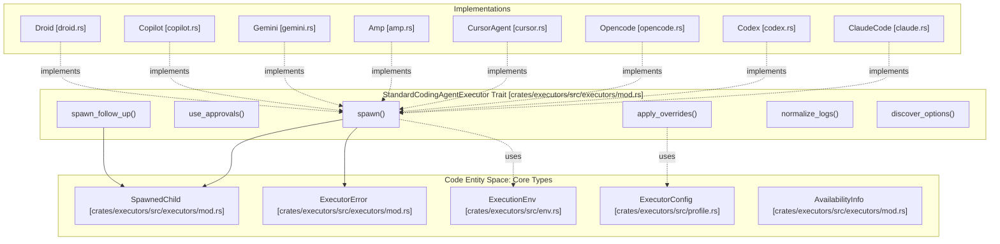
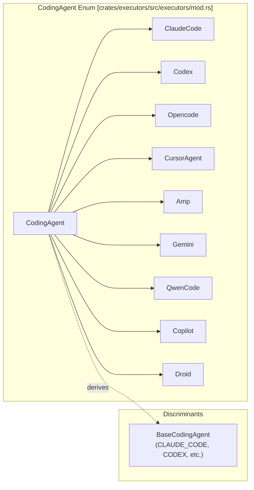
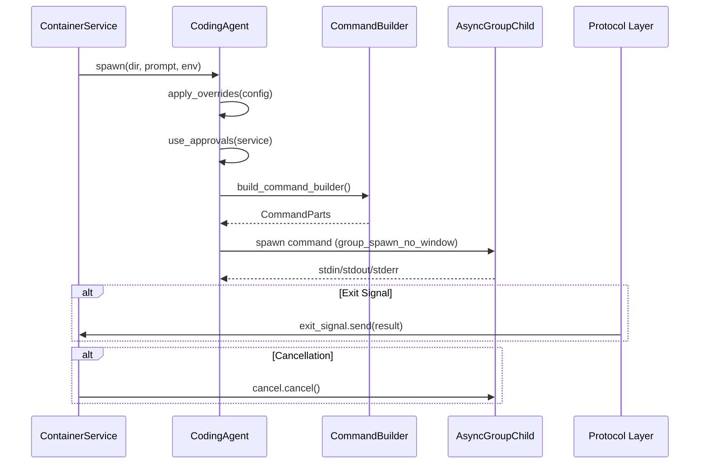

# Executor Architecture and Traits

Relevant source files

The following files were used as context for generating this wiki page:

- [crates/executors/default_profiles.json](crates/executors/default_profiles.json)
- [crates/executors/src/command.rs](crates/executors/src/command.rs)
- [crates/executors/src/executors/amp.rs](crates/executors/src/executors/amp.rs)
- [crates/executors/src/executors/claude.rs](crates/executors/src/executors/claude.rs)
- [crates/executors/src/executors/copilot.rs](crates/executors/src/executors/copilot.rs)
- [crates/executors/src/executors/cursor.rs](crates/executors/src/executors/cursor.rs)
- [crates/executors/src/executors/droid.rs](crates/executors/src/executors/droid.rs)
- [crates/executors/src/executors/gemini.rs](crates/executors/src/executors/gemini.rs)
- [crates/executors/src/executors/mod.rs](crates/executors/src/executors/mod.rs)
- [crates/executors/src/executors/opencode.rs](crates/executors/src/executors/opencode.rs)
- [crates/executors/src/executors/qwen.rs](crates/executors/src/executors/qwen.rs)
- [crates/executors/src/logs/mod.rs](crates/executors/src/logs/mod.rs)
- [shared/schemas/cursor_agent.json](shared/schemas/cursor_agent.json)

This document describes the core executor system that enables Vibe Kanban to integrate with multiple AI coding agents. It covers the `StandardCodingAgentExecutor` trait, the executor enumeration pattern, spawn lifecycle, configuration system, log normalization architecture, and approval integration.

---

## Core Trait: StandardCodingAgentExecutor

The `StandardCodingAgentExecutor` trait defines the common interface that all AI coding agent executors must implement. This trait enables Vibe Kanban to work with diverse executors (Claude Code, Codex, Cursor, etc.) through a unified API.

### StandardCodingAgentExecutor Interface

| Method | Purpose | Returns |
|--------|---------|---------|
| `spawn()` | Start new execution with prompt | `Result<SpawnedChild, ExecutorError>` |
| `spawn_follow_up()` | Continue existing session | `Result<SpawnedChild, ExecutorError>` |
| `spawn_review()` | Start code review session | `Result<SpawnedChild, ExecutorError>` |
| `normalize_logs()` | Convert raw output to structured logs | `Vec<JoinHandle<()>>` |
| `discover_options()` | Query available models/agents | `BoxStream<'static, json_patch::Patch>` |
| `apply_overrides()` | Apply runtime configuration | `()` |
| `use_approvals()` | Inject approval service | `()` |
| `get_preset_options()` | Get default configuration | `ExecutorConfig` |
| `default_mcp_config_path()` | MCP config file location | `Option<PathBuf>` |
| `get_availability_info()` | Check authentication status | `AvailabilityInfo` |

### Architecture Overview
The following diagram bridges the Natural Language concepts (like "Spawning an Agent") to the specific Code Entities used in the Rust backend.

Title: Executor Trait and Data Flow

Sources: [crates/executors/src/executors/mod.rs:220-302](), [crates/executors/src/executors/claude.rs:148-196](), [crates/executors/src/executors/cursor.rs:170-185](), [crates/executors/src/executors/amp.rs:47-53](), [crates/executors/src/executors/gemini.rs:84-108](), [crates/executors/src/executors/copilot.rs:89-106](), [crates/executors/src/executors/droid.rs:144-168]()

---

## Executor Enumeration and Dispatch

Vibe Kanban uses the `enum_dispatch` pattern to provide zero-cost abstraction over different executor implementations. The `CodingAgent` enum contains variants for each supported executor, and trait methods are automatically dispatched to the appropriate implementation.

Title: CodingAgent Dispatch Hierarchy

**Executor Variants**
The `CodingAgent` enum is defined with `#[enum_dispatch(StandardCodingAgentExecutor)]`, which generates trait delegation code automatically. The `BaseCodingAgent` discriminant enum provides a simple enumeration of executor types without the associated data, useful for storage in the database (via `sqlx::Type`) and type identification.

Sources: [crates/executors/src/executors/mod.rs:94-124](), [crates/executors/src/executors/mod.rs:103-108]()

---

## Spawn Lifecycle

The spawn lifecycle describes how an executor is created, configured, launched, and monitored.

Title: Execution Process Sequence

**SpawnedChild Structure**
The `SpawnedChild` struct wraps the spawned process and provides bidirectional signaling:
- `child`: `AsyncGroupChild` - The spawned process group. [crates/executors/src/executors/mod.rs:322-339]()
- `exit_signal`: `Option<ExecutorExitSignal>` - Signals completion to the `ContainerService`.
- `cancel`: `Option<CancellationToken>` - Requests cancellation from the `ContainerService`.

Sources: [crates/executors/src/executors/mod.rs:322-339](), [crates/executors/src/executors/claude.rs:148-196](), [crates/executors/src/executors/opencode.rs:105-136]()

---

## Configuration and Overrides

Executors are configured through a layered system: base configuration, profile defaults, and runtime overrides.

**CmdOverrides Pattern**
Every executor struct (e.g., `ClaudeCode`, `Opencode`, `CursorAgent`) includes a `CmdOverrides` field (flattened with serde) that provides common configuration:
- `base_command_override`: Override the default binary (e.g., `npx claude-code`).
- `additional_params`: Extra CLI flags.
- `env`: Environment variables passed to the process.

Sources: [crates/executors/src/executors/claude.rs:119-145](), [crates/executors/src/executors/cursor.rs:42-57](), [crates/executors/src/executors/opencode.rs:46-67](), [crates/executors/src/executors/amp.rs:22-33](), [crates/executors/src/executors/gemini.rs:30-45](), [crates/executors/src/executors/copilot.rs:25-48](), [crates/executors/src/executors/droid.rs:57-85]()

**Default Profiles**
The `default_profiles.json` file defines standard configurations for executors, such as enabling "YOLO" mode or skipping permissions.
- `CLAUDE_CODE`: `dangerously_skip_permissions: true` [crates/executors/default_profiles.json:6]()
- `OPENCODE`: `auto_approve: true` [crates/executors/default_profiles.json:34]()
- `CURSOR_AGENT`: `force: true` [crates/executors/default_profiles.json:48]()
- `GEMINI`: `yolo: true` [crates/executors/default_profiles.json:20]()
- `DROID`: `autonomy: skip-permissions-unsafe` [crates/executors/default_profiles.json:63]()

---

## Log Processing Architecture

Executors produce raw output (stdout/stderr) that must be converted to structured `NormalizedEntry` objects. Each executor implements `normalize_logs()` to spawn background tasks that process these streams.

| Type | Purpose | Example |
|------|---------|---------|
| `AssistantMessage` | AI text responses | Claude thinking out loud |
| `ToolUse` | Tool invocations | Shell command, file edit, web search |
| `ErrorMessage` | Errors | API key missing, auth failed |

**Processing Patterns**
1. **JSON Line Protocol**: `ClaudeCode`, `Amp`, `Droid`, and `CursorAgent` use `PlainTextLogProcessor` or specialized processors to handle streaming JSON output. [crates/executors/src/executors/claude.rs:69-102](), [crates/executors/src/executors/amp.rs:127-146](), [crates/executors/src/executors/droid.rs:186-196]()
2. **ACP Protocol**: `Gemini`, `QwenCode`, and `Copilot` use `AcpAgentHarness` and its associated `normalize_logs` for Agent Client Protocol messages. [crates/executors/src/executors/gemini.rs:139-149](), [crates/executors/src/executors/copilot.rs:152-158](), [crates/executors/src/executors/qwen.rs:148-154]()
3. **Opencode Logic**: `Opencode` uses specialized server event handling to process logs. [crates/executors/src/executors/opencode.rs:172-200]()

Sources: [crates/executors/src/executors/claude.rs:69-102](), [crates/executors/src/executors/gemini.rs:139-149](), [crates/executors/src/executors/amp.rs:127-146](), [crates/executors/src/executors/droid.rs:186-196]()

---

## Executor Discovery System

The discovery system allows the UI to query an executor for available models, agents, and permission policies. Executors return a stream of JSON patches that progressively update the UI.

- **Claude**: Discovers models like `claude-3-7-sonnet` and handles permission policies. [crates/executors/src/executors/claude.rs:404-564]()
- **Opencode**: Discovers agents and providers via its local server protocol. [crates/executors/src/executors/opencode.rs:527-731]()
- **Copilot**: Hardcodes discovery for models like `gpt-5.4` and `claude-opus-4.6`. [crates/executors/src/executors/copilot.rs:192-210]()
- **Gemini**: Provides a list of available Gemini models and reasoning options. [crates/executors/src/executors/gemini.rs:199-220]()
- **Droid**: Discovers autonomy levels and reasoning effort options. [crates/executors/src/executors/droid.rs:202-214]()

Sources: [crates/executors/src/executors/claude.rs:404-564](), [crates/executors/src/executors/opencode.rs:527-731](), [crates/executors/src/executors/copilot.rs:192-210](), [crates/executors/src/executors/gemini.rs:199-220]()

---

## Approval Integration

Executors integrate with the `ExecutorApprovalService` to request user permission before executing dangerous operations.

- **Claude Code**: Uses `PermissionMode::BypassPermissions` when `plan` or `approvals` is enabled, otherwise it suppresses `AskUserQuestion`. [crates/executors/src/executors/claude.rs:160-174]()
- **Gemini/Qwen/Copilot**: Use a `yolo` or `allow_all_tools` flag to toggle between `PermissionPolicy::Auto` and `Supervised`. [crates/executors/src/executors/gemini.rs:68-78](), [crates/executors/src/executors/copilot.rs:99-105](), [crates/executors/src/executors/qwen.rs:69-74]()
- **Opencode**: Provides an `auto_approve` flag that bypasses manual confirmation for agent actions. [crates/executors/src/executors/opencode.rs:55-57]()
- **Droid**: Maps `PermissionPolicy` to `Autonomy` levels (e.g., `Auto` becomes `SkipPermissionsUnsafe`). [crates/executors/src/executors/droid.rs:149-156]()

Sources: [crates/executors/src/executors/claude.rs:160-174](), [crates/executors/src/executors/gemini.rs:68-78](), [crates/executors/src/executors/copilot.rs:99-105](), [crates/executors/src/executors/opencode.rs:55-57](), [crates/executors/src/executors/droid.rs:149-156]()

---

## Error Handling

The `ExecutorError` enum provides comprehensive error handling across all executors.

| Variant | Purpose |
|---------|---------|
| `FollowUpNotSupported` | Session continuation not supported by this agent. |
| `SpawnError` | Process spawn failed (I/O). |
| `ExecutableNotFound` | The agent binary (e.g., `cursor-agent`) is missing from PATH. |
| `AuthRequired` | The agent requires login (e.g., `claude login`). |

Sources: [crates/executors/src/executors/mod.rs:66-92]()