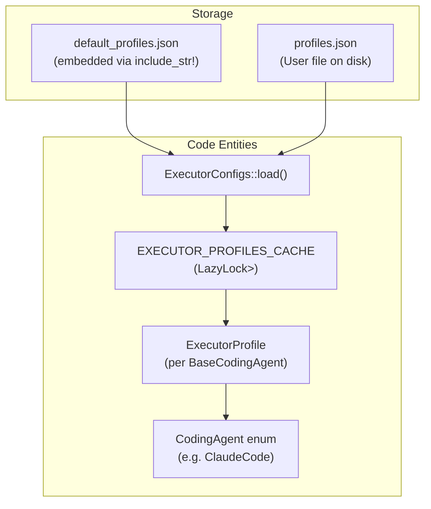
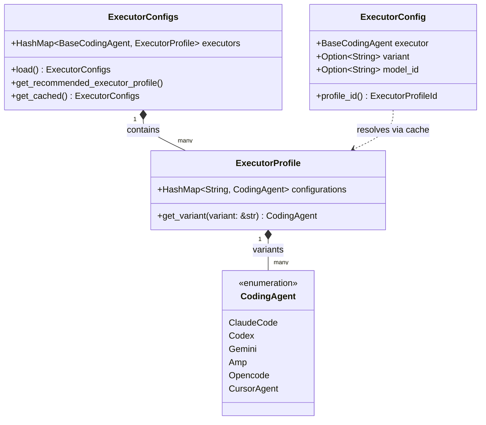
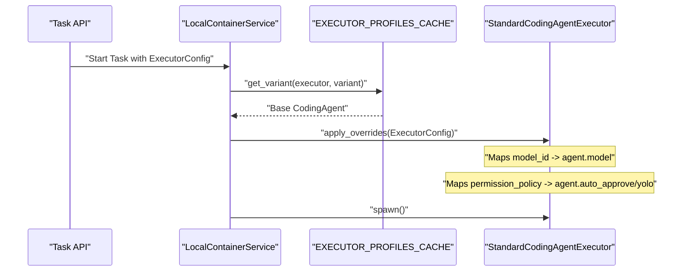

# Executor Profiles and Configuration

<details>
<summary>Relevant source files</summary>

The following files were used as context for generating this wiki page:

- [crates/deployment/src/lib.rs](crates/deployment/src/lib.rs)
- [crates/executors/src/profile.rs](crates/executors/src/profile.rs)
- [crates/local-deployment/src/lib.rs](crates/local-deployment/src/lib.rs)
- [crates/server/src/error.rs](crates/server/src/error.rs)
- [crates/server/src/routes/config.rs](crates/server/src/routes/config.rs)
- [crates/services/src/services/mod.rs](crates/services/src/services/mod.rs)
- [packages/web-core/src/shared/hooks/useExecutorConfig.ts](packages/web-core/src/shared/hooks/useExecutorConfig.ts)
- [shared/schemas/claude_code.json](shared/schemas/claude_code.json)

</details>


This page covers how executor profiles and configurations are defined, stored, merged, and applied at runtime in `vibe-kanban`. It describes the types `ExecutorConfigs`, `ExecutorProfile`, `ExecutorProfileId`, and `ExecutorConfig`; the configuration files (`default_profiles.json` and `profiles.json`); the static in-memory cache; and the mechanism by which per-request overrides are translated into executor-native settings.

---

## Overview

Every time `vibe-kanban` runs an AI coding agent, it resolves two layers of configuration:

1.  **Identity & Preset**: Which agent family to run (e.g., `CLAUDE_CODE`) and which named preset (variant) to use (e.g., `DEFAULT`).
2.  **Runtime Overrides**: User-level overrides provided at execution time, such as a specific model ID or permission policy.

These are resolved against a merged configuration cache built from embedded defaults and an optional user-written `profiles.json`.

**Configuration Loading Diagram**



Sources: [crates/executors/src/profile.rs:55-59](), [crates/executors/src/profile.rs:240-275]()

---

## Key Types

### `ExecutorProfileId`

A lightweight identifier for a profile consisting of the executor type and an optional variant name.

```rust
pub struct ExecutorProfileId {
    pub executor: BaseCodingAgent,
    pub variant: Option<String>,
}
```

The `cache_key()` method produces strings like `CLAUDE_CODE` or `CLAUDE_CODE:PLAN`. Variant keys are normalized to `SCREAMING_SNAKE_CASE` via `canonical_variant_key()`, except for `"DEFAULT"`.

Sources: [crates/executors/src/profile.rs:62-118](), [crates/executors/src/profile.rs:21-29]()

### `ExecutorConfig`

The primary object used in API requests and state persistence. It wraps the `ExecutorProfileId` and adds optional override fields. This type is shared with the frontend via `ts-rs`.

| Field | Type | Description |
| :--- | :--- | :--- |
| `executor` | `BaseCodingAgent` | The agent family (e.g., `CLAUDE_CODE`, `AMP`, `CURSOR_AGENT`). |
| `variant` | `Option<String>` | Named preset; defaults to `None` (which resolves to `"DEFAULT"`). |
| `model_id` | `Option<String>` | Specific model override (e.g., `claude-3-7-sonnet`). |
| `agent_id` | `Option<String>` | Agent mode override (e.g., `architect`). |
| `reasoning_id` | `Option<String>` | Reasoning effort level (e.g., `high`). |
| `permission_policy` | `Option<PermissionPolicy>` | `Auto`, `Supervised`, or `Plan`. |

Sources: [crates/executors/src/profile.rs:120-144]()

### `ExecutorProfile`

Holds the configuration map for a single executor family and metadata about recently used models.

```rust
pub struct ExecutorProfile {
    pub recently_used_models: Option<ExecutorRecentModels>,
    #[serde(flatten)]
    pub configurations: HashMap<String, CodingAgent> ,
}
```

The `configurations` map typically contains at least a `"DEFAULT"` key mapping to a `CodingAgent` variant.

Sources: [crates/executors/src/profile.rs:195-202]()

---

## Configuration Files

### `default_profiles.json` — Embedded Defaults

This file is compiled into the binary using `include_str!` and contains the standard configurations for all supported agents. Each executor is configured by default to its most permissive "auto-approve" or "yolo" mode to facilitate automated workflows within the kanban environment.

| Executor | Key Default Flag in `DEFAULT` Variant |
| :--- | :--- |
| `CLAUDE_CODE` | `dangerously_skip_permissions: true` |
| `AMP` | `dangerously_allow_all: true` |
| `GEMINI` | `yolo: true` |
| `CODEX` | `sandbox: "danger-full-access"` |
| `OPENCODE` | `auto_approve: true` |
| `CURSOR_AGENT`| `force: true` |
| `COPILOT` | `allow_all_tools: true` |

Sources: [crates/executors/src/profile.rs:59]()

### `profiles.json` — User Overrides

Users can define custom profiles in `profiles.json`. `ExecutorConfigs::load()` merges these entries over the defaults. The system prevents the deletion of built-in executors or their `DEFAULT` variants via `ProfileError`.

Sources: [crates/executors/src/profile.rs:31-40](), [crates/executors/src/profile.rs:240-275]()

### MCP Configuration

The system also handles Model Context Protocol (MCP) server configurations via `McpConfig`. This includes preconfigured servers for tools like `vibe_kanban`, `playwright`, `exa`, and `chrome_devtools`.

The `McpConfig` utility abstracts over JSON, TOML, and JSONC formats. It specifically supports preserving comments in JSONC files during updates by using `jsonc-parser`'s CST (Concrete Syntax Tree) navigation.

| Function | Role |
| :--- | :--- |
| `read_agent_config` | Loads config from disk, handling TOML/JSON/JSONC detection. |
| `write_agent_config` | Serializes and saves config, invoking JSONC preservation if needed. |
| `update_jsonc_content` | Uses `CstRootNode` to merge new keys into existing JSONC while keeping comments. |

Sources: [crates/executors/src/routes/config.rs:17-19](), [crates/executors/src/mcp_config.rs:25-37](), [crates/executors/src/mcp_config.rs:59-86](), [crates/executors/src/mcp_config.rs:88-104](), [crates/executors/src/mcp_config.rs:120-131]()

---

## Global System Configuration

The backend maintains a general `Config` object which tracks the globally selected `executor_profile`. This is the profile used by default for new task attempts if not specified otherwise.

The `load_config_from_file` and `save_config_to_file` functions handle persistence for this global state, typically stored in the user's application data directory (`config_path()`).

Sources: [crates/local-deployment/src/lib.rs:98-127](), [crates/server/src/routes/config.rs:180-204]()

---

## In-Memory Cache and Resolution

The `EXECUTOR_PROFILES_CACHE` is a `LazyLock<RwLock<ExecutorConfigs>>`. It is initialized on first access and can be reloaded if the user updates settings via the `/api/profiles` endpoint.

**Type Relationship & Resolution Diagram**



Sources: [crates/executors/src/profile.rs:55-56](), [crates/executors/src/profile.rs:120-193](), [crates/server/src/routes/config.rs:161]()

---

## Applying Overrides at Execution Time

When a task starts, the `ExecutorConfig` is used to look up the base `CodingAgent` from the cache. Then, the `apply_overrides` method (part of the `StandardCodingAgentExecutor` trait) is called to merge runtime overrides into the executor-specific fields.

**Execution Configuration Flow**



Sources: [crates/executors/src/profile.rs:219-238](), [crates/local-deployment/src/container.rs:140-160]()

---

## Frontend Configuration Logic

The frontend uses the `useExecutorConfig` hook to resolve the "effective" configuration for the UI. It follows a fallback chain:
1. **User Selection**: Explicit changes in the current session via `setUserSelections`.
2. **Scratch Data**: Draft data saved for the specific task/workspace via `scratchConfig`.
3. **Last Used**: The most recent successful configuration for that executor via `lastUsedConfig`.
4. **Global Config**: The default profile set in system settings via `configExecutorProfile`.
5. **First Available**: Fallback to the first executor in the list.

The hook independently resolves `effectiveExecutor`, `effectiveVariant`, and `effectiveOverrides` to ensure that changing an executor preserves relevant overrides where applicable.

Sources: [packages/web-core/src/shared/hooks/useExecutorConfig.ts:30-60](), [packages/web-core/src/shared/hooks/useExecutorConfig.ts:67-113](), [packages/web-core/src/shared/hooks/useExecutorConfig.ts:119-178]()

---

## Availability Detection

The `get_recommended_executor_profile` function determines which agent to use if none is specified (e.g., during onboarding) by checking the local environment for authentication tokens or installation markers via the `get_availability_info` trait method.

| Executor | Detection Logic |
| :--- | :--- |
| `ClaudeCode` | Checks for `~/.claude.json` |
| `Codex` | Checks `~/.codex` for configuration |
| `Gemini` | Checks `~/.gemini/oauth_creds.json` for modified timestamp |
| `CursorAgent` | Checks for `cursor-agent` in `PATH` |

Sources: [crates/executors/src/profile.rs:290-310](), [crates/local-deployment/src/lib.rs:101-105]()