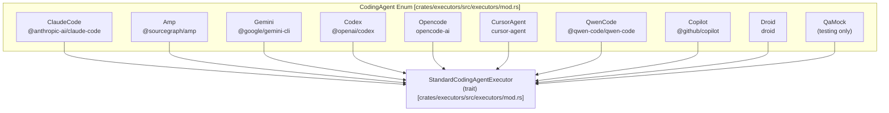
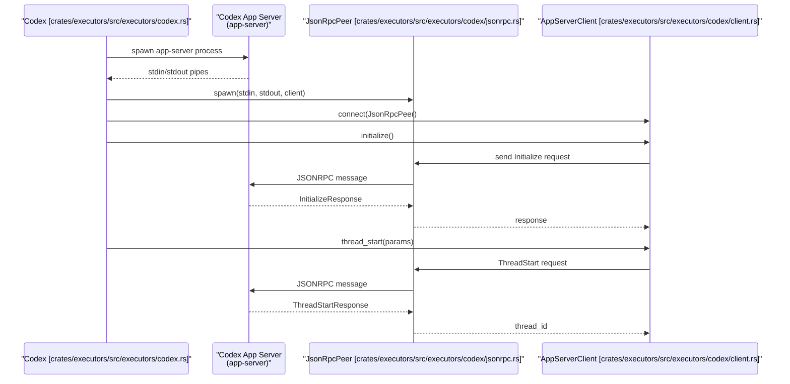
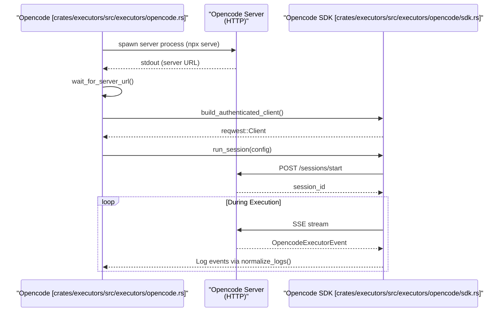

# Executor Implementations

<details>
<summary>Relevant source files</summary>

The following files were used as context for generating this wiki page:

- [crates/executors/default_profiles.json](crates/executors/default_profiles.json)
- [crates/executors/src/executors/acp/harness.rs](crates/executors/src/executors/acp/harness.rs)
- [crates/executors/src/executors/acp/normalize_logs.rs](crates/executors/src/executors/acp/normalize_logs.rs)
- [crates/executors/src/executors/amp.rs](crates/executors/src/executors/amp.rs)
- [crates/executors/src/executors/claude.rs](crates/executors/src/executors/claude.rs)
- [crates/executors/src/executors/codex.rs](crates/executors/src/executors/codex.rs)
- [crates/executors/src/executors/codex/client.rs](crates/executors/src/executors/codex/client.rs)
- [crates/executors/src/executors/codex/normalize_logs.rs](crates/executors/src/executors/codex/normalize_logs.rs)
- [crates/executors/src/executors/codex/review.rs](crates/executors/src/executors/codex/review.rs)
- [crates/executors/src/executors/codex/slash_commands.rs](crates/executors/src/executors/codex/slash_commands.rs)
- [crates/executors/src/executors/copilot.rs](crates/executors/src/executors/copilot.rs)
- [crates/executors/src/executors/cursor.rs](crates/executors/src/executors/cursor.rs)
- [crates/executors/src/executors/droid.rs](crates/executors/src/executors/droid.rs)
- [crates/executors/src/executors/droid/normalize_logs.rs](crates/executors/src/executors/droid/normalize_logs.rs)
- [crates/executors/src/executors/gemini.rs](crates/executors/src/executors/gemini.rs)
- [crates/executors/src/executors/mod.rs](crates/executors/src/executors/mod.rs)
- [crates/executors/src/executors/opencode.rs](crates/executors/src/executors/opencode.rs)
- [crates/executors/src/executors/opencode/models.rs](crates/executors/src/executors/opencode/models.rs)
- [crates/executors/src/executors/opencode/normalize_logs.rs](crates/executors/src/executors/opencode/normalize_logs.rs)
- [crates/executors/src/executors/opencode/sdk.rs](crates/executors/src/executors/opencode/sdk.rs)
- [crates/executors/src/executors/opencode/types.rs](crates/executors/src/executors/opencode/types.rs)
- [crates/executors/src/executors/qwen.rs](crates/executors/src/executors/qwen.rs)
- [crates/executors/src/stdout_dup.rs](crates/executors/src/stdout_dup.rs)
- [packages/web-core/src/features/workspace-chat/ui/DisplayConversationEntry.tsx](packages/web-core/src/features/workspace-chat/ui/DisplayConversationEntry.tsx)
- [shared/schemas/codex.json](shared/schemas/codex.json)
- [shared/schemas/cursor_agent.json](shared/schemas/cursor_agent.json)
- [shared/schemas/opencode.json](shared/schemas/opencode.json)

</details>


This page describes the specific executor implementations available in Vibe Kanban. Each executor integrates a different AI coding agent (Claude Code, Codex, Cursor, etc.) with standardized interfaces for spawning processes, normalizing logs, and managing configuration.

For information about the `StandardCodingAgentExecutor` trait that all executors implement, see [3.1 Executor Architecture and Traits](). For details on how executor configurations and profiles are loaded, see [3.2 Executor Profiles and Configuration]().

---

## Executor Variants Overview

Vibe Kanban supports several production executor implementations, plus a QA mock executor for testing. Each executor wraps a different third-party AI coding agent CLI tool.

Title: CodingAgent Implementation Hierarchy


**Executor Types and NPM Packages**
Sources: [crates/executors/src/executors/mod.rs:109-124]()

### Executor Capabilities Matrix

The `CodingAgent` enum defines the capabilities available for each implementation through the `capabilities()` method.

| Executor | Session Fork | Setup Helper | Context Usage | MCP Support |
|----------|--------------|--------------|---------------|-------------|
| **ClaudeCode** | ✓ | - | ✓ | ✓ |
| **Codex** | ✓ | ✓ | ✓ | ✓ |
| **Opencode** | ✓ | - | ✓ | ✓ |
| **CursorAgent** | - | ✓ | - | ✓ |
| **Amp** | - | - | - | ✓ |
| **Gemini** | ✓ | - | - | ✓ |
| **Copilot** | - | - | - | ✓ |
| **QwenCode** | ✓ | - | - | - |
| **Droid** | - | - | - | ✓ |

Sources: [crates/executors/src/executors/mod.rs:177-200](), [crates/executors/src/executors/mod.rs:173-175]()

---

## ClaudeCode Executor

The ClaudeCode executor integrates Anthropic's Claude Code CLI (`@anthropic-ai/claude-code` or `@musistudio/claude-code-router`).

### Configuration Structure

```rust
pub struct ClaudeCode {
    pub append_prompt: AppendPrompt,
    pub claude_code_router: Option<bool>,
    pub plan: Option<bool>,
    pub approvals: Option<bool>,
    pub model: Option<String>,
    pub effort: Option<ClaudeEffort>,  // Low, Medium, High, Max
    pub agent: Option<String>,
    pub dangerously_skip_permissions: Option<bool>,
    pub disable_api_key: Option<bool>,
    pub cmd: CmdOverrides,
}
```
Sources: [crates/executors/src/executors/claude.rs:118-146]()

### Key Features

**Permission Modes**: ClaudeCode supports distinct permission modes determined by `plan` and `approvals` flags. If `plan` or `approvals` is enabled, the executor uses `--permission-mode=BypassPermissions` and `--permission-prompt-tool=stdio` to delegate control to the Vibe Kanban approval system.
Sources: [crates/executors/src/executors/claude.rs:166-172]()

**Model Options**: Supports `ClaudeEffort` levels (`Low`, `Medium`, `High`, `XHigh`, `Max`) passed via the `--effort` flag.
Sources: [crates/executors/src/executors/claude.rs:110-116](), [crates/executors/src/executors/claude.rs:182-184]()

**Protocol**: Uses a bidirectional JSON-RPC protocol over stdin/stdout with `ProtocolPeer` to handle tool execution, permissions, and progress updates.
Sources: [crates/executors/src/executors/claude.rs:33-35](), [crates/executors/src/executors/claude.rs:188-194]()

---

## Codex Executor

The Codex executor integrates OpenAI's Codex app server, using a JSON-RPC protocol for bidirectional communication via `AppServerClient`.

### Configuration Structure

```rust
pub struct Codex {
    pub append_prompt: AppendPrompt,
    pub sandbox: Option<SandboxMode>,  // Auto, ReadOnly, WorkspaceWrite, DangerFullAccess
    pub ask_for_approval: Option<AskForApproval>,  // UnlessTrusted, OnFailure, OnRequest, Never
    pub model: Option<String>,
    pub model_reasoning_effort: Option<ReasoningEffort>,
    pub plan: bool,
    pub cmd: CmdOverrides,
}
```
Sources: [crates/executors/src/executors/codex.rs:151-191]()

### App Server Architecture

Title: Codex App Server Communication Pattern

Sources: [crates/executors/src/executors/codex/client.rs:111-130](), [crates/executors/src/executors/codex/client.rs:95-97]()

### Key Features

**Sandbox Modes**: Controls file system access with four levels: `Auto`, `ReadOnly`, `WorkspaceWrite`, and `DangerFullAccess`.
Sources: [crates/executors/src/executors/codex.rs:86-94]()

**Thread Management**: Supports thread creation (`thread_start`) and forking (`thread_fork`) with full parameter inheritance via `fork_params_from`.
Sources: [crates/executors/src/executors/codex.rs:34-48](), [crates/executors/src/executors/codex/client.rs:132-152]()

---

## Opencode Executor

The Opencode executor integrates the Opencode AI server, spawning a local HTTP server and communicating via a generated password.

### Configuration Structure

```rust
pub struct Opencode {
    pub append_prompt: AppendPrompt,
    pub model: Option<String>,
    pub variant: Option<String>,
    pub agent: Option<String>,
    pub auto_approve: bool,
    pub auto_compact: bool,
    pub cmd: CmdOverrides,
}
```
Sources: [crates/executors/src/executors/opencode.rs:44-67]()

### Server-Based Architecture

Title: Opencode Server Lifecycle and SDK Interaction

Sources: [crates/executors/src/executors/opencode.rs:139-156](), [crates/executors/src/executors/opencode.rs:158-251]()

### Key Features

**Server Spawning**: Uses `npx -y opencode-ai@1.4.7 serve --hostname 127.0.0.1 --port 0`. It generates a cryptographically secure `ServerPassword` for `OPENCODE_SERVER_PASSWORD`.
Sources: [crates/executors/src/executors/opencode.rs:91-95](), [crates/executors/src/executors/opencode.rs:113-126]()

**Dynamic Discovery**: Implements `discover_options` to query the server for available providers and models via `list_providers` and `list_agents`.
Sources: [crates/executors/src/executors/opencode/sdk.rs:36-40]()

---

## CursorAgent Executor

The CursorAgent executor integrates the `cursor-agent` CLI.

### Configuration Structure

```rust
pub struct CursorAgent {
    pub append_prompt: AppendPrompt,
    pub force: Option<bool>,
    pub model: Option<String>,
    pub reasoning: Option<String>,
    pub cmd: CmdOverrides,
}
```
Sources: [crates/executors/src/executors/cursor.rs:41-57]()

### Model Resolution

CursorAgent maps base models and reasoning levels (low, medium, high, xhigh) to specific CLI model strings via `resolve_cursor_model_name`.

| Base Model | Reasoning | Resolved Model Name |
|------------|-----------|---------------------|
| `gpt-5.4` | `medium` | `gpt-5.4-medium` |
| `gpt-5.4` | `high` | `gpt-5.4-high` |
| `opus-4.6` | `thinking` | `opus-4.6-thinking` |
| `sonnet-4.6` | `standard` | `sonnet-4.6` |

Sources: [crates/executors/src/executors/cursor.rs:60-110]()

### Key Features

**Trust Mode**: Uses the `--trust` flag by default to allow execution in the workspace directory.
Sources: [crates/executors/src/executors/cursor.rs:157-159]()

**Authentication Detection**: Monitors for `CURSOR_AUTH_REQUIRED_MSG` in output to signal the user to login.
Sources: [crates/executors/src/executors/cursor.rs:39-40]()

---

## ACP-Based Executors (Gemini, Copilot, Qwen)

Several executors use the **Agent Control Protocol (ACP)** via a shared `AcpAgentHarness` [crates/executors/src/executors/acp.rs]().

### Gemini Executor
- **Command**: `npx -y @google/gemini-cli@0.29.3`
- **Flags**: `--experimental-acp`, `--yolo` (auto-approvals).
- **Auth**: Detects `~/.gemini/oauth_creds.json`.
Sources: [crates/executors/src/executors/gemini.rs:49-60](), [crates/executors/src/executors/gemini.rs:156-165]()

### Copilot Executor
- **Command**: `npx -y @github/copilot@0.0.403`
- **Flags**: `--acp`, `--allow-all-tools`.
- **Tool Control**: Supports `--allow-tool` and `--deny-tool` configuration.
Sources: [crates/executors/src/executors/copilot.rs:51-82]()

---

## MCP Configuration Paths

Each executor implementation defines where its native MCP (Model Context Protocol) configuration is stored.

| Executor | MCP Configuration Path |
|----------|------------------------|
| **ClaudeCode** | `~/.claude.json` |
| **Codex** | `~/.codex/config.toml` |
| **Opencode** | `~/.config/opencode/opencode.json` |
| **Amp** | `~/.config/amp/settings.json` |
| **Gemini** | `~/.gemini/settings.json` |
| **Copilot** | `~/.copilot/mcp-config.json` |
| **Droid** | `~/.config/droid/settings.json` |

Sources: [crates/executors/src/executors/mod.rs:127-171](), [crates/executors/src/executors/amp.rs:149-151](), [crates/executors/src/executors/gemini.rs:151-153](), [crates/executors/src/executors/copilot.rs:160-162]()