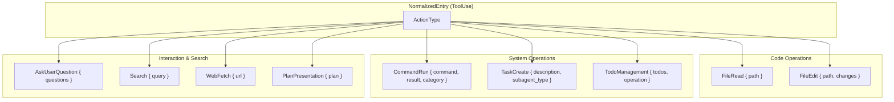
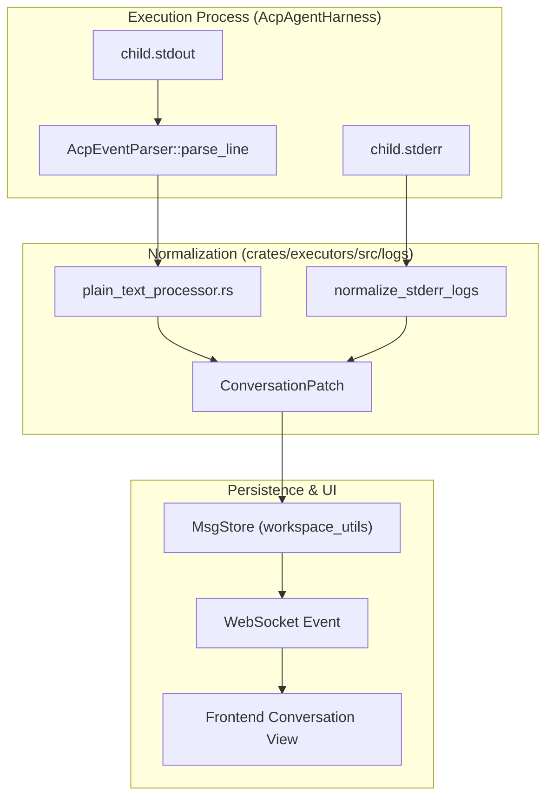
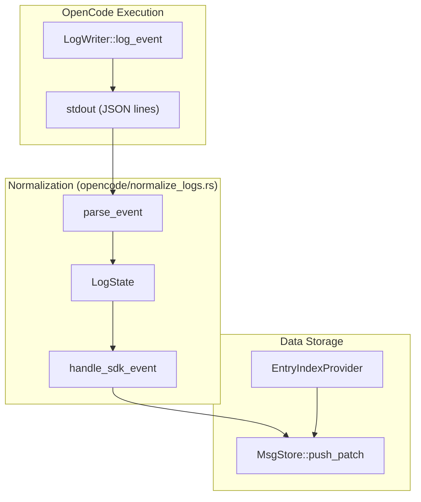

# Log Processing and Normalization

<details>
<summary>Relevant source files</summary>

The following files were used as context for generating this wiki page:

- [crates/executors/src/executors/acp/normalize_logs.rs](crates/executors/src/executors/acp/normalize_logs.rs)
- [crates/executors/src/executors/droid/normalize_logs.rs](crates/executors/src/executors/droid/normalize_logs.rs)
- [crates/executors/src/executors/opencode/models.rs](crates/executors/src/executors/opencode/models.rs)
- [crates/executors/src/executors/opencode/normalize_logs.rs](crates/executors/src/executors/opencode/normalize_logs.rs)
- [crates/executors/src/executors/opencode/sdk.rs](crates/executors/src/executors/opencode/sdk.rs)
- [crates/executors/src/executors/opencode/types.rs](crates/executors/src/executors/opencode/types.rs)
- [crates/executors/src/logs/mod.rs](crates/executors/src/logs/mod.rs)
- [crates/executors/src/logs/utils/patch.rs](crates/executors/src/logs/utils/patch.rs)
- [crates/executors/src/stdout_dup.rs](crates/executors/src/stdout_dup.rs)
- [shared/schemas/opencode.json](shared/schemas/opencode.json)

</details>


## Purpose and Scope

This document describes the log processing and normalization system that converts raw stdout/stderr output from different coding agents into a unified, structured format for display in the frontend. Each executor produces logs in different formats (JSON, JSONC, plain text, or the OpenCode SDK format), and this system standardizes them into `NormalizedEntry` structures delivered to the UI.

For information about the executor architecture and trait definitions, see [3.1 Executor Architecture and Traits](). For details on specific executor implementations and their configuration, see [3.3 Executor Implementations]().

## Normalization Architecture

### Core Data Structures

The system centers around the `NormalizedEntry` struct, which encapsulates a timestamp, an entry type, and the content to be displayed.

```rust
pub struct NormalizedEntry {
    pub timestamp: Option<String>,
    pub entry_type: NormalizedEntryType,
    pub content: String,
    pub metadata: Option<serde_json::Value>,
}
```

**Sources:** [crates/executors/src/logs/mod.rs:115-121]()

### Normalized Entry Types

The `NormalizedEntryType` enum defines the semantic nature of the log entry, allowing the UI to render different components (e.g., chat bubbles, tool execution blocks, or error banners).

| Type | Description |
| :--- | :--- |
| `UserMessage` | Message sent by the user to the agent. |
| `UserFeedback` | Feedback sent back to the agent, such as a denied tool execution [crates/executors/src/logs/mod.rs:75-77](). |
| `AssistantMessage` | Textual response from the AI agent. |
| `ToolUse` | Execution of a specific tool (e.g., `FileEdit`, `CommandRun`). |
| `Thinking` | Internal reasoning steps of the agent [crates/executors/src/logs/mod.rs:88-88](). |
| `SystemMessage` | System-level notifications or startup logs [crates/executors/src/logs/mod.rs:84-84](). |
| `ErrorMessage` | Errors encountered during execution or setup. |
| `TokenUsageInfo` | Metadata regarding model context and token consumption [crates/executors/src/logs/mod.rs:95-95](). |
| `UserAnsweredQuestions` | Results from an `AskUserQuestion` interaction [crates/executors/src/logs/mod.rs:96-98](). |

**Sources:** [crates/executors/src/logs/mod.rs:73-99]()

### Tool Action Types

When an entry is of type `ToolUse`, it contains an `ActionType` which specifies the exact operation performed. This allows the UI to provide specialized rendering for diffs, terminal output, or search results.



**Diagram: ActionType Hierarchy for Tool Normalization**

**Sources:** [crates/executors/src/logs/mod.rs:170-219]()

## Normalization Process

### Status Mapping

The system normalizes various executor-specific statuses into a standard `ToolStatus`. This includes mapping from the approval system's `ApprovalStatus` and `QuestionStatus`.

```rust
pub enum ToolStatus {
    Created,
    Success,
    Failed,
    Denied { reason: Option<String> },
    PendingApproval { approval_id: String },
    TimedOut,
}
```

**Sources:** [crates/executors/src/logs/mod.rs:125-137]()

The implementation provides conversion logic to bridge the `workspace_utils::approvals` space into the `NormalizedEntry` space:
* `ApprovalStatus::Approved` maps to `ToolStatus::Created` [crates/executors/src/logs/mod.rs:142-142]().
* `ApprovalStatus::Denied` maps to `ToolStatus::Denied` [crates/executors/src/logs/mod.rs:143-145]().
* `QuestionStatus::Answered` maps to `ToolStatus::Success` [crates/executors/src/logs/mod.rs:153-153]().

### Command Result Normalization

Output from shell commands is captured and structured into `CommandRunResult`. This ensures that exit codes and terminal output are associated correctly with the tool call that triggered them.

```rust
pub struct CommandRunResult {
    pub exit_status: Option<CommandExitStatus>,
    pub output: Option<String>,
}
```

**Sources:** [crates/executors/src/logs/mod.rs:49-52]()

## Log Processors and Patching

### Log Processors
The system employs specialized processors to handle different stream types:
* **Plain Text Processor**: Used primarily for stderr or simple executors. It handles line-buffering and basic cleaning of raw strings into `NormalizedEntry` objects [crates/executors/src/logs/mod.rs:7-7]().
* **Stderr Processor**: Specifically tuned for capturing error streams. It filters out known non-critical warnings and formats actual errors via `normalize_stderr_logs` [crates/executors/src/logs/stderr_processor.rs:26-26]().
* **OpenCode Normalizer**: Handles the complex `OpencodeExecutorEvent` stream, which includes SDK events, token usage, and session lifecycle events [crates/executors/src/executors/opencode/normalize_logs.rs:44-47]().
* **Droid Normalizer**: Parses JSON-based logs from the Droid executor, extracting session IDs and mapping `DroidToolData` to `ActionType` [crates/executors/src/executors/droid/normalize_logs.rs:85-134]().

### Conversation Patching
To support real-time UI updates without re-sending the entire conversation, the system uses a JSON-Patch based approach. The `ConversationPatch` helper creates granular updates (ADD, REPLACE, REMOVE) for entries in the conversation [crates/executors/src/logs/utils/patch.rs:48-50]().

* `add_normalized_entry`: Appends a new entry to the conversation [crates/executors/src/logs/utils/patch.rs:52-60]().
* `replace`: Updates an existing entry (e.g., updating tool status from `Created` to `Success`) [crates/executors/src/logs/utils/patch.rs:135-143]().
* `add_repo_diff`: Specifically handles adding Git diffs under a repository namespace [crates/executors/src/logs/utils/patch.rs:94-105]().

**Sources:** [crates/executors/src/logs/utils/patch.rs:18-152]()

## Data Flow: From Raw Output to UI

The following diagrams illustrate how raw process output is captured and transformed into normalized entries.

### ACP Normalization Flow
This diagram shows the flow for executors using the Agent Client Protocol (ACP).



**Diagram: Log Normalization Data Flow via ACP Harness**

**Sources:** [crates/executors/src/executors/acp/normalize_logs.rs:27-65](), [crates/executors/src/logs/utils/patch.rs:171-185](), [crates/executors/src/logs/mod.rs:55-61]()

### OpenCode Normalization Flow
OpenCode uses a dedicated SDK and a specialized event stream for log capture.



**Diagram: OpenCode SDK Event Normalization**

**Sources:** [crates/executors/src/executors/opencode/normalize_logs.rs:44-82](), [crates/executors/src/executors/opencode/sdk.rs:45-53]()

## File Change Normalization

For executors that modify the filesystem, the `FileChange` enum standardizes how these edits are represented. This supports full overwrites, deletions, renames, and unified diffs.

| Variant | Data | Purpose |
| :--- | :--- | :--- |
| `Write` | `content: String` | Creating or overwriting a file [crates/executors/src/logs/mod.rs:242-242](). |
| `Delete` | N/A | Removing a file from the worktree [crates/executors/src/logs/mod.rs:244-244](). |
| `Rename` | `new_path: String` | Moving a file [crates/executors/src/logs/mod.rs:246-246](). |
| `Edit` | `unified_diff: String` | Applying a patch with optional line numbers [crates/executors/src/logs/mod.rs:248-253](). |

**Sources:** [crates/executors/src/logs/mod.rs:239-254]()