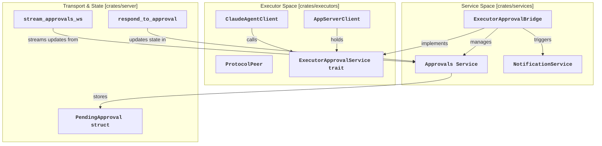
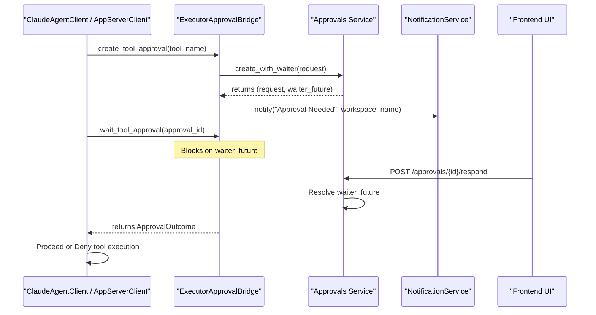

# Approval System

Relevant source files

The following files were used as context for generating this wiki page:

- [crates/executors/src/approvals.rs](crates/executors/src/approvals.rs)
- [crates/executors/src/env.rs](crates/executors/src/env.rs)
- [crates/executors/src/executors/claude/client.rs](crates/executors/src/executors/claude/client.rs)
- [crates/executors/src/executors/claude/protocol.rs](crates/executors/src/executors/claude/protocol.rs)
- [crates/executors/src/executors/claude/types.rs](crates/executors/src/executors/claude/types.rs)
- [crates/executors/src/executors/codex.rs](crates/executors/src/executors/codex.rs)
- [crates/executors/src/executors/codex/client.rs](crates/executors/src/executors/codex/client.rs)
- [crates/executors/src/executors/codex/normalize_logs.rs](crates/executors/src/executors/codex/normalize_logs.rs)
- [crates/executors/src/executors/codex/review.rs](crates/executors/src/executors/codex/review.rs)
- [crates/executors/src/executors/codex/slash_commands.rs](crates/executors/src/executors/codex/slash_commands.rs)
- [crates/server/src/routes/approvals.rs](crates/server/src/routes/approvals.rs)
- [crates/services/src/services/approvals.rs](crates/services/src/services/approvals.rs)
- [crates/services/src/services/approvals/executor_approvals.rs](crates/services/src/services/approvals/executor_approvals.rs)
- [crates/services/src/services/notification.rs](crates/services/src/services/notification.rs)
- [crates/utils/src/approvals.rs](crates/utils/src/approvals.rs)
- [packages/web-core/src/features/workspace-chat/ui/DisplayConversationEntry.tsx](packages/web-core/src/features/workspace-chat/ui/DisplayConversationEntry.tsx)
- [shared/schemas/codex.json](shared/schemas/codex.json)

This document describes the tool approval workflow in Vibe Kanban, including implementation details of the approval services, data flow between the backend and AI agents, and the lifecycle of approval requests. The approval system ensures that AI coding agents cannot execute sensitive actions (like file edits or shell commands) without explicit user consent when configured in supervised modes.

---

## Architecture and Data Flow

The approval system is built on a tiered architecture that bridges the gap between the asynchronous execution of an AI agent and the real-time user interface.

### Code Entity Space Mapping

The following diagram maps high-level system concepts to specific code entities within the Rust backend and executor crates.

**Sources:** [crates/executors/src/executors/claude/client.rs:31-38](), [crates/executors/src/executors/codex/client.rs:48-63](), [crates/services/src/services/approvals/executor_approvals.rs:15-22](), [crates/services/src/services/approvals.rs:50-54](), [crates/server/src/routes/approvals.rs:109-113]()

---

## Core Components

### ExecutorApprovalService Trait
This trait defines the interface used by executors to request permissions or ask questions. It abstracts the underlying transport (WebSockets, HTTP) from the agent logic.

- `create_tool_approval`: Initiates a request for a tool execution [crates/executors/src/approvals.rs:32-32]().
- `wait_tool_approval`: Blocks the executor thread until a response is received or a timeout occurs [crates/executors/src/approvals.rs:41-46]().
- `create_question_approval`: Initiates a request for user input (e.g., `AskUserQuestion`) [crates/executors/src/approvals.rs:35-39]().
- `wait_question_answer`: Blocks until the user provides structured answers [crates/executors/src/approvals.rs:49-53]().

**Sources:** [crates/executors/src/approvals.rs:29-54]()

### Approvals Service
The central coordinator for all pending requests. It uses `DashMap` for thread-safe access to `PendingApproval` and `ApprovalOutcome` states [crates/services/src/services/approvals.rs:50-54](). It also manages a `broadcast::Sender<Patch>` to stream state changes to the frontend via JSON Patches [crates/services/src/services/approvals.rs:53-54]().

**Sources:** [crates/services/src/services/approvals.rs:50-54](), [crates/services/src/services/approvals.rs:76-84]()

---

## Detailed Approval Workflow

When an agent needs to use a tool, it initiates a handshake through its specific client implementation.

**Sources:** [crates/services/src/services/approvals/executor_approvals.rs:40-98](), [crates/services/src/services/approvals/executor_approvals.rs:100-127](), [crates/server/src/routes/approvals.rs:21-49]()

### Timeout Management
Approval requests are not indefinite. The system enforces a timeout (defaulting to 10 hours) via `spawn_timeout_watcher` [crates/services/src/services/approvals.rs:178-216](). If the user does not respond within the `timeout_at` period, the `waiter` future resolves to `ApprovalOutcome::TimedOut`, and the agent is notified to abort or retry [crates/services/src/services/approvals.rs:204-215]().

**Sources:** [crates/services/src/services/approvals.rs:178-216]()

---

## Executor Implementations

### Claude-Specific Workflow
Claude agents use a bidirectional control protocol handled by `ProtocolPeer`. When the Claude CLI sends a `ControlRequestType::CanUseTool`, the `ClaudeAgentClient` intercepts it [crates/executors/src/executors/claude/protocol.rs:114-120]().

1. **Handling Tool Permissions**: The client calls `handle_approval`, which requests an ID from the `ExecutorApprovalService` [crates/executors/src/executors/claude/client.rs:71](), logs a `ClaudeJson::ApprovalRequested` event [crates/executors/src/executors/claude/client.rs:82-87](), and blocks on `wait_tool_approval` [crates/executors/src/executors/claude/client.rs:89-91]().
2. **Handling Questions**: For tools like `AskUserQuestion`, the client uses `handle_question` [crates/executors/src/executors/claude/client.rs:145-150](). It supports multiple questions in a single tool call [crates/executors/src/executors/claude/client.rs:156-160]().

**Sources:** [crates/executors/src/executors/claude/client.rs:60-143](), [crates/executors/src/executors/claude/protocol.rs:107-142]()

### Codex-Specific Workflow
Codex uses an `AppServerClient` to manage its interaction with the underlying Codex app server.

1. **Approval Policy**: Codex supports multiple `AskForApproval` modes: `UnlessTrusted` (read-only auto-approved), `OnFailure` (ask after restricted sandbox fail), `OnRequest` (model decides), and `Never` [crates/executors/src/executors/codex.rs:98-113]().
2. **Log Normalization**: The `normalize_logs.rs` module converts Codex protocol events (like `ExecApprovalRequestEvent` or `ApplyPatchApprovalRequestEvent`) into normalized entries for the UI [crates/executors/src/executors/codex/normalize_logs.rs:26-31](). It tracks the `awaiting_approval` state within `CommandState` [crates/executors/src/executors/codex/normalize_logs.rs:90]().

**Sources:** [crates/executors/src/executors/codex.rs:98-113](), [crates/executors/src/executors/codex/normalize_logs.rs:24-33](), [crates/executors/src/executors/codex/client.rs:48-63]()

---

## Notifications and Real-time Updates

### Push Notifications
The `ExecutorApprovalBridge` triggers the `NotificationService` whenever a new approval or question is created [crates/services/src/services/approvals/executor_approvals.rs:93-95](). This service uses platform-specific commands (e.g., `afplay` on macOS, `powershell` on Windows/WSL, `paplay` or `aplay` on Linux) to send desktop notifications and play sound alerts [crates/services/src/services/notification.rs:106-150]().

**Sources:** [crates/services/src/services/approvals/executor_approvals.rs:93-95](), [crates/services/src/services/notification.rs:71-152]()

### Frontend Integration
The frontend renders approvals using the `ChatApprovalCard` component [packages/web-core/src/features/workspace-chat/ui/DisplayConversationEntry.tsx:39]().

- **Tool Summaries**: The UI generates descriptive text for tool uses (e.g., "Read file", "Ran command") via `getToolSummary` [packages/web-core/src/features/workspace-chat/ui/DisplayConversationEntry.tsx:87-117]().
- **Real-time State**: Updates are streamed via WebSockets, allowing the UI to transition from a pending state to an approved/denied state without a page refresh [crates/server/src/routes/approvals.rs:62-107]().

**Sources:** [packages/web-core/src/features/workspace-chat/ui/DisplayConversationEntry.tsx:39-117](), [crates/server/src/routes/approvals.rs:51-107]()

---

## Data Models

### ApprovalOutcome
The unified result type for both permission requests and user questions.

| Variant | Description |
| :--- | :--- |
| `Approved` | The tool is allowed to execute. |
| `Denied { reason }` | Execution is blocked; includes an optional message for the agent. |
| `Answered { answers }` | Contains a list of `QuestionAnswer` pairs (question string + response values). |
| `TimedOut` | The request expired without user interaction [crates/services/src/services/approvals.rs:188](). |

**Sources:** [crates/services/src/services/approvals.rs:133-140](), [crates/services/src/services/approvals.rs:188-188]()

### ApprovalInfo
The metadata sent to the frontend to render the approval UI.
- `approval_id`: Unique Uuid string [crates/services/src/services/approvals.rs:41]().
- `tool_name`: Name of the tool (e.g., `bash`, `file_edit`) [crates/services/src/services/approvals.rs:42]().
- `execution_process_id`: Links the approval to a specific task execution [crates/services/src/services/approvals.rs:43]().
- `is_question`: Boolean flag to toggle between Permission and Question UI components [crates/services/src/services/approvals.rs:44]().

**Sources:** [crates/services/src/services/approvals.rs:39-47]()