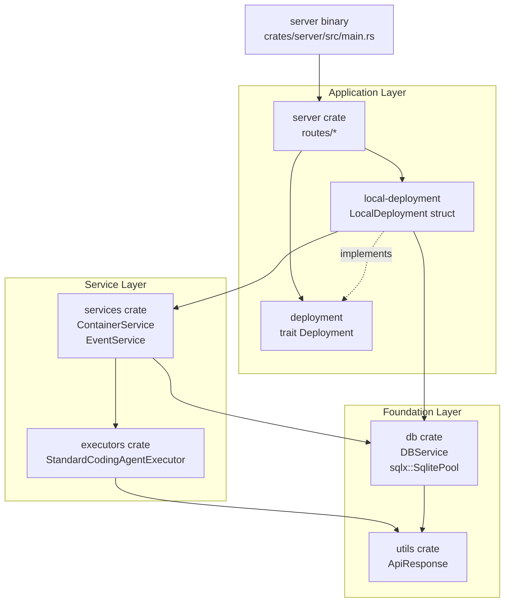
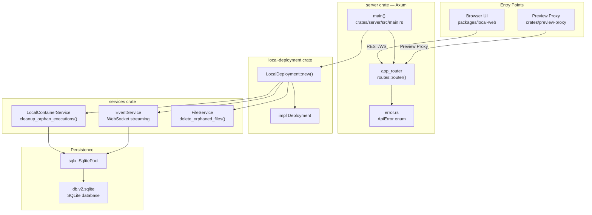

# Backend Services

Relevant source files

The following files were used as context for generating this wiki page:

- [Cargo.lock](Cargo.lock)
- [crates/db/Cargo.toml](crates/db/Cargo.toml)
- [crates/deployment/Cargo.toml](crates/deployment/Cargo.toml)
- [crates/deployment/src/lib.rs](crates/deployment/src/lib.rs)
- [crates/executors/Cargo.toml](crates/executors/Cargo.toml)
- [crates/local-deployment/Cargo.toml](crates/local-deployment/Cargo.toml)
- [crates/local-deployment/src/lib.rs](crates/local-deployment/src/lib.rs)
- [crates/review/Cargo.toml](crates/review/Cargo.toml)
- [crates/server/Cargo.toml](crates/server/Cargo.toml)
- [crates/server/src/error.rs](crates/server/src/error.rs)
- [crates/server/src/routes/config.rs](crates/server/src/routes/config.rs)
- [crates/services/Cargo.toml](crates/services/Cargo.toml)
- [crates/services/src/services/mod.rs](crates/services/src/services/mod.rs)
- [crates/utils/Cargo.toml](crates/utils/Cargo.toml)
- [npx-cli/package.json](npx-cli/package.json)
- [package.json](package.json)

This section describes the Rust backend server — its crate structure, startup lifecycle, service layer, persistence model, API surface, and background subsystems.

For information about the AI coding agent executors that the backend launches and manages, see [Executor System](#3). For the frontend React application that communicates with the backend, see [Frontend Application](#5). For Git and GitHub integrations, see [Git and GitHub Integration](#6).

---

## Purpose and Scope

The backend is a Rust binary built on the Axum framework [crates/server/src/main.rs:2-2]() that provides REST APIs, WebSocket streams, and workspace orchestration. The entry point is `main()` which initializes the Axum server with all routes and services [crates/server/src/main.rs:33-198]().

Core responsibilities:
- **HTTP/WebSocket API**: Axum router serving REST endpoints and WebSocket streams to the browser UI and MCP clients [crates/server/src/main.rs:142-171]().
- **Workspace Orchestration**: `LocalContainerService` manages workspace lifecycle, spawns executors, and handles execution state [crates/local-deployment/src/lib.rs:58-58]().
- **Git Worktree Isolation**: `WorktreeManager` and `WorkspaceManager` create isolated git checkouts per workspace [crates/local-deployment/src/lib.rs:42-43]().
- **SQLite Persistence**: `DBService` wraps a `sqlx::SqlitePool` connected to the local database, typically `db.v2.sqlite` [crates/server/src/main.rs:59-68]().
- **Event Streaming**: `EventService` hooks into SQLite updates and publishes changes to WebSocket clients [crates/local-deployment/src/lib.rs:24-24]().
- **Image Storage**: `FileService` (often referred to as Image Management) provides storage for attachments [crates/local-deployment/src/lib.rs:25-25]().
- **Background Tasks**: Services like `PrMonitorService` monitor pull request status [crates/local-deployment/src/lib.rs:29-29](), and cleanup jobs for orphan executions run on startup [crates/server/src/main.rs:74-88]().
- **Relay Tunneling**: Optional `relay-tunnel` client for secure remote access and preview proxy functionality [crates/server/src/main.rs:183-183]().

The backend typically runs in local mode using standalone SQLite but is architected via the `Deployment` trait to support different environments [crates/deployment/src/lib.rs:80-80]().

Sources: [crates/server/src/main.rs:1-198](), [crates/deployment/src/lib.rs:1-158](), [crates/local-deployment/src/lib.rs:1-100]()

---

## Crate Map

The backend is a Cargo workspace composed of focused crates, each with a specific responsibility. Below is a summary of the primary crates.

| Crate | Path | Primary Role | Key Types |
|---|---|---|---|
| `server` | `crates/server` | Axum HTTP/WS server, route handlers, startup sequence | `main`, `DeploymentImpl`, `ApiError` |
| `services` | `crates/services` | Business logic layer with core services | `ContainerService`, `EventService`, `FileService` |
| `executors` | `crates/executors` | Coding agent executor integrations | `StandardCodingAgentExecutor` trait |
| `db` | `crates/db` | SQLite schema, models, and migrations via `sqlx` | `DBService` |
| `utils` | `crates/utils` | Shared utilities and helpers | `ApiResponse`, `LogMsg`, tracing setup |
| `deployment` | `crates/deployment` | Deployment abstraction trait | `Deployment` trait |
| `local-deployment` | `crates/local-deployment` | Local deployment implementation | `LocalDeployment` struct |

Sources: [crates/server/src/error.rs:1-30](), [crates/services/src/services/mod.rs:1-24](), [crates/deployment/src/lib.rs:1-38](), [crates/local-deployment/src/lib.rs:1-50](), [crates/executors/Cargo.toml:1-30]()

---

## Crate Dependency Graph

**Backend Crate Dependencies and Key Types**

Sources: [crates/server/Cargo.toml:10-34](), [crates/local-deployment/Cargo.toml:7-25](), [crates/services/Cargo.toml:11-20](), [crates/db/Cargo.toml:7-14]()

---

## Runtime Service Topology

**Backend Runtime Components and Code Entity Relationships**

Sources: [crates/server/src/main.rs:33-198](), [crates/server/src/error.rs:35-92](), [crates/local-deployment/src/lib.rs:91-147]()

---

## Subsection Guide

The child pages in this section each cover a specific aspect of the backend in depth.

| Page | Topic |
|---|---|
| [Crate Organization](#4.1) | Detailed description of each crate, their public surfaces, and the dependency direction |
| [Server Initialization and Configuration](#4.2) | `main.rs` startup sequence, `Deployment` trait, and port assignment [crates/server/src/main.rs:33-140]() |
| [API Routes and Handlers](#4.3) | Axum route tree, route modules, and request/response patterns [crates/server/src/routes/config.rs:43-60]() |
| [Container Service and Workspace Management](#4.4) | `ContainerService` trait and `LocalContainerService` lifecycle management [crates/local-deployment/src/lib.rs:47-48]() |
| [Database Models and Queries](#4.5) | SQLite schema via `sqlx` migrations and model definitions [crates/server/src/main.rs:59-68]() |
| [Background Services and Cleanup](#4.6) | `PrMonitorService`, orphan cleanup, and repo name backfilling [crates/server/src/main.rs:74-88]() |
| [WebSocket Streaming and Event System](#4.7) | `EventService`, SQLite hooks, and real-time state synchronization [crates/local-deployment/src/lib.rs:135-147]() |
| [Image Management Service](#4.8) | `FileService`: storage and orphaned file cleanup [crates/local-deployment/src/lib.rs:149-158]() |
| [Error Handling and ApiResponse System](#4.9) | `ApiError` enum and the unified `ApiResponse` wrapper [crates/server/src/error.rs:35-92]() |
| [Relay Tunnel System](#4.10) | Relay tunnel client/server for remote connectivity and preview proxy |

---

## Key Design Decisions

**Single SQLite database.** All workspace state, execution history, and task records are stored in a single SQLite file (`db.v2.sqlite`). The system handles safe migrations from legacy versions [crates/server/src/main.rs:59-68]().

**Deployment trait abstraction.** The `server` crate depends on a `Deployment` trait [crates/deployment/src/lib.rs:80-80](). `LocalDeployment` implements this trait, allowing the server binary to remain decoupled from environment-specific service initialization [crates/local-deployment/src/lib.rs:91-91]().

**Executor isolation.** The `executors` crate provides agent-specific logic while the `services` crate handles orchestration. This ensures that adding a new AI agent only requires implementing the `StandardCodingAgentExecutor` trait [crates/server/src/routes/config.rs:13-19]().

**Preview Proxy Isolation.** Preview content is served via a separate HTTP server to isolate iframe content from the main application for security [crates/server/Cargo.toml:33-33]().

**Centralized Error Mapping.** The `ApiError` enum in the server crate acts as a central hub, using `thiserror` to map errors from all sub-crates (Git, DB, Container, etc.) into unified HTTP responses [crates/server/src/error.rs:35-92]().

Sources: [crates/server/src/main.rs](), [crates/deployment/src/lib.rs](), [crates/local-deployment/src/lib.rs](), [crates/server/src/error.rs]()