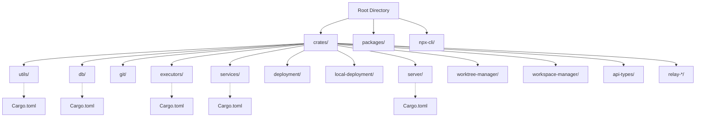
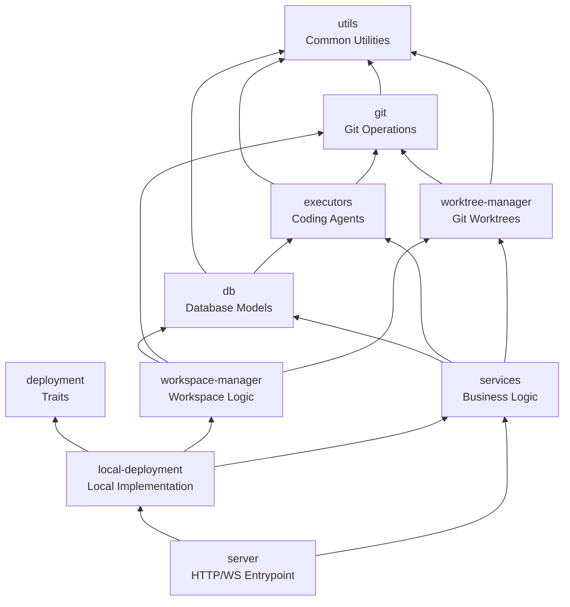

# Crate Organization

Relevant source files

The following files were used as context for generating this wiki page:

- [Cargo.lock](Cargo.lock)
- [crates/client-info/Cargo.toml](crates/client-info/Cargo.toml)
- [crates/db/Cargo.toml](crates/db/Cargo.toml)
- [crates/deployment/Cargo.toml](crates/deployment/Cargo.toml)
- [crates/desktop-bridge/Cargo.toml](crates/desktop-bridge/Cargo.toml)
- [crates/embedded-ssh/Cargo.toml](crates/embedded-ssh/Cargo.toml)
- [crates/executors/Cargo.toml](crates/executors/Cargo.toml)
- [crates/git-host/Cargo.toml](crates/git-host/Cargo.toml)
- [crates/local-deployment/Cargo.toml](crates/local-deployment/Cargo.toml)
- [crates/mcp/Cargo.toml](crates/mcp/Cargo.toml)
- [crates/preview-proxy/Cargo.toml](crates/preview-proxy/Cargo.toml)
- [crates/relay-hosts/Cargo.toml](crates/relay-hosts/Cargo.toml)
- [crates/relay-tunnel-core/Cargo.toml](crates/relay-tunnel-core/Cargo.toml)
- [crates/relay-ws/Cargo.toml](crates/relay-ws/Cargo.toml)
- [crates/review/Cargo.toml](crates/review/Cargo.toml)
- [crates/server/Cargo.toml](crates/server/Cargo.toml)
- [crates/services/Cargo.toml](crates/services/Cargo.toml)
- [crates/utils/Cargo.toml](crates/utils/Cargo.toml)
- [npx-cli/package.json](npx-cli/package.json)
- [package.json](package.json)

## Purpose and Scope

This document explains the Rust workspace structure of the Vibe Kanban backend, detailing how the codebase is divided into multiple crates, their individual responsibilities, and their dependency relationships. The workspace follows a layered architecture where lower-level crates provide shared functionality and higher-level crates compose them into application-specific logic.

The backend is structured as a Cargo workspace, allowing for clear separation of concerns between core utilities, database management, git operations, and high-level business services.

**Sources**: [Cargo.lock:1-100](), [package.json:1-68](), [crates/server/Cargo.toml:1-5]()

---

## Workspace Structure

The repository uses a Cargo workspace to manage multiple related crates. All core backend crates are located under the `crates/` directory.

### File System Layout

**Sources**: [package.json:1-68](), [crates/server/Cargo.toml:1-34](), [crates/services/Cargo.toml:1-58]()

---

## Crate Dependency Graph

The crates follow a strict dependency hierarchy. Higher-level crates like `server` and `local-deployment` aggregate lower-level domain crates.

**Sources**: [crates/server/Cargo.toml:11-34](), [crates/services/Cargo.toml:11-20](), [crates/local-deployment/Cargo.toml:7-25](), [crates/db/Cargo.toml:7-8]()

---

## Core Infrastructure Crates

### `utils` Crate

The `utils` crate provides foundational utilities used across all other crates. It handles system-level concerns and common data patterns.

**Location**: [crates/utils/Cargo.toml:1-42]()

| Component | Purpose |
|-----------|---------|
| **Process Management** | Execution via `command-group` [line 34] and `shlex` [line 9] |
| **Tracing & Sentry** | Logging and error reporting [lines 13-14, 22-23] |
| **Environment** | Directory resolution via `dirs` [line 32] and `directories` [line 19] |
| **Networking** | WebSocket types via `axum` [line 10] and `tokio-util` codecs [line 7] |
| **Auth** | JWT handling via `jsonwebtoken` [line 25] |

**Sources**: [crates/utils/Cargo.toml:1-42]()

### `api-types` Crate

Contains shared data structures used by both the backend and frontend. It is the source of truth for the system's type schema. It utilizes `ts-rs` to generate TypeScript interfaces from Rust structs.

**Location**: [crates/api-types/Cargo.toml:1-14]() (Note: referenced in [crates/server/Cargo.toml:11]())

Key dependencies:
- `sqlx` for database trait derivation [crates/db/Cargo.toml:14]()
- `ts-rs` for TypeScript synchronization [crates/db/Cargo.toml:17]()
- `schemars` for JSON schema generation [crates/executors/Cargo.toml:18]()

**Sources**: [crates/server/Cargo.toml:11](), [crates/db/Cargo.toml:14-17](), [crates/executors/Cargo.toml:18]()

### `db` Crate

The `db` crate defines the SQLite database schema, SQLx queries, and logic for real-time update triggers.

**Location**: [crates/db/Cargo.toml:1-22]()

| Component | Purpose |
|-----------|---------|
| **SQLx Integration** | Type-safe SQLite queries using `sqlx` [line 14] |
| **Serialization** | `serde` and `serde_json` for DB-to-JSON mapping [lines 10-11] |
| **Type Generation** | Exporting database models to TypeScript via `ts-rs` [line 17] |

**Sources**: [crates/db/Cargo.toml:1-22]()

---

## Execution and Workspace Management

### `executors` Crate

The `executors` crate abstracts different AI coding agents into a unified interface. It supports multiple protocols and handles the normalization of agent outputs.

**Location**: [crates/executors/Cargo.toml:1-58]()

| Component | Purpose |
|-----------|---------|
| **Agent Protocols** | Implementation of `agent-client-protocol` [line 38] and `codex-protocol` [line 39] |
| **Log Handling** | ANSI escape stripping [line 32] and output streaming [line 50] |
| **Process Control** | Async process management via `tokio` [line 9] and `command-group` [line 22] |

**Sources**: [crates/executors/Cargo.toml:1-58]()

### `worktree-manager` and `workspace-manager`

These crates handle the isolation of development environments using Git's worktree feature.

- **`worktree-manager`**: Low-level management of `git worktree` operations and path resolution [crates/server/Cargo.toml:20]().
- **`workspace-manager`**: Orchestrates the relationship between database workspace entities and physical git worktrees [crates/server/Cargo.toml:21]().

**Sources**: [crates/server/Cargo.toml:20-21](), [crates/local-deployment/Cargo.toml:21-22]()

---

## Business Logic and Deployment

### `services` Crate

The `services` crate contains the core application logic that isn't tied to a specific HTTP endpoint. It acts as the "Service Layer" in the architecture.

**Location**: [crates/services/Cargo.toml:1-58]()

| Service | Role |
|---------|------|
| **GitService** | High-level git operations and integration with `git-host` [line 16-17] |
| **ContainerService** | Execution environment lifecycle management [line 20] |
| **FileWatcher** | Monitoring workspace changes via `notify` [line 46] |
| **ImageService** | Handling image attachments and mime guessing [line 54] |

**Sources**: [crates/services/Cargo.toml:1-58]()

### `deployment` and `local-deployment`

- **`deployment`**: Defines the `Deployment` trait which abstracts environment-specific setup (database initialization, service wiring) [crates/deployment/Cargo.toml:1-28]().
- **`local-deployment`**: Concrete implementation for running on a user's machine, including local PTY support via `portable-pty` [crates/local-deployment/Cargo.toml:40]() and embedded SSH [line 11].

**Sources**: [crates/deployment/Cargo.toml:1-28](), [crates/local-deployment/Cargo.toml:1-47]()

---

## API and Server Layer

### `server` Crate

The `server` crate is the entry point for the backend application. It composes all other crates into a running Axum server.

**Location**: [crates/server/Cargo.toml:1-79]()

| Component | Purpose |
|-----------|---------|
| **Axum Router** | Routing for REST and WebSocket endpoints [line 38] |
| **Relay System** | Support for remote access tunnels (relay-client, relay-ws, relay-tunnel-core) [lines 23-30] |
| **Preview Proxy** | Proxying internal dev servers to the UI [line 33] |
| **Desktop Bridge** | Integration with the Tauri desktop environment [line 32] |

**Sources**: [crates/server/Cargo.toml:1-79]()

---

## Auxiliary and Tooling Crates

In addition to the core server components, the workspace contains several standalone tools and specialized bridge crates.

| Crate | Purpose |
|-------|---------|
| **`review`** | A CLI tool for code review workflows, using `dialoguer` for TUI [crates/review/Cargo.toml:1-31]() |
| **`mcp`** | Model Context Protocol server for external agent integration [crates/mcp/Cargo.toml:1-33]() |
| **`embedded-ssh`** | Provides SSH server capabilities for remote terminal access [crates/server/Cargo.toml:22]() |

**Sources**: [crates/review/Cargo.toml:1-31](), [crates/mcp/Cargo.toml:1-33](), [crates/server/Cargo.toml:22]()

---

## Feature Flags and Build Configuration

### Feature: `qa-mode`
Used to enable testing-only endpoints and behaviors across the workspace.
- **`server`**: Enables `qa-mode` in `services` and `executors` [crates/server/Cargo.toml:78]().
- **`services`**: Enables `qa-mode` in `executors` [crates/services/Cargo.toml:9]().
- **`executors`**: Specific logic for QA testing environments [crates/executors/Cargo.toml:64]().

### Build Scripts and Binaries
- **`generate-types`**: A binary target in the workspace used to synchronize Rust types with the TypeScript frontend [package.json:35]().
- **`npx-cli`**: A wrapper that distributes the compiled binaries via NPM, bundling the CLI using `esbuild` [npx-cli/package.json:1-35]().
- **`vibe-kanban-mcp`**: Binary target for the MCP server [crates/mcp/Cargo.toml:8-9]().

**Sources**: [crates/server/Cargo.toml:78](), [crates/services/Cargo.toml:9](), [package.json:35](), [npx-cli/package.json:1-35](), [crates/mcp/Cargo.toml:8-9]()