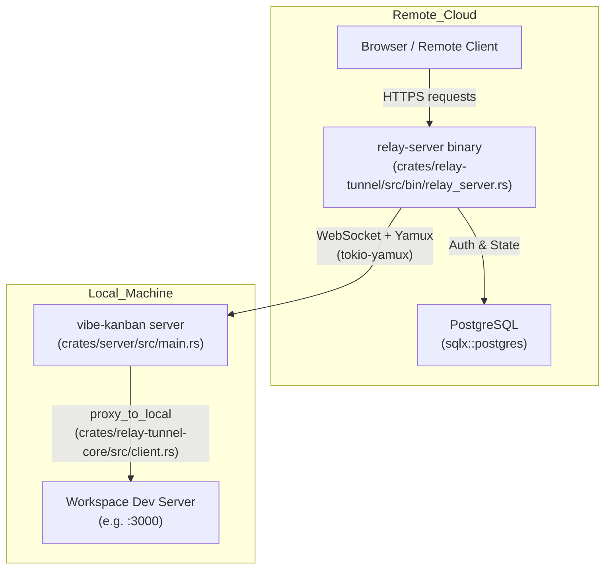
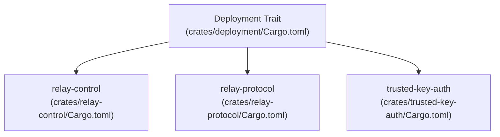
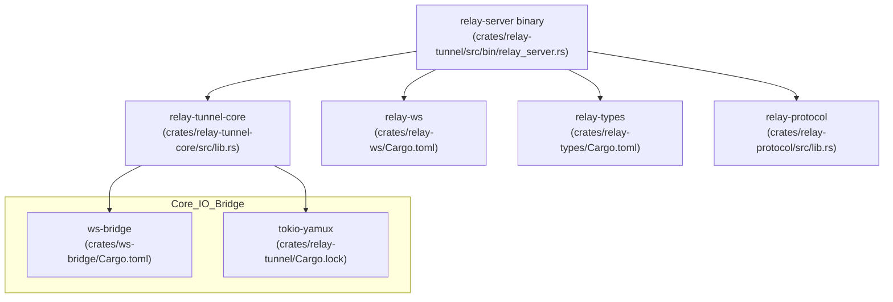

# Relay Tunnel System

Relevant source files

The following files were used as context for generating this wiki page:

- [Cargo.toml](Cargo.toml)
- [crates/client-info/src/lib.rs](crates/client-info/src/lib.rs)
- [crates/preview-proxy/src/lib.rs](crates/preview-proxy/src/lib.rs)
- [crates/relay-control/Cargo.toml](crates/relay-control/Cargo.toml)
- [crates/relay-protocol/Cargo.toml](crates/relay-protocol/Cargo.toml)
- [crates/relay-tunnel-core/src/client.rs](crates/relay-tunnel-core/src/client.rs)
- [crates/relay-tunnel-core/src/lib.rs](crates/relay-tunnel-core/src/lib.rs)
- [crates/relay-tunnel-core/src/server.rs](crates/relay-tunnel-core/src/server.rs)
- [crates/relay-tunnel/Cargo.lock](crates/relay-tunnel/Cargo.lock)
- [crates/relay-tunnel/Cargo.toml](crates/relay-tunnel/Cargo.toml)
- [crates/relay-webrtc/Cargo.toml](crates/relay-webrtc/Cargo.toml)
- [crates/server/src/main.rs](crates/server/src/main.rs)
- [crates/server/src/middleware/error_logging.rs](crates/server/src/middleware/error_logging.rs)
- [crates/server/src/middleware/mod.rs](crates/server/src/middleware/mod.rs)
- [crates/server/src/middleware/origin.rs](crates/server/src/middleware/origin.rs)
- [crates/server/src/routes/mod.rs](crates/server/src/routes/mod.rs)
- [crates/server/src/routes/preview.rs](crates/server/src/routes/preview.rs)
- [crates/server/src/runtime/relay_registration.rs](crates/server/src/runtime/relay_registration.rs)
- [crates/server/src/startup.rs](crates/server/src/startup.rs)
- [docs/images/remote-access-cloud-mobile.png](docs/images/remote-access-cloud-mobile.png)
- [docs/images/remote-access-generate-pairing-code-modal.png](docs/images/remote-access-generate-pairing-code-modal.png)
- [docs/images/remote-access-generate-pairing-code-settings.png](docs/images/remote-access-generate-pairing-code-settings.png)
- [docs/images/remote-access-pair-host-mobile-form.png](docs/images/remote-access-pair-host-mobile-form.png)
- [docs/images/remote-access-pair-host-mobile-select.png](docs/images/remote-access-pair-host-mobile-select.png)
- [docs/remote-access.mdx](docs/remote-access.mdx)

The Relay Tunnel System provides remote access and preview proxy functionality for Vibe Kanban. It allows a local server (typically running on a developer's machine) to be accessible via a public URL through a cloud-based relay intermediary, bypassing firewalls and NAT without requiring a public IP.

---

## Purpose

By default, a Vibe Kanban server binds to `127.0.0.1` and is accessible only on the local machine [crates/server/src/main.rs:115-115](). The relay tunnel enables:
1.  **Remote Access**: Accessing the Kanban board and workspace UI from any browser via a persistent tunnel [crates/server/src/main.rs:183-183]().
2.  **Preview Proxy**: Proxying web applications running within a workspace (e.g., a React dev server on port 3000) to a public URL for testing and sharing [crates/server/src/routes/mod.rs:52-52]().
3.  **SSH Tunneling**: Establishing secure SSH sessions to local workspaces via the relay using embedded SSH capabilities [crates/server/src/routes/mod.rs:56-56]().

---

## High-Level Architecture

The system consists of a persistent WebSocket control channel between the local server and the relay server. Incoming browser traffic is multiplexed over this single connection using the Yamux protocol.

**Relay Tunnel: Runtime Components**

Sources: [crates/relay-tunnel/Cargo.toml:7-9](), [crates/relay-tunnel/Cargo.toml:37-37](), [crates/relay-tunnel/Cargo.toml:26-26](), [crates/server/src/main.rs:183-183](), [crates/relay-tunnel-core/src/client.rs:94-115]()

---

## Deployment and Initialization

The relay tunnel is integrated into the backend via the `Deployment` trait. During startup, the `relay_registration::spawn_relay` function initiates the connection [crates/server/src/main.rs:183-183]().

**Relay Components in Deployment**

### Component Roles
*   **`relay-control`**: Manages the identity and cryptographic primitives for the relay connection, utilizing `ed25519-dalek` for signing and `uuid` for session identification [crates/relay-control/Cargo.toml:11-14]().
*   **`relay-protocol`**: Defines the shared message structures and WebSocket types used for communication between the client and server [crates/relay-protocol/Cargo.toml:1-12]().
*   **`trusted-key-auth`**: Implements key-based authentication for secure handshakes [Cargo.toml:8-8]().

Sources: [Cargo.toml:1-34](), [crates/relay-control/Cargo.toml:1-15](), [crates/server/src/main.rs:183-183]()

---

## Client-Side Implementation: `relay-tunnel-core`

The `relay-tunnel-core` crate contains the shared logic for establishing the connection and proxying requests to local services. It is used by the `relay-server` binary and the local Vibe Kanban instance [crates/relay-tunnel/Cargo.toml:12-12]().

### Connection Lifecycle
1.  **Handshake**: Connects to the relay via `tokio-tungstenite` using a secure WebSocket (WSS) with `rustls` support [crates/relay-tunnel-core/src/client.rs:43-46]().
2.  **Multiplexing**: Wraps the WebSocket in a `tokio-yamux` session to allow multiple virtual streams over one TCP connection [crates/relay-tunnel-core/src/client.rs:48-50]().
3.  **Stream Handling**: The `handle_inbound_stream` function listens for inbound streams from the relay and routes them to local addresses via `hyper` [crates/relay-tunnel-core/src/client.rs:78-92]().

### Configuration
The system uses a shared `yamux_config` that increases the stream window size to 1 MB and sets a 30-second write timeout to handle large HTTP responses over remote connections [crates/relay-tunnel-core/src/lib.rs:13-19]().

Sources: [crates/relay-tunnel-core/src/client.rs:30-76](), [crates/relay-tunnel-core/src/lib.rs:9-19]()

---

## Server-Side Implementation: `relay-server`

The relay server is a standalone binary that acts as the public-facing gateway for remote access [crates/relay-tunnel/Cargo.toml:7-9]().

### API Routes and Multiplexing
The relay server exposes endpoints for both the local host to connect and for the remote client (browser) to access the host.

*   **Authentication**: Uses `jsonwebtoken` for verifying host identity and managing sessions [crates/relay-tunnel/Cargo.toml:32-32]().
*   **Session Management**: Uses `run_control_channel` to initialize the Yamux server session over an upgraded WebSocket [crates/relay-tunnel-core/src/server.rs:24-47]().
*   **Request Proxying**: The `proxy_request_over_control` function opens a new Yamux stream and forwards the incoming HTTP request to the local client [crates/relay-tunnel-core/src/server.rs:50-64]().

**Relay Server Entity Map**

Sources: [crates/relay-tunnel/Cargo.toml:7-14](), [crates/relay-tunnel/Cargo.toml:26-27](), [crates/relay-tunnel-core/src/server.rs:1-130]()

---

## Preview Proxy and WebSocket Bridging

The `preview-proxy` service manages the specific logic of rewriting URLs and bridging WebSockets for the built-in browser preview [Cargo.toml:31-31]().

### `ws-bridge` and `relay-webrtc`
The `ws-bridge` crate provides utilities like `axum_ws_stream_io` for adapting WebSocket streams into async I/O objects [crates/relay-tunnel-core/src/server.rs:14-14](). For low-latency data channels, the system can utilize `relay-webrtc` [Cargo.toml:33-33]().

**Data Flow for Preview Proxy**
1.  **Request**: Browser hits a preview URL.
2.  **Relay**: The Relay Server identifies the target host and calls `proxy_request_over_control` [crates/relay-tunnel-core/src/server.rs:50-54]().
3.  **Local Server**: The local server receives the stream and identifies the target port via the `preview` router [crates/server/src/routes/mod.rs:52-52]().
4.  **Local Proxy**: The `proxy_to_local` function in the client establishes a `TcpStream` to the local service [crates/relay-tunnel-core/src/client.rs:103-115]().

Sources: [crates/server/src/routes/mod.rs:52-52](), [crates/relay-tunnel-core/src/server.rs:50-121](), [crates/relay-tunnel-core/src/client.rs:94-162]()

---

## Security and Authentication

The relay system employs multiple layers of security to prevent unauthorized access:

1.  **TLS Encryption**: All traffic is encrypted using `rustls` with `aws-lc-rs` as the cryptographic provider, initialized at server startup [crates/server/src/main.rs:35-37]().
2.  **Request Signing**: The `require_relay_request_signature` and `sign_relay_response` middleware ensure that requests and responses flowing through the relay are cryptographically verified [crates/server/src/routes/mod.rs:60-67]().
3.  **Origin Validation**: The `validate_origin` middleware ensures requests come from trusted domains and prevents unauthorized cross-origin access [crates/server/src/main.rs:161-162]().
4.  **Relay Auth**: The `relay_auth` router handles the initial authentication handshake between the local host and the relay service [crates/server/src/routes/mod.rs:71-71]().

Sources: [crates/server/src/main.rs:35-37](), [crates/server/src/routes/mod.rs:60-78](), [crates/relay-tunnel/Cargo.toml:32-37]()