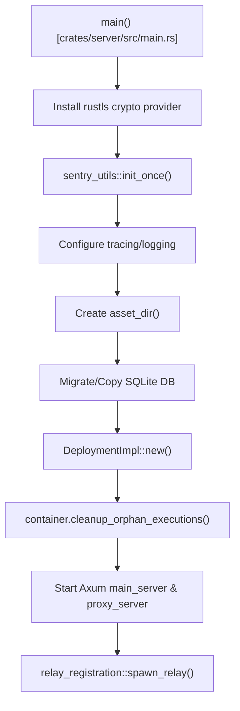
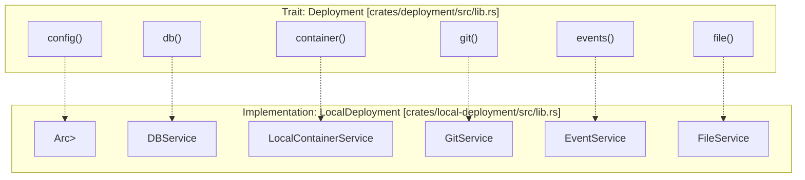
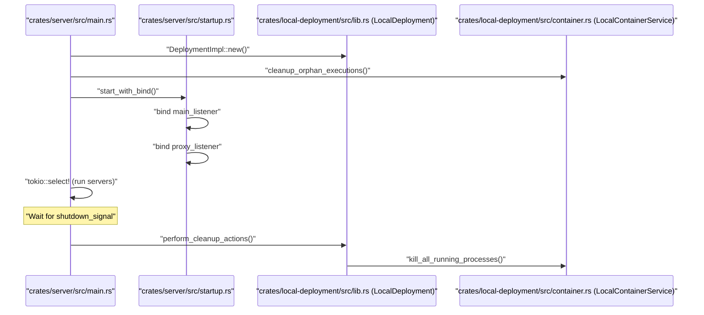

# Server Initialization and Configuration

Relevant source files

The following files were used as context for generating this wiki page:

- [crates/client-info/src/lib.rs](crates/client-info/src/lib.rs)
- [crates/deployment/src/lib.rs](crates/deployment/src/lib.rs)
- [crates/local-deployment/src/lib.rs](crates/local-deployment/src/lib.rs)
- [crates/preview-proxy/src/lib.rs](crates/preview-proxy/src/lib.rs)
- [crates/relay-tunnel-core/src/client.rs](crates/relay-tunnel-core/src/client.rs)
- [crates/relay-tunnel-core/src/lib.rs](crates/relay-tunnel-core/src/lib.rs)
- [crates/relay-tunnel-core/src/server.rs](crates/relay-tunnel-core/src/server.rs)
- [crates/server/src/error.rs](crates/server/src/error.rs)
- [crates/server/src/main.rs](crates/server/src/main.rs)
- [crates/server/src/routes/config.rs](crates/server/src/routes/config.rs)
- [crates/server/src/routes/preview.rs](crates/server/src/routes/preview.rs)
- [crates/server/src/runtime/relay_registration.rs](crates/server/src/runtime/relay_registration.rs)
- [crates/server/src/startup.rs](crates/server/src/startup.rs)
- [crates/services/src/services/config/mod.rs](crates/services/src/services/config/mod.rs)
- [crates/services/src/services/config/versions/mod.rs](crates/services/src/services/config/versions/mod.rs)
- [crates/services/src/services/config/versions/v3.rs](crates/services/src/services/config/versions/v3.rs)
- [crates/services/src/services/config/versions/v5.rs](crates/services/src/services/config/versions/v5.rs)
- [crates/services/src/services/config/versions/v7.rs](crates/services/src/services/config/versions/v7.rs)
- [crates/services/src/services/mod.rs](crates/services/src/services/mod.rs)
- [crates/utils/src/msg_store.rs](crates/utils/src/msg_store.rs)
- [crates/utils/src/version.rs](crates/utils/src/version.rs)

This document explains how the Vibe Kanban server starts up, initializes its services, and manages configuration. It covers the main entry point, the `Deployment` trait pattern, service initialization order, and the configuration system.

---

## Main Entry Point

The server entry point is located in `crates/server/src/main.rs`. The `main` function performs the following initialization steps:

### Initialization Flow

**Sources:** [crates/server/src/main.rs:33-183]()

### Environment Variables

The server reads the following environment variables during startup:

| Variable | Default | Purpose |
|----------|---------|---------|
| `RUST_LOG` | `"info"` | Logging level for all crates [crates/server/src/main.rs:41-45]() |
| `BACKEND_PORT` or `PORT` | `0` | Server port (0 = auto-assign) [crates/server/src/main.rs:96-108]() |
| `PREVIEW_PROXY_PORT` | `0` | Preview proxy port [crates/server/src/main.rs:110-113]() |
| `HOST` | `"127.0.0.1"` | Bind address [crates/server/src/main.rs:115]() |
| `VK_SHARED_API_BASE` | None | Remote API base URL [crates/local-deployment/src/lib.rs:171-173]() |
| `VK_SHARED_RELAY_API_BASE` | None | Remote Relay API base URL [crates/local-deployment/src/lib.rs:174-176]() |

### Logging Configuration

The logging system uses `tracing-subscriber` with environment filters to control verbosity per crate. It specifically silences `codex_core` while enabling internal crates like `server`, `services`, `db`, and `executors`.

**Sources:** [crates/server/src/main.rs:41-50]()

---

## Deployment Trait Pattern

The server uses the `Deployment` trait to abstract over different deployment modes. In the current implementation, `DeploymentImpl` is an alias for `LocalDeployment`.

### Deployment Trait Definition

The trait defines the interface for accessing all core services required by the API handlers.

**Sources:** [crates/deployment/src/lib.rs:80-158](), [crates/local-deployment/src/lib.rs:52-91]()

---

## LocalDeployment Initialization

The `LocalDeployment::new()` method orchestrates the complete initialization sequence, establishing dependencies in the correct order.

### Initialization Sequence

1.  **Log Migration**: Runs `migrate_execution_logs_to_files()` to move logs from the database to the filesystem [crates/local-deployment/src/lib.rs:94-96]().
2.  **Config Loading**: Calls `load_config_from_file()`, handles recommended executor profiles, and updates the version flag [crates/local-deployment/src/lib.rs:98-117]().
3.  **Event System**: Creates a `MsgStore` and hooks it into the `DBService` to capture real-time database changes via `EventService::create_hook()` [crates/local-deployment/src/lib.rs:135-147]().
4.  **Database**: Initializes SQLite via `DBService` with the event hook [crates/local-deployment/src/lib.rs:146-147]().
5.  **File Cleanup**: Spawns a task to call `delete_orphaned_files()` [crates/local-deployment/src/lib.rs:150-158]().
6.  **Auth & Remote**: Sets up `AuthContext`, `OAuthCredentials`, and `RemoteClient` for communication with the Vibe Kanban cloud [crates/local-deployment/src/lib.rs:163-200]().
7.  **Managers**: Initializes `WorkspaceManager` and `WorktreeManager` [crates/local-deployment/src/lib.rs:204-206]().

**Sources:** [crates/local-deployment/src/lib.rs:92-249]()

---

## Configuration System

### Config Structure

The configuration is versioned. The current version is `v8`, re-exported in `services::services::config`.

| Field | Type | Purpose |
|-------|------|---------|
| `onboarding_acknowledged` | `bool` | Whether the user has seen the welcome screen [crates/local-deployment/src/lib.rs:101]() |
| `executor_profile` | `String` | Active executor profile ID [crates/local-deployment/src/lib.rs:104]() |
| `workspace_dir` | `Option<String>` | Custom root for git worktrees [crates/local-deployment/src/lib.rs:122]() |
| `last_app_version` | `Option<String>` | Version used during last run [crates/local-deployment/src/lib.rs:110-115]() |

**Sources:** [crates/services/src/services/config/mod.rs:35-45](), [crates/local-deployment/src/lib.rs:98-125]()

### Config Management

The system supports loading and saving to the filesystem using `serde_json`.

*   **Load**: `load_config_from_file` reads from the asset directory or returns `Config::default()` if missing [crates/services/src/services/config/mod.rs:47-55]().
*   **Save**: `save_config_to_file` performs a pretty-printed JSON write [crates/services/src/services/config/mod.rs:58-65]().

---

## Server Runtime and Cleanup

The server utilizes `axum::serve` to handle requests on two distinct listeners: the main API and the preview proxy.

### Server Lifecycle

**Sources:** [crates/server/src/main.rs:72-198](), [crates/server/src/startup.rs:105-128](), [crates/server/src/startup.rs:186-192]()

### Shutdown and Cleanup

When a shutdown signal is received (SIGINT/SIGTERM), the `CancellationToken` is cancelled [crates/server/src/main.rs:193](). The server then calls `perform_cleanup_actions`, which invokes `kill_all_running_processes()` on the `ContainerService` to ensure no orphaned agent processes or PTYs remain active [crates/server/src/startup.rs:186-192]().

### Preview Proxy and Relay Systems

The server initializes two specialized networking systems for remote access and previews:

1.  **Preview Proxy**: Handles subdomain-based routing for web application previews. During startup, the `actual_proxy_port` is registered in `ClientInfo` [crates/server/src/main.rs:137-140]().
2.  **Relay Tunnel**: The `relay_registration::spawn_relay` function starts a background task that connects to the Vibe Kanban relay servers using `start_relay_client` [crates/server/src/main.rs:183](). This uses `tokio_yamux` over WebSockets to tunnel inbound HTTP requests to the local Axum server [crates/relay-tunnel-core/src/client.rs:30-76]().

**Sources:** [crates/server/src/main.rs:110-140](), [crates/server/src/routes/preview.rs:112-139](), [crates/relay-tunnel-core/src/client.rs:30-92]()