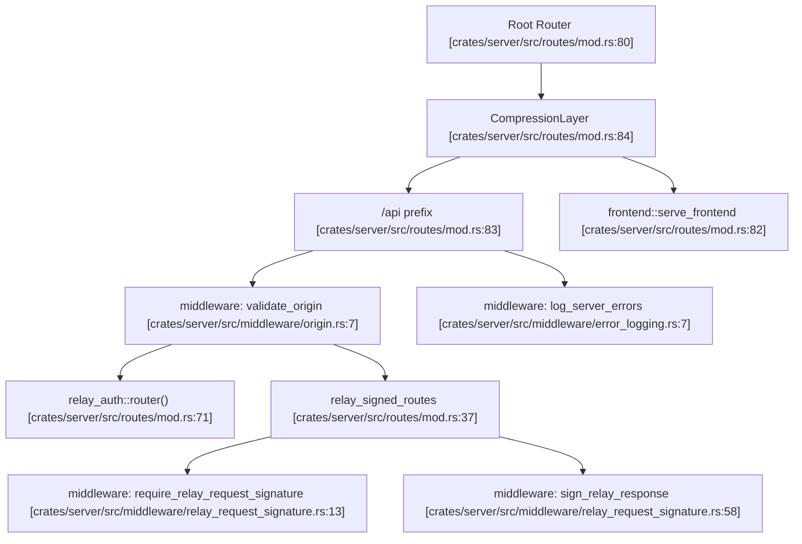
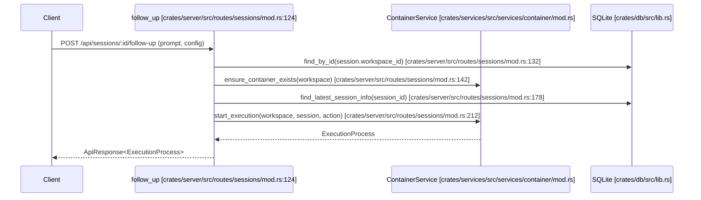
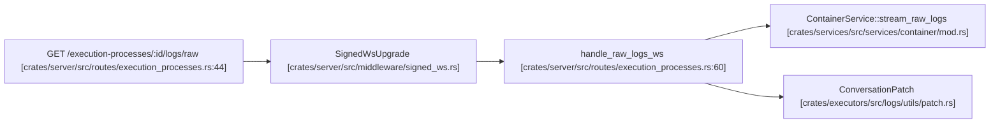

# API Routes and Handlers

<details>
<summary>Relevant source files</summary>

The following files were used as context for generating this wiki page:

- [Cargo.toml](Cargo.toml)
- [crates/relay-control/Cargo.toml](crates/relay-control/Cargo.toml)
- [crates/relay-tunnel/Cargo.lock](crates/relay-tunnel/Cargo.lock)
- [crates/relay-tunnel/Cargo.toml](crates/relay-tunnel/Cargo.toml)
- [crates/server/src/middleware/error_logging.rs](crates/server/src/middleware/error_logging.rs)
- [crates/server/src/middleware/mod.rs](crates/server/src/middleware/mod.rs)
- [crates/server/src/middleware/origin.rs](crates/server/src/middleware/origin.rs)
- [crates/server/src/routes/execution_processes.rs](crates/server/src/routes/execution_processes.rs)
- [crates/server/src/routes/mod.rs](crates/server/src/routes/mod.rs)
- [crates/server/src/routes/sessions/mod.rs](crates/server/src/routes/sessions/mod.rs)
- [crates/server/src/routes/workspaces/core.rs](crates/server/src/routes/workspaces/core.rs)
- [crates/server/src/routes/workspaces/execution.rs](crates/server/src/routes/workspaces/execution.rs)
- [crates/server/src/routes/workspaces/integration.rs](crates/server/src/routes/workspaces/integration.rs)
- [crates/server/src/routes/workspaces/links.rs](crates/server/src/routes/workspaces/links.rs)
- [crates/server/src/routes/workspaces/mod.rs](crates/server/src/routes/workspaces/mod.rs)
- [crates/server/src/routes/workspaces/repos.rs](crates/server/src/routes/workspaces/repos.rs)
- [crates/server/src/routes/workspaces/streams.rs](crates/server/src/routes/workspaces/streams.rs)
- [crates/services/src/services/events.rs](crates/services/src/services/events.rs)
- [packages/web-core/src/shared/components/VirtualizedProcessLogs.tsx](packages/web-core/src/shared/components/VirtualizedProcessLogs.tsx)
- [packages/web-core/src/shared/hooks/useJsonPatchWsStream.ts](packages/web-core/src/shared/hooks/useJsonPatchWsStream.ts)
- [packages/web-core/src/shared/hooks/useLogStream.ts](packages/web-core/src/shared/hooks/useLogStream.ts)

</details>


This page covers the HTTP route tree of the `crates/server` crate: how routes are organized into modules, how middleware layers are applied, the request/response conventions, and how errors map to HTTP status codes. For the WebSocket-specific streaming endpoints, see [WebSocket Streams](#10.2). For the broader server startup and initialization sequence, see [Server Initialization and Configuration](#4.2). For the error type and `ApiResponse` wrapper in depth, see [Error Handling and ApiResponse System](#4.9).

---

## Route Tree Structure

The top-level router is assembled in `crates/server/src/routes/mod.rs`. Routes are split into three tiers based on applied middleware. The router uses Axum's `Router::merge` and `Router::nest` to compose the full API surface [crates/server/src/routes/mod.rs:36-86]().

**Route tree and middleware hierarchy**



Sources: [crates/server/src/routes/mod.rs:36-86](), [crates/server/src/middleware/mod.rs:1-11](), [crates/server/src/middleware/error_logging.rs:7-32]()

The `validate_origin` middleware (applied to all `/api` routes via `ValidateRequestHeaderLayer`) rejects requests from disallowed origins [crates/server/src/routes/mod.rs:74-76](). `require_relay_request_signature` and `sign_relay_response` handle authentication and integrity when requests are forwarded through the relay tunnel [crates/server/src/routes/mod.rs:60-67]().

---

## Route Modules

Each sub-module exposes a `router()` function merged into the main router. The table below lists the primary modules registered in `routes/mod.rs`.

| Module | Key Handlers / Functionality | Path / Method |
|---|---|---|
| `health` | `health_check` | `GET /health` [crates/server/src/routes/mod.rs:38]() |
| `config` | `get_user_system_info`, `update_config` | `merge(config::router())` [crates/server/src/routes/mod.rs:39]() |
| `workspaces` | Core workspace lifecycle and management | `merge(workspaces::router(&deployment))` [crates/server/src/routes/mod.rs:41]() |
| `sessions` | Agent interaction and session context | `merge(sessions::router(&deployment))` [crates/server/src/routes/mod.rs:54]() |
| `repo` | Repository registration and git operations | `merge(repo::router())` [crates/server/src/routes/mod.rs:47]() |
| `execution_processes` | List/get `ExecutionProcess` records | `merge(execution_processes::router(&deployment))` [crates/server/src/routes/mod.rs:42]() |
| `events` | Real-time update streams | `merge(events::router(&deployment))` [crates/server/src/routes/mod.rs:48]() |
| `approvals` | Tool-use approval accept/deny | `merge(approvals::router())` [crates/server/src/routes/mod.rs:49]() |
| `attachments` | Image/file upload via `ImageService` | `nest("/attachments", attachments::routes())` [crates/server/src/routes/mod.rs:59]() |
| `scratch` | Transient UI state persistence | `merge(scratch::router(&deployment))` [crates/server/src/routes/mod.rs:50]() |
| `terminal` | Interactive PTY terminal sessions | `merge(terminal::router())` [crates/server/src/routes/mod.rs:55]() |
| `ssh_session` | WebSocket-based SSH access | `GET /ssh-session` [crates/server/src/routes/mod.rs:56]() |

Sources: [crates/server/src/routes/mod.rs:9-68](), [crates/server/src/routes/sessions/mod.rs:4-10]()

---

## Session and Agent Handlers

The `sessions` module manages the interaction with AI coding agents. The `follow_up` handler is a critical endpoint that initiates new execution processes based on user prompts [crates/server/src/routes/sessions/mod.rs:124-208]().

**Agent Interaction Data Flow**



Sources: [crates/server/src/routes/sessions/mod.rs:124-222](), [crates/server/src/routes/workspaces/execution.rs:203-211]()

---

## Log Streaming Handlers

The `execution_processes` module provides specialized WebSocket handlers for streaming process output. It supports both raw stdout/stderr and normalized log formats.

- `stream_raw_logs_ws`: Upgrades a connection to stream raw terminal output [crates/server/src/routes/execution_processes.rs:44-58]().
- `stream_normalized_logs_ws`: Streams logs processed by the agent's log normalizer [crates/server/src/routes/execution_processes.rs:138-166]().

**Log Streaming Code Entity Map**



Sources: [crates/server/src/routes/execution_processes.rs:44-166](), [packages/web-core/src/shared/components/VirtualizedProcessLogs.tsx:20-31]()

---

## Workspace-Scoped Routes and Middleware

Routes acting on specific workspaces or sessions require the target entity to be pre-loaded. The system uses specialized middleware like `load_workspace_middleware` and `load_session_middleware` to resolve rows from the database and inject them as Axum `Extension` objects [crates/server/src/routes/workspaces/mod.rs:25-42](), [crates/server/src/routes/sessions/mod.rs:34]().

**Workspace Route Composition**

```mermaid
graph TD
    WS_Router["workspaces::router [crates/server/src/routes/workspaces/mod.rs:24]"]
    WS_ID_Router["workspace_id_router [crates/server/src/routes/workspaces/mod.rs:25]"]
    LoadWS["load_workspace_middleware [crates/server/src/middleware/model_loaders.rs]"]
    
    WS_Router -->|nest /{id}| WS_ID_Router
    WS_ID_Router -->|layer| LoadWS
    WS_ID_Router --> Git["/git [crates/server/src/routes/workspaces/git.rs]"]
    WS_ID_Router --> Exec["/execution [crates/server/src/routes/workspaces/execution.rs]"]
    WS_ID_Router --> Links["/links [crates/server/src/routes/workspaces/links.rs]"]
```

Sources: [crates/server/src/routes/workspaces/mod.rs:24-61](), [crates/server/src/routes/workspaces/links.rs:105-116]()

---

## Real-time Event Streaming

The `events` module manages the delivery of database change notifications to the frontend via WebSockets. It leverages a `PreupdateHook` in SQLite to capture changes before they are committed [crates/services/src/services/events.rs:77-117]().

- **Patches**: The system sends JSON patches (RFC 6902) to update the frontend state incrementally [crates/services/src/services/events.rs:23-24]().
- **Consumption**: The frontend uses the `useJsonPatchWsStream` hook to apply these patches to local state [packages/web-core/src/shared/hooks/useJsonPatchWsStream.ts:33-64]().

Sources: [crates/services/src/services/events.rs:1-117](), [packages/web-core/src/shared/hooks/useJsonPatchWsStream.ts:1-64]()

---

## Request and Response Conventions

All REST handlers return a uniform `ApiResponse<T>` envelope defined in `crates/utils/src/response.rs`.

- **Success**: Returns `ResponseJson(ApiResponse::success(data))` with HTTP 200 [crates/server/src/routes/sessions/mod.rs:89]().
- **Error**: Returns an `ApiError` which implements `IntoResponse` to convert internal failures into appropriate HTTP responses [crates/server/src/routes/sessions/mod.rs:53]().

### `ApiError` to HTTP Status Mapping

The `ApiError` enum maps internal failures to standard HTTP status codes. The `log_server_errors` middleware ensures that any 5xx responses are logged with request context [crates/server/src/middleware/error_logging.rs:21-29]().

| ApiError Variant | HTTP Status | Context |
|---|---|---|
| `BadRequest` | 400 Bad Request | Validation failures, invalid parameters |
| `Unauthorized` | 401 Unauthorized | Missing or invalid relay signatures |
| `NotFound` | 404 Not Found | Workspace, Session, or File not found |
| `Internal` | 500 Internal Server Error | Database errors, executor crashes |

Sources: [crates/server/src/middleware/error_logging.rs:7-32](), [crates/server/src/routes/mod.rs:77-78]()

---

## Frontend Integration

The `frontend` module handles serving the compiled React application. It includes a fallback route `/{*path}` to support client-side routing (e.g., TanStack Router) by serving the `index.html` for any non-API path [crates/server/src/routes/mod.rs:80-83]().

- `GET /`: Serves `serve_frontend_root` [crates/server/src/routes/mod.rs:81]().
- `GET /{*path}`: Serves `serve_frontend` (SPA fallback) [crates/server/src/routes/mod.rs:82]().

Sources: [crates/server/src/routes/mod.rs:80-86]()