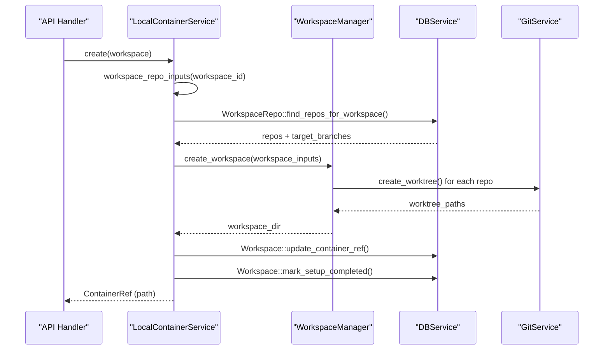
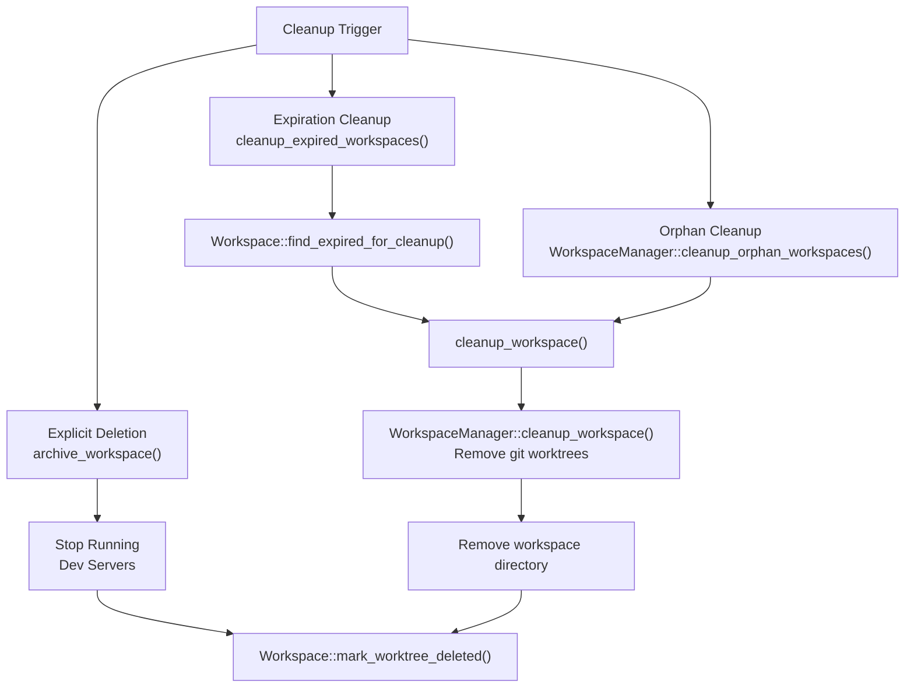
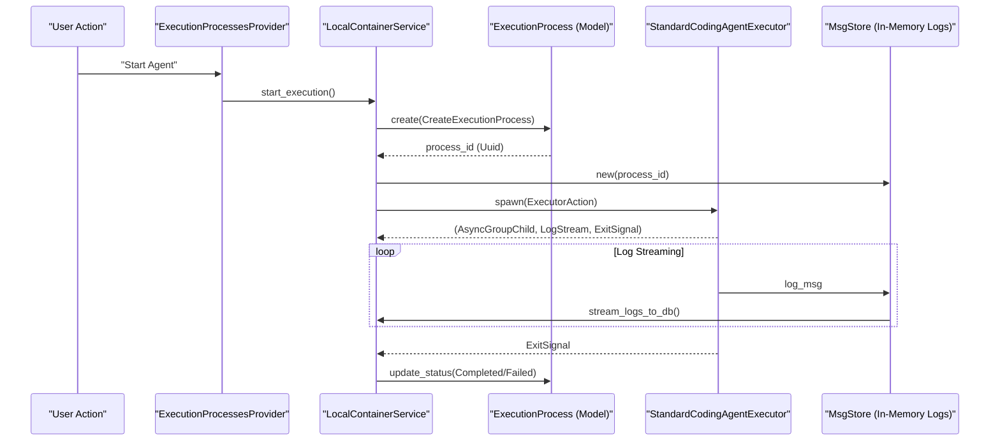
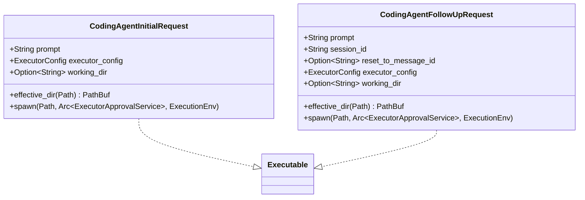

# Container Service and Workspace Management

Relevant source files

The following files were used as context for generating this wiki page:

- [crates/db/.sqlx/query-1b186dc075846fc1f7270a942afbf82a88806ee6ababdb437ab5e97ddd2122da.json](crates/db/.sqlx/query-1b186dc075846fc1f7270a942afbf82a88806ee6ababdb437ab5e97ddd2122da.json)
- [crates/db/.sqlx/query-2a57b702e52b3cc9bdbc361267985958b11d4493b01a9ab8daedf5d951422897.json](crates/db/.sqlx/query-2a57b702e52b3cc9bdbc361267985958b11d4493b01a9ab8daedf5d951422897.json)
- [crates/db/.sqlx/query-f584dbe0f2f2a4f1e7dcf5b8f675eb2a6d954bb3f148ac0fece10652f05fb49b.json](crates/db/.sqlx/query-f584dbe0f2f2a4f1e7dcf5b8f675eb2a6d954bb3f148ac0fece10652f05fb49b.json)
- [crates/db/src/models/execution_process.rs](crates/db/src/models/execution_process.rs)
- [crates/db/src/models/workspace.rs](crates/db/src/models/workspace.rs)
- [crates/executors/src/actions/coding_agent_follow_up.rs](crates/executors/src/actions/coding_agent_follow_up.rs)
- [crates/executors/src/actions/coding_agent_initial.rs](crates/executors/src/actions/coding_agent_initial.rs)
- [crates/local-deployment/src/container.rs](crates/local-deployment/src/container.rs)
- [crates/server/src/routes/containers.rs](crates/server/src/routes/containers.rs)
- [crates/server/src/routes/filesystem.rs](crates/server/src/routes/filesystem.rs)
- [crates/services/src/services/container.rs](crates/services/src/services/container.rs)
- [crates/services/src/services/filesystem.rs](crates/services/src/services/filesystem.rs)
- [crates/utils/src/port_file.rs](crates/utils/src/port_file.rs)

This document describes the `ContainerService` and its primary implementation `LocalContainerService`, which manage workspace execution environments and process lifecycles. The container service orchestrates workspace creation, execution process spawning, real-time log streaming, and cleanup operations.

For information about the conceptual workspace and execution process data models, see [Workspaces and Execution Lifecycle](2.3). For git worktree mechanics, see [Git Worktree Management](2.4). For server initialization and dependency injection, see [Server Initialization and Configuration](4.2).

## Service Architecture

The container service follows a trait-based architecture where `ContainerService` defines the interface and `LocalContainerService` provides the local deployment implementation.

### Service Structure and Dependencies

The following diagram maps the high-level system components to their specific Rust code entities.

```mermaid
graph TB
    subgraph "Trait Layer [crates/services/src/services/container.rs]"
        ContainerService["ContainerService<br/>(trait)"]
    end
    
    subgraph "Implementation Layer [crates/local-deployment/src/container.rs]"
        LocalContainerService["LocalContainerService"]
    end
    
    subgraph "Core Dependencies"
        DBService["DBService<br/>(crates/db/src/lib.rs)"]
        WorkspaceManager["WorkspaceManager<br/>(crates/workspace-manager/src/lib.rs)"]
        GitService["GitService<br/>(crates/git/src/lib.rs)"]
        FileService["FileService<br/>(crates/services/src/services/file.rs)"]
        Approvals["Approvals<br/>(crates/services/src/services/approvals/mod.rs)"]
    end
    
    subgraph "State Management [LocalContainerService Fields]"
        ChildStore["child_store<br/>HashMap[Uuid, AsyncGroupChild]"]
        CancellationTokens["cancellation_tokens<br/>HashMap[Uuid, CancellationToken]"]
        MsgStores["msg_stores<br/>HashMap[Uuid, MsgStore]"]
        DbStreamHandles["db_stream_handles<br/>HashMap[Uuid, JoinHandle]"]
        ExitMonitorHandles["exit_monitor_handles<br/>HashMap[Uuid, JoinHandle]"]
    end
    
    ContainerService -.implemented by.-> LocalContainerService
    
    LocalContainerService --> DBService
    LocalContainerService --> WorkspaceManager
    LocalContainerService --> GitService
    LocalContainerService --> FileService
    LocalContainerService --> Approvals
    
    LocalContainerService --> ChildStore
    LocalContainerService --> CancellationTokens
    LocalContainerService --> MsgStores
    LocalContainerService --> DbStreamHandles
    LocalContainerService --> ExitMonitorHandles
```

**Sources:** [crates/services/src/services/container.rs:88-100](), [crates/local-deployment/src/container.rs:69-88]()

### ContainerService Trait

The `ContainerService` trait defines the core operations for managing workspace execution:

| Method | Purpose |
|--------|---------|
| `create()` | Create workspace directory and git worktrees |
| `delete()` | Remove workspace directory and worktrees |
| `start_execution()` | Spawn executor process for a session |
| `stop_execution()` | Kill running process and update status |
| `touch()` | Update workspace last-access timestamp |
| `workspace_to_current_dir()` | Resolve workspace container reference to filesystem path |
| `should_finalize()` | Determine if execution context should be finalized |
| `finalize_task()` | Send notifications and perform cleanup |
| `discover_executor_options()` | Fetch available options (e.g., slash commands) from an agent |

**Sources:** [crates/services/src/services/container.rs:88-210]()

### LocalContainerService Implementation

`LocalContainerService` maintains several concurrent hash maps to track running processes and their associated resources:

| State Map | Key | Value | Purpose |
|-----------|-----|-------|---------|
| `child_store` | `Uuid` (process ID) | `Arc<RwLock<AsyncGroupChild>>` | OS process handles (wrapped for cross-platform group killing) |
| `cancellation_tokens` | `Uuid` | `CancellationToken` | Signals for graceful shutdown of executor logic |
| `msg_stores` | `Uuid` | `Arc<MsgStore>` | In-memory log message buffers |
| `db_stream_handles` | `Uuid` | `JoinHandle<()>` | Background tasks that stream logs from `MsgStore` to SQLite |
| `exit_monitor_handles` | `Uuid` | `JoinHandle<()>` | Tasks that wait for process exit and perform post-run logic |
| `workspace_touch_times` | `Uuid` (workspace ID) | `Instant` | Last access times for debounced `touch` updates |

**Sources:** [crates/local-deployment/src/container.rs:69-88]()

## Workspace Lifecycle Management

### Workspace Creation

Workspace creation involves coordinating multiple services to set up an isolated development environment using git worktrees:

**Sources:** [crates/local-deployment/src/container.rs:160-194](), [crates/services/src/services/container.rs:193]()

The `workspace_repo_inputs()` helper method retrieves the repository configuration for a workspace and constructs `RepoWorkspaceInput` objects specifying the `target_branch` for each repo in the workspace.

**Sources:** [crates/local-deployment/src/container.rs:160-188]()

### Workspace Deletion and Cleanup

Workspace cleanup occurs in multiple scenarios, including explicit deletion, periodic expiration of inactive workspaces, and cleanup of orphaned directories at startup.

**Sources:** [crates/local-deployment/src/container.rs:241-274](), [crates/local-deployment/src/container.rs:276-297](), [crates/services/src/services/container.rs:524-558]()

### Background Cleanup Service

The container service spawns a background cleanup task during initialization in `LocalContainerService::new()`:

- Performs initial orphan cleanup at startup via `WorkspaceManager`.
- Runs a periodic cleanup loop every 30 minutes.
- Can be disabled via the `DISABLE_WORKTREE_CLEANUP` environment variable.

**Sources:** [crates/local-deployment/src/container.rs:130-132](), [crates/local-deployment/src/container.rs:299-320]()

## Execution Process Management

### Execution Lifecycle: Natural Language to Code Entities

The following diagram bridges the conceptual "Execution" with the specific code entities involved in its lifecycle.

**Sources:** [crates/services/src/services/container.rs:644-868](), [crates/db/src/models/execution_process.rs:16-18]()

### Starting Execution

The `start_execution()` method orchestrates the complete lifecycle of spawning and monitoring an executor process:

1. **Database Entry**: Creates an `ExecutionProcess` record and `ExecutionProcessRepoState` for each repository. [crates/services/src/services/container.rs:644-727]()
2. **Resource Prep**: Ensures the container exists and initializes a `MsgStore` for log buffering. [crates/services/src/services/container.rs:741-764]()
3. **Executor Spawn**: Calls the executor's `spawn` method to get an OS process handle and log stream. [crates/services/src/services/container.rs:766-784]()
4. **Monitoring**: Spawns background tasks for streaming logs to the database (`stream_logs_to_db`) and monitoring process exit (`spawn_exit_monitor`). [crates/services/src/services/container.rs:790-850]()

**Sources:** [crates/services/src/services/container.rs:644-868]()

### Process Exit Monitoring

Each execution process has an associated exit monitor task (`spawn_exit_monitor`) that handles completion:

1. **Graceful Signal Handling**: Listens for an `ExecutorExitSignal` which allows the executor to signal completion even if the process is still alive (e.g., background tasks). [crates/local-deployment/src/container.rs:480-550]()
2. **Status Mapping**: Maps OS exit codes or executor signals to `ExecutionProcessStatus` (Completed, Failed, Killed). [crates/db/src/models/execution_process.rs:43-48]()
3. **Commit Automation**: Attempts to commit changes after successful execution using `try_commit_changes`. [crates/local-deployment/src/container.rs:560-600]()
4. **Action Chaining**: If an execution action has a `next_action` (like a cleanup script after a setup script), it triggers `try_start_next_action`. [crates/local-deployment/src/container.rs:610-650]()

**Sources:** [crates/local-deployment/src/container.rs:480-761](), [crates/db/src/models/execution_process.rs:50-51]()

### Stopping Execution

The `stop_execution()` method terminates a running process by canceling its token and killing the OS process group:

1. Retrieves and cancels the `CancellationToken`. [crates/services/src/services/container.rs:880-890]()
2. Retrieves the `AsyncGroupChild` and calls `kill_process_group`. [crates/services/src/services/container.rs:895-905]()
3. Awaits the `db_stream_handle` to ensure all logs are flushed to the database. [crates/services/src/services/container.rs:910-915]()
4. Awaits the `exit_monitor_handle` to ensure database state is updated. [crates/services/src/services/container.rs:916-920]()

**Sources:** [crates/services/src/services/container.rs:870-930]()

## Filesystem and Repo Discovery

The `FilesystemService` provides utility methods for discovering repositories on the local machine, which is critical for workspace initialization.

| Function | Description |
|----------|-------------|
| `list_git_repos` | Scans a specific path for git repositories with a timeout. |
| `list_common_git_repos` | Scans common development directories (e.g., `~/repos`, `~/code`) for git repositories. |
| `get_directories_to_skip` | Returns a set of directories to ignore during scanning (e.g., `node_modules`, `target`). |

**Sources:** [crates/services/src/services/filesystem.rs:55-91](), [crates/services/src/services/filesystem.rs:94-121](), [crates/services/src/services/filesystem.rs:169-202]()

## Agent Request Management

Agent execution is triggered by `CodingAgentInitialRequest` and `CodingAgentFollowUpRequest`. These requests define the execution environment and parameters for the AI agent.

**Sources:** [crates/executors/src/actions/coding_agent_initial.rs:17-40](), [crates/executors/src/actions/coding_agent_follow_up.rs:17-43]()

## Integration Points

### WorkspaceManager Integration
The `LocalContainerService` uses `WorkspaceManager` to perform the physical directory and git worktree operations. Errors from the manager are mapped to `ContainerError` via `map_workspace_manager_error`.

**Sources:** [crates/local-deployment/src/container.rs:135-158]()

### Approval Service Integration
The container service creates an `ExecutorApprovalBridge` for each execution, connecting the executor's approval requests to the global `Approvals` service.

**Sources:** [crates/services/src/services/container.rs:729-739]()

### Database Models
The service interacts with several core models defined in the database crate:
- `Workspace`: [crates/db/src/models/workspace.rs:42-54]()
- `Session`: [crates/db/src/models/session.rs:1-10]()
- `ExecutionProcess`: [crates/db/src/models/execution_process.rs:62-78]()
- `ExecutionProcessRepoState`: [crates/db/src/models/execution_process_repo_state.rs:1-10]()

**Sources:** [crates/db/src/models/execution_process.rs:1-21]()