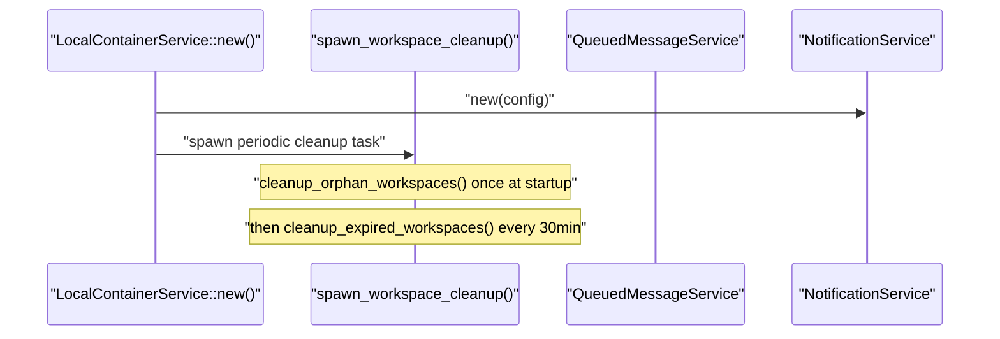
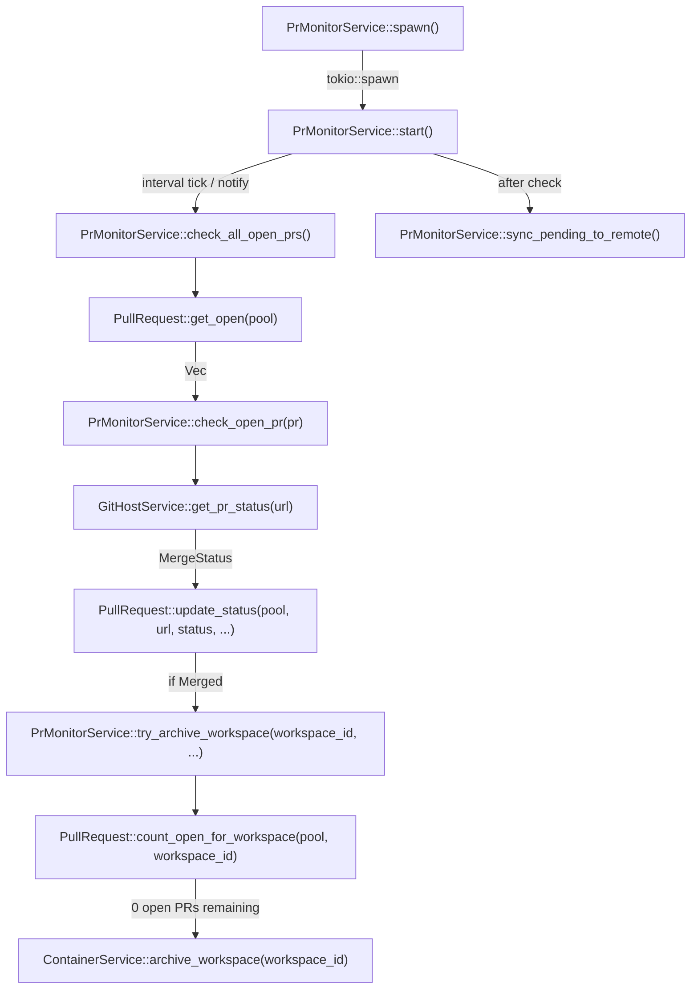
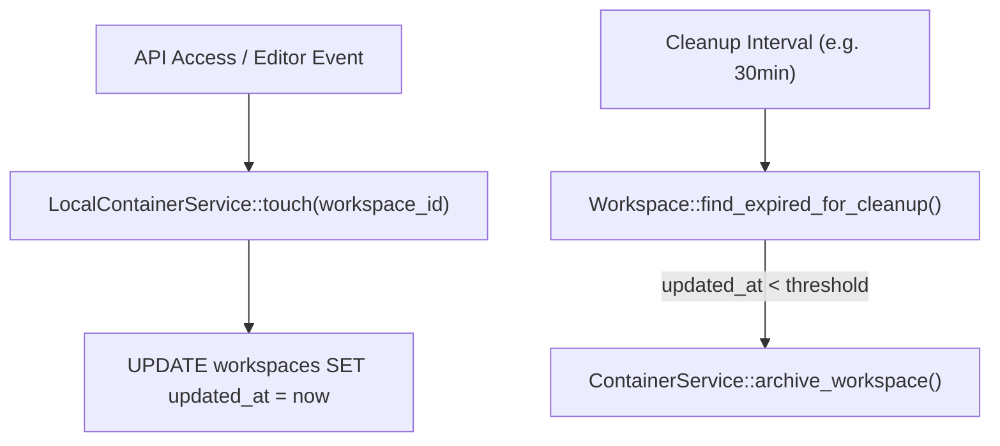
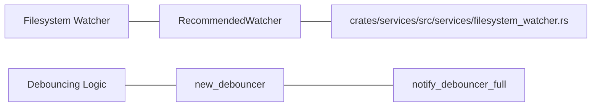

# Background Services and Cleanup

Relevant source files

The following files were used as context for generating this wiki page:

- [crates/db/.sqlx/query-1b186dc075846fc1f7270a942afbf82a88806ee6ababdb437ab5e97ddd2122da.json](crates/db/.sqlx/query-1b186dc075846fc1f7270a942afbf82a88806ee6ababdb437ab5e97ddd2122da.json)
- [crates/db/.sqlx/query-2a57b702e52b3cc9bdbc361267985958b11d4493b01a9ab8daedf5d951422897.json](crates/db/.sqlx/query-2a57b702e52b3cc9bdbc361267985958b11d4493b01a9ab8daedf5d951422897.json)
- [crates/db/.sqlx/query-f584dbe0f2f2a4f1e7dcf5b8f675eb2a6d954bb3f148ac0fece10652f05fb49b.json](crates/db/.sqlx/query-f584dbe0f2f2a4f1e7dcf5b8f675eb2a6d954bb3f148ac0fece10652f05fb49b.json)
- [crates/db/src/models/execution_process.rs](crates/db/src/models/execution_process.rs)
- [crates/db/src/models/merge.rs](crates/db/src/models/merge.rs)
- [crates/db/src/models/workspace.rs](crates/db/src/models/workspace.rs)
- [crates/local-deployment/src/container.rs](crates/local-deployment/src/container.rs)
- [crates/server/src/routes/containers.rs](crates/server/src/routes/containers.rs)
- [crates/services/src/services/container.rs](crates/services/src/services/container.rs)
- [crates/services/src/services/filesystem_watcher.rs](crates/services/src/services/filesystem_watcher.rs)
- [crates/services/src/services/pr_monitor.rs](crates/services/src/services/pr_monitor.rs)
- [crates/utils/src/port_file.rs](crates/utils/src/port_file.rs)

This page covers the background tasks that run alongside the main HTTP server in vibe-kanban's local deployment: periodic workspace expiration cleanup, PR status polling, orphan workspace and worktree cleanup, and filesystem monitoring. These are primarily handled by the `services` and `local-deployment` crates.

For how workspaces and worktrees are created and destroyed as part of the foreground request lifecycle, see [Workspaces and Execution Lifecycle](2.3) and [Git Worktree Management](2.4). For the database models these services operate on, see [Database Models and Queries](4.5).

---

## Initialization Overview

All background services are initialized within the `LocalContainerService` or the main deployment lifecycle. The `LocalContainerService` is responsible for starting the workspace cleanup task immediately upon instantiation.

**Startup sequence for background tasks in `LocalContainerService::new()`**

Sources: [crates/local-deployment/src/container.rs:92-133](), [crates/local-deployment/src/container.rs:130-130]()

---

## PrMonitorService

`PrMonitorService` polls open pull requests at a fixed interval and archives workspaces when their PRs are merged. It also handles synchronization of PR states to a remote server if configured.

### Structure

| Field | Type | Description |
|---|---|---|
| `db` | `DBService` | SQLite connection pool [crates/services/src/services/pr_monitor.rs:50]() |
| `poll_interval` | `Duration` | Hard-coded to 60 seconds [crates/services/src/services/pr_monitor.rs:68]() |
| `analytics` | `Option<AnalyticsContext>` | Tracks `pr_merged` events [crates/services/src/services/pr_monitor.rs:52]() |
| `container` | `C: ContainerService` | Used to archive workspaces [crates/services/src/services/pr_monitor.rs:53]() |
| `remote_client` | `Option<RemoteClient>` | Syncs PR status to the cloud backend [crates/services/src/services/pr_monitor.rs:54]() |
| `sync_notify` | `Arc<Notify>` | External trigger for immediate PR sync [crates/services/src/services/pr_monitor.rs:55]() |

Sources: [crates/services/src/services/pr_monitor.rs:49-56]()

### Poll Loop

The service runs an infinite loop using `tokio::select!` on an interval and a notification channel [crates/services/src/services/pr_monitor.rs:85-100](). It fetches all PRs with `MergeStatus::Open` from the database via `PullRequest::get_open` [crates/services/src/services/pr_monitor.rs:104]().

**`PrMonitorService` internal call graph**

Sources: [crates/services/src/services/pr_monitor.rs:59-168](), [crates/db/src/models/merge.rs:12-17]()

### Archive Trigger Logic

When a PR transitions to `MergeStatus::Merged`:

1. `PullRequest::update_status()` is called to persist the change in the local SQLite DB [crates/services/src/services/pr_monitor.rs:148-155]().
2. `try_archive_workspace()` checks if the workspace is eligible for archiving [crates/services/src/services/pr_monitor.rs:171]().
3. `PullRequest::count_open_for_workspace()` is called to check if any other PRs remain open for the same workspace [crates/services/src/services/pr_monitor.rs:180-181]().
4. Only if the count is **zero** and `workspace.pinned == false` is `archive_workspace()` called on the `ContainerService` [crates/services/src/services/pr_monitor.rs:183-192]().

Sources: [crates/services/src/services/pr_monitor.rs:129-211](), [crates/db/src/models/merge.rs:12-17]()

---

## Periodic Workspace Cleanup

`LocalContainerService` spawns a background task via `spawn_workspace_cleanup()` that manages workspace lifecycle.

### Workspace Touch Mechanism
To prevent active workspaces from being cleaned up, the system uses a "touch" mechanism. `LocalContainerService` maintains `workspace_touch_times` [crates/local-deployment/src/container.rs:79](). When a workspace is accessed, `Workspace::touch` updates the `updated_at` timestamp in the database [crates/db/src/models/workspace.rs:184-192]().

### Periodic Expiration Cleanup
The cleanup task typically runs on an interval. It identifies workspaces where `updated_at` is older than the configured threshold.

**Workspace Touch and Cleanup Interaction**

Sources: [crates/local-deployment/src/container.rs:66-79](), [crates/db/src/models/workspace.rs:184-192](), [crates/db/.sqlx/query-2a57b702e52b3cc9bdbc361267985958b11d4493b01a9ab8daedf5d951422897.json:3-3]()

---

## Filesystem Watcher

The system utilizes a `FilesystemWatcher` to monitor changes in workspace directories. This is implemented using the `notify` crate with a debouncer to prevent excessive event firing [crates/services/src/services/filesystem_watcher.rs:20-22]().

### Implementation Details
- **Platform Support**: Uses native recursive watching on macOS (FSEvents) and Windows, but falls back to manual directory descriptors on Linux [crates/services/src/services/filesystem_watcher.rs:57-59]().
- **Ignore Logic**: It builds a `Gitignore` set by walking the directory tree to find all `.gitignore` files [crates/services/src/services/filesystem_watcher.rs:61-118]().
- **Filtering**: Events are filtered to skip "always skip" directories defined in `ALWAYS_SKIP_DIRS` [crates/services/src/services/filesystem_watcher.rs:50-52]().

**Natural Language to Code Entity: Filesystem Watcher**

Sources: [crates/services/src/services/filesystem_watcher.rs:1-170](), [crates/services/src/services/filesystem_watcher.rs:20-22]()

---

## Summary Table

| Service | Implementation | Trigger | Frequency |
|---|---|---|---|
| PR status polling | `PrMonitorService` | `PrMonitorService::spawn()` | Every 60 seconds |
| Workspace Expiration | `spawn_workspace_cleanup()` | `LocalContainerService::new()` | Periodic (30m) |
| Workspace Touch | `Workspace::touch()` | API/Editor activity | On access (debounced) |
| Filesystem Monitoring | `FilesystemWatcher` | Session initialization | Real-time (debounced) |

Sources: [crates/services/src/services/pr_monitor.rs:68](), [crates/local-deployment/src/container.rs:130-130](), [crates/db/src/models/workspace.rs:184-192]()