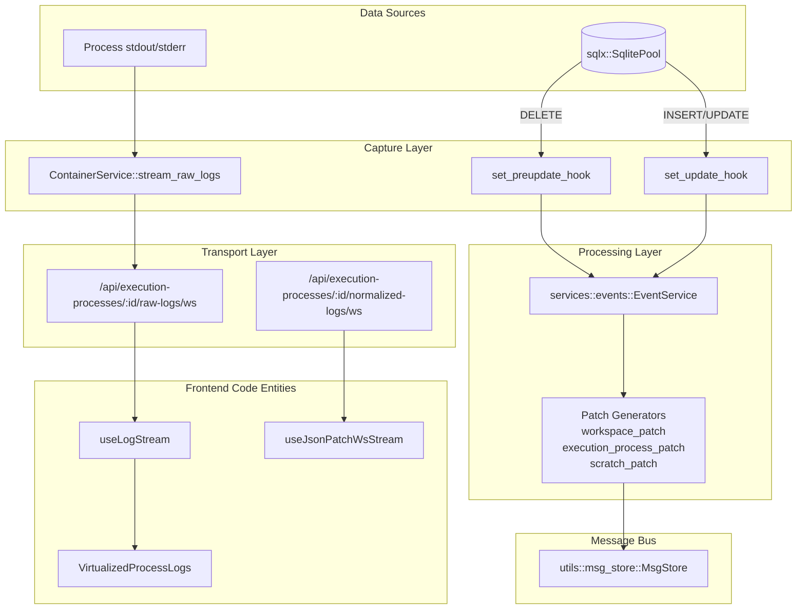
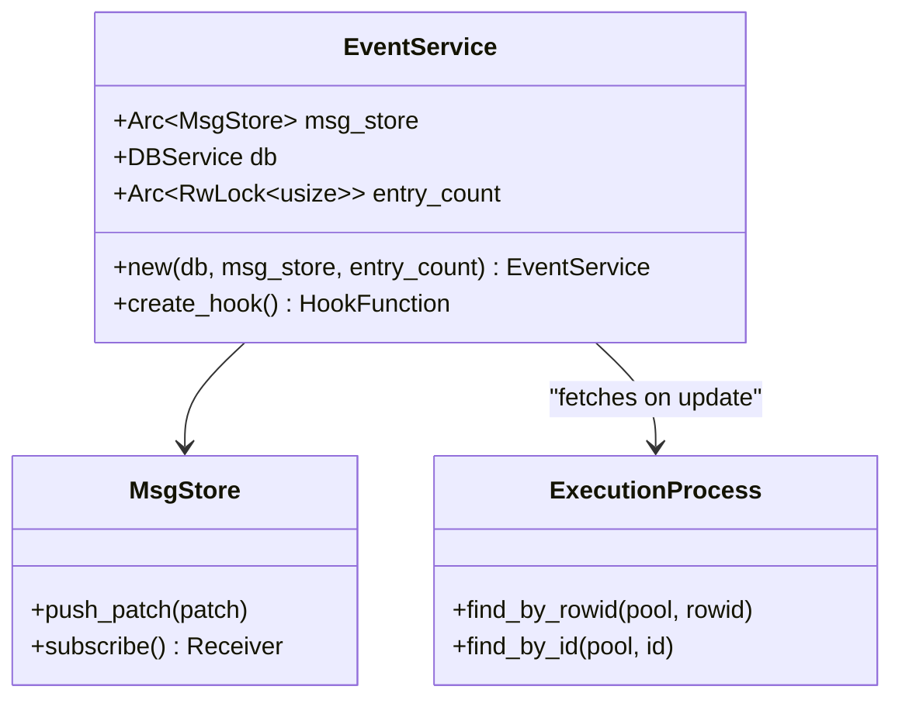
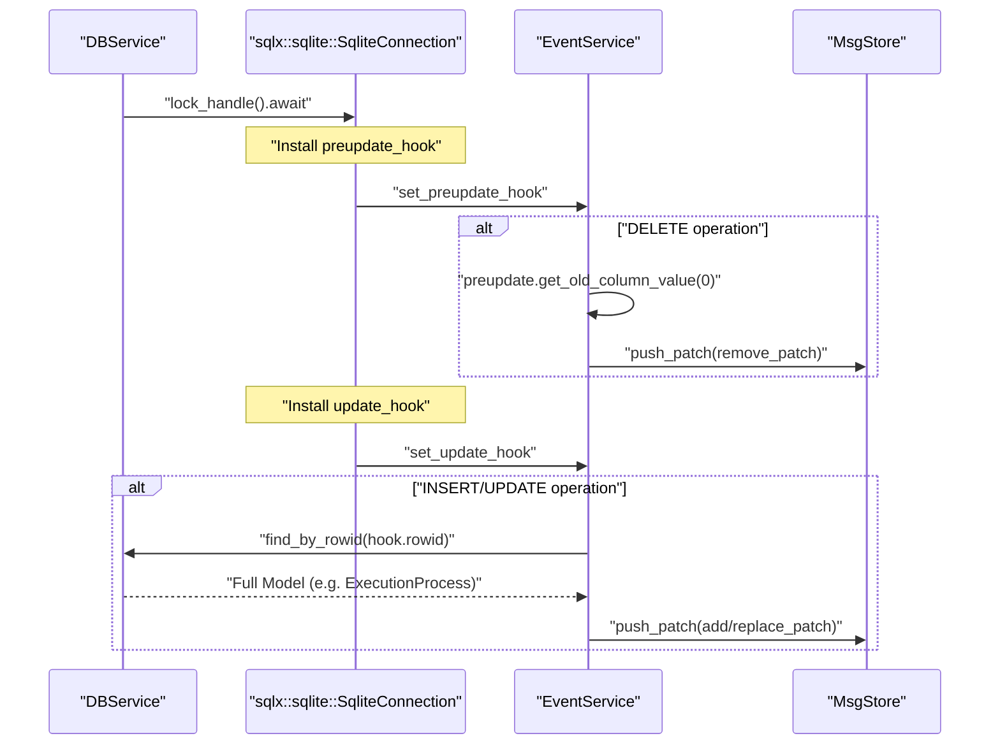

# WebSocket Streaming and Event System

Relevant source files

The following files were used as context for generating this wiki page:

- [crates/db/.sqlx/query-12a5c0a8b95d8cb87f1c869ff35692a2cee52bc418b06d00a31a4c139e12d18a.json](crates/db/.sqlx/query-12a5c0a8b95d8cb87f1c869ff35692a2cee52bc418b06d00a31a4c139e12d18a.json)
- [crates/db/.sqlx/query-9139f8d02c4ff94db0f2e8de7a6d5a53092479499815531962b7c84f5e0b2129.json](crates/db/.sqlx/query-9139f8d02c4ff94db0f2e8de7a6d5a53092479499815531962b7c84f5e0b2129.json)
- [crates/db/src/lib.rs](crates/db/src/lib.rs)
- [crates/db/src/models/execution_process_logs.rs](crates/db/src/models/execution_process_logs.rs)
- [crates/server/src/routes/execution_processes.rs](crates/server/src/routes/execution_processes.rs)
- [crates/services/src/services/events.rs](crates/services/src/services/events.rs)
- [crates/services/src/services/execution_process.rs](crates/services/src/services/execution_process.rs)
- [packages/web-core/src/shared/components/VirtualizedProcessLogs.tsx](packages/web-core/src/shared/components/VirtualizedProcessLogs.tsx)
- [packages/web-core/src/shared/hooks/useJsonPatchWsStream.ts](packages/web-core/src/shared/hooks/useJsonPatchWsStream.ts)
- [packages/web-core/src/shared/hooks/useLogStream.ts](packages/web-core/src/shared/hooks/useLogStream.ts)

**Purpose**: This document describes the real-time event streaming system that provides live updates from the Rust backend to connected clients. The system captures database changes using SQLite hooks, generates JSON Patch operations, and delivers them to clients via WebSocket connections.

For information about the database models being tracked, see [crates/services/src/services/events.rs:5-9](). For details on the frontend's consumption of these streams, see [packages/web-core/src/shared/hooks/useJsonPatchWsStream.ts:33-53]().

## System Overview

The event system consists of three main layers:

1. **Capture Layer**: SQLite database hooks (`preupdate_hook` and `update_hook`) intercept all database changes [crates/services/src/services/events.rs:77-119]().
2. **Processing Layer**: `EventService` fetches full records and generates JSON Patch operations via specific patch modules [crates/services/src/services/events.rs:17-24]().
3. **Transport Layer**: `MsgStore` buffers events and streams them to clients via WebSocket endpoints [crates/server/src/routes/execution_processes.rs:44-58]().

### Data Flow: From Database to UI

Title: Real-time Event Propagation Flow

**Sources**: [crates/services/src/services/events.rs:1-32](), [crates/server/src/routes/execution_processes.rs:44-63](), [packages/web-core/src/shared/hooks/useLogStream.ts:12-51](), [packages/web-core/src/shared/components/VirtualizedProcessLogs.tsx:66-72]()

## EventService Implementation

The `EventService` coordinates database change detection and patch generation by wrapping a `MsgStore` and a `DBService`.

Title: EventService Class Relationships

The service is initialized with a `DBService` configured with hooks, a shared `MsgStore` for message distribution, and an `entry_count` for legacy event numbering [crates/services/src/services/events.rs:27-42]().

**Sources**: [crates/services/src/services/events.rs:26-42](), [crates/services/src/services/events.rs:150-151]()

## Database Hook System

SQLite hooks provide the mechanism for intercepting database changes at the lowest level using `sqlx`.

### Hook Installation

The `create_hook` function returns a closure that installs both `preupdate_hook` and `update_hook` on a `SqliteConnection` [crates/services/src/services/events.rs:59-77](). This is typically passed to `DBService::new_with_after_connect` during initialization [crates/db/src/lib.rs:104-116]().

Title: SQLite Hook Execution Logic

**Sources**: [crates/services/src/services/events.rs:59-130](), [crates/services/src/services/events.rs:149-151](), [crates/db/src/lib.rs:104-116]()

### Tracked Entities and Patching

The system tracks three primary entities: `Workspaces`, `ExecutionProcesses`, and `Scratch` data.

| Table | Model Class | Patch Generator | Path Format |
|-------|-------------|-----------------|-------------|
| `workspaces` | `Workspace` | `workspace_patch` | `/workspaces/{id}` |
| `execution_processes` | `ExecutionProcess` | `execution_process_patch` | `/execution_processes/{id}` |
| `scratch` | `Scratch` | `scratch_patch` | `/scratch/{type}/{id}` |

**Sources**: [crates/services/src/services/events.rs:85-113](), [crates/services/src/services/events/types.rs:23-25]()

## Log Streaming System

Logs are handled separately from database changes to improve performance and avoid database bloat. Historically, logs were stored in SQLite but are now migrated to flat files for performance [crates/services/src/services/execution_process.rs:30-44]().

### Execution Log Streaming

The backend provides two types of log streams for an `ExecutionProcess`:
1. **Raw Logs**: Direct stdout/stderr from the process, converted to `ConversationPatch` on-the-fly [crates/server/src/routes/execution_processes.rs:44-58]().
2. **Normalized Logs**: Processed logs (e.g., from an AI agent) using `LogMsg` [crates/server/src/routes/execution_processes.rs:138-154]().

In the `handle_raw_logs_ws` function, stdout and stderr are mapped to JSON patches with sequential indices using an `AtomicUsize` counter [crates/server/src/routes/execution_processes.rs:87-104]().

**Sources**: [crates/server/src/routes/execution_processes.rs:44-63](), [crates/server/src/routes/execution_processes.rs:87-104](), [crates/server/src/routes/execution_processes.rs:138-166](), [crates/services/src/services/execution_process.rs:30-44]()

## Frontend Integration

The frontend consumes these streams via specialized hooks like `useLogStream` and `useJsonPatchWsStream`.

### Log Consumption (`useLogStream`)

The `useLogStream` hook manages the WebSocket connection for raw logs [packages/web-core/src/shared/hooks/useLogStream.ts:12-15](). It handles:
- **Automatic Reconnection**: Retries up to 6 times with exponential backoff [packages/web-core/src/shared/hooks/useLogStream.ts:148-158]().
- **History Replay**: When reconnecting, it replaces the log buffer on the first message to avoid duplicates from server-side history replay [packages/web-core/src/shared/hooks/useLogStream.ts:64-66]().
- **Process Isolation**: Tracks `currentProcessIdRef` to prevent stale messages from a previous process from contaminating the current view [packages/web-core/src/shared/hooks/useLogStream.ts:22-32]().

### Patch Consumption (`useJsonPatchWsStream`)

This generic hook handles streams of `rfc6902` JSON patches [packages/web-core/src/shared/hooks/useJsonPatchWsStream.ts:33-38](). It uses `immer` to apply patches efficiently, ensuring only modified parts of the state trigger React re-renders [packages/web-core/src/shared/hooks/useJsonPatchWsStream.ts:138-140]().

**Sources**: [packages/web-core/src/shared/hooks/useLogStream.ts:12-158](), [packages/web-core/src/shared/hooks/useJsonPatchWsStream.ts:33-140]()

## Scratch Data Synchronization

The `Scratch` system enables real-time synchronization of UI state and temporary data across clients [crates/services/src/services/events.rs:102-113]().

- **Composite Keys**: Scratch patches use both an `id` and a `scratch_type` (e.g., `ui_preferences`) [crates/services/src/services/events.rs:103-104]().
- **Preupdate Logic**: On deletion, the `preupdate_hook` extracts both the ID (column 0) and type (column 1) to form the correct patch path [crates/services/src/services/events.rs:104-111]().
- **Update Logic**: On change, the full `Scratch` model is fetched and broadcasted, allowing all connected UIs to update their local state [crates/services/src/services/events.rs:166-179]().

**Sources**: [crates/services/src/services/events.rs:102-113](), [crates/services/src/services/events.rs:166-179]()