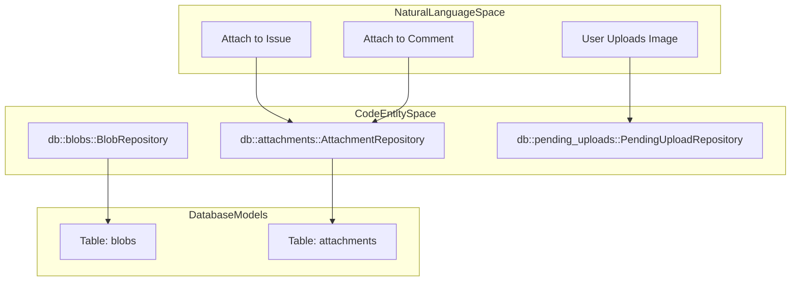
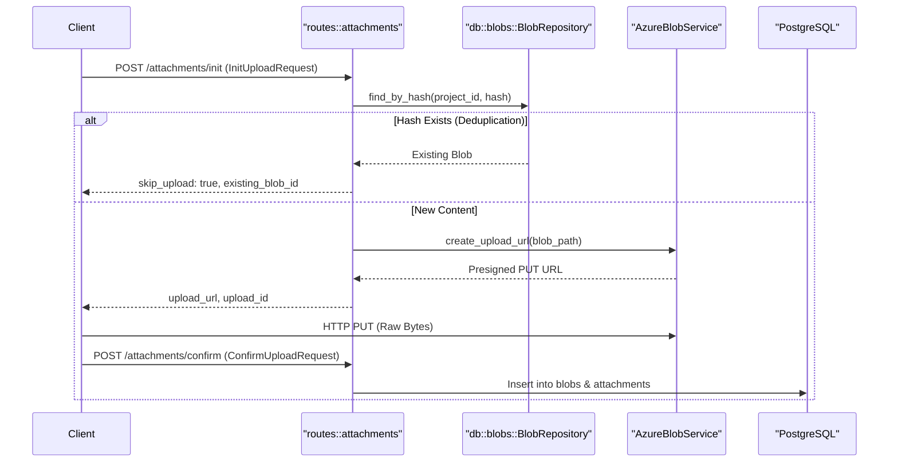
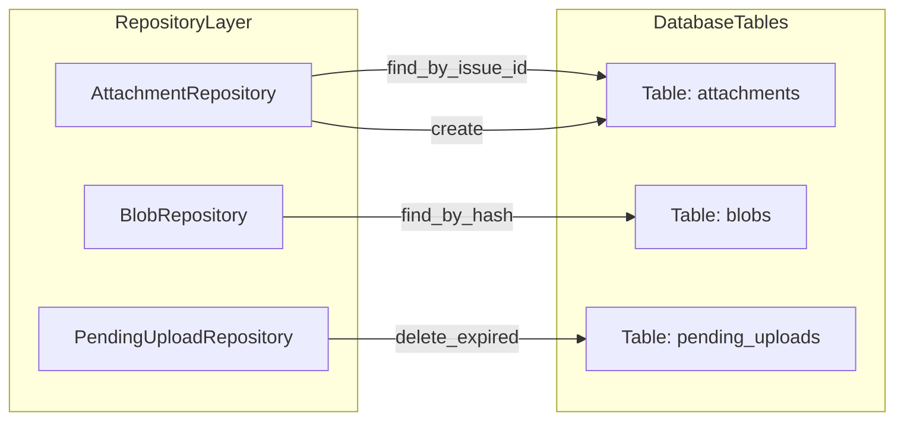

# Image Management Service

<details>
<summary>Relevant source files</summary>

The following files were used as context for generating this wiki page:

- [crates/remote/Cargo.lock](crates/remote/Cargo.lock)
- [crates/remote/Cargo.toml](crates/remote/Cargo.toml)
- [crates/remote/src/attachments/cleanup.rs](crates/remote/src/attachments/cleanup.rs)
- [crates/remote/src/attachments/mod.rs](crates/remote/src/attachments/mod.rs)
- [crates/remote/src/attachments/thumbnail.rs](crates/remote/src/attachments/thumbnail.rs)
- [crates/remote/src/db/attachments.rs](crates/remote/src/db/attachments.rs)
- [crates/remote/src/routes/attachments.rs](crates/remote/src/routes/attachments.rs)
- [crates/remote/src/routes/electric_proxy.rs](crates/remote/src/routes/electric_proxy.rs)
- [crates/remote/src/shapes.rs](crates/remote/src/shapes.rs)

</details>


The Image Management Service provides the infrastructure for uploading, storing, and retrieving image attachments within the Vibe Kanban ecosystem. While local development focuses on filesystem-based storage, the remote service architecture leverages cloud-native storage solutions—primarily **Azure Blob Storage**—to handle issue and comment attachments at scale.

---

## Purpose and Scope

The service manages the lifecycle of image data from initial upload to persistent storage and retrieval. Key features include:

- **Cloud Storage Integration**: Native support for Azure Blob Storage for persistent attachment storage [crates/remote/src/routes/attachments.rs:103-106]().
- **Deduplication**: Content-addressable storage using SHA-256 hashes to prevent redundant uploads of identical files [crates/remote/src/routes/attachments.rs:187-200]().
- **Thumbnail Generation**: Automated creation of JPEG previews (max 200x150) for UI efficiency [crates/remote/src/attachments/thumbnail.rs:3-5]().
- **Attachment Linking**: Associating blobs with specific `Issue` or `IssueComment` entities [crates/remote/src/db/attachments.rs:164-165]().
- **Security**: Generation of presigned URLs for secure, time-limited access to private assets [crates/remote/src/routes/attachments.rs:191-194]().

---

## Storage Architecture

The system distinguishes between **Blobs** (the raw data and metadata) and **Attachments** (the link between a blob and a domain entity like an issue).

### Code Entity Space Mapping

The following diagram bridges the logical storage concepts to the specific Rust structs and database repositories.


Sources: [crates/remote/src/db/attachments.rs:13-15](), [crates/remote/src/attachments/cleanup.rs:9-12]()

### Storage Providers

The service is initialized within the application state, requiring configuration of the storage backend.

| Provider | Implementation | Purpose |
|---|---|---|
| **Azure Blob** | `AzureBlobService` | Primary storage for issue/comment attachments [crates/remote/src/routes/attachments.rs:24](). |
| **Thumbnail** | `ThumbnailService` | Processes raw bytes into optimized JPEGs [crates/remote/src/attachments/thumbnail.rs:27-29](). |

Sources: [crates/remote/src/routes/attachments.rs:20-30](), [crates/remote/src/attachments/thumbnail.rs:32-35]()

---

## Upload and Attachment Flow

The upload process follows a "prepare-upload-confirm" pattern to ensure reliability and handle deduplication before data is transmitted.

### Data Flow Diagram

This diagram traces the interaction between the API routes, repositories, and the cloud storage provider.


Sources: [crates/remote/src/routes/attachments.rs:174-200](), [crates/remote/src/routes/attachments.rs:58-64](), [crates/remote/src/routes/attachments.rs:76-89]()

### Key Functions

- `init_upload`: Validates file size (max 20MB) and checks for existing blobs by hash. If unique, it returns a presigned URL [crates/remote/src/routes/attachments.rs:171-185]().
- `confirm_upload`: Finalizes the upload by creating the `Blob` record and the initial `Attachment` link [crates/remote/src/routes/attachments.rs:35]().
- `commit_issue_attachments`: Links multiple pre-uploaded attachments to an issue in a single operation [crates/remote/src/routes/attachments.rs:44-46]().

---

## Retrieval and Security

Attachments are served via short-lived presigned URLs to ensure that only authorized users can view private project assets.

### URL Generation

- `get_attachment_file`: Generates a temporary read URL for the original high-resolution file [crates/remote/src/routes/attachments.rs:36]().
- `get_attachment_thumbnail`: Generates a read URL for the optimized preview [crates/remote/src/routes/attachments.rs:37]().

### Access Control

Access is enforced using specialized middleware-like functions that verify organization membership:
- `ensure_project_access` [crates/remote/src/routes/attachments.rs:179-181]()
- `ensure_issue_access` [crates/remote/src/routes/attachments.rs:18]()
- `ensure_comment_access` [crates/remote/src/routes/attachments.rs:18]()

---

## Thumbnail Generation and Cleanup

### Thumbnail Service

The `ThumbnailService` uses the `image` crate to process uploads. It supports PNG, JPEG, GIF, and WebP [crates/remote/src/attachments/thumbnail.rs:37-42]().
- **Logic**: It calculates dimensions to preserve aspect ratio within a 200x150 bounding box [crates/remote/src/attachments/thumbnail.rs:3-4]().
- **Output**: Always encodes the resulting thumbnail as a JPEG with 80% quality [crates/remote/src/attachments/thumbnail.rs:5]().

### Cleanup Task

To prevent storage bloat, the `spawn_cleanup_task` runs as a background process [crates/remote/src/attachments/cleanup.rs:20-25]().
- **Expired Attachments**: Deletes attachments past their `expires_at` date. If a blob has no remaining attachments, the physical file is deleted from Azure [crates/remote/src/attachments/cleanup.rs:64-80]().
- **Pending Uploads**: Cleans up files that were uploaded to storage but never "confirmed" via the API [crates/remote/src/attachments/cleanup.rs:105-110]().

Sources: [crates/remote/src/attachments/cleanup.rs:1-121](), [crates/remote/src/attachments/thumbnail.rs:27-73]()

---

## Data Models

### Repository Interface Mapping

The following diagram maps the database interaction layer to the underlying storage logic.


Sources: [crates/remote/src/db/attachments.rs:81-84](), [crates/remote/src/db/attachments.rs:151-158](), [crates/remote/src/attachments/cleanup.rs:109]()

### Attachment Repository Logic
The `AttachmentRepository` manages the link between blobs and domain entities.
```rust
// Logic from crates/remote/src/db/attachments.rs
pub async fn create(
    pool: &PgPool,
    id: Option<Uuid>,
    blob_id: Uuid,
    issue_id: Option<Uuid>,
    comment_id: Option<Uuid>,
    expires_at: Option<DateTime<Utc>>,
) -> Result<Attachment, AttachmentError>
```
Sources: [crates/remote/src/db/attachments.rs:151-158]()