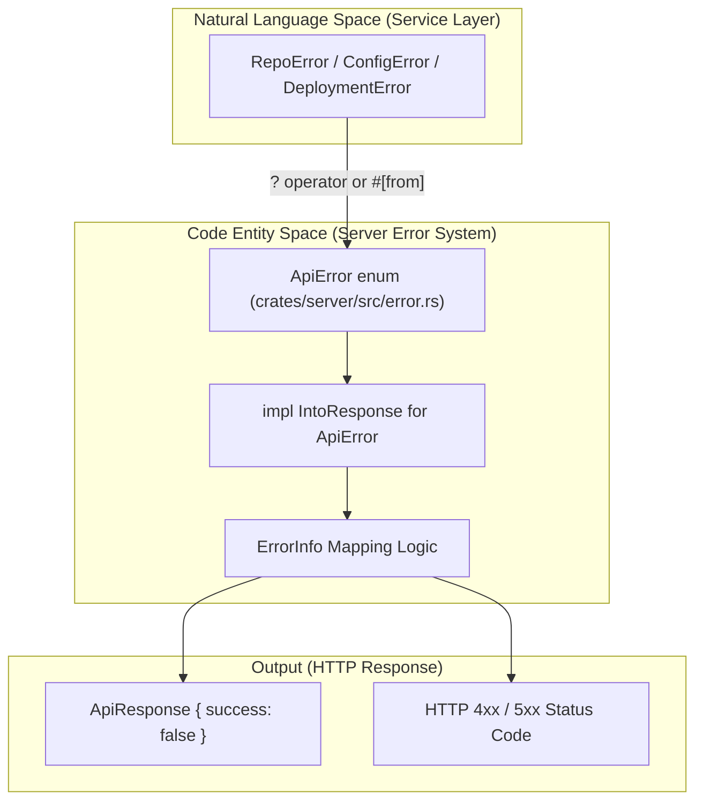
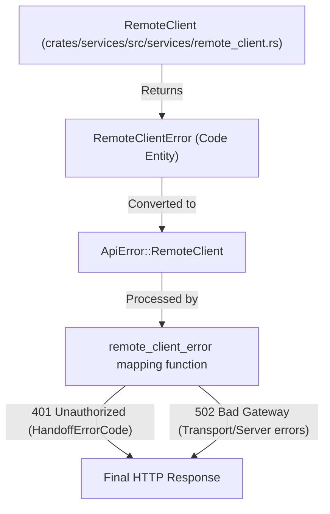

# Error Handling and ApiResponse System

<details>
<summary>Relevant source files</summary>

The following files were used as context for generating this wiki page:

- [crates/deployment/src/lib.rs](crates/deployment/src/lib.rs)
- [crates/local-deployment/src/lib.rs](crates/local-deployment/src/lib.rs)
- [crates/server/src/error.rs](crates/server/src/error.rs)
- [crates/server/src/routes/config.rs](crates/server/src/routes/config.rs)
- [crates/services/src/services/mod.rs](crates/services/src/services/mod.rs)

</details>


This page covers how the Vibe Kanban backend handles errors at the route handler level, maps service-level errors to HTTP status codes, and wraps all responses in a uniform `ApiResponse` envelope.

---

## Overview

The system uses two complementary mechanisms to manage failures and communicate them to the frontend:

| Mechanism | Type | Layer | Purpose |
|:---|:---|:---|:---|
| `ApiError` | Rust `enum` | Route boundary | Signals protocol-level failures (non-200 HTTP status) |
| `ApiResponse<T, E>` | Rust `struct` | Response body | Wraps every HTTP response, distinguishing success from known business errors |

A key design principle in Vibe Kanban is that **not every error results in a non-200 HTTP response**. Well-understood domain failures (e.g., validation errors) are often returned as HTTP 200 with `success: false` inside the `ApiResponse` envelope [crates/server/src/routes/config.rs:187-191](). Only systemic or unexpected failures (unauthorized access, internal database errors) produce non-200 status codes via the `IntoResponse` implementation for `ApiError` [crates/server/src/error.rs:1-6]().

Sources: [crates/server/src/error.rs:33-92](), [crates/server/src/error.rs:29-29](), [crates/server/src/routes/config.rs:187-191]()

---

## `ApiResponse<T, E>` — The Response Envelope

The `ApiResponse` is the standard wrapper for all data returned by the API. It ensures that the frontend receives a consistent structure regardless of the specific endpoint or the success/failure state. This type is exported to TypeScript via `ts-rs` [crates/server/src/error.rs:29-29]().

### Constructor Methods
The Rust implementation provides static helpers to create these envelopes easily within handlers:

| Method | `success` | `data` | `error_data` | `message` |
|:---|:---|:---|:---|:---|
| `ApiResponse::success(data)` | `true` | `Some(data)` | `None` | `None` |
| `ApiResponse::error(msg)` | `false` | `None` | `None` | `Some(msg)` |
| `ApiResponse::error_with_data(err_data)` | `false` | `None` | `Some(err_data)` | `None` |

### Usage in Route Handlers
Handlers return `ResponseJson(ApiResponse::success(user_system_info))` for standard operations like fetching system info [crates/server/src/routes/config.rs:106-178](). When validation fails within a handler, such as an invalid git branch prefix, it returns an error envelope directly [crates/server/src/routes/config.rs:187-191]().

Sources: [crates/server/src/error.rs:29-29](), [crates/server/src/routes/config.rs:177-177](), [crates/server/src/routes/config.rs:188-191]()

---

## `ApiError` — The Protocol Error Enum

`ApiError` is a centralized `thiserror::Error` enum defined in `crates/server/src/error.rs`. It aggregates errors from across the entire backend services and database layers using `ts-rs` to export types to the frontend [crates/server/src/error.rs:33-35]().

### Aggregated Error Variants
`ApiError` uses `#[from]` attributes to automatically convert lower-level errors into API-level errors:

| Variant | Source Error Type | File Reference |
|:---|:---|:---|
| `Repo(RepoError)` | `db::models::repo::RepoError` | [crates/server/src/error.rs:37-37]() |
| `Workspace(WorkspaceError)` | `db::models::workspace::WorkspaceError` | [crates/server/src/error.rs:39-39]() |
| `Session(SessionError)` | `db::models::session::SessionError` | [crates/server/src/error.rs:41-41]() |
| `GitService(GitServiceError)` | `git::GitServiceError` | [crates/server/src/error.rs:47-47]() |
| `Deployment(DeploymentError)` | `deployment::DeploymentError` | [crates/server/src/error.rs:51-51]() |
| `Container(ContainerError)` | `services::services::container::ContainerError` | [crates/server/src/error.rs:53-53]() |
| `Executor(ExecutorError)` | `executors::executors::ExecutorError` | [crates/server/src/error.rs:55-55]() |
| `Database(sqlx::Error)` | `sqlx::Error` | [crates/server/src/error.rs:57-57]() |
| `Config(ConfigError)` | `services::services::config::ConfigError` | [crates/server/src/error.rs:61-61]() |
| `RemoteClient(RemoteClientError)` | `services::services::remote_client::RemoteClientError` | [crates/server/src/error.rs:71-71]() |
| `ScratchError(ScratchError)` | `db::models::scratch::ScratchError` | [crates/server/src/error.rs:43-43]() |

### Conversion Logic
The enum includes manual `From` implementations for common conversion cases, such as turning a static string into a `BadRequest` [crates/server/src/error.rs:94-98]().

It also specifically handles `WorkspaceManagerError` by mapping specific business logic failures (like `RepoAlreadyAttached`) to `Conflict` or `BadRequest` status codes [crates/server/src/error.rs:112-138](). Similarly, `WorktreeError` and `ContainerError` are explicitly converted to ensure nested errors (like `GitServiceError` inside a container error) are flattened correctly [crates/server/src/error.rs:140-161]().

Sources: [crates/server/src/error.rs:33-92](), [crates/server/src/error.rs:112-161]()

---

## Internal Error Mapping Logic

### `ErrorInfo` Helper
The backend uses a private `ErrorInfo` struct to map `ApiError` variants to specific HTTP status codes and user-friendly messages [crates/server/src/error.rs:163-167]().

```rust
struct ErrorInfo {
    status: StatusCode,
    error_type: &'static str,
    message: Option<String>,
}
```

This struct includes constructor helpers like `ErrorInfo::internal()`, `ErrorInfo::not_found()`, and `ErrorInfo::bad_request()` to standardize how different error types are presented to the client [crates/server/src/error.rs:169-209]().

### Deployment and Remote Configuration
Specific errors for missing configurations (like `RemoteClientNotConfigured` or `RelayHostsNotConfigured`) are mapped to `BadRequest` status codes to inform the user that their environment setup is incomplete [crates/server/src/error.rs:100-110]().

Sources: [crates/server/src/error.rs:163-209](), [crates/server/src/error.rs:100-110]()

---

## Data Flow Diagrams

### Error Propagation Path
This diagram illustrates how a low-level service error (Natural Language Space) propagates up through the `ApiError` enum to eventually form an HTTP response (Code Entity Space).



Sources: [crates/server/src/error.rs:33-92](), [crates/server/src/error.rs:163-167]()

### Remote Client Error Handling
This diagram maps the `RemoteClientError` types to the `ApiError` system, specifically highlighting the conversion of `HandoffErrorCode`.



Sources: [crates/server/src/error.rs:71-71](), [crates/server/src/error.rs:211-213]()

---

## System-Wide Error Types

The backend defines several error enums for different lifecycle stages:

1.  **`DeploymentError`**: Used by the `Deployment` trait and `LocalDeployment` for environment-level failures during initialization [crates/deployment/src/lib.rs:48-77]().
2.  **`ApiError`**: The primary error type for all Axum route handlers [crates/server/src/error.rs:33-92]().
3.  **`ScratchError`**: Specifically handles failures in the scratch data system [crates/server/src/error.rs:43-43]().
4.  **`ContainerError`**: Handles errors related to workspace execution environments, often wrapping `GitServiceError` or `ExecutorError` [crates/server/src/error.rs:149-161]().

### `DeploymentError` Definition
Used during the `LocalDeployment::new` initialization phase [crates/local-deployment/src/lib.rs:92-96]().

```rust
pub enum DeploymentError {
    #[error(transparent)]
    Io(#[from] std::io::Error),
    #[error(transparent)]
    Sqlx(#[from] SqlxError),
    #[error(transparent)]
    GitServiceError(#[from] GitServiceError),
    // ... other variants
    #[error(transparent)]
    Other(#[from] AnyhowError),
}
```

Sources: [crates/deployment/src/lib.rs:48-77](), [crates/server/src/error.rs:33-92](), [crates/local-deployment/src/lib.rs:92-96]()