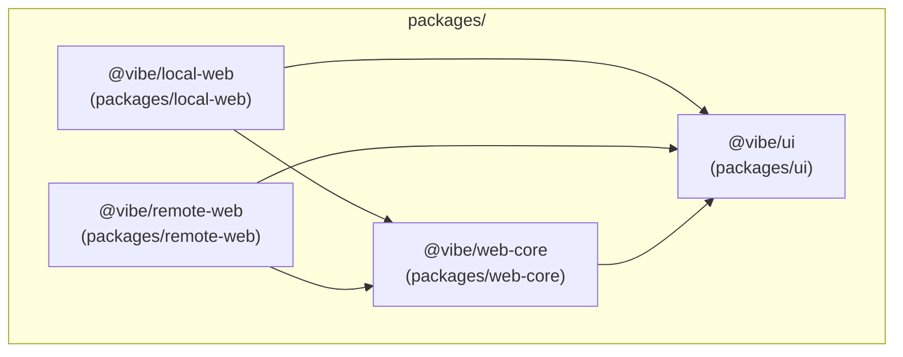
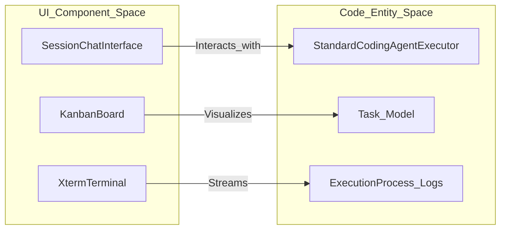
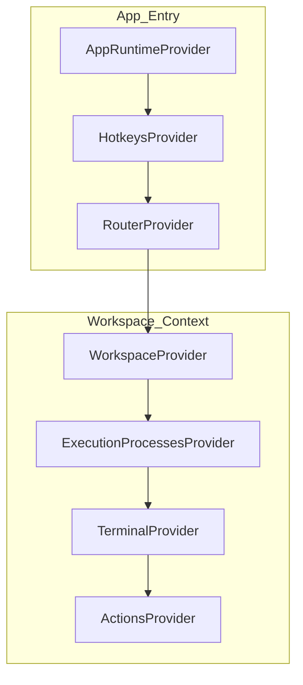

# Frontend Application

Relevant source files

The following files were used as context for generating this wiki page:

- [packages/local-web/index.html](packages/local-web/index.html)
- [packages/local-web/package.json](packages/local-web/package.json)
- [packages/local-web/tailwind.new.config.js](packages/local-web/tailwind.new.config.js)
- [packages/public/apple-touch-icon.png](packages/public/apple-touch-icon.png)
- [packages/public/site.webmanifest](packages/public/site.webmanifest)
- [packages/remote-web/package.json](packages/remote-web/package.json)
- [packages/remote-web/src/app/entry/App.tsx](packages/remote-web/src/app/entry/App.tsx)
- [packages/remote-web/src/routes/__root.tsx](packages/remote-web/src/routes/__root.tsx)
- [packages/remote-web/src/shared/stores/useMobileWorkspaceTitle.ts](packages/remote-web/src/shared/stores/useMobileWorkspaceTitle.ts)

This section documents the React/TypeScript frontend for vibe-kanban: its package layout, technology stack, major architectural patterns, and how it communicates with the Rust backend. The frontend is split into two primary applications: `local-web` for local development and `remote-web` for cloud-hosted environments.

---

## Overview

The frontend is a browser-based single-page application built with React and TypeScript. In production, it is compiled to static assets and served directly by the Axum backend. In development, it runs as a separate Vite dev server that proxies API requests to the backend [packages/local-web/package.json:7-8]().

The application supports two primary deployment modes:
*   **Local Application**: High-performance local development tool interacting with the local filesystem and executors [packages/local-web/package.json:2]().
*   **Remote Application**: Cloud-hosted version with multi-user support, organizations, and relay-based workspace access [packages/remote-web/package.json:2]().

---

## Package Layout

The monorepo splits the frontend across four main packages under `packages/`.

**Frontend Package Structure**

| Package | Role |
|---|---|
| `packages/local-web` | Entry point and routing for the locally deployed application [packages/local-web/package.json:2](). |
| `packages/remote-web` | Entry point for the cloud-hosted deployment with organization and relay support [packages/remote-web/package.json:2](). |
| `packages/ui` | Shared, reusable UI primitives, design system components (Radix UI), and complex organisms [packages/local-web/package.json:61](). |
| `packages/web-core` | Shared logic: hooks, Zustand stores, contexts, and internationalization (`i18next`) [packages/local-web/package.json:60](). |

Sources: [packages/local-web/package.json:1-61](), [packages/remote-web/package.json:1-23]().

---

## Technology Stack

The frontend leverages a modern React stack optimized for real-time updates and complex state management.

| Concern | Technology |
|---|---|
| **UI Framework** | React 18 (TypeScript) [packages/local-web/package.json:81]() |
| **Routing** | TanStack Router [packages/local-web/package.json:56]() |
| **State Management** | Zustand & React Context [packages/local-web/package.json:97]() |
| **Data Fetching** | TanStack Query [packages/local-web/package.json:55]() |
| **Styling** | Tailwind CSS & Radix UI [packages/local-web/package.json:125](), [packages/local-web/package.json:38-48]() |
| **Rich Text** | Lexical [packages/local-web/package.json:77]() |
| **Terminal** | Xterm.js [packages/local-web/package.json:65]() |
| **Real-time** | WebSockets via `react-use-websocket` [packages/local-web/package.json:88]() |

Sources: [packages/local-web/package.json:17-98]().

---

## Application Architecture

The frontend follows a provider-heavy architecture to manage global concerns like authentication, navigation, and workspace state. It bridges the "Natural Language Space" (user chat/tasks) to the "Code Entity Space" (git branches, PRs, and execution logs).

**Entity Mapping: UI to Code**

**Root Component Hierarchy**

The application uses a deep nesting of providers to inject functionality. In `remote-web`, the `RootLayout` manages the transition between standalone routes (login/account) and the main workspace application shell [packages/remote-web/src/routes/__root.tsx:142-160](). The `AppRuntimeProvider` defines whether the app is running in `local` or `remote` mode [packages/remote-web/src/app/entry/App.tsx:8]().

Sources: [packages/remote-web/src/app/entry/App.tsx:8-14](), [packages/remote-web/src/routes/__root.tsx:92-107](), [packages/local-web/package.json:55-56]().

---

## Major UI Systems

### Internationalization (i18n)
The application provides comprehensive multi-language support via `i18next`. Localization logic is centralized in `@vibe/web-core` and consumed by the entry point applications [packages/local-web/package.json:73-86](). For details, see [Internationalization (i18n)](#5.9).

### Session Chat and Agent Interaction
The primary interface for working with AI agents is the session chat. This includes a rich text editor (Lexical) for user input and specialized renderers for agent actions [packages/local-web/package.json:33-35](). It supports file mentions and rich text formatting [packages/local-web/package.json:29-32](). For details, see [Session Chat Interface](#5.4).

### Kanban and Drag-and-Drop
The task management interface utilizes `@hello-pangea/dnd` and `@dnd-kit` for fluid kanban board interactions, allowing users to move tasks through different stages of the development lifecycle [packages/local-web/package.json:22-28](). For details, see [Kanban Board and Issue Management](#5.6).

### Browser Testing and Preview
The frontend includes a built-in preview browser for testing applications. This integrates with dev servers and provides responsive testing tools [packages/local-web/package.json:10](). For details, see [Browser Testing and Preview](#5.7).

---

## Sub-Section Index

For detailed information on specific frontend subsystems, see the following child pages:

| Sub-page | Topic |
|---|---|
| [Application Structure and Routing](#5.1) | Monorepo structure, package organization, and routing with TanStack Router. |
| [State Management](#5.2) | State management with Zustand stores and React context providers. |
| [Workspace Creation and Management Flow](#5.3) | UI flow for creating workspaces, selecting repos, and configuring executors. |
| [Session Chat Interface](#5.4) | The chat interface for interacting with coding agents, including rich text editing and file mentions. |
| [Workspaces Layout and Views](#5.5) | UI layout of workspace views including panels, tabs, and navigation. |
| [Kanban Board and Issue Management](#5.6) | The kanban board UI for managing tasks and issues. |
| [Browser Testing and Preview](#5.7) | Built-in preview browser for testing applications and dev server integration. |
| [Settings and Configuration UI](#5.8) | Settings interface for configuring executors, themes, and notifications. |
| [Internationalization (i18n)](#5.9) | How the frontend handles multiple languages and translation keys. |
| [Remote vs Local Deployment UIs](#5.10) | Differences between local-web and remote-web feature sets. |

Sources: [packages/local-web/package.json:1-129](), [packages/remote-web/src/routes/__root.tsx:1-171](), [packages/remote-web/src/app/entry/App.tsx:1-16]().