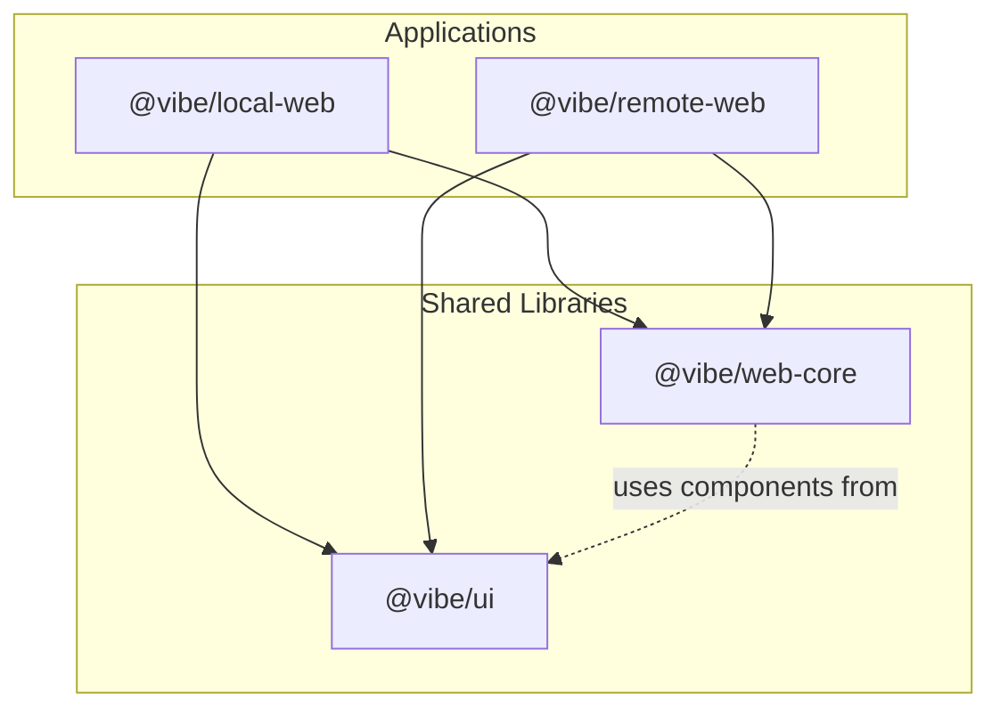
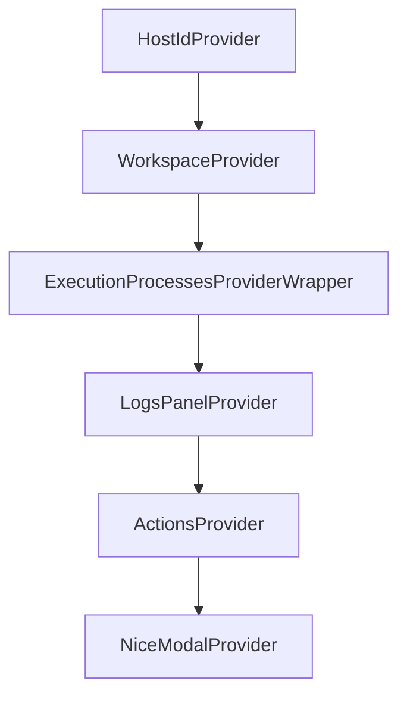
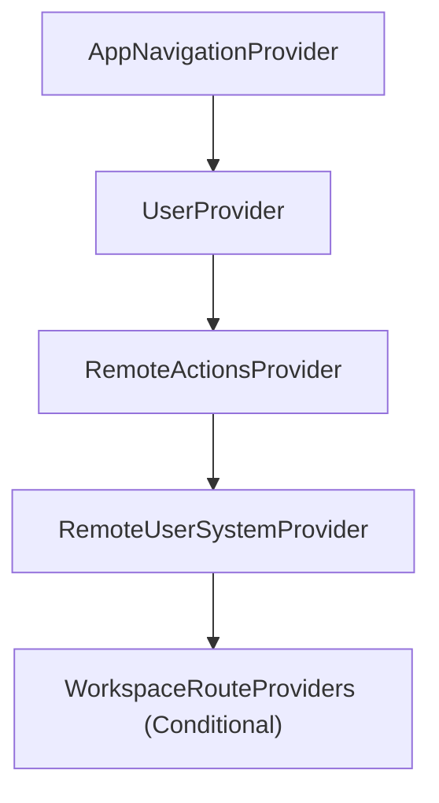
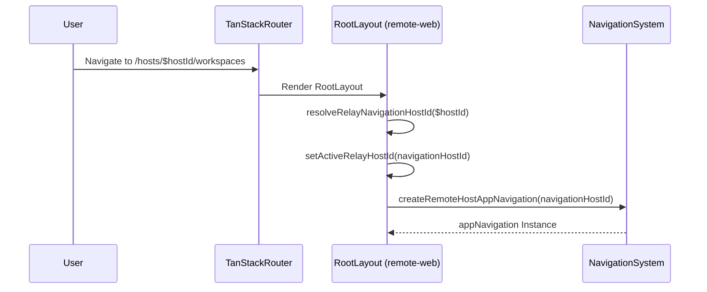

# Application Structure and Routing

Relevant source files

The following files were used as context for generating this wiki page:

- [packages/local-web/index.html](packages/local-web/index.html)
- [packages/local-web/package.json](packages/local-web/package.json)
- [packages/local-web/src/routes/__root.tsx](packages/local-web/src/routes/__root.tsx)
- [packages/local-web/src/routes/_app.tsx](packages/local-web/src/routes/_app.tsx)
- [packages/local-web/src/routes/hosts.$hostId.workspaces.$workspaceId.vscode.tsx](packages/local-web/src/routes/hosts.$hostId.workspaces.$workspaceId.vscode.tsx)
- [packages/local-web/src/routes/onboarding_.sign-in.tsx](packages/local-web/src/routes/onboarding_.sign-in.tsx)
- [packages/local-web/src/routes/workspaces.$workspaceId.vscode.tsx](packages/local-web/src/routes/workspaces.$workspaceId.vscode.tsx)
- [packages/local-web/tailwind.new.config.js](packages/local-web/tailwind.new.config.js)
- [packages/public/apple-touch-icon.png](packages/public/apple-touch-icon.png)
- [packages/public/site.webmanifest](packages/public/site.webmanifest)
- [packages/remote-web/package.json](packages/remote-web/package.json)
- [packages/remote-web/src/app/entry/App.tsx](packages/remote-web/src/app/entry/App.tsx)
- [packages/remote-web/src/routes/__root.tsx](packages/remote-web/src/routes/__root.tsx)
- [packages/remote-web/src/shared/stores/useMobileWorkspaceTitle.ts](packages/remote-web/src/shared/stores/useMobileWorkspaceTitle.ts)

This document describes the frontend application structure, package organization, and routing architecture for Vibe Kanban's React-based user interfaces. It covers the monorepo layout, entry points, and how TanStack Router manages navigation in both local and remote deployments.

## Monorepo Package Organization

Vibe Kanban organizes frontend code into four primary packages within a pnpm workspace:

| Package | Location | Purpose |
|---------|----------|---------|
| `@vibe/local-web` | `packages/local-web/` | Desktop application UI, includes features like preview system, file browser, and local-only integrations. |
| `@vibe/remote-web` | `packages/remote-web/` | Remote web UI for cloud deployments, includes relay host management and authentication flows. |
| `@vibe/web-core` | `packages/web-core/` | Shared business logic, providers, hooks, and utilities used by both local and remote apps. |
| `@vibe/ui` | `packages/ui/` | Shared presentational components (buttons, dialogs, kanban board, etc.). |

The dependency graph flows from specific to shared:

**Frontend Dependency Structure**

Sources: [packages/local-web/package.json:60-61](), [packages/remote-web/package.json:22-23]()

## Application Entry Points

### Local Web Application

The local web application uses a standard Vite entry point that initializes global services before mounting the router.

1.  **Bootstrapping:** The application initializes through the Vite entry point. It manages dependencies like `@tanstack/react-router` [packages/local-web/package.json:56]() and UI components.
2.  **Root Route:** [packages/local-web/src/routes/__root.tsx:43-45]() defines the top-level layout component `RootRouteComponent`.
3.  **Global Initialization:** [packages/local-web/src/routes/__root.tsx:13-30]() initializes analytics identification via `machineId` from `useUserSystem` and manages theme configuration [packages/local-web/src/routes/__root.tsx:34-34]().
4.  **UI State:** The root route also initializes `useUiPreferencesScratch` to persist user interface state [packages/local-web/src/routes/__root.tsx:17-17]().

### Remote Web Application

The remote web application includes logic for managing relay host context and multi-tenant authentication.

1.  **App Entry:** [packages/remote-web/src/app/entry/App.tsx:6-16]() sets the `AppRuntimeProvider` to `remote` and wraps the router in a `HotkeysProvider`.
2.  **Root Layout:** [packages/remote-web/src/routes/__root.tsx:109-172]() handles theme initialization via `useSystemTheme`, authentication state via `useAuth`, and relay host resolution.

Sources: [packages/local-web/src/routes/__root.tsx:13-45](), [packages/remote-web/src/app/entry/App.tsx:6-16](), [packages/remote-web/src/routes/__root.tsx:109-172]()

## Router Configuration

Both applications use **TanStack Router** with file-based routing and type-safe navigation.

### Router Setup

The router is configured with:
-   **File-based routes:** Route files in `src/routes/` define the navigation structure.
-   **Root Route Component:** Both apps define a root route that wraps all other routes via the `<Outlet />` component [packages/local-web/src/routes/__root.tsx:36-36](), [packages/remote-web/src/routes/__root.tsx:4-4]().
-   **Dynamic Path Parameters:** Supports parameters like `hostId` for context-aware rendering [packages/remote-web/src/routes/__root.tsx:115-116]() and `workspaceId` for specific task contexts [packages/local-web/src/routes/workspaces.$workspaceId.vscode.tsx:44-46]().

### Root Route Structure

**Local Web Root:** [packages/local-web/src/routes/__root.tsx:32-41]() includes:
-   `I18nextProvider` for internationalization.
-   `ThemeProvider` for dark/light mode management.
-   `UserProvider` for user context.
-   `useUiPreferencesScratch` for persisting UI state.

**Remote Web Root:** [packages/remote-web/src/routes/__root.tsx:49-52]() includes:
-   `RemoteAppShell` for the global navigation layout.
-   `AppNavigationProvider` for host-aware navigation.
-   `RemoteActionsProvider` and `RemoteUserSystemProvider`.

Sources: [packages/local-web/src/routes/__root.tsx:13-45](), [packages/remote-web/src/routes/__root.tsx:49-52](), [packages/remote-web/src/routes/__root.tsx:163-171](), [packages/local-web/src/routes/workspaces.$workspaceId.vscode.tsx:44-46]()

## Application Provider Hierarchy

The application uses a nested provider pattern to ensure that contextual data (like the active workspace or host) is available to child components.

### Local Web Providers

The `AppRouteProviders` component [packages/local-web/src/routes/_app.tsx:85-102]() defines the standard provider stack for authenticated routes. It includes `WorkspaceProvider`, `ExecutionProcessesProvider`, and `ActionsProvider`. Specialized routes like the VSCode integration also implement a similar stack [packages/local-web/src/routes/workspaces.$workspaceId.vscode.tsx:26-42]().

**Local Provider Hierarchy**

### Remote Web Providers

The remote root layout [packages/remote-web/src/routes/__root.tsx:154-171]() conditionally wraps content in `WorkspaceRouteProviders` if the current route destination is a project or workspace [packages/remote-web/src/routes/__root.tsx:139-140]().

**Remote Provider Hierarchy**

Sources: [packages/local-web/src/routes/_app.tsx:85-102](), [packages/remote-web/src/routes/__root.tsx:155-171](), [packages/local-web/src/routes/workspaces.$workspaceId.vscode.tsx:26-42]()

## Relay and Host Management

In the remote application, routing is heavily tied to the **Relay Host** system, which allows the cloud UI to interact with local backend instances.

### Host Resolution

[packages/remote-web/src/routes/__root.tsx:114-133]() resolves the active relay host from the URL `hostId` parameter. This `navigationHostId` is then used to initialize host-aware navigation via `createRemoteHostAppNavigation`.

-   **`setActiveRelayHostId`**: Synchronizes the detected host from the route to the active host context [packages/remote-web/src/routes/__root.tsx:123-125]().
-   **`resolveRelayNavigationHostId`**: Logic to determine which host is currently active based on the route and available hosts [packages/remote-web/src/routes/__root.tsx:118-121]().

**Host-Aware Routing Flow**

Sources: [packages/remote-web/src/routes/__root.tsx:114-133]()

## Keyboard Shortcuts Integration

Shortcuts are managed via `react-hotkeys-hook` with a focus on scope-based activation to prevent collisions.

### Scope Initialization

[packages/remote-web/src/app/entry/App.tsx:9-11]() initializes the global hotkey scopes for the remote application:
-   `global`: Always active (e.g., help dialog).
-   `workspace`: Active when a workspace is selected.
-   `kanban`: Active in the project board view.
-   `projects`: Active in the project list.

### Handler Registration

-   **Global:** `GlobalKeyboardShortcuts` [packages/remote-web/src/routes/__root.tsx:72-80]() handles the help shortcut (`?`) to show the `KeyboardShortcutsDialog`.
-   **Contextual:** `WorkspaceKeyboardShortcuts` [packages/remote-web/src/routes/__root.tsx:86-90]() registers workspace and issue-specific shortcuts (`useWorkspaceShortcuts`, `useIssueShortcuts`) only when the `WorkspaceRouteProviders` are mounted.
-   **Local:** The local-web implementation uses a `KeyboardShortcutsHandler` component [packages/local-web/src/routes/_app.tsx:25-35]() to register these hooks and `SequenceTrackerProvider` for complex key sequences [packages/local-web/src/routes/_app.tsx:110-112]().

Sources: [packages/remote-web/src/app/entry/App.tsx:9-11](), [packages/remote-web/src/routes/__root.tsx:72-90](), [packages/local-web/src/routes/_app.tsx:25-35](), [packages/local-web/src/routes/_app.tsx:110-112]()

## Internationalization (i18n)

Vibe Kanban uses `react-i18next` for managing translations. The `I18nextProvider` is initialized at the root of the local-web application using the global `i18n` configuration [packages/local-web/src/routes/__root.tsx:33-33]().

The frontend build includes linting scripts to ensure i18n consistency [packages/local-web/package.json:13]().

Sources: [packages/local-web/src/routes/__root.tsx:33-33](), [packages/local-web/package.json:13]()