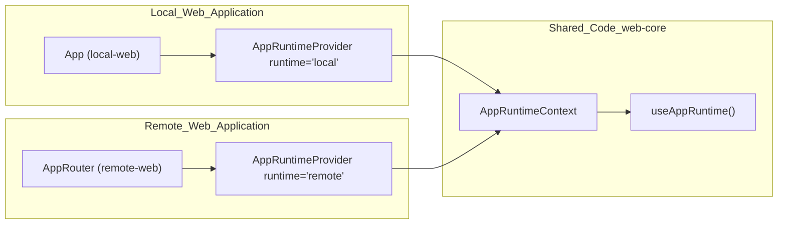
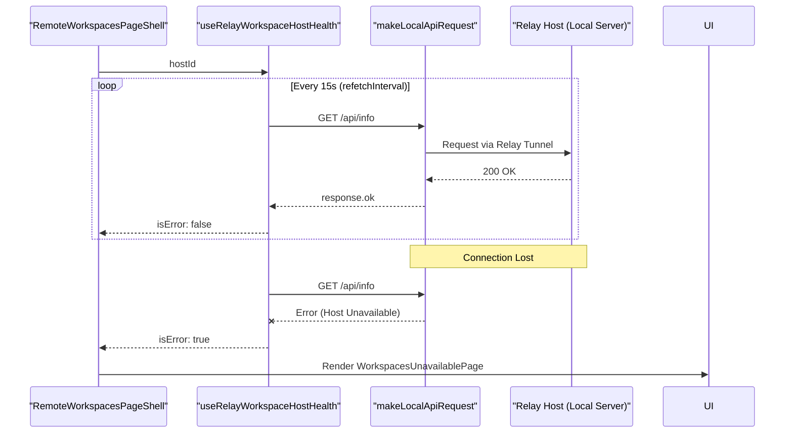

# Remote vs Local Deployment UIs

Relevant source files

The following files were used as context for generating this wiki page:

- [packages/local-web/src/app/entry/App.tsx](packages/local-web/src/app/entry/App.tsx)
- [packages/local-web/src/routes/__root.tsx](packages/local-web/src/routes/__root.tsx)
- [packages/local-web/src/routes/_app.tsx](packages/local-web/src/routes/_app.tsx)
- [packages/local-web/src/routes/hosts.$hostId.workspaces.$workspaceId.vscode.tsx](packages/local-web/src/routes/hosts.$hostId.workspaces.$workspaceId.vscode.tsx)
- [packages/local-web/src/routes/onboarding_.sign-in.tsx](packages/local-web/src/routes/onboarding_.sign-in.tsx)
- [packages/local-web/src/routes/workspaces.$workspaceId.vscode.tsx](packages/local-web/src/routes/workspaces.$workspaceId.vscode.tsx)
- [packages/remote-web/src/app/layout/RemoteAppShell.tsx](packages/remote-web/src/app/layout/RemoteAppShell.tsx)
- [packages/remote-web/src/app/layout/RemoteNavbarContainer.tsx](packages/remote-web/src/app/layout/RemoteNavbarContainer.tsx)
- [packages/remote-web/src/app/navigation/AppNavigation.ts](packages/remote-web/src/app/navigation/AppNavigation.ts)
- [packages/remote-web/src/pages/HomePage.tsx](packages/remote-web/src/pages/HomePage.tsx)
- [packages/remote-web/src/pages/RemoteProjectKanbanShell.tsx](packages/remote-web/src/pages/RemoteProjectKanbanShell.tsx)
- [packages/remote-web/src/pages/RemoteWorkspacesPageShell.tsx](packages/remote-web/src/pages/RemoteWorkspacesPageShell.tsx)
- [packages/remote-web/src/pages/WorkspacesUnavailablePage.tsx](packages/remote-web/src/pages/WorkspacesUnavailablePage.tsx)
- [packages/remote-web/src/routeTree.gen.ts](packages/remote-web/src/routeTree.gen.ts)
- [packages/remote-web/src/routes/projects.$projectId.tsx](packages/remote-web/src/routes/projects.$projectId.tsx)
- [packages/remote-web/src/routes/projects.$projectId_.hosts.$hostId.workspaces.create.$draftId.tsx](packages/remote-web/src/routes/projects.$projectId_.hosts.$hostId.workspaces.create.$draftId.tsx)
- [packages/remote-web/src/routes/projects.$projectId_.issues.$issueId.tsx](packages/remote-web/src/routes/projects.$projectId_.issues.$issueId.tsx)
- [packages/remote-web/src/routes/projects.$projectId_.issues.$issueId_.hosts.$hostId.workspaces.$workspaceId.tsx](packages/remote-web/src/routes/projects.$projectId_.issues.$issueId_.hosts.$hostId.workspaces.$workspaceId.tsx)
- [packages/remote-web/src/routes/projects.$projectId_.issues.$issueId_.hosts.$hostId.workspaces.create.$draftId.tsx](packages/remote-web/src/routes/projects.$projectId_.issues.$issueId_.hosts.$hostId.workspaces.create.$draftId.tsx)
- [packages/remote-web/src/shared/hooks/useRelayWorkspaceHostHealth.ts](packages/remote-web/src/shared/hooks/useRelayWorkspaceHostHealth.ts)
- [packages/remote-web/src/shared/lib/relay/routing.ts](packages/remote-web/src/shared/lib/relay/routing.ts)
- [packages/remote-web/src/shared/lib/relayHostApi.ts](packages/remote-web/src/shared/lib/relayHostApi.ts)
- [packages/web-core/src/shared/hooks/useAppRuntime.tsx](packages/web-core/src/shared/hooks/useAppRuntime.tsx)
- [packages/web-core/src/shared/lib/notificationMessage.ts](packages/web-core/src/shared/lib/notificationMessage.ts)
- [packages/web-core/src/shared/lib/routes/appNavigation.ts](packages/web-core/src/shared/lib/routes/appNavigation.ts)

This page documents the architectural differences between the `local-web` and `remote-web` frontend applications, including their distinct entry points, deployment-specific features, and how they share common business logic.

## Purpose and Scope

Vibe Kanban provides two distinct frontend applications that serve different deployment scenarios:

- **local-web**: Desktop application bundled with `npx-cli` or Tauri for local deployment, providing direct access to a local server instance. [packages/local-web/src/app/entry/App.tsx:20-45]()
- **remote-web**: Browser-based web application for remote deployment, connecting to workspaces through relay tunnels and managing multi-tenant organizations and projects. [packages/remote-web/src/app/layout/RemoteAppShell.tsx:54-68]()

Both applications share substantial business logic through the `@vibe/web-core` and `@vibe/ui` packages while implementing deployment-specific features independently. [packages/remote-web/src/app/layout/RemoteNavbarContainer.tsx:1-16](), [packages/local-web/src/routes/_app.tsx:23-23]()

## Package Structure

The frontend monorepo is organized into packages with clear separation of concerns:

| Package | Path | Purpose |
|---------|------|---------|
| `@vibe/local-web` | `packages/local-web/` | Local deployment application entry point. |
| `@vibe/remote-web` | `packages/remote-web/` | Remote deployment application with Organization/Project support. |
| `@vibe/ui` | `packages/ui/` | Shared UI components (Navbar, AppBar, Dialogs). |
| `@vibe/web-core` | `packages/web-core/` | Shared business logic, hooks, i18n, and state. |

**Sources:** [packages/remote-web/src/app/layout/RemoteAppShell.tsx:1-41](), [packages/local-web/src/app/entry/App.tsx:1-12](), [packages/remote-web/src/app/layout/RemoteNavbarContainer.tsx:1-8]()

## Runtime Context System

Both applications use a runtime context system to enable shared code to adapt behavior based on the deployment mode. The `useAppRuntime()` hook returns either `'local'` or `'remote'`.

### Runtime Initialization Diagram

The `App` component in `local-web` initializes the `AppRuntimeProvider` with the `"local"` runtime. [packages/local-web/src/app/entry/App.tsx:22](). The remote application is initialized with `"remote"`.

**Sources:** [packages/local-web/src/app/entry/App.tsx:20-25](), [packages/web-core/src/shared/hooks/useAppRuntime.tsx:1-10]()

## Application Shells and Navigation

### Remote App Shell
The `RemoteAppShell` in `remote-web` manages complex state including active organizations, projects, and relay host selection. It uses `useUserOrganizations` to populate the organization switcher and `useRelayAppBarHosts` to manage available relay connections. [packages/remote-web/src/app/layout/RemoteAppShell.tsx:72-130]()

### Navbar Implementation
The `Navbar` component in `@vibe/ui` is a shared primitive used by both `SharedAppLayout` (local) and `RemoteNavbarContainer` (remote). [packages/local-web/src/routes/_app.tsx:23-23](), [packages/remote-web/src/app/layout/RemoteNavbarContainer.tsx:218-232]()

- **RemoteNavbarContainer**: Customizes the navigation experience for the remote web app, filtering mobile tabs to exclude "preview" and "workspaces" which are handled differently in the remote context. [packages/remote-web/src/app/layout/RemoteNavbarContainer.tsx:121-125]()
- **Mobile Navigation**: The remote UI uses `useMobileActiveTab` and `useMobileWorkspaceTitle` to manage state for mobile users, specifically handling transitions between project views and workspace chat. [packages/remote-web/src/app/layout/RemoteNavbarContainer.tsx:114-120]()

**Sources:** [packages/remote-web/src/app/layout/RemoteAppShell.tsx:57-141](), [packages/remote-web/src/app/layout/RemoteNavbarContainer.tsx:106-138](), [packages/local-web/src/routes/_app.tsx:23-23]()

## Deployment-Specific Features

### Host Health Monitoring (Remote Only)
Remote workspaces require monitoring of the relay host's health to ensure the connection to the local environment is active. The `useRelayWorkspaceHostHealth` hook performs periodic checks against the host's `/api/info` endpoint via `makeLocalApiRequest`. [packages/remote-web/src/shared/hooks/useRelayWorkspaceHostHealth.ts:18-38]()

### Remote Host Health Check Lifecycle

**Sources:** [packages/remote-web/src/shared/hooks/useRelayWorkspaceHostHealth.ts:21-38](), [packages/remote-web/src/pages/RemoteWorkspacesPageShell.tsx:24-56]()

### Workspace Title Synchronization
The `RemoteWorkspacesPageShell` includes a `WorkspaceTitleSync` component that updates the mobile app bar title based on the active workspace's branch or name using the `useMobileWorkspaceTitle` store. [packages/remote-web/src/pages/RemoteWorkspacesPageShell.tsx:12-22]()

### Tauri Listeners (Local Only)
The `local-web` application includes specific listeners for Tauri desktop environments, such as `useTauriNotificationNavigation` for handling native OS notifications and `useTauriUpdateReady` for app updates. [packages/local-web/src/app/entry/App.tsx:14-18]()

**Sources:** [packages/local-web/src/app/entry/App.tsx:9-18](), [packages/remote-web/src/pages/RemoteWorkspacesPageShell.tsx:12-22]()

## API Request Routing

The `remote-web` application uses a specialized transport layer to determine if an API request should go to the remote cloud backend or be routed through a relay tunnel to a local host.

| Function | File | Logic |
|----------|------|-------|
| `requestLocalApiViaRelay` | [packages/remote-web/src/shared/lib/relayHostApi.ts:38]() | Routes `/api/` calls (excluding `/api/remote/`) to a `hostId`. |
| `shouldRelayApiPath` | [packages/remote-web/src/shared/lib/relay/routing.ts:45]() | Returns true if path starts with `/api/` but not `/api/remote/`. |
| `openRelayHostWebSocket` | [packages/remote-web/src/shared/lib/relayHostApi.ts:135]() | Establishes signed WebSocket connections through the relay tunnel. |

**Sources:** [packages/remote-web/src/shared/lib/relayHostApi.ts:38-86](), [packages/remote-web/src/shared/lib/relay/routing.ts:45-52]()

## Summary of Differences

| Feature | Local Web | Remote Web |
|---------|-----------|------------|
| **Authentication** | `LocalAuthProvider` [packages/local-web/src/app/entry/App.tsx:26]() | `useAuth` via `RemoteAuthProvider` [packages/remote-web/src/app/layout/RemoteAppShell.tsx:58]() |
| **Connectivity** | Direct local access | Relay Tunnel System via `requestRelayHostApi` [packages/remote-web/src/shared/lib/relayHostApi.ts:88]() |
| **Organization Support** | Not applicable | Multi-Org / Multi-Project via `useUserOrganizations` [packages/remote-web/src/app/layout/RemoteAppShell.tsx:72]() |
| **Native Features** | Tauri Listeners & OS Integration [packages/local-web/src/app/entry/App.tsx:14]() | Browser standard |
| **Routing** | Local-only routes | Host-prefixed routes (e.g., `/hosts/$hostId/workspaces`) [packages/remote-web/src/routeTree.gen.ts:151]() |

**Sources:** [packages/remote-web/src/app/layout/RemoteAppShell.tsx:72-130](), [packages/local-web/src/app/entry/App.tsx:14-26](), [packages/remote-web/src/shared/lib/relayHostApi.ts:88-133](), [packages/remote-web/src/routeTree.gen.ts:142-155]()