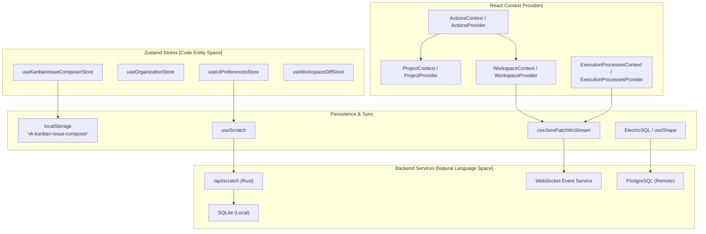
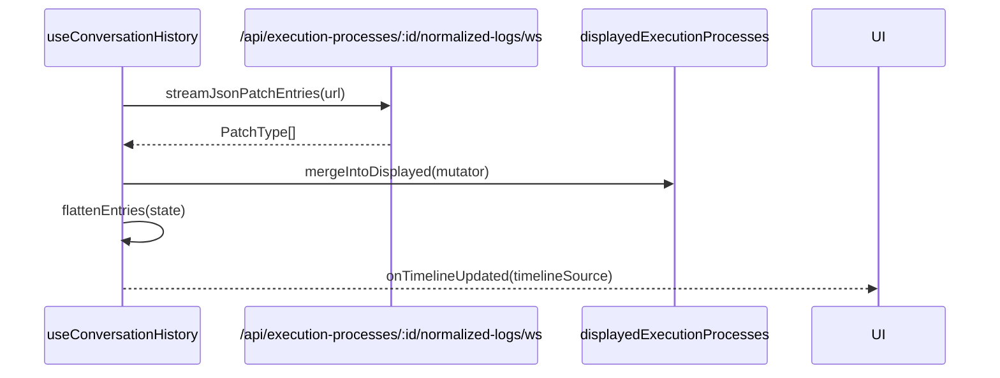

# State Management

Relevant source files

The following files were used as context for generating this wiki page:

- [packages/ui/src/components/WorkspacesSidebar.tsx](packages/ui/src/components/WorkspacesSidebar.tsx)
- [packages/web-core/src/features/workspace-chat/model/contexts/RetryUiContext.tsx](packages/web-core/src/features/workspace-chat/model/contexts/RetryUiContext.tsx)
- [packages/web-core/src/features/workspace-chat/model/hooks/useConversationHistory.ts](packages/web-core/src/features/workspace-chat/model/hooks/useConversationHistory.ts)
- [packages/web-core/src/features/workspace-chat/model/hooks/useResetProcess.ts](packages/web-core/src/features/workspace-chat/model/hooks/useResetProcess.ts)
- [packages/web-core/src/pages/kanban/KanbanIssuePanelContainer.tsx](packages/web-core/src/pages/kanban/KanbanIssuePanelContainer.tsx)
- [packages/web-core/src/pages/kanban/kanban-issue-panel-state.ts](packages/web-core/src/pages/kanban/kanban-issue-panel-state.ts)
- [packages/web-core/src/pages/root/RootRedirectPage.tsx](packages/web-core/src/pages/root/RootRedirectPage.tsx)
- [packages/web-core/src/pages/workspaces/ProcessListContainer.tsx](packages/web-core/src/pages/workspaces/ProcessListContainer.tsx)
- [packages/web-core/src/pages/workspaces/WorkspacesLayout.tsx](packages/web-core/src/pages/workspaces/WorkspacesLayout.tsx)
- [packages/web-core/src/pages/workspaces/WorkspacesSidebarContainer.tsx](packages/web-core/src/pages/workspaces/WorkspacesSidebarContainer.tsx)
- [packages/web-core/src/shared/components/ui-new/containers/SharedAppLayout.tsx](packages/web-core/src/shared/components/ui-new/containers/SharedAppLayout.tsx)
- [packages/web-core/src/shared/hooks/useActionVisibilityContext.ts](packages/web-core/src/shared/hooks/useActionVisibilityContext.ts)
- [packages/web-core/src/shared/hooks/useExecutionProcesses.ts](packages/web-core/src/shared/hooks/useExecutionProcesses.ts)
- [packages/web-core/src/shared/hooks/useExecutionProcessesContext.ts](packages/web-core/src/shared/hooks/useExecutionProcessesContext.ts)
- [packages/web-core/src/shared/hooks/useUiPreferencesScratch.ts](packages/web-core/src/shared/hooks/useUiPreferencesScratch.ts)
- [packages/web-core/src/shared/hooks/useWorkspaceExecution.ts](packages/web-core/src/shared/hooks/useWorkspaceExecution.ts)
- [packages/web-core/src/shared/hooks/useWorkspaceSidebarPreviewController.ts](packages/web-core/src/shared/hooks/useWorkspaceSidebarPreviewController.ts)
- [packages/web-core/src/shared/lib/firstProjectDestination.ts](packages/web-core/src/shared/lib/firstProjectDestination.ts)
- [packages/web-core/src/shared/providers/ExecutionProcessesProvider.tsx](packages/web-core/src/shared/providers/ExecutionProcessesProvider.tsx)
- [packages/web-core/src/shared/stores/useOrganizationStore.ts](packages/web-core/src/shared/stores/useOrganizationStore.ts)
- [packages/web-core/src/shared/stores/useUiPreferencesStore.ts](packages/web-core/src/shared/stores/useUiPreferencesStore.ts)

## Purpose and Scope

This document describes the frontend state management architecture in Vibe Kanban. It covers the Zustand-based stores, React context providers, and synchronization mechanisms that manage UI preferences, layout state, and user selections across the application.

Vibe Kanban uses a hybrid state management approach:
- **Zustand** for global UI preferences, client-side application state, and transient composer data.
- **React Context** for scoped runtime state (workspaces, execution processes, user systems, projects).
- **TanStack Query** and **ElectricSQL Shapes** for server-state synchronization and caching.

Persistence is split between `localStorage` (for immediate local access and remote-web scratch) and server-side **Scratch** storage (for cross-device synchronization in local-web).

---

## State Management Architecture

The frontend state architecture bridges local UI interactions with persistent backend storage via a set of specialized stores and providers.

### System Overview

**Sources:**
- [packages/web-core/src/shared/stores/useUiPreferencesStore.ts:1-240]()
- [packages/web-core/src/shared/stores/useOrganizationStore.ts:1-34]()
- [packages/web-core/src/shared/providers/ExecutionProcessesProvider.tsx:9-74]()
- [packages/web-core/src/shared/hooks/useScratch.ts:34-87]()
- [packages/web-core/src/shared/stores/useKanbanIssueComposerStore.ts:1-65]()

---

## UI Preferences and Scratch System

The `useUiPreferencesStore` manages global UI configuration, such as sidebar visibility, pane sizes, and workspace filters [packages/web-core/src/shared/stores/useUiPreferencesStore.ts:232-260](). In local-web, it synchronizes with the backend via `useScratch`.

### Runtime-Aware Persistence

The `useScratch` hook abstracts the persistence layer based on the `AppRuntime` [packages/web-core/src/shared/hooks/useScratch.ts:39-40]().

| Runtime | Implementation | Storage Mechanism |
| :--- | :--- | :--- |
| **Local** | `serverResult` | WebSocket (JSON Patch) via `useJsonPatchWsStream` backed by SQLite [packages/web-core/src/shared/hooks/useScratch.ts:48-57](). |
| **Remote** | `localResult` | `localStorage` via `useLocalStorageScratch` [packages/web-core/src/shared/hooks/useLocalStorageScratch.ts:97-101](). |

The conversion between the Zustand store (camelCase) and the backend Scratch data (snake_case) is handled by mapping functions `storeToScratchData` and `scratchDataToStore` in the sync hook [packages/web-core/src/shared/hooks/useUiPreferencesScratch.ts:35-179]().

### Workspace Panel State
A unique aspect of Vibe Kanban's layout state is the `useWorkspacePanelState` hook, which provides workspace-specific visibility for sidebars and main panels [packages/web-core/src/shared/stores/useUiPreferencesStore.ts:50-60](). This allows the UI to remember if the logs or preview panels were open for a specific workspace [packages/web-core/src/pages/workspaces/WorkspacesLayout.tsx:129-136]().

**Sources:**
- [packages/web-core/src/shared/hooks/useScratch.ts:34-87]()
- [packages/web-core/src/shared/hooks/useUiPreferencesScratch.ts:35-179]()
- [packages/web-core/src/shared/stores/useUiPreferencesStore.ts:51-60]()
- [packages/web-core/src/pages/workspaces/WorkspacesLayout.tsx:129-136]()

---

## Kanban State and Issue Composition

The Kanban board utilizes a specialized store to manage the state of the issue creation interface across different project contexts.

### Issue Composer Store
The `useKanbanIssueComposerStore` tracks drafts for new issues. It is keyed by a combination of `hostId` and `projectId` via `buildKanbanIssueComposerKey` to allow multiple concurrent drafts [packages/web-core/src/shared/stores/useKanbanIssueComposerStore.ts:15-18]().

- **Integration**: `KanbanIssuePanelContainer` consumes this store via `useKanbanIssueComposer` to determine if it should render in "create mode" or "edit mode" [packages/web-core/src/pages/kanban/KanbanIssuePanelContainer.tsx:122-130]().
- **Drafting**: The store allows patching partial issue data (title, status, assignees) before the issue is formally committed to the database [packages/web-core/src/pages/kanban/KanbanIssuePanelContainer.tsx:152-170]().

### Actions Visibility
The `useActionVisibilityContext` hook consolidates state from multiple stores (UI preferences, diffs, dev servers) to provide a unified context for UI elements like the Command Bar [packages/web-core/src/shared/hooks/useActionVisibilityContext.ts:38-40](). It calculates properties such as `hasUnpushedCommits` and `isAttemptRunning` to enable or disable specific user actions [packages/web-core/src/shared/hooks/useActionVisibilityContext.ts:122-145]().

**Sources:**
- [packages/web-core/src/shared/stores/useKanbanIssueComposerStore.ts:1-65]()
- [packages/web-core/src/pages/kanban/KanbanIssuePanelContainer.tsx:122-170]()
- [packages/web-core/src/shared/hooks/useActionVisibilityContext.ts:38-176]()

---

## Real-time State and Conversation History

Vibe Kanban streams logs and process updates in real-time, requiring sophisticated reconciliation logic.

### Execution Processes Context
The `ExecutionProcessesProvider` wraps session views to provide a filtered list of "visible" processes (ignoring soft-deleted or dropped ones) [packages/web-core/src/shared/providers/ExecutionProcessesProvider.tsx:22-24](). It exposes `isAttemptRunningVisible`, which indicates if a coding agent or script is currently active [packages/web-core/src/shared/providers/ExecutionProcessesProvider.tsx:32-42]().

### Conversation History Hook
The `useConversationHistory` hook manages the transport and reconciliation of log entries for the chat interface [packages/web-core/src/features/workspace-chat/model/hooks/useConversationHistory.ts:68-69]().

- **Reconciliation**: It reconciles historic logs with live streams, ensuring that as a process completes, its final state is correctly merged into the conversation timeline [packages/web-core/src/features/workspace-chat/model/hooks/useConversationHistory.ts:96-122]().
- **Retry UI**: The `RetryUiProvider` uses the execution process order to determine which parts of the UI should be "greyed out" during a history rollback or retry operation [packages/web-core/src/features/workspace-chat/model/contexts/RetryUiContext.tsx:29-38]().

**Sources:**
- [packages/web-core/src/shared/providers/ExecutionProcessesProvider.tsx:9-74]()
- [packages/web-core/src/features/workspace-chat/model/hooks/useConversationHistory.ts:29-166]()
- [packages/web-core/src/features/workspace-chat/model/contexts/RetryUiContext.tsx:8-58]()

---

## Summary of Key Stores and Providers

| Entity | File Path | Responsibility |
| :--- | :--- | :--- |
| `useUiPreferencesStore` | `useUiPreferencesStore.ts` | Global and workspace-specific UI layout state [packages/web-core/src/shared/stores/useUiPreferencesStore.ts:232-260](). |
| `ExecutionProcessesProvider` | `ExecutionProcessesProvider.tsx` | Streams and filters execution process status for a session [packages/web-core/src/shared/providers/ExecutionProcessesProvider.tsx:44-67](). |
| `useKanbanIssueComposerStore` | `useKanbanIssueComposerStore.ts` | Manages transient issue creation drafts [packages/web-core/src/shared/stores/useKanbanIssueComposerStore.ts:1-20](). |
| `useScratch` | `useScratch.ts` | Unified hook for persistent transient data across runtimes [packages/web-core/src/shared/hooks/useScratch.ts:34-40](). |
| `RetryUiProvider` | `RetryUiContext.tsx` | Manages UI state during process retries and history rollbacks [packages/web-core/src/features/workspace-chat/model/contexts/RetryUiContext.tsx:40-53](). |

**Sources:**
- [packages/web-core/src/shared/stores/useUiPreferencesStore.ts:1-5]()
- [packages/web-core/src/shared/providers/ExecutionProcessesProvider.tsx:1-5]()
- [packages/web-core/src/shared/hooks/useScratch.ts:34-38]()
- [packages/web-core/src/features/workspace-chat/model/contexts/RetryUiContext.tsx:1-7]()