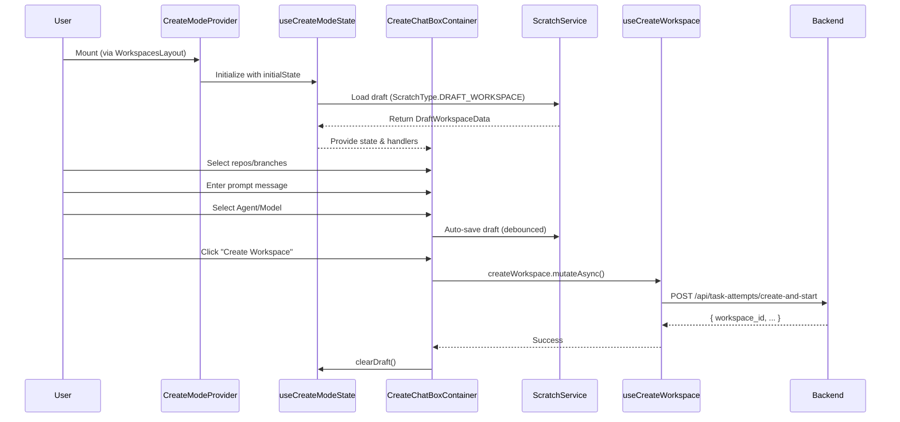
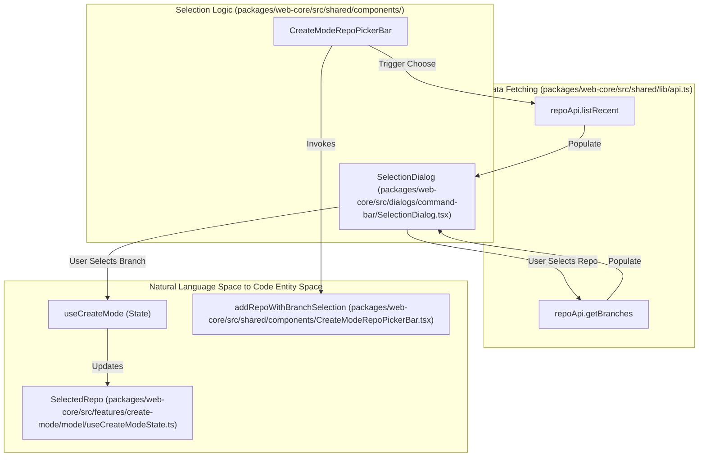
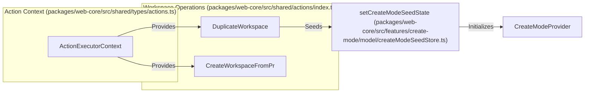

# Workspace Creation and Management Flow

Relevant source files

The following files were used as context for generating this wiki page:

- [packages/remote-web/src/app/providers/RemoteActionsProvider.tsx](packages/remote-web/src/app/providers/RemoteActionsProvider.tsx)
- [packages/web-core/src/features/create-mode/model/CreateModeProvider.tsx](packages/web-core/src/features/create-mode/model/CreateModeProvider.tsx)
- [packages/web-core/src/features/create-mode/model/createModeBootstrap.ts](packages/web-core/src/features/create-mode/model/createModeBootstrap.ts)
- [packages/web-core/src/features/create-mode/model/createModeSeedStore.ts](packages/web-core/src/features/create-mode/model/createModeSeedStore.ts)
- [packages/web-core/src/features/create-mode/model/useCreateMode.ts](packages/web-core/src/features/create-mode/model/useCreateMode.ts)
- [packages/web-core/src/features/create-mode/model/useCreateModeState.ts](packages/web-core/src/features/create-mode/model/useCreateModeState.ts)
- [packages/web-core/src/pages/kanban/IssueCommentsSectionContainer.tsx](packages/web-core/src/pages/kanban/IssueCommentsSectionContainer.tsx)
- [packages/web-core/src/shared/actions/index.ts](packages/web-core/src/shared/actions/index.ts)
- [packages/web-core/src/shared/components/CreateChatBoxContainer.tsx](packages/web-core/src/shared/components/CreateChatBoxContainer.tsx)
- [packages/web-core/src/shared/components/CreateModeRepoPickerBar.tsx](packages/web-core/src/shared/components/CreateModeRepoPickerBar.tsx)
- [packages/web-core/src/shared/hooks/useKanbanIssueComposerScratch.ts](packages/web-core/src/shared/hooks/useKanbanIssueComposerScratch.ts)
- [packages/web-core/src/shared/hooks/useLocalStorageScratch.ts](packages/web-core/src/shared/hooks/useLocalStorageScratch.ts)
- [packages/web-core/src/shared/hooks/useProjectWorkspaceCreateDraft.ts](packages/web-core/src/shared/hooks/useProjectWorkspaceCreateDraft.ts)
- [packages/web-core/src/shared/hooks/useScratch.ts](packages/web-core/src/shared/hooks/useScratch.ts)
- [packages/web-core/src/shared/lib/workspaceCreateState.ts](packages/web-core/src/shared/lib/workspaceCreateState.ts)
- [packages/web-core/src/shared/providers/ActionsProvider.tsx](packages/web-core/src/shared/providers/ActionsProvider.tsx)
- [packages/web-core/src/shared/types/actions.ts](packages/web-core/src/shared/types/actions.ts)

## Purpose and Scope

This page documents the complete UI flow for creating and managing workspaces in Vibe Kanban. It covers the frontend implementation of the creation wizard, the state management for drafts using the scratch system, repository selection, executor configuration, and the lifecycle of workspace sessions.

- **Creation Flow**: UI components, state management via `CreateModeProvider`, draft persistence, and repository/branch selection.
- **Session Management**: Handling multiple sessions within a workspace, creating new sessions, and starting specialized sessions.
- **Integration Points**: How workspace creation integrates with Kanban issues and repository defaults.

## High-Level Creation Flow

The creation flow is managed primarily by the `CreateModeProvider` and the `useCreateModeState` hook, which coordinate between user input, scratch persistence, and the backend API.

**Sources:** [packages/web-core/src/features/create-mode/model/CreateModeProvider.tsx:17-48](), [packages/web-core/src/features/create-mode/model/useCreateModeState.ts:216-248](), [packages/web-core/src/shared/components/CreateChatBoxContainer.tsx:39-61]()

## Creation State Management

The `useCreateModeState` hook uses a `useReducer` pattern to manage the complex state of a workspace being drafted.

### Initialization and Bootstrapping
When the creation UI loads, it resolves the initial state using `resolveCreateModeBootstrap`. It prioritizes data in the following order:
1.  **Seed State**: Explicit state passed via navigation (e.g., from `DuplicateWorkspace` action or a Kanban issue). [packages/web-core/src/features/create-mode/model/createModeBootstrap.ts:94-134](), [packages/web-core/src/shared/actions/index.ts:176-215]()
2.  **Scratch Data**: Previously saved draft data from the backend or local storage. [packages/web-core/src/features/create-mode/model/createModeBootstrap.ts:136-180]()
3.  **Fresh/Defaults**: User's preferred executor and repository defaults. [packages/web-core/src/features/create-mode/model/createModeBootstrap.ts:182-188]()

### State Transitions
The `draftReducer` handles updates to repositories, target branches, and the prompt message.

| Action Type | Description |
|-----------|-------------|
| `ADD_REPO` | Adds a repository and its selected target branch to the draft. [packages/web-core/src/features/create-mode/model/useCreateModeState.ts:108-120]() |
| `SET_TARGET_BRANCH` | Updates the base branch for a specific repository in the selection. [packages/web-core/src/features/create-mode/model/useCreateModeState.ts:134-142]() |
| `SET_EXECUTOR_CONFIG` | Persists the selected agent (e.g., Claude, GPT) and model variant. [packages/web-core/src/features/create-mode/model/useCreateModeState.ts:167-168]() |
| `SET_ATTACHMENTS` | Manages file attachments added to the workspace draft. [packages/web-core/src/features/create-mode/model/useCreateModeState.ts:170-171]() |

**Sources:** [packages/web-core/src/features/create-mode/model/useCreateModeState.ts:91-176](), [packages/web-core/src/features/create-mode/model/createModeBootstrap.ts:83-189]()

## Repository and Branch Selection

The `CreateModeRepoPickerBar` provides the interface for selecting codebases. It interacts with the `repoApi` to list recent repositories and fetch available branches.

**Sources:** [packages/web-core/src/shared/components/CreateModeRepoPickerBar.tsx:97-109](), [packages/web-core/src/shared/components/CreateModeRepoPickerBar.tsx:134-149]()

## Workspace Actions and Context

Workspace management is facilitated by a centralized `Actions` system. The `ActionsProvider` exposes an `ActionExecutorContext` which provides hooks and state to various action implementations.

### Duplicate Workspace
The `DuplicateWorkspace` action demonstrates the flow of extracting state from an existing workspace and seeding the `CreateModeProvider`. It fetches the first user message, repositories, and executor configuration to populate the `CreateModeInitialState`. [packages/web-core/src/shared/actions/index.ts:182-212]()

### Navigation and Contextual Creation
Workspaces can be created from specific contexts:
- **From PR**: `CreateWorkspaceFromPrDialog` allows creating a workspace linked to a Pull Request. [packages/web-core/src/shared/actions/index.ts:75]()
- **From Issue**: `openWorkspaceSelection` facilitates linking new or existing workspaces to Kanban issues. [packages/web-core/src/shared/providers/ActionsProvider.tsx:167-175]()

**Sources:** [packages/web-core/src/shared/actions/index.ts:176-215](), [packages/web-core/src/shared/providers/ActionsProvider.tsx:202-230](), [packages/web-core/src/shared/types/actions.ts:55-104]()

## Persistence via Scratch System

To prevent data loss, workspace drafts are persisted using the `Scratch` system.

- **Draft Persistence**: The `persistWorkspaceCreateDraft` function converts `CreateModeInitialState` into `DraftWorkspaceData` and saves it via `scratchApi.update` (local) or `localStorageScratchUpdate` (remote). [packages/web-core/src/shared/lib/workspaceCreateState.ts:100-133]()
- **Scratch Types**: Uses `ScratchType.DRAFT_WORKSPACE` with a fixed `DEFAULT_WORKSPACE_CREATE_DRAFT_ID`. [packages/web-core/src/shared/lib/workspaceCreateState.ts:23-24]()
- **Auto-saving**: The `useCreateModeState` hook debounces updates to the scratch system as the user types or modifies the repository list. [packages/web-core/src/features/create-mode/model/useCreateModeState.ts:21-25]()

**Sources:** [packages/web-core/src/shared/lib/workspaceCreateState.ts:77-133](), [packages/web-core/src/features/create-mode/model/useCreateModeState.ts:20-31]()