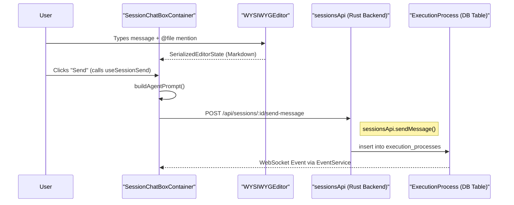

# Session Chat Interface

<details>
<summary>Relevant source files</summary>

The following files were used as context for generating this wiki page:

- [packages/ui/src/components/CodeBlockEscapePlugin.tsx](packages/ui/src/components/CodeBlockEscapePlugin.tsx)
- [packages/ui/src/components/InlineCodeBoundaryPlugin.tsx](packages/ui/src/components/InlineCodeBoundaryPlugin.tsx)
- [packages/ui/src/components/KanbanIssuePanel.tsx](packages/ui/src/components/KanbanIssuePanel.tsx)
- [packages/ui/src/components/MarkdownSyncPlugin.tsx](packages/ui/src/components/MarkdownSyncPlugin.tsx)
- [packages/ui/src/components/SessionChatBox.tsx](packages/ui/src/components/SessionChatBox.tsx)
- [packages/ui/src/components/StaticToolbarPlugin.tsx](packages/ui/src/components/StaticToolbarPlugin.tsx)
- [packages/ui/src/components/TurnNavigationPopup.tsx](packages/ui/src/components/TurnNavigationPopup.tsx)
- [packages/web-core/package.json](packages/web-core/package.json)
- [packages/web-core/src/features/workspace-chat/model/conversation-scroll-commands.ts](packages/web-core/src/features/workspace-chat/model/conversation-scroll-commands.ts)
- [packages/web-core/src/features/workspace-chat/model/hooks/useCreateSession.ts](packages/web-core/src/features/workspace-chat/model/hooks/useCreateSession.ts)
- [packages/web-core/src/features/workspace-chat/model/useConversationVirtualizer.ts](packages/web-core/src/features/workspace-chat/model/useConversationVirtualizer.ts)
- [packages/web-core/src/features/workspace-chat/model/useScrollCommandExecutor.ts](packages/web-core/src/features/workspace-chat/model/useScrollCommandExecutor.ts)
- [packages/web-core/src/features/workspace-chat/ui/ConversationListContainer.tsx](packages/web-core/src/features/workspace-chat/ui/ConversationListContainer.tsx)
- [packages/web-core/src/features/workspace-chat/ui/SessionChatBoxContainer.tsx](packages/web-core/src/features/workspace-chat/ui/SessionChatBoxContainer.tsx)
- [packages/web-core/src/features/workspace-chat/ui/forwardWheelToScroller.ts](packages/web-core/src/features/workspace-chat/ui/forwardWheelToScroller.ts)
- [packages/web-core/src/pages/kanban/ProjectRightSidebarContainer.tsx](packages/web-core/src/pages/kanban/ProjectRightSidebarContainer.tsx)
- [packages/web-core/src/pages/workspaces/VSCodeWorkspacePage.tsx](packages/web-core/src/pages/workspaces/VSCodeWorkspacePage.tsx)
- [packages/web-core/src/pages/workspaces/WorkspacesMainContainer.tsx](packages/web-core/src/pages/workspaces/WorkspacesMainContainer.tsx)
- [packages/web-core/src/shared/components/MarkdownPreview.tsx](packages/web-core/src/shared/components/MarkdownPreview.tsx)
- [packages/web-core/src/shared/components/WYSIWYGEditor.tsx](packages/web-core/src/shared/components/WYSIWYGEditor.tsx)
- [packages/web-core/src/shared/dialogs/command-bar/StartReviewDialog.tsx](packages/web-core/src/shared/dialogs/command-bar/StartReviewDialog.tsx)
- [packages/web-core/src/shared/dialogs/tasks/ResolveConflictsDialog.tsx](packages/web-core/src/shared/dialogs/tasks/ResolveConflictsDialog.tsx)
- [packages/web-core/src/shared/hooks/useWorkspaceSessions.ts](packages/web-core/src/shared/hooks/useWorkspaceSessions.ts)
- [packages/web-core/src/shared/hooks/workspaceSessionKeys.ts](packages/web-core/src/shared/hooks/workspaceSessionKeys.ts)
- [pnpm-lock.yaml](pnpm-lock.yaml)

</details>


## Purpose and Scope

The **Session Chat Interface** is the primary UI for interacting with AI coding agents within workspace sessions. It provides a rich text editor based on Lexical, real-time message streaming, approval workflows, and session management capabilities. This page documents the chat box component architecture, its container logic, and the workflows for sending messages, queueing follow-ups, handling approvals, managing feedback, and editing messages.

**Key User Interactions:**
- Send messages to coding agents with rich text formatting and Markdown support.
- Attach images and mention files from the repository via typeahead.
- Queue follow-up messages while an agent is currently executing.
- Approve or request changes for agent actions in supervised or plan modes.
- Edit and retry previous messages with conflict detection.
- Switch between multiple conversation sessions or start new ones.

---

## Component Architecture

The session chat interface follows a layered architecture: a **container** component that manages business logic and hooks, a **primitive** component that handles UI layout, and the **WYSIWYGEditor** which provides the rich text editing surface.

### Component Hierarchy Diagram

Title: Session Chat Interface Component Hierarchy
```mermaid
graph TB
    subgraph "Container Layer"
        ["SessionChatBoxContainer"]
        ["ConversationListContainer"]
    end
    
    ["SessionChatBoxContainer"] -- "Manages Editor State" --> ["SessionChatBox"]
    ["ConversationListContainer"] -- "Manages Message History" --> ["ConversationList"]
    
    subgraph "Primitive Layer"
        ["SessionChatBox"]
        ["ConversationList"]
    end
    
    subgraph "Editor Layer"
        ["WYSIWYGEditor"]
        ["LexicalComposer"]
    end
    
    subgraph "Core Hooks & Logic"
        ["useSessionSend"]
        ["useSessionQueueInteraction"]
        ["useSessionAttachments"]
        ["useScrollCommandExecutor"]
        ["useConversationVirtualizer"]
        ["useConversationHistory"]
    end
    
    subgraph "Lexical Plugins"
        ["FileTagTypeaheadPlugin"]
        ["SlashCommandTypeaheadPlugin"]
        ["StaticToolbarPlugin"]
        ["MarkdownSyncPlugin"]
        ["CodeBlockEscapePlugin"]
        ["InlineCodeBoundaryPlugin"]
    end
    
    ["SessionChatBoxContainer"] --> ["useSessionSend"]
    ["SessionChatBoxContainer"] --> ["useSessionQueueInteraction"]
    ["SessionChatBoxContainer"] --> ["useSessionAttachments"]
    ["ConversationListContainer"] --> ["useScrollCommandExecutor"]
    ["ConversationListContainer"] --> ["useConversationVirtualizer"]
    ["ConversationListContainer"] --> ["useConversationHistory"]
    
    ["SessionChatBox"] --> ["WYSIWYGEditor"]
    ["WYSIWYGEditor"] --> ["LexicalComposer"]
    
    ["LexicalComposer"] --> ["FileTagTypeaheadPlugin"]
    ["LexicalComposer"] --> ["SlashCommandTypeaheadPlugin"]
    ["LexicalComposer"] --> ["StaticToolbarPlugin"]
    ["LexicalComposer"] --> ["MarkdownSyncPlugin"]
    ["LexicalComposer"] --> ["CodeBlockEscapePlugin"]
    ["LexicalComposer"] --> ["InlineCodeBoundaryPlugin"]
```
Sources: [packages/web-core/src/shared/components/WYSIWYGEditor.tsx:12-68](), [packages/web-core/src/shared/components/WYSIWYGEditor.tsx:96-141](), [packages/ui/src/components/StaticToolbarPlugin.tsx:66-72](), [packages/web-core/src/features/workspace-chat/ui/ConversationListContainer.tsx:18-21](), [packages/web-core/src/features/workspace-chat/ui/SessionChatBoxContainer.tsx:27-31]()

---

## Execution Status Model

The interface computes a single `ExecutionStatus` to drive UI states like button visibility and loading indicators. This status is derived from several boolean flags within the container.

| Status | Condition | UI Behavior |
| :--- | :--- | :--- |
| `feedback` | `isInFeedbackMode` | Brand-colored border, "Submit Feedback" button active. |
| `edit` | `isInEditMode` | "Retry" button active, original message in editor. |
| `stopping` | `isStopping` | Spinner shown on stop button, inputs disabled. |
| `queue-loading` | `isQueueLoading` | Spinner on queue actions. |
| `sending` | `isSendingFollowUp` | Primary button shows "Sending...". |
| `queued` | `isQueued` | "Cancel Queue" button visible. |
| `running` | `isAttemptRunning` | "Stop" and "Queue" buttons visible. |
| `idle` | Default | "Send" button active. |

Sources: [packages/ui/src/components/SessionChatBox.tsx:42-50](), [packages/web-core/src/features/workspace-chat/ui/SessionChatBoxContainer.tsx:70-87]()

---

## Rich Text & Markdown Editor

The `WYSIWYGEditor` uses the Lexical framework to provide a hybrid experience where users type in rich text but the underlying state is managed as Markdown [packages/web-core/src/shared/components/WYSIWYGEditor.tsx:94-100]().

### Markdown Synchronization
The `MarkdownSyncPlugin` handles bidirectional synchronization between the Lexical editor state and the external Markdown string. It leverages `TRANSFORMERS` from `@lexical/markdown` [packages/web-core/src/shared/components/WYSIWYGEditor.tsx:17-18]().

### Specialized Editing Plugins
- **CodeBlockEscapePlugin**: Allows users to exit code blocks by pressing Enter on double-empty lines or ArrowDown at the end of the block [packages/web-core/src/shared/components/WYSIWYGEditor.tsx:19-19]().
- **InlineCodeBoundaryPlugin**: Fixes selection inheritance when exiting inline code via keyboard navigation [packages/web-core/src/shared/components/WYSIWYGEditor.tsx:20-20]().
- **MarkdownSyncPlugin**: Syncs state to the parent via `onChange` and `onEditorStateChange` [packages/web-core/src/shared/components/WYSIWYGEditor.tsx:56-56]().

### Static Toolbar
The `StaticToolbarPlugin` provides standard formatting buttons (Bold, Italic, Strikethrough, Code, Lists) [packages/ui/src/components/StaticToolbarPlugin.tsx:89-156](). It includes a `saveStatus` indicator to show when drafts are persisted [packages/ui/src/components/StaticToolbarPlugin.tsx:165-175]().

Sources: [packages/web-core/src/shared/components/WYSIWYGEditor.tsx:53-56](), [packages/ui/src/components/StaticToolbarPlugin.tsx:66-71]()

---

## Message Submission Flow

Sending a message involves gathering the editor content, attachments, and the current executor configuration.

### Data Mapping: Frontend to Backend

Title: Message Submission Flow (Natural Language to Code Entity)

Sources: [packages/web-core/src/shared/components/WYSIWYGEditor.tsx:94-100](), [packages/web-core/src/features/workspace-chat/ui/SessionChatBoxContainer.tsx:29-29](), [packages/web-core/src/features/workspace-chat/ui/SessionChatBoxContainer.tsx:65-65]()

---

## File Mentions and Typeahead

The editor integrates repository context via specialized Lexical plugins.

### FileTagTypeaheadPlugin
This plugin triggers when the user types `@`. It calls `searchTagsAndFiles` to fetch matching repository entities [packages/web-core/src/shared/components/WYSIWYGEditor.tsx:73-74]().
- **Data Source**: `repoApi` is used to fetch file trees and tags for the specific `repoIds` associated with the workspace [packages/web-core/src/shared/components/WYSIWYGEditor.tsx:105-106]().
- **Rendering**: Matches are displayed in a floating menu, allowing the user to "tag" a file, which the agent then uses as explicit context.

### Slash Command Discovery
The `SlashCommandTypeaheadPlugin` triggers on `/`. It uses `useSlashCommands` to discover available commands for the current `executor` [packages/web-core/src/shared/components/WYSIWYGEditor.tsx:47-47](). This allows users to invoke agent-specific tools (e.g., `/test`, `/review`) directly from the chat box [packages/web-core/src/shared/components/WYSIWYGEditor.tsx:107-108]().

Sources: [packages/web-core/src/shared/components/WYSIWYGEditor.tsx:43-47](), [packages/web-core/src/shared/components/WYSIWYGEditor.tsx:70-74]()

---

## Conversation History Rendering

The `ConversationListContainer` manages the display of the message history using a virtualized list for performance.

### History Management Logic
The `useConversationHistory` hook owns transport and reconciliation. It processes entries derived from the timeline [packages/web-core/src/features/workspace-chat/ui/ConversationListContainer.tsx:40-40](). It differentiates between standard entries and aggregated groups to drive specific UI states [packages/web-core/src/features/workspace-chat/ui/ConversationListContainer.tsx:36-39]().

### Display Rendering
- **Virtualization**: Uses `useConversationVirtualizer` to handle large message histories efficiently [packages/web-core/src/features/workspace-chat/ui/ConversationListContainer.tsx:20-20]().
- **Entry Derivation**: Entries are derived via `deriveConversationEntries` and `deriveConversationTimeline`, which aggregate logs into groups such as `AggregatedDiffGroup` or `AggregatedThinkingGroup` [packages/web-core/src/features/workspace-chat/ui/ConversationListContainer.tsx:18-19](), [packages/web-core/src/features/workspace-chat/ui/ConversationListContainer.tsx:73-119]().
- **Reset Capabilities**: The `useResetProcess` hook allows users to revert the workspace state to a specific point in the conversation history [packages/web-core/src/features/workspace-chat/ui/ConversationListContainer.tsx:27-29]().

Sources: [packages/web-core/src/features/workspace-chat/ui/ConversationListContainer.tsx:14-25](), [packages/web-core/src/features/workspace-chat/ui/ConversationListContainer.tsx:156-157]()

---

## Workspace Integration

The chat interface is integrated into both the full workspace view and the Kanban sidebar.

### Sidebar Integration
In `ProjectRightSidebarContainer.tsx`, the `WorkspaceSessionPanel` provides a chat view for quick interactions while managing the Kanban board [packages/web-core/src/pages/kanban/ProjectRightSidebarContainer.tsx:138-141](). It uses `useWorkspaceSessions` to manage session switching within the sidebar context [packages/web-core/src/pages/kanban/ProjectRightSidebarContainer.tsx:153-161]().

### Scroll Synchronization
The system maintains "At Bottom" stickiness. When the `SessionChatBox` changes height (e.g., due to typing multiple lines), the `WorkspacesMainContainer` uses a `ResizeObserver` to adjust the scroll position of the `ConversationList` [packages/web-core/src/pages/workspaces/WorkspacesMainContainer.tsx:175-192]().

Sources: [packages/web-core/src/pages/kanban/ProjectRightSidebarContainer.tsx:147-161](), [packages/web-core/src/pages/workspaces/WorkspacesMainContainer.tsx:127-149]()